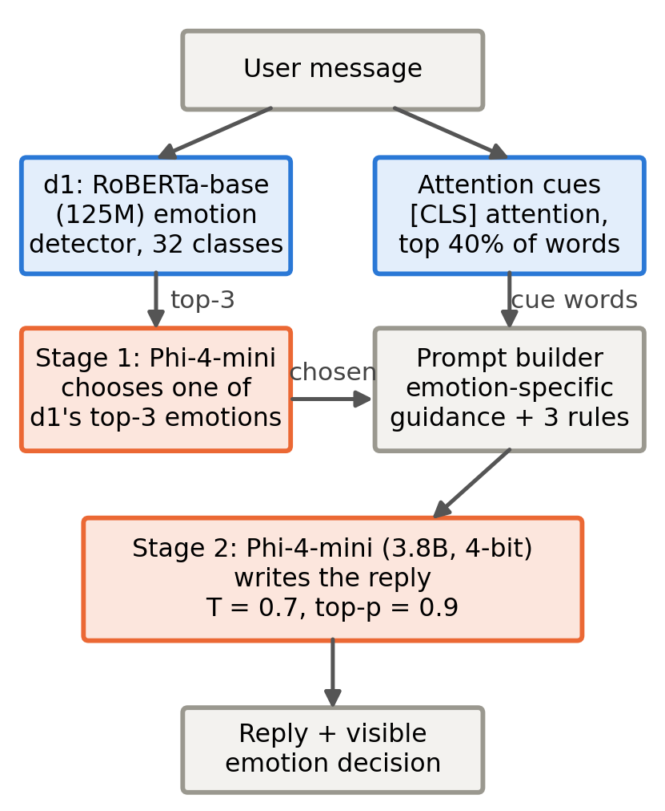

# Does a Separate Emotion Detector Help Small Language Models Respond Empathetically? A Controlled Study on a Consumer GPU

*Anonymous Authors (double-blind review)*

**Abstract**

Small language models that run on local hardware are attractive for emotionally supportive conversation, because a user's disclosure never has to leave the device. It is unclear, however, whether such models benefit from a separate emotion detector or should simply be prompted to recognise the emotion and respond in one step. We present a controlled study on the EmpatheticDialogues benchmark in which every system uses the same 300 test conversations, the same decoding settings and a single 8 GB GPU. Our decoupled system passes the three most probable of 32 emotions from a RoBERTa-base detector (50.3% top-1 accuracy), together with emotion-specific guidance and attention-derived cue words, to a 4-bit Phi-4-mini generator. We evaluate replies with rule adherence, the WASSA 2024 empathy classifier, emotion validation and a blind two-judge LLM panel, using paired tests with Holm correction. The decoupled system (4.0B parameters) is significantly more empathetic and emotionally faithful than single models of both 1.5B and, at an equal generator, 3.8B parameters, but a 7.6B single model remains stronger on rule adherence and empathy; with 52% of its parameters and 38% less GPU memory, at a similar response time, our system reaches 97.5% of its overall AI-judge score. Three analyses show that detection accuracy is not the bottleneck: incorrect labels do not degrade replies, a more accurate detector brings no gain, and the generator's own emotion choice is less accurate than the detector's yet yields better replies. The benefit comes from how the detected emotion is used rather than how accurately it is detected.

**Index Terms**

empathetic response generation, emotion recognition, small language models, EmpatheticDialogues, LLM-as-a-judge

## I. Introduction

People increasingly turn to conversational agents when they want to talk about how they feel. A useful reply to such a message should recognise the feeling, validate it, and invite the person to continue without overwhelming them with questions [1]. Large language models (LLMs) produce fluent and often empathetic replies [2], [3], but the strongest models run on remote servers, which means that sensitive disclosures are sent to a third party. Small open models that fit on a consumer GPU avoid this problem, yet they are weaker at recognising fine-grained emotions [4].

A natural response is to *decouple* the task: a small encoder detects the emotion and a generator writes the reply conditioned on it. Earlier empathetic dialogue models predicted the emotion as an auxiliary objective of a single generation model [5], [6], [7], and Yang et al. recently proposed using the emotion predictions of such models to guide an LLM [8]. What remains unclear is whether a separate detector is worth its cost for *small, locally run* generators, and, if it helps, whether the benefit comes from detecting the emotion more accurately or from the way the detected emotion is used.

We answer these questions with a controlled comparison in which data, decoding and hardware are held fixed. Our contributions are:

- A decoupled pipeline for a single 8 GB GPU, in which a RoBERTa-base detector passes its top-3 emotions, emotion-specific guidance and attention-derived cue words to a 4-bit Phi-4-mini generator, compared against monolithic baselines at 1.5B and 7.6B parameters.
- Controlled ablations separating the effect of *decoupling* (same generator with and without a detector) from the effect of *emotion-specific guidance* (same detector and generator, with and without it).
- Three independent analyses showing that detector accuracy is not what limits reply quality.
- A multi-signal evaluation (rule adherence, WASSA empathy, emotion validation and a blind LLM-judge panel) with paired significance tests and correction for multiple comparisons, including negative results for retrieval augmentation and for end-to-end fine-tuning.

## II. Related Work

**Empathetic response generation.** EmpatheticDialogues (ED) [1] contains about 25k conversations grounded in 32 emotions. Models trained on it, such as MoEL [5], MIME [9], EmpDG [10], KEMP [11], CEM [6], CASE [7] and ESCM [12], predict the emotion as an auxiliary task and report emotion accuracies between 30.6% and 41.2% [2], [12].

**LLMs for empathy.** Qian et al. found that LLMs outperform these specialised models in human evaluation [2], and TOOL-ED improves LLM empathy by letting the model call an emotion knowledge tool [13]. A systematic review reports that LLM replies are often rated as empathetic but tend to be repetitive and lengthy [3].

**Combining small models with LLMs.** The closest work to ours is HEF [8], which gives an LLM the top-*k* emotions and the attention-weighted cause words of a small empathetic model and reports higher emotion accuracy for ChatGPT and 6-13B open models. Our study differs in four respects: we use a dedicated classifier rather than a joint generation model; every component runs locally with at most 3.8B generator parameters; we compare against monolithic single models of smaller and larger size under identical conditions; and we test directly whether detection accuracy drives the improvement.

**Evaluation.** Strong LLM judges agree with human preferences in over 80% of cases but favour longer answers and their own outputs [14], [15]; panels of judges from different model families reduce this bias [16]. The WASSA 2024 shared task provides empathy classifiers trained on human ratings of conversation turns [17].

## III. Method

### A. Task and Data

Given a user's message, the system must produce a reply that satisfies three rules: it (R1) acknowledges the feeling, (R2) asks exactly one question and (R3) stays within 120 words. R1 and R2 correspond to the *emotional reactions* and *explorations* mechanisms of empathy in text-based support [18], while asking several questions is the question-answer trap that counselling guidance warns against [19]. Within systems, replies with an acknowledgement score 0.36 points higher on WASSA (p < 0.001) and replies within the length limit score 0.65 points higher on judged empathy (p = 0.006); the one-question rule is not rewarded by either measure and is justified as a usability requirement. The rules are not satisfied by imitating the data: real ED listener replies acknowledge the feeling in only 10.6% of cases and meet all three rules in 4.3%. We use the official ED train, validation and test partitions. Each conversation contributes its *first user utterance* labelled with the conversation's emotion, which gives 2,542 test examples. We deliberately do not use the situation descriptions, because they are written after the fact and state the feeling explicitly: a GPT-2 detector trained on them scored 56.9% on situation text but only 48.2% on the user messages that a deployed system actually receives.

### B. Emotion Detector (d1)

We fine-tune RoBERTa-base [20] (125M parameters) as a 32-way classifier on first utterances (learning rate 2e-5, effective batch size 16, linear warm-up over 6% of steps, early stopping on validation accuracy, at most 128 tokens). Among equally tuned base-size encoders, RoBERTa-base was comparable to ELECTRA in top-1 accuracy (50.1% against 50.2%), above BERT (48.8%), and gave the highest top-5 accuracy (85.0%); RoBERTa-large reached 53.0% but required 7x the training time. The deployed checkpoint reaches **50.3% top-1, 76.5% top-3 and 84.3% top-5** accuracy (macro-F1 49.4%) on the test partition, against a chance level of 3.1%. Its most frequent errors are between neighbouring emotions such as *sentimental*/*nostalgic* and *afraid*/*terrified*, which motivates passing several candidates rather than one label.

### C. Two-Stage Generator (d2)

*Fig. 1. Decoupled two-stage pipeline. The detector's top-3 emotions and attention cue words condition a 4-bit Phi-4-mini generator.*

Fig. 1 shows the pipeline. The generator is Phi-4-mini-instruct [21] (3.8B) loaded with 4-bit NF4 quantisation [22]. It was selected in a bake-off against Qwen2.5-1.5B [23] and Gemma-3-4B under the same detector and prompt: Phi-4-mini gave the highest rule adherence (65.3% against 57.7% and 22.0%), whereas Gemma-3-4B exceeded the length limit in 72.3% of replies. In **stage 1**, the generator is shown the user message and the detector's three most probable emotions and chooses one by greedy decoding. In **stage 2**, it writes the reply under a system prompt containing (i) guidance specific to the chosen emotion, stating what to focus on and what to avoid for each of the 32 emotions, (ii) the three rules, and (iii) *cue words*, the 40% of tokens that received the most attention from the detector's final-layer [CLS] representation. Stage-2 decoding uses temperature 0.7, top-p 0.9 and at most 250 new tokens. The full system has 4.0B parameters.

### D. Baselines

All baselines respond to the same conversations with the same decoding settings. *Zero-shot*: Qwen2.5-1.5B with a generic empathetic prompt and no detector. *Fine-tuned*: Qwen2.5-1.5B fine-tuned end to end on ED replies with LoRA [24] (rank 16, alpha 32, learning rate 2e-4, dropout 0.1, best epoch by validation loss). *Single model (1.5B)* and *single model (7.6B)*: Qwen2.5-1.5B and Qwen2.5-7B (4-bit), each prompted with the same rules to first name the emotion and then respond in one pass. *Initial pipeline*: a GPT-2 Medium detector with a Qwen2.5-1.5B generator and a generic emotion-conditioned prompt. *Top-1 Phi*: our detector and generator, passing only the top-1 emotion with a generic prompt. We also tested retrieval augmentation [25] of the initial pipeline with similar ED conversations.

## IV. Experimental Setup

**Evaluation sample.** Generation experiments use 300 test conversations sampled with seed 42. The detector is evaluated on all 2,542 test examples.

**Measures.** (1) *Rule adherence*: automatic checks for an acknowledgement phrase, exactly one question mark and at most 120 words; we report the share of replies satisfying all three. (2) *WASSA empathy*: the hyy33 system from the WASSA 2024 shared task [26], trained on human empathy ratings of conversation turns and correlating with them at r = 0.544 [17], mapped to a 0-10 scale. (3) *Emotion validation*: whether the detector, applied to the reply, recovers the gold emotion of the conversation. (4) *AI judges*: Nemotron 3 Ultra and gpt-oss-120b, from developers unrelated to our models [15], score each reply blind from 1 to 10 for empathy, relevance and safety at temperature 0; overall is the mean of the three. Judges are applied to a stratified subset of 64 conversations (the shortest and longest for each emotion). A third planned judge, Mistral Large, became unavailable before the final systems were judged; on the 256 replies it scored of systems still in the comparison, the two- and three-judge averages correlate at Spearman ρ = 0.97 with identical system rankings.

**Statistics.** All comparisons are paired. We use McNemar's exact test for binary measures [27], the Wilcoxon signed-rank test for scores [28] and 95% bootstrap confidence intervals from 10,000 resamples [29]. P-values are Holm-corrected [30] across the baselines compared on each measure. We call a difference significant only if the corrected p < 0.05 and the interval excludes zero.

**Implementation.** All experiments use Python with PyTorch [31] and Hugging Face Transformers [32] on one NVIDIA RTX 4060 with 8 GB of memory.

## V. Results

### A. Overall Comparison

*TABLE I. Results on 300 ED test conversations (judge scores on the 64-conversation subset). Params: total parameters in billions. Rules: replies satisfying all three rules. Val.: emotion validation. Emp./All: AI-judge empathy and overall (1-10); n/a = system not covered by the judge panel, or judging not complete at submission.*

| System | Params | Rules (%) | 1 Q (%) | Words | WASSA | Val. (%) | Emp. | All |
|---|---|---|---|---|---|---|---|---|
| Zero-shot Qwen2.5-1.5B | 1.5 | 19.0 | 22.7 | 75.9 | 4.25 | 24.7 | 5.98 | 7.51 |
| Fine-tuned Qwen2.5-1.5B | 1.5 | 22.3 | 74.0 | 10.0 | 3.36 | 18.3 | n/a | n/a |
| Single model Qwen2.5-1.5B | 1.5 | 51.3 | 73.7 | 42.0 | 4.84 | 25.7 | 7.15 | 8.24 |
| Single model Phi-4-mini (our generator) | 3.8 | 73.7 | 96.0 | 73.5 | 4.75 | 27.0 | n/a | n/a |
| Single model Qwen2.5-7B | 7.6 | **82.3** | **99.0** | 53.0 | **5.76** | 32.3 | **8.15** | **8.90** |
| Initial pipeline (GPT-2 + Qwen-1.5B) | 1.9 | 63.7 | 87.3 | 35.2 | 4.80 | 26.0 | 6.98 | 8.04 |
| RoBERTa + Qwen-1.5B, top-1 | 1.7 | 57.7 | 84.3 | 34.7 | 4.78 | 25.3 | n/a | n/a |
| RoBERTa + Phi-4-mini, top-1 | 4.0 | 65.3 | 94.7 | 80.5 | 4.89 | 28.3 | 7.84 | 8.65 |
| **Ours: two-stage RoBERTa + Phi-4-mini** | 4.0 | 60.0 | 92.7 | 57.1 | 5.05 | **36.7** | 7.84 | 8.68 |

Table I summarises all systems. Our system achieves the highest emotion validation (36.7%) and the second-highest WASSA and AI-judge scores, behind only the 7.6B single model. The fine-tuned model learns the style of ED listeners: 10-word replies that usually ask a question but rarely acknowledge the feeling (30.0%), meeting all rules in 22.3% of cases. Retrieval augmentation lowered the initial pipeline's rule adherence from 63.7% to 43.7%, as the retrieved listener replies model the same style.

### B. Significance Against Key Baselines

*TABLE II. Paired differences (ours minus baseline) with 95% bootstrap CIs. Rules and validation in percentage points. * significant after Holm correction.*

| Measure | vs 1.5B single | vs 7.6B single | vs top-1 Phi |
|---|---|---|---|
| Rules | +8.7 [+1.0, +16.3] | -22.3 [-29.3, -15.3]* | -5.3 [-13.0, +2.0] |
| Validation | +11.0 [+5.0, +17.0]* | +4.3 [-1.7, +10.3] | +8.3 [+3.0, +13.7]* |
| WASSA | +0.21 [+0.08, +0.35]* | -0.71 [-0.84, -0.58]* | +0.16 [+0.05, +0.26]* |
| Judge emp. | +0.70 [+0.39, +1.01]* | -0.30 [-0.55, -0.07]* | +0.01 [-0.23, +0.25] |
| Judge all | +0.44 [+0.17, +0.72]* | -0.21 [-0.40, -0.03] | +0.04 [-0.16, +0.24] |

Table II reports the key paired comparisons. **Against the 1.5B single model**, our system is significantly more empathetic by both WASSA (+0.21) and the AI judges (+0.70 for empathy, +0.44 overall) and more emotionally faithful (+11.0 points). Its higher rule adherence (+8.7 points) is not significant after correction (corrected p = 0.095). **Against the 7.6B single model**, it is significantly worse on rule adherence, WASSA and judge-rated empathy; the gap in the judges' overall score (-0.21) does not survive correction (corrected p = 0.073). **Against top-1 Phi**, which uses the same detector and generator, emotion-specific guidance significantly raises WASSA (+0.16) and emotion validation (+8.3 points) while writing 29% fewer words, but the AI judges rate the two configurations alike.

### C. Decoupling Versus Guidance

Because our generator is larger than the 1.5B single model, Table I alone cannot attribute the gains to decoupling. We therefore prompt **our own generator as a single model**, with no detector. **Capacity explains the structural gains; the decoupled design explains the empathic gains.** Moving from Qwen2.5-1.5B to Phi-4-mini as a single model raises rule adherence from 51.3% to 73.7% (p < 0.001) but leaves WASSA (4.84 to 4.75, p = 0.18) and emotion validation (25.7% to 27.0%, p = 0.70) unchanged: a larger generator alone buys none of the empathy we report. Adding the detector and emotion-specific guidance to that same generator raises WASSA to 5.05 (+0.30, adjusted p < 0.001) and emotion validation to 36.7% (+9.7 points, adjusted p = 0.007). The design's cost is rule adherence, which falls to 60.0% (-13.7 points, p = 0.002), mainly through the keyword-based acknowledgement check (66.3% against 77.3%), because the rules share the prompt with emotion-specific guidance. At an equal generator the decoupled design therefore trades part of its rule adherence for significantly more empathetic and more emotionally faithful replies. The two-stage prompt also depends on generator capacity: with Qwen2.5-1.5B it reduced rule adherence to 36.7%.

### D. Is the Detector the Bottleneck?

*TABLE III. Three tests of whether detector accuracy limits reply quality.*

| Test | Result | p |
|---|---|---|
| Rules when d1 label is wrong vs correct (ours) | 64.2% vs 54.3% | 0.096 |
| WASSA when label is wrong vs correct (initial) | 4.78 vs 4.83 | 0.72 |
| GPT-2 to RoBERTa d1, Qwen-1.5B fixed: validation | 26.0% to 25.3% | 0.91 |
| RoBERTa-base to -large in ours: accuracy | 50.3% to 53.3% | 0.21 |
| ... all rules | 60.0% to 54.7% | 0.60 |
| ... WASSA | 5.05 to 5.01 | 0.85 |
| ... emotion validation | 36.7% to 38.0% | 0.85 |
| Stage-1 pick vs d1 top-1 accuracy | 42.3% vs 50.3% | 0.005 |

Table III presents three analyses. First, replies generated from an incorrect detector label are no worse in rule adherence or empathy (Fisher and Mann-Whitney tests). Second, replacing the detector with a more accurate one leaves reply quality unchanged, both when GPT-2 is replaced by RoBERTa and when RoBERTa-large is substituted into our system (Holm-corrected p shown). Third, the generator's stage-1 choice agrees with the gold label *less* often than the detector's top-1 prediction (42.3% against 50.3%), yet the two-stage system produces the most emotionally faithful replies. Many disagreements are plausible neighbouring emotions, and ED assigns a single label per conversation [1]. Together these results indicate that a reply needs an emotion close enough to respond to, and that the gain comes from the emotion-specific guidance rather than from selecting the gold label.

For reference, our detector reads only the first user message yet exceeds the emotion accuracy reported by joint generation models that use the full dialogue context (30.6-48.3%) [2], [12], [33]. It achieves higher accuracy with less input for two reasons. First, it is initialised from RoBERTa, pre-trained on about 160 GB of text [20], whereas joint models such as MoEL and CASE start from GloVe word vectors and train their encoders on ED alone [5], [7]; RoBERTa-GPT2, which is built on pre-trained RoBERTa and GPT-2, reaches a comparable 51.5% [34], showing that pre-training, not access to the full dialogue, drives the accuracy. Second, our detector is trained and selected only for emotion classification, whereas joint models share their capacity with response generation. As those models were not re-trained under our setting, we do not claim the best detector on ED.

### E. Judge Agreement

The judged systems exclude the fine-tuned baseline, whose judging was still in progress. The two judges agree with each other at Spearman ρ = 0.60 for empathy and overall across 384 replies of six systems, and rank them identically except for exchanging our system and top-1 Phi, whose scores differ by 0.03. At the system level, WASSA ranks the systems in nearly the same order as the judges (ρ = 0.94).

## VI. Discussion and Limitations

Our results give a qualified answer. At comparable or smaller scale, a separate detector combined with emotion-specific guidance yields replies that are more empathetic and more faithful to the user's emotion, and the detector's decision remains visible and auditable. It does not, however, outperform a single model with nearly twice as many parameters, which remains preferable when only output quality matters and such hardware is available.

**Parameter efficiency.** With 52% of the parameters of the 7.6B single model, our system reaches 97.5% of its overall AI-judge score (difference not significant) and 96.2% of its judge-rated empathy (difference significant). At the detector level, RoBERTa-large has 2.8x the parameters of RoBERTa-base and 2.9 points higher test accuracy (Section III-B) but brings no gain in reply quality (Table III), so the smaller detector is the efficient choice.

**Resource use.** Measured on the same GPU over 50 messages, our system needs 38% less peak GPU memory than the 7.6B single model (3.40 GB against 5.47 GB) with no significant difference in response time (4.17 s against 3.91 s per reply, Wilcoxon p = 0.10; 65.7 against 65.4 ms per generated token). The detector and stage-1 selection add only 0.31 s, about 7% of the reply time. The 1.5B single model is lighter (2.90 GB) and 2.6x faster, but significantly less empathetic.

**Application orientation.** The system runs entirely on one 8 GB consumer GPU, so disclosures need not leave the device. We extended it into a multi-turn agent in which the detector reads the user's last four turns, the generator keeps the last ten exchanges, and every turn displays the candidate emotions, the chosen emotion and the cue words. This audit trail lets developers or clinicians see why a reply took a given tone and insert safeguards before generation, which a single end-to-end model cannot offer.

This study has several limitations. The single-model Phi-4-mini baseline of Section V-C has not yet been scored by the AI judges, so its comparison rests on rule adherence, WASSA and emotion validation. Automatic measures are proxies: the acknowledgement check is keyword-based, WASSA rewards length (Spearman ρ = 0.14-0.54 with word count within systems) and was trained on discussions of news articles [17], emotion validation uses our own detector, and LLM judges prefer longer answers [14]. Judge results rest on 64 conversations. All measures reported here are automatic: a human preference study is under way but not complete, so the ranking rests on rule checks, an empathy classifier and LLM judges rather than on the judgement of people seeking support. Evaluation covers single turns in English, and resource use was measured on one GPU. Our system reuses stock phrases in 58.7% of replies.

**Ethical considerations.** ED is used under its CC BY-NC 4.0 licence, and no data from real users was collected; only ED text was sent to the judge APIs. The label set has no category for suicidal ideation and the system has no crisis safeguard, so it must not be deployed as a mental-health service without a reviewed crisis filter and referral mechanism [35].

## VII. Conclusion

We compared decoupled and monolithic small language models for empathetic response generation under identical data, decoding and hardware. A RoBERTa-base detector feeding its top-3 emotions and emotion-specific guidance to a 4-bit Phi-4-mini produces replies that are significantly more empathetic and emotionally faithful than the same generator used alone, at the cost of some rule adherence, although a 7.6B single model remains stronger overall. Detection accuracy is not the limiting factor; how the detected emotion is used matters more. Future work should complete the human preference study, add a Phi-4-mini single-model baseline, combine emotion-specific guidance with larger generators, and evaluate multi-turn conversations with mental-health professionals.

**Acknowledgment**

In accordance with IEEE policy on AI-generated text, the authors disclose the following. Claude (Anthropic) was used to produce the initial draft of the Abstract and of Sections I to VII of this manuscript from the authors' experimental results and notes, and the authors then revised that draft. Claude was also used to write parts of the analysis code, namely the scripts that compute the reported statistics and generate the tables and figures, and the scripts that run and merge the LLM-judge evaluation. It was not used to generate any experimental result: all models were trained and all systems evaluated by the authors on their own hardware, and every number reported here comes from those runs. The authors verified all results, references and claims, and take full responsibility for the content of this paper.

## References

[1] H. Rashkin, E. M. Smith, M. Li, and Y.-L. Boureau, "Towards empathetic open-domain conversation models: A new benchmark and dataset," in Proc. 57th Annu. Meeting Assoc. Comput. Linguistics (ACL), Florence, Italy, 2019, pp. 5370-5381, doi: 10.18653/v1/P19-1534.  
[2] Y. Qian, W.-N. Zhang, and T. Liu, "Harnessing the power of large language models for empathetic response generation: Empirical investigations and improvements," in Findings Assoc. Comput. Linguistics: EMNLP 2023, 2023; arXiv:2310.05140.  
[3] V. Sorin, D. Brin, Y. Barash, E. Konen, A. Charney, G. Nadkarni, and E. Klang, "Large language models and empathy: Systematic review," J. Med. Internet Res., vol. 26, p. e52597, 2024, doi: 10.2196/52597.  
[4] T. D. Belay, I. A. Azime, A. A. Ayele, G. Sidorov, D. Klakow, P. Slusallek, O. Kolesnikova, and S. M. Yimam, "Evaluating the capabilities of large language models for multi-label emotion understanding," in Proc. 31st Int. Conf. Computational Linguistics (COLING), Abu Dhabi, UAE, 2025, pp. 3523-3540.  
[5] Z. Lin, A. Madotto, J. Shin, P. Xu, and P. Fung, "MoEL: Mixture of empathetic listeners," in Proc. 2019 Conf. Empirical Methods Natural Language Processing and 9th Int. Joint Conf. Natural Language Processing (EMNLP-IJCNLP), 2019, pp. 121-132, doi: 10.18653/v1/D19-1012.  
[6] S. Sabour, C. Zheng, and M. Huang, "CEM: Commonsense-aware empathetic response generation," in Proc. AAAI Conf. Artificial Intelligence, vol. 36, no. 10, 2022, pp. 11229-11237.  
[7] J. Zhou, C. Zheng, B. Wang, Z. Zhang, and M. Huang, "CASE: Aligning coarse-to-fine cognition and affection for empathetic response generation," in Proc. 61st Annu. Meeting Assoc. Comput. Linguistics (ACL), vol. 1, 2023, pp. 8223-8237, doi: 10.18653/v1/2023.acl-long.457.  
[8] Z. Yang, Z. Ren, Y. Wang, S. Peng, H. Sun, X. Zhu, and X. Liao, "Enhancing empathetic response generation by augmenting LLMs with small-scale empathetic models," arXiv:2402.11801, 2024.  
[9] N. Majumder, P. Hong, S. Peng, J. Lu, D. Ghosal, A. Gelbukh, R. Mihalcea, and S. Poria, "MIME: MIMicking emotions for empathetic response generation," in Proc. 2020 Conf. Empirical Methods Natural Language Processing (EMNLP), 2020, pp. 8968-8979, doi: 10.18653/v1/2020.emnlp-main.721.  
[10] Q. Li, H. Chen, Z. Ren, P. Ren, Z. Tu, and Z. Chen, "EmpDG: Multi-resolution interactive empathetic dialogue generation," in Proc. 28th Int. Conf. Computational Linguistics (COLING), 2020, pp. 4454-4466, doi: 10.18653/v1/2020.coling-main.394.  
[11] Q. Li, P. Li, Z. Ren, P. Ren, and Z. Chen, "Knowledge bridging for empathetic dialogue generation," in Proc. AAAI Conf. Artificial Intelligence, vol. 36, no. 10, 2022, pp. 10993-11001.  
[12] Z. Yang, Z. Ren, Y. Wang, X. Zhu, Z. Chen, T. Cai, Y. Wu, Y. Su, S. Ju, and X. Liao, "Exploiting emotion-semantic correlations for empathetic response generation," in Findings Assoc. Comput. Linguistics: EMNLP 2023, 2023, pp. 4826-4837, doi: 10.18653/v1/2023.findings-emnlp.320.  
[13] H. Cao, Y. Zhang, S. Feng, X. Yang, D. Wang, and Y. Zhang, "TOOL-ED: Enhancing empathetic response generation with the tool calling capability of LLM," in Proc. 31st Int. Conf. Computational Linguistics (COLING), Abu Dhabi, UAE, 2025, pp. 5305-5320.  
[14] L. Zheng, W.-L. Chiang, Y. Sheng et al., "Judging LLM-as-a-judge with MT-Bench and Chatbot Arena," in Advances in Neural Information Processing Systems (NeurIPS), Datasets and Benchmarks Track, vol. 36, 2023; arXiv:2306.05685.  
[15] A. Panickssery, S. R. Bowman, and S. Feng, "LLM evaluators recognize and favor their own generations," in Advances in Neural Information Processing Systems (NeurIPS), vol. 37, 2024; arXiv:2404.13076.  
[16] P. Verga, S. Hofstatter, S. Althammer, Y. Su, A. Piktus, A. Arkhangorodsky, M. Xu, N. White, and P. Lewis, "Replacing judges with juries: Evaluating LLM generations with a panel of diverse models," arXiv:2404.18796, 2024.  
[17] S. Giorgi, J. Sedoc, V. Barriere, and S. Tafreshi, "Findings of WASSA 2024 shared task on empathy and personality detection in interactions," in Proc. 14th Workshop Computational Approaches to Subjectivity, Sentiment, & Social Media Analysis (WASSA), 2024, pp. 369-379, doi: 10.18653/v1/2024.wassa-1.30.  
[18] A. Sharma, A. S. Miner, D. C. Atkins, and T. Althoff, "A computational approach to understanding empathy expressed in text-based mental health support," in Proc. 2020 Conf. Empirical Methods Natural Language Processing (EMNLP), 2020, pp. 5263-5276, doi: 10.18653/v1/2020.emnlp-main.425.  
[19] Substance Abuse and Mental Health Services Administration, Enhancing Motivation for Change in Substance Use Disorder Treatment, Treatment Improvement Protocol (TIP) Series No. 35, SAMHSA Publication No. PEP19-02-01-003. Rockville, MD, USA: SAMHSA, 2019, ch. 3.  
[20] Y. Liu, M. Ott, N. Goyal, J. Du, M. Joshi, D. Chen, O. Levy, M. Lewis, L. Zettlemoyer, and V. Stoyanov, "RoBERTa: A robustly optimized BERT pretraining approach," arXiv:1907.11692, 2019.  
[21] A. Abouelenin, A. Ashfaq, A. Atkinson et al. (Microsoft), "Phi-4-Mini technical report: Compact yet powerful multimodal language models via Mixture-of-LoRAs," arXiv:2503.01743, 2025.  
[22] T. Dettmers, A. Pagnoni, A. Holtzman, and L. Zettlemoyer, "QLoRA: Efficient finetuning of quantized LLMs," in Advances in Neural Information Processing Systems (NeurIPS), vol. 36, 2023.  
[23] A. Yang, B. Yang, B. Zhang, B. Hui et al. (Qwen Team), "Qwen2.5 technical report," arXiv:2412.15115, 2024.  
[24] E. J. Hu, Y. Shen, P. Wallis, Z. Allen-Zhu, Y. Li, S. Wang, L. Wang, and W. Chen, "LoRA: Low-rank adaptation of large language models," in Proc. Int. Conf. Learning Representations (ICLR), 2022.  
[25] P. Lewis, E. Perez, A. Piktus, F. Petroni, V. Karpukhin, N. Goyal, H. Kuttler, M. Lewis, W. Yih, T. Rocktaschel, S. Riedel, and D. Kiela, "Retrieval-augmented generation for knowledge-intensive NLP tasks," in Advances in Neural Information Processing Systems (NeurIPS), vol. 33, 2020, pp. 9459-9474.  
[26] H. Yang, L. Huang, T. Li, N. Rusnachenko, and H. Liang, "hyy33 at WASSA 2024 empathy and personality shared task: Using the CombinedLoss and FGM for enhancing BERT-based models in emotion and empathy prediction from conversation turns," in Proc. 14th Workshop Computational Approaches to Subjectivity, Sentiment, & Social Media Analysis (WASSA), 2024, pp. 430-434, doi: 10.18653/v1/2024.wassa-1.39.  
[27] Q. McNemar, "Note on the sampling error of the difference between correlated proportions or percentages," Psychometrika, vol. 12, no. 2, pp. 153-157, 1947.  
[28] F. Wilcoxon, "Individual comparisons by ranking methods," Biometrics Bulletin, vol. 1, no. 6, pp. 80-83, 1945.  
[29] B. Efron and R. J. Tibshirani, An Introduction to the Bootstrap. New York, NY, USA: Chapman & Hall, 1993.  
[30] S. Holm, "A simple sequentially rejective multiple test procedure," Scandinavian J. Statistics, vol. 6, no. 2, pp. 65-70, 1979.  
[31] A. Paszke, S. Gross, F. Massa, A. Lerer, J. Bradbury, G. Chanan et al., "PyTorch: An imperative style, high-performance deep learning library," in Advances in Neural Information Processing Systems (NeurIPS), vol. 32, 2019, pp. 8024-8035.  
[32] T. Wolf, L. Debut, V. Sanh, J. Chaumond, C. Delangue, A. Moi, P. Cistac, T. Rault, R. Louf, M. Funtowicz et al., "Transformers: State-of-the-art natural language processing," in Proc. 2020 Conf. Empirical Methods Natural Language Processing: System Demonstrations, 2020, pp. 38-45, doi: 10.18653/v1/2020.emnlp-demos.6.  
[33] J. Wu, X. Huang, Z. Zhu, and S. Wang, "From traits to empathy: Personality-aware multimodal empathetic response generation," in Proc. 31st Int. Conf. Computational Linguistics (COLING), Abu Dhabi, UAE, 2025, pp. 8925-8938.  
[34] Y. Liu, W. Maier, W. Minker, and S. Ultes, "Empathetic dialogue generation with pre-trained RoBERTa-GPT2 and external knowledge," in Proc. Int. Workshop Spoken Dialogue System Technology (IWSDS), 2021; arXiv:2109.03004.  
[35] World Health Organization and International Association for Suicide Prevention, Preventing Suicide: A Resource for Media Professionals, Update 2023. Geneva, Switzerland: WHO, 2023. [Online]. Available: https://www.who.int/publications/i/item/9789240076846  
