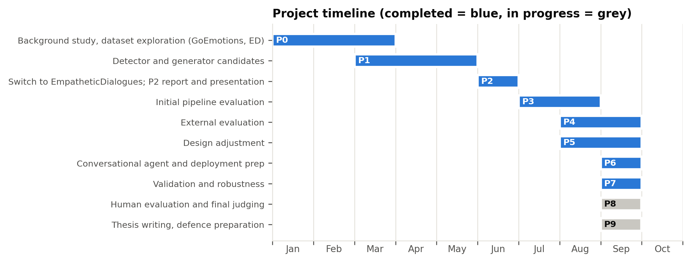

# Chapter 3: Requirements, Impacts and Constraints

## 3.1 Final Specifications and Requirements

The requirements below were fixed after the Pre-Thesis 2 review and did not change afterwards. Each one is stated so that it can be checked by measurement, and Table 3.1 records how each was verified and what the verification produced. The evidence for every entry is reported in Chapter 5.

### 3.1.1 Functional Requirements

1. **Emotion detection from the user's own words.** The system shall read the message the user actually writes, not a summary or a description of the situation, and shall identify the emotion it expresses from the 32 categories of EmpatheticDialogues [2].
2. **Candidate emotions rather than a single guess.** The detector shall expose more than one candidate emotion with its confidence, so that the generator is not forced to accept a single, possibly wrong, label.
3. **Visible emotional decision.** For every reply, the system shall report the candidate emotions, the emotion it finally responded to, and the words in the user's message that drove that decision.
4. **Guided response generation.** The generator shall receive wording written for the specific emotion selected, rather than one generic instruction for all emotions.
5. **Response rules.** Every reply shall acknowledge the feeling, ask exactly one question, and stay within 120 words.
6. **Multi-turn operation.** The same components shall support a conversation of several turns, keeping earlier turns in view and detecting a change in the user's emotion.

### 3.1.2 Non-Functional Requirements

1. **Hardware budget.** The complete system shall run on a single consumer GPU with 8 GB of memory [38].
2. **Privacy by locality.** No user message shall have to leave the device during normal operation; only openly licensed dataset text was sent to external services, and only for evaluation.
3. **Response time.** A reply shall be produced in a few seconds on that hardware, so that the exchange feels like a conversation.
4. **Reproducibility.** Every reported number shall be reproducible from scripts and saved outputs in the project repository, with fixed random seeds where sampling is involved.
5. **Inspectability.** Each component shall be replaceable and testable on its own, so that a failure can be traced to the detector, the emotion selection or the generator.
6. **Cost.** The project shall use only openly available models, datasets and free service tiers.

### 3.1.3 Constraints and Assumptions

The work is constrained by the hardware available to the team (one RTX 4060 with 8 GB of memory), by the licence of EmpatheticDialogues, which permits non-commercial research use only [20], and by the free tiers of the AI-judge services, which limit how many replies can be scored. Three assumptions are made and stated openly: that the single emotion label supplied with each conversation is an acceptable, if imperfect, reference; that an automatic empathy classifier and AI judges are reasonable proxies for human perception of empathy, which the human study is designed to test; and that the first message of a conversation carries enough signal for the detector, which Section 5.1.2 examines.

### 3.1.4 Standards and Compliance

The standards, codes of practice and licences applied to this project are listed in Section 3.5 and Table 3.3.

| ID | Requirement | How it was verified | Result | Reported in |
|---|---|---|---|---|
| FR1 | Detect the emotion of the user's own message across 32 categories | Fine-tuned RoBERTa-base evaluated on the official test partition (2,542 conversations) | Top-1 50.3%, top-3 76.5%, top-5 84.3% against a chance level of 3.1% | Section 5.1.2 |
| FR2 | Expose more than one candidate emotion with confidence | Top-3 accuracy of the detector; stage-1 selection measured against the gold label | Correct emotion is among the top 3 for 76.5% of messages; the generator picks it 42.3% of the time | Sections 5.1.2 and 5.1.6 |
| FR3 | Report the candidate emotions, the chosen emotion and the words behind the decision | Inspection of the agent output for every turn; attention cues taken from the detector's [CLS] attention | Met - every turn prints the three candidates with confidence, the chosen emotion and the cue words | Sections 5.3.3 and 5.3.4 |
| FR4 | Give the generator wording written for the selected emotion | Compared with the same detector and generator using one generic prompt (top-1 configuration) | Emotion validation 36.7% against 28.3% (adjusted p = 0.003); WASSA 5.05 against 4.89 | Sections 5.1.5 and 5.4.2 |
| FR5 | Acknowledge the feeling, ask exactly one question, stay within 120 words | Automatic checks on 300 held-out conversations | Acknowledgement 66.3%, exactly one question 92.7%, within the length limit 100%, all three together 60.0% | Section 5.1.3 |
| FR6 | Support a multi-turn conversation and follow a change of emotion | Multi-turn agent built on the same components; detector reads the last four user turns | Met - agent runs with a 10-exchange memory and reports a detected emotion shift | Section 5.3.4 |
| NFR1 | Run within 8 GB of GPU memory | Measured over 50 messages on an RTX 4060 8 GB | 3.40 GB peak, against 5.47 GB for the 7.6B single model (38% less) | Section 5.5.7 |
| NFR2 | No user message has to leave the device | Review of every component; only EmpatheticDialogues text was sent to the judge APIs | Met - detector and generator run locally; external services were used for evaluation only | Sections 3.4.2 and 5.6.5 |
| NFR3 | Produce a reply in a few seconds | Same 50-message benchmark | 4.17 s per reply on average (65.7 ms per generated token); detection and emotion selection add 0.31 s | Section 5.5.7 |
| NFR4 | Every number reproducible from scripts and saved outputs | Fixed seeds; scored prediction files kept for all systems; tables regenerated by script | Met - 4,200 scored replies and 1,024 judge ratings are stored in the repository | Section 5.1.1 |
| NFR5 | Components replaceable and testable on their own | Detector swapped for RoBERTa-large and for the earlier GPT-2 detector with the generator held fixed | Met - swaps ran without any change to the generator; neither improved reply quality significantly | Sections 5.4.3 and 5.5.3 |
| NFR6 | Use only open models, datasets and free service tiers | Licence review of every asset; cost record | Met - no paid service was used at any stage | Sections 3.4.4 and 3.8 |

*Table 3.1: Final requirements, how each was verified and the result*

## 3.2 Societal Impact

### 3.2.1 Intended Benefit

The system is built for situations where a person wants to be heard and no trained listener is available at that moment. Three properties make it useful in such settings. It runs on one ordinary graphics card, so a student counselling service, a small clinic or a helpline can host it on its own machine instead of paying for a commercial service. Because it runs locally, what a person types does not have to travel to a third-party provider, which matters when the message concerns their mental state. And because the emotion behind each reply is exposed rather than hidden, a supervisor can review why a reply took a particular tone, and a developer can place a safeguard between the emotional decision and the text the user sees.

In Bangladesh, where trained mental-health professionals are few relative to the population and where stigma discourages people from seeking help in person, a private, low-cost, locally hosted listener could give a first point of contact. That claim is about the deployment setting, not about clinical benefit: nothing in this thesis measures a health outcome.

### 3.2.2 Risks and Misuse

A system that sounds understanding can be trusted more than it deserves. Three risks follow.

**Substitution for real help.** A person in distress may keep talking to a machine instead of contacting a professional. The label set used here contains no category for suicidal ideation and the system has no crisis filter, so it must not be presented as a mental-health service. Any deployment must place a reviewed crisis filter and a referral path in front of the generator, and must display a helpline number [39].

**Wrong or shallow empathy.** The detector is correct 50.3% of the time on its first choice, and the generator names the user's actual emotion in 36.7% of replies. A reply built on a mistaken emotion can feel dismissive. The design reduces the cost of this error by passing three candidate emotions rather than one, and Section 5.4.3 shows that a wrong label does not measurably lower reply quality, but the risk remains real for an individual user.

**Cultural fit.** EmpatheticDialogues was collected from English-speaking crowd workers [2]. The way feelings are expressed, and the kind of reply that feels supportive, differ across cultures and languages. Deployment in Bangladesh would need data and evaluation in the local language before any claim of usefulness could be made.

### 3.2.3 Accountability and Transparency

The design answers a question that a single end-to-end model cannot: *on what emotional reading was this reply based?* Every turn records the three candidate emotions with their confidence, the emotion chosen, and the words that drove the decision. This record can be logged, audited after a complaint, or used to stop a reply before it is shown. For an institution that must take responsibility for what its system says, this auditability is the main societal argument for the decoupled design, and it is reported honestly alongside the fact that the AI judges do not rate our replies above those of a single model of the same generator.

## 3.3 Environmental Impact

### 3.3.1 Energy Used by This Project

The environmental cost of this work is the electricity used to train and evaluate the models. All training and all local inference ran on a single RTX 4060 with a rated board power of 115 W [38]. Energy is estimated as rated power multiplied by measured GPU hours, which overstates the true figure because the card rarely draws its full rated power.

On that basis, training the final detector used about 0.017 kWh and the larger RoBERTa-large alternative about 0.124 kWh. The heaviest items were response generation for fourteen system configurations over 300 conversations each and the repeated fine-tuning runs. Table 3.8 lists the recorded compute, and Section 3.8.2 converts it into cost. The total is of the order of a few kilowatt-hours, comparable to running a desktop computer for a few days, because every model used here is small by current standards: the largest is 7.6 billion parameters in 4-bit form, and nothing was trained from scratch.

No cloud GPU was rented at any point. The only external services used were free API tiers for the two AI judges, whose energy use is not under our control and is not included in this estimate; the judging workload was 1,024 short scoring calls.

### 3.3.2 Environmental Argument for the Design

The design choice examined in this thesis has a direct environmental consequence. The proposed system reaches, within statistical error, the same AI-judge scores as a single model with 1.9 times its parameters, while using 38% less GPU memory (3.40 GB against 5.47 GB) and the same time per generated token. A deployment that would otherwise need a larger card, or a data-centre GPU, can run this system on a mid-range consumer card instead.

Three further properties reduce the footprint of any deployment. The detector is small: RoBERTa-base at 125 million parameters gives the same reply quality as RoBERTa-large at 355 million, so the larger detector's additional training and inference energy buys nothing (Section 5.5.3). The generator is quantised to 4 bits, which cuts memory and therefore the class of hardware required. And because the system runs locally, replies do not travel to a data centre and back for every message.

### 3.3.3 Electronic Waste and Hardware

The project bought no new hardware. It ran on a personal computer the team already owned, and the requirement that everything fit in 8 GB of memory was set precisely so that no new equipment would be needed. By keeping useful work on existing consumer hardware, the design extends the service life of machines that would otherwise be considered insufficient for this class of model.

## 3.4 Ethical Issues

A system that responds to people describing their feelings raises ethical questions that shaped its design from the outset. This section addresses user safety, privacy, the ethics of the human evaluation, data and model licensing, bias, and research integrity.

### 3.4.1 Scope and User Safety

The system is designed for supportive listening in low-risk conversations. It is not a therapeutic, diagnostic or crisis service and must not be presented as one. This boundary is reflected in the response rules, which instruct the generator to acknowledge and validate the user's feelings, offer a reassuring thought and invite the user to continue, rather than to give clinical advice.

The most serious ethical risk is a user disclosing suicidal thoughts. The 32 emotion categories of EmpatheticDialogues [2] include no label for suicidal ideation or self-harm, so the detector cannot represent such a message. During interactive testing, the input "I want to die" was classified as *afraid* (45%), *terrified* (28%) and *sad* (4%). The generated reply was warm and invited the user to keep talking, but it did not point the user to any crisis resource. General-purpose commercial assistants given the same message responded mainly with helpline information. We consider neither response adequate on its own. World Health Organization guidance on communicating about suicide stresses both fostering understanding and empathy and providing accurate information on where and how to seek help [39]; although written for media professionals, the same principle applies to a system that responds to such disclosures.

In the current prototype, mitigation is limited to the interface. The prepared demonstration page states that the system is a student research prototype, is not monitored, and is not a substitute for professional help, and it lists crisis services ([[TEAM TO FILL: current Kaan Pete Roi number, verified on its official website]]; findahelpline.com). A pre-generation crisis filter, which would route messages containing self-harm language to a fixed, reviewed response, was identified but not implemented, and is listed as essential future work before any public deployment. The decoupled architecture makes such a filter straightforward to add, because emotion detection takes place in a separate, inspectable step before any text is generated.

### 3.4.2 Privacy and Data Protection

All models were developed and evaluated using the public EmpatheticDialogues corpus, and no personal data was collected to train or tune them. During evaluation, only EmpatheticDialogues text and the corresponding generated replies were sent to the third-party AI-judge services, and no data from real users was involved. Both models run on local hardware, so a deployed instance would not need to send a user's disclosure to an external provider, which is one practical motivation for a small, self-hostable system. The prepared demonstration interface, which has not yet been publicly deployed, holds conversation history only in per-session memory on the server, writes nothing to disk or logs, and discards the conversation when the page is closed.

### 3.4.3 Human Evaluation

The human evaluation described in Chapter 5 asks volunteers, mostly students together with some faculty members, to compare replies to 13 short situations. Participation is voluntary and anonymous. The questionnaire collects no names or email addresses, explains its purpose and expected duration of about 12 to 17 minutes, warns that some situations describe sad or stressful experiences, and allows participants to stop at any time. The identity of the system behind each reply is hidden and reply order is counterbalanced, so participants cannot be steered toward the authors' system. [[TEAM TO FILL: state the department's policy or the supervisor's confirmation that formal ethics review is not required for this anonymous, minimal-risk survey.]]

### 3.4.4 Data and Model Licensing

Table 3.2 lists the licences of the dataset and models used. EmpatheticDialogues is released under the Creative Commons Attribution-NonCommercial 4.0 licence [20], which requires attribution and forbids commercial use. Because the emotion detector is trained on this data, it may be shared for research but may not be incorporated into a commercial product without separately licensed training data. The final generator, Phi-4-mini-instruct [21], and the RoBERTa detector backbone [6] are released under the MIT licence, the Qwen2.5 baselines [22] under Apache-2.0, and the Gemma-3 candidate under Google's Gemma Terms of Use [40]. The WASSA empathy model [17] does not state a licence on its model card and is used for evaluation only, with credit to its authors.

| Asset | Role | Licence | Implication |
|---|---|---|---|
| EmpatheticDialogues | Dataset | CC BY-NC 4.0 | Attribution required; no commercial use of the data or derived commercial product |
| FacebookAI/roberta-base, roberta-large | d1 backbone | MIT | Permissive |
| microsoft/Phi-4-mini-instruct | Final d2 | MIT | Permissive |
| Qwen/Qwen2.5-1.5B-Instruct, Qwen2.5-7B-Instruct | Baselines / initial d2 | Apache-2.0 | Permissive, keep notice |
| google/gemma-3-4b-it | Bake-off candidate | Gemma Terms of Use | Use-restriction policy applies |
| google-bert/bert-base-uncased, google/electra-base-discriminator | d1 comparison | Apache-2.0 | Permissive |
| openai-community/gpt2-medium | Initial d1 | MIT | Permissive |
| sentence-transformers/all-MiniLM-L6-v2 | RAG retriever | Apache-2.0 | Permissive |
| hyy-33/hyy33-WASSA-2024-Track-2 | Empathy scorer | Not stated on model card | Evaluation use only; cite the shared task |
| openai/gpt-oss-120b | AI judge | Apache-2.0 | Accessed via Groq API terms |
| NVIDIA Nemotron 3 Ultra, gpt-oss-120b (Groq) | AI judges | Provider API terms | Only public ED text was sent |

*Table 3.2: Licences of the dataset and models used in this work*

### 3.4.5 Bias and Fairness

EmpatheticDialogues is an English-only corpus written by crowdworkers [2]. Its situations and ways of expressing emotion may not reflect users in Bangladesh or speakers of other languages, so neither detection accuracy nor the appropriateness of replies can be assumed to transfer to those users. The evaluation itself carries a known bias. The rule-based acknowledgement check searches for phrases such as "I'm sorry" and "that sounds", which suit negative emotions and under-credit valid responses to positive ones. We therefore never rely on this measure alone, and complement it with a blind panel of AI judges from different developers, an independent empathy classifier and a human study. The AI judges were chosen from developers unrelated to both the generator (Microsoft) and the baselines (Alibaba), because LLM evaluators tend to favour outputs from their own model family [37].

### 3.4.6 Research Integrity

Failed experiments were treated as failures, not as results. For example, a RoBERTa-large training run that diverged to 5.0% accuracy because learning-rate warmup was missing was repeated with corrected settings, and the failed run was not reported. Negative findings are reported in full, including those for retrieval-augmented generation, the monolithic fine-tuned generator, the Gemma-3 candidate, the larger RoBERTa-large detector, and the result that the final system's advantage in rule adherence over a same-size single model is not significant after correction for multiple comparisons. When a configuration error was found in the fine-tuned baseline, whose training script prevented the model from learning to end its replies, the baseline was retrained and every affected result was replaced, and the error is documented rather than hidden (Section 5.3.5). All reported figures are regenerated from saved experiment outputs by scripts kept in the project repository. [[TEAM TO FILL: disclosure of any use of AI writing or coding assistants, as required by BRAC University policy.]]

## 3.5 Standards

There is no single engineering standard for an empathetic dialogue system. This project therefore followed the standards, published codes of practice and licence terms that apply to its parts: the data and models it uses, the way it reports results, the professional practice it imitates, and the safety rules that any mental-health-adjacent tool must respect. Table 3.3 lists each one and what was done to comply.

**Data and model licences.** EmpatheticDialogues is used under CC BY-NC 4.0, which permits non-commercial research use [20]; this constrains any later deployment and is stated in Section 3.4.4. Every model used is openly released under a licence that permits research use, and the licence of each is recorded in Table 3.2.

**Practice standards for supportive conversation.** The three response rules are not invented. Acknowledging the feeling corresponds to the emotional-reaction mechanism of the EPITOME framework for text-based support [1]. Asking exactly one question follows counselling guidance that warns against the question-answer trap, in which repeated questioning turns support into interrogation [41]. The length limit follows from the same guidance and from our own measurement that replies within the limit are rated higher by the judges. Section 5.5.8 reports the evidence for each rule, including where our own measures disagree with the rule.

**Evaluation and reporting standards.** Empathy is measured with the classifier from the WASSA 2024 shared task, which is a published, peer-reviewed benchmark for exactly this quantity [16], [17]. AI-judge evaluation follows the practice established in the LLM-as-judge literature: blind scoring, an anchored rubric, temperature 0, and a panel drawn from unrelated developers to limit self-preference bias [18], [37], [19]. Statistical reporting follows standard practice for paired comparisons: McNemar's exact test [27], the Wilcoxon signed-rank test [28], bootstrap confidence intervals [29] and Holm correction for multiple comparisons [30].

**Safety standards.** The World Health Organization's guidance on suicide prevention and the safe handling of people in crisis sets the requirement that this system does not meet and must not be claimed to meet: it has no crisis-detection safeguard and no referral mechanism, so it must not be deployed as a mental-health service in its present form [39].

**Academic and professional conduct.** The work follows BRAC University's academic integrity requirements: all sources are cited, all results come from runs the team performed, errors found during the project are reported rather than removed, and the use of AI assistance is disclosed (Section 3.4.6).

| Area | Standard, code or licence | How it was applied | Reported in |
|---|---|---|---|
| Data licence | EmpatheticDialogues, CC BY-NC 4.0 | Used for research only; no commercial use; licence recorded and cited | Section 3.4.4 |
| Model licences | MIT (Phi-4-mini), Apache-2.0 (Qwen2.5, gpt-oss), MIT (RoBERTa), Gemma Terms of Use | Each licence checked before use; terms of use respected; Gemma dropped from the final system | Section 3.4.4 |
| Supportive-practice standard | EPITOME framework for empathy in text-based support (Sharma et al., 2020) | Rule R1, acknowledge the feeling, implements the emotional-reaction mechanism | Section 5.5.8 |
| Counselling practice | SAMHSA TIP 35, guidance against the question-answer trap | Rule R2, exactly one question per reply | Section 5.5.8 |
| Empathy measurement | WASSA 2024 shared task on empathy detection, Track 2 | Replies scored with the published hyy33 system from that shared task | Section 4.1.5.2 |
| LLM-as-judge practice | Blind scoring, anchored rubric, temperature 0, panel of unrelated developers | Two judges from NVIDIA and OpenAI, neither related to the models judged | Section 4.1.5.1 |
| Statistical reporting | Paired tests with correction for multiple comparisons | McNemar, Wilcoxon, 10,000-sample bootstrap CIs, Holm correction | Section 5.4.1 |
| Safety guidance | WHO guidance on suicide prevention and crisis response | Requirement not met: no crisis filter; deployment as a mental-health service is ruled out | Sections 3.2.2 and 3.4.1 |
| Human-subject practice | Informed consent, anonymity, no personal data collected, right to withdraw | Applied to the forced-choice human evaluation | Section 3.4.3 |
| Academic integrity | BRAC University academic conduct requirements | All sources cited; all results from the team's own runs; errors reported, not removed; AI use disclosed | Section 3.4.6 |

*Table 3.3: Standards, codes of practice and licences applied in this project*

## 3.6 Project Management Plan

This section sets out the project's requirements, the development method followed, the schedule and resources, and the revisions made to the plan as the work progressed. Risks are analysed in Section 3.7 and costs in Section 3.8.

### 3.6.1 Requirements and Specifications

The requirements were refined from the project proposal, supervisor feedback and the remarks of the Pre-Thesis 2 defence panel into the following specification.

**Functional requirements.** (F1) Given a user's message, the system identifies the most likely emotion among the 32 EmpatheticDialogues categories [2] and exposes this decision for inspection. (F2) It generates a reply that acknowledges the feeling, offers a reassuring thought and asks at most one follow-up question. (F3) Replies are short: at most 100 words as instructed, and scored against a limit of 120 words. (F4) The system supports multi-turn conversation and tracks changes in the user's emotion.

**Non-functional requirements.** (N1) Both models run on a single consumer GPU with 8 GB of memory. (N2) No user message needs to be sent to a third-party service at inference time. (N3) Every reported result can be reproduced from saved outputs with fixed random seeds.

**Constraints.** The project was bound by a fixed academic calendar, a single GPU-equipped machine, a three-member team in which one member ran the GPU experiments, and the rate limits of free evaluation APIs.

### 3.6.2 Development Methodology

The project followed an iterative, evidence-gated methodology, described in Section 4.1. Each design alternative was implemented, simulated on the same 300 held-out conversations, scored with the same measures, and adopted only if the evidence supported it. Inexpensive local measures, such as rule adherence and emotion validation, served as a first gate before costly or rate-limited evaluation with AI judges and human participants, so that limited evaluation capacity was spent only on candidates that had already passed.

### 3.6.3 Work Breakdown and Schedule

Table 3.4 divides the work into ten phases and Figure 3.1 presents them as a Gantt chart. Because the dates are taken from when each set of project artefacts was produced, the schedule reflects the work as it actually happened. Phases P0 to P2 cover background study, candidate models and the move to EmpatheticDialogues that produced the Pre-Thesis 2 report in June 2026. Phases P3 to P5 cover evaluation of the initial pipeline, external evaluation, and the design adjustments made in response, from July to September 2026. Phases P6 to P9 cover the conversational agent, robustness analyses, human evaluation and thesis writing.

| Phase | Work package | Start | End | Main outputs | Evidence in repository |
|---|---|---|---|---|---|
| P0 | Background study, dataset exploration (GoEmotions, ED) | Jan 2026 | Mar 2026 | GoEmotions EDA; first GPT-2 Medium training | `GoEmotions/`, `GPT 2 medium training/` |
| P1 | Detector and generator candidates | Mar 2026 | May 2026 | Qwen2 / Qwen2.5 / TinyLlama detectors; Qwen2.5, Phi-2, Gemma responders | `train_qwen2/`, `train_response_*` |
| P2 | Switch to EmpatheticDialogues; P2 report and presentation | Jun 2026 | Jun 2026 | GPT-2 d1 on ED; Chapter 3 draft v1-v6; poster; speech | `Chapter_3_Final_Submission_v6.docx`, `Posters/` |
| P3 | Initial pipeline evaluation | Jul 2026 | Aug 2026 | Confidence-gating ablation; zero-shot / fine-tuned baselines; interrogative bias | `evaluation_results_ablation_confidence_gating/` |
| P4 | External evaluation | Aug 2026 | Sep 2026 | AI-judge panel (3 judges); WASSA; RAG test; single-model baselines; significance tests | `llm_judge_evaluation/`, `single_model_baseline/` |
| P5 | Design adjustment | Aug 2026 | Sep 2026 | d1 mismatch fix (RoBERTa); d2 bake-off; two-stage + per-emotion prompts; attention cues | `train_roberta_ed_d1/`, `emotion_prompts/` |
| P6 | Conversational agent and deployment prep | Sep 2026 | Sep 2026 | Context memory (4 / 10 turns); Hugging Face Space (not deployed) | `conversational_agent/`, `huggingface_space/` |
| P7 | Validation and robustness | Sep 2026 | Sep 2026 | Backbone comparison; error propagation; diversity; literature comparison | `d1_model_comparison/`, `evaluation_results_diversity/` |
| P8 | Human evaluation and final judging | Sep 2026 | [[TEAM TO FILL]] | Google Form (13 items); AI-judge scores for final system (completed, two-judge panel) | `human_evaluation/`, `teammate_judge_package/` |
| P9 | Thesis writing, defence preparation | Sep 2026 | [[TEAM TO FILL - submission / defence date]] | Chapters 2-5, final report, slides | `writing/` |

*Table 3.4: Project phases, outputs and supporting evidence*

*Figure 3.1: Project timeline*

### 3.6.4 Team Roles and Responsibilities

[[TEAM TO FILL: one line per member giving name, student ID, main responsibilities and supporting responsibilities, reflecting the real division of work, for example model development and experiments; AI-judge evaluation runs and literature review; human-evaluation design, data collection and writing.]]

Because only one member's computer had a suitable GPU, tasks were divided so that work not requiring a GPU, namely AI-judge evaluation through APIs, the human study, the literature review and writing, could proceed in parallel with the GPU experiments. Step-by-step command guides were prepared so that members without a programming background could run evaluations independently.

### 3.6.5 Resource Plan

**Compute:** a single NVIDIA GeForce RTX 4060 with 8 GB of memory [38] and 16 GB of system memory, used for all training and generation. Heavy jobs were scheduled when memory was free, following two system freezes (risk R1, Section 3.7). **Evaluation services:** three free API tiers from different providers, with rate-limited work divided between two team members' accounts. **Data:** the public EmpatheticDialogues corpus [20]. **People:** as described in Section 3.6.4. Costs are analysed in Section 3.8.

### 3.6.6 Revisions to the Plan

The plan was revised whenever evidence overturned an assumption. The five main revisions were as follows.

1. **Change of dataset (June 2026).** Early work used GoEmotions [42], a dataset of Reddit comments labelled with 28 emotions. Because these are isolated comments rather than conversations, the project moved to EmpatheticDialogues, and the detector and generator work was restarted on the new data.
2. **Expanded evaluation (July-August 2026).** After the Pre-Thesis 2 panel questioned whether multiple models were needed, single-model baselines of equal and larger size, a retrieval-augmented variant and an AI-judge panel were added to the schedule before any further development.
3. **Replacement of the judge panel (August 2026).** Several planned judges became unavailable because of quota limits and model retirements. The panel was rebuilt from other providers and fixed at two judges that remained accessible for the whole evaluation, and judging was divided between two accounts to work within a daily limit of 50 requests, so that every system was scored by the same two judges.
4. **Redesign of the detector (late August 2026).** A mismatch was discovered between the text the detector was trained on and the text it received in use. The detector was retrained, and a comparison of generator models was added to the schedule, leading to the final two-stage design.
5. **Scope control (September 2026).** A repetition-penalty improvement was deferred to future work and the final system's outputs were frozen, because regenerating them would have invalidated AI-judge scores that were already being collected.

### 3.6.7 Remaining Schedule

Table 3.5 lists the milestones remaining at the time of writing.

| Milestone | Target date | Status |
|---|---|---|
| AI-judge scores for the final system returned | September 2026 | Completed |
| Human evaluation questionnaire closed | [[TEAM TO FILL]] | In progress |
| Complete draft submitted to supervisor | [[TEAM TO FILL]] | In progress |
| Final report submitted | [[TEAM TO FILL]] | Planned |
| Final defence | [[TEAM TO FILL]] | Planned |

*Table 3.5: Remaining milestones*

## 3.7 Risk Management

This section describes how project risks were identified, assessed and mitigated. Most of the risks listed were encountered during the project, and each has a documented mitigation.

### 3.7.1 Risk Management Process

Risks were identified at each phase review and whenever an experiment behaved unexpectedly. Each risk was rated for **likelihood** (Low, Medium or High), meaning how probable it was within the project period, and for **impact** (Low, Medium, High or Very High), meaning its effect on the validity of results, the schedule or user safety. Risks with high impact were mitigated immediately, while the others were monitored and addressed if they occurred. Wherever possible, mitigations were made *structural*, such as an automatic check in the code, a fixed random seed or a pinned library version, so that the same failure could not recur unnoticed.

### 3.7.2 Risk Register

Table 3.6 summarises the twelve risks identified, grouped into seven categories: technical, methodological, external, schedule, evaluation, ethical and team. Eight of these risks occurred during the project, two remain active, and two were identified in advance and mitigated or partly mitigated.

| ID | Category | Risk | Likelihood | Impact | Status | Mitigation |
|---|---|---|---|---|---|---|
| R1 | Technical | GPU out-of-memory / system freeze on 8 GB VRAM, 16 GB RAM | High | High | Occurred twice | 4-bit NF4 quantisation; pre-flight VRAM/RAM checks; heavy jobs run only when RAM is free |
| R2 | Technical | Library upgrade breaks code (transformers 5.x removed StableDropout, warmup_ratio) | Medium | High | Occurred | Compatibility shim; pinned versions; WASSA re-validated at 100% match on 1,800 pre-upgrade scores |
| R3 | Technical | Silent failure - default 'sdpa' attention returned no attention weights | Low | High | Occurred | Forced 'eager' attention + hard-fail assertion so the feature cannot silently switch off |
| R4 | Methodological | Train/inference mismatch in d1 (trained on situation text, fed user messages) | Medium | High | Occurred | Retrained on first user message; honest accuracy reported |
| R5 | Methodological | Unstable training of larger model (roberta-large diverged to 5.0%) | Medium | Medium | Occurred | Warmup 0.06 + lr 1e-5; failed run not reported as a result |
| R6 | Methodological | Non-reproducible generation (no fixed seed) | Medium | Medium | Occurred | Fixed seed 42 for sampling and data; earlier noisy numbers discarded |
| R7 | External | Free API models retired or withdrawn mid-project (Llama 3.3 on Groq, DeepSeek on GitHub Models, Gemini quota, Mistral Large 403 on both team accounts) | High | Medium | Occurred | Judge panel from several providers; final comparison on the two judges that scored every system; two- vs three-judge panel checked (rho 0.98, same ranking) |
| R8 | External | API rate limits (OpenRouter 50 requests/day) | High | Medium | Occurred | Stratified short/long split across two teammates' accounts with dedup merge |
| R9 | Schedule | Late design changes invalidate in-progress judging | Medium | High | Active | Freeze the final system outputs while teammates judge; repetition penalty moved to future work |
| R10 | Evaluation | Automatic metrics reward length or keywords, not empathy | High | Medium | Identified | Multiple independent signals: rules, WASSA, AI-judge panel, human study; length-matched analysis |
| R11 | Ethical | Unsafe reply to crisis disclosure (no self-harm category in ED labels) | Low | Very high | Identified | Disclaimer and helplines in demo UI; stated as limitation; crisis gate listed as future work |
| R12 | Team | Only one member can run GPU work | High | Medium | Active | No-GPU tasks (judging, writing, human eval) assigned to teammates with written command guides |

*Table 3.6: Risk register*

### 3.7.3 Key Risks and Their Handling

**Silent technical failure (R3).** The design uses the detector's attention weights to identify the words that most influenced its prediction. With the default attention implementation of the Transformers library [43], requesting attention weights returns an empty result without raising an error, so cue extraction silently fell back to simple text splitting while appearing to work. Had this gone unnoticed, the thesis would have described an attention mechanism that was not operating. The implementation was switched to one that returns attention weights, and an automatic check was added that stops execution if the weights are missing. This is the clearest example in the project of a structural mitigation.

**Validity of results (R4, R5).** Two risks threatened the correctness of reported figures rather than the schedule. First, the original detector was trained on situation descriptions but was evaluated and deployed on user messages. When evaluated on the real input, its accuracy fell from 56.9% to 48.2%, and it was retrained on the correct input. Second, a RoBERTa-large training run diverged to 5.0% accuracy because learning-rate warmup was missing. Rather than report this as a result, the cause was identified and the run repeated with warmup over 6% of training steps and a lower learning rate, reaching 53.0% accuracy.

**Dependence on external services (R7, R8).** Evaluation with AI judges relied on free APIs outside the team's control. During the project, several candidate judge models became unavailable through quota limits, retirement or subscription restrictions, and one provider limited its judge to 50 requests per day. These risks were mitigated by drawing the judges from independent providers, fixing the panel on the two judges that remained accessible throughout so that every system is scored by identical judges, and dividing rate-limited judging between two team members using a split that keeps every emotion category represented in each half.

### 3.7.4 Residual Risks

Two risks remain open at the time of writing. **R9 (schedule):** a late change to the design would invalidate the collected AI-judge scores and the human-evaluation items built from the final system's replies, so these outputs are frozen and the repetition-penalty improvement has been deferred. **R11 (ethical):** apart from interface disclaimers, the system has no safeguard for disclosures of suicidal thoughts. This risk has low likelihood in the evaluation setting but very high impact in any public deployment, and it must be resolved before such deployment (Section 3.4).

## 3.8 Economic Analysis

This section analyses the cost of developing and evaluating the system, the computing resources used, the cost-effectiveness of the main design decisions, and the constraints on commercial use.

### 3.8.1 Development Cost

The project was designed to use hardware the team already owned together with free software, models and services (Table 3.7). All models are openly released and all software libraries are open source. The dataset is freely available for non-commercial research [20]. The AI judges were accessed through free API tiers, the demonstration interface targets the free Hugging Face Spaces CPU tier, and the human study uses Google Forms with volunteer participants. Direct monetary cost is therefore limited to electricity, internet access and the GPU workstation, [[TEAM TO FILL: purchase price in BDT, or a statement that it is an existing personal asset with no additional cost]].

| Item | Details | Cost (BDT) | Type |
|---|---|---|---|
| Hardware | Personal PC with RTX 4060 8 GB, 16 GB RAM (already owned) | [[TEAM TO FILL - BDT purchase price, or 'existing asset']] | One-time |
| Electricity | GPU board power 115 W (NVIDIA spec) x GPU hours x tariff | [[TEAM TO FILL - BDT/kWh]] | Per run |
| Pretrained models | RoBERTa (MIT), Phi-4-mini (MIT), Qwen2.5 (Apache-2.0), Gemma-3 (Gemma terms) | 0 | Open weights |
| Dataset | EmpatheticDialogues (CC BY-NC 4.0) | 0 | Non-commercial use only |
| AI judges | OpenRouter free tier, Groq free tier | 0 | Rate-limited |
| Hosting (demo) | Hugging Face Spaces free CPU tier (2 vCPU, 16 GB) | 0 | Not yet deployed |
| Human evaluation | Google Forms, volunteer raters | 0 | No payment |
| Internet | Model downloads, API calls | [[TEAM TO FILL]] | Monthly |

*Table 3.7: Development cost breakdown*

### 3.8.2 Compute Usage and Energy

Training time was recorded for each detector experiment (Table 3.8). Fine-tuning RoBERTa-base took 8.8 minutes, the BERT-base and ELECTRA-base comparison models took 8.6 and 8.7 minutes, and RoBERTa-large took 64.7 minutes. An upper-bound estimate of the GPU energy consumed by a training run is

E (kWh) = P (kW) x t (h),

where P = 0.115 kW is the rated board power of the RTX 4060 [38]. This gives about 0.017 kWh for RoBERTa-base and 0.124 kWh for RoBERTa-large, excluding the rest of the computer. At an electricity tariff of [[TEAM TO FILL: BDT per kWh]], the cost of training the detector is negligible. Generation time for the response experiments was not recorded and is therefore not reported.

| Task | Hardware | Wall-clock minutes | Status |
|---|---|---|---|
| d1 RoBERTa-base training | RTX 4060 8 GB | 8.8 | recorded (d1 comparison run) |
| d1 BERT-base training | RTX 4060 8 GB | 8.6 | recorded |
| d1 ELECTRA-base training | RTX 4060 8 GB | 8.7 | recorded |
| d1 RoBERTa-large training | RTX 4060 8 GB | 64.7 | recorded |
| Response generation, 300 conversations per system (x11 systems) | RTX 4060 8 GB | [[TEAM TO FILL - not logged]] | not recorded |
| AI judging (Nemotron, gpt-oss) | Cloud API, free tier | network time only | free tier |
| WASSA scoring, 3,300 replies | RTX 4060 / CPU | [[TEAM TO FILL]] | not recorded |

*Table 3.8: Recorded compute usage*

### 3.8.3 Cost-Benefit Analysis of Design Choices

**Detector size.** Compared with RoBERTa-base, RoBERTa-large improves top-1 accuracy by 2.9 percentage points (53.0% against 50.1%) and top-5 accuracy by 2.2 points, both statistically significant, but it has 2.8 times as many parameters and needs 7.4 times the training time (Table 3.9). We measured the benefit directly by running the final system with RoBERTa-large as its detector (Table 5.13). Rule adherence (60.0% against 54.7%), WASSA empathy (5.05 against 5.01) and emotion validation (36.7% against 38.0%) showed no significant change. Because the additional cost bought no measurable improvement in the replies, RoBERTa-base was retained.

| Backbone | Parameters (M) | Top-1 acc (%) | Top-5 acc (%) | Train time (min) |
|---|---|---|---|---|
| bert-base-uncased | 110 | 48.8 | 81.7 | 8.6 |
| google/electra-base-discriminator | 110 | 50.2 | 82.7 | 8.7 |
| roberta-base | 125 | 50.1 | 85 | 8.8 |
| roberta-large | 355 | 53 | 87.2 | 64.7 |

*Table 3.9: Size, accuracy and training cost of the candidate detectors*

**Fine-tuning compared with prompting the generator.** Fine-tuning the generator with LoRA [24] consumed 43 minutes of GPU time and produced a model that follows all three rules in only 22.3% of replies, because it learns the casual style of the dataset's listener replies. Prompting an instruction-tuned model requires no training and achieves 60.0% for the final system. For this task, prompting is superior in both cost and quality.

**Generator size.** Here the trade-off runs the other way. A single Qwen2.5-7B model [22], with 7.6 billion parameters and using about 5.6 GB of GPU memory in 4-bit form, outperforms our pipeline, whose generator has 3.8 billion parameters, on rule adherence (82.3% against 60.0%), WASSA empathy (5.76 against 5.05) and AI-judge empathy (8.15 against 7.84). If output quality were the only objective, the larger single model would be preferred. Measured on the same GPU, however, our pipeline needs 38% less peak GPU memory than the larger model (3.40 GB against 5.47 GB) with no significant difference in response time (4.17 s against 3.91 s per reply; Section 5.5.7), so it can run on hardware with less memory while reaching 97.5% of the larger model's overall AI-judge score. It is not cheaper to run than the Qwen2.5-1.5B single model, which is lighter and 2.6 times faster but produces significantly less empathetic replies. The decoupled design is retained for this balance and for its inspectability, since the candidate emotions, the chosen emotion and the words that drove the decision are all visible and can be acted upon.

**Evaluation method.** Human annotation in comparable research is paid; for example, Belay et al. report paying annotators about USD 6 per hour [36]. The free-tier AI judges in this project produced several hundred judgements each at no monetary cost, in exchange for rate limits and the need to replace unavailable judges (Section 3.7). The human study is used to validate these judges rather than to replace them.

### 3.8.4 Operating Cost

A self-hosted deployment incurs the hardware and electricity costs described above but no per-message fees, and no user message leaves the host. A deployment based on a commercial LLM API would instead incur a fee for every message, [[TEAM TO FILL: current published price per million input and output tokens for a named commercial model, with the date checked]]. A free CPU host with 2 virtual CPUs and 16 GB of memory costs nothing but would respond considerably more slowly than the 4.17 seconds per reply measured on the project's GPU (Section 5.5.7); latency on such a host was not measured. [[TEAM TO FILL: if the demonstration is deployed, add its measured response time.]]

### 3.8.5 Commercial Constraints

EmpatheticDialogues is licensed under CC BY-NC 4.0, which forbids commercial use [20]. Because the detector is trained on this data, the system as built cannot be sold or used in a paid service. Commercial use would require retraining the detector on commercially licensed or newly collected data. The generator and the detector backbone are MIT-licensed [21], [6] and impose no such restriction (Table 3.2).
