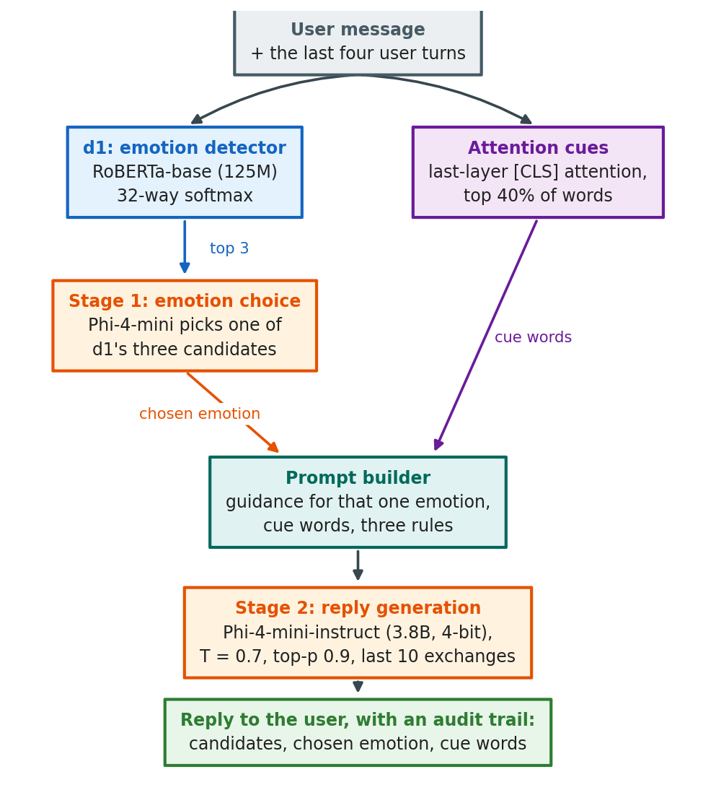
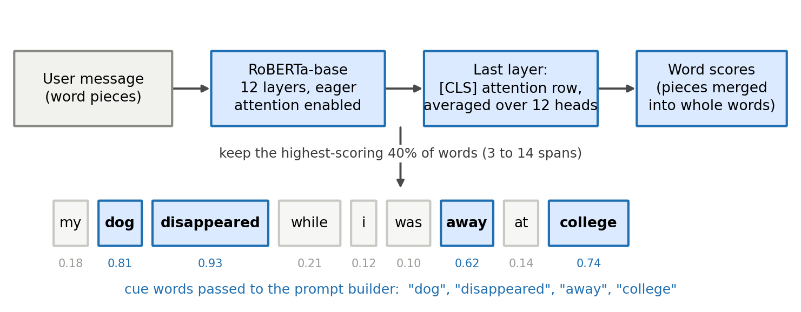
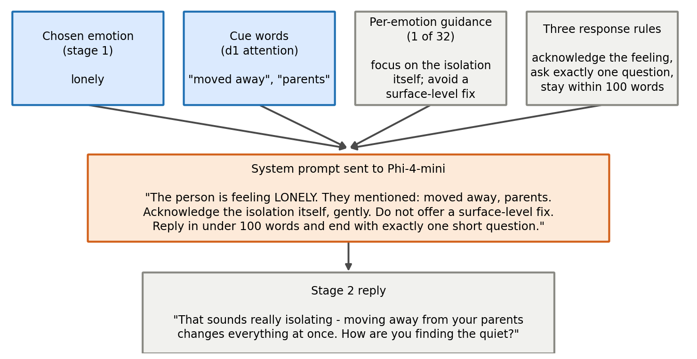
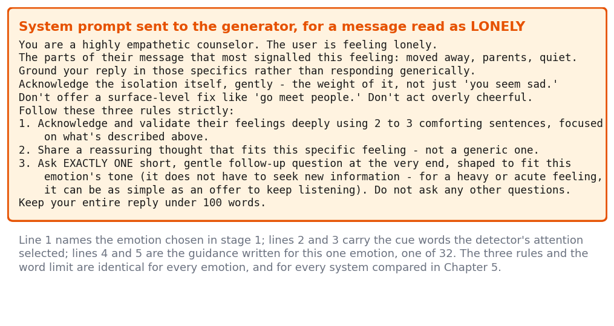
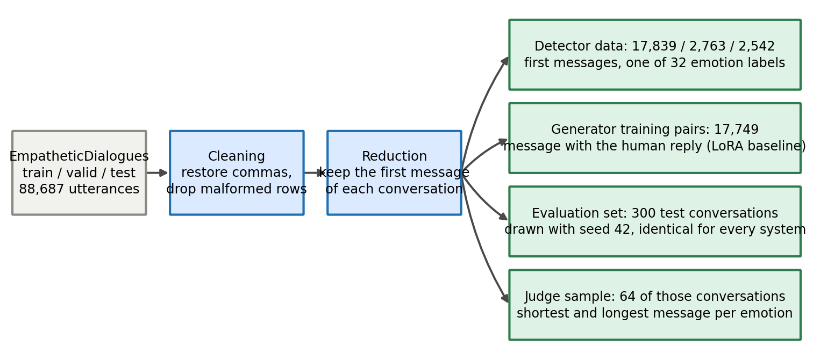
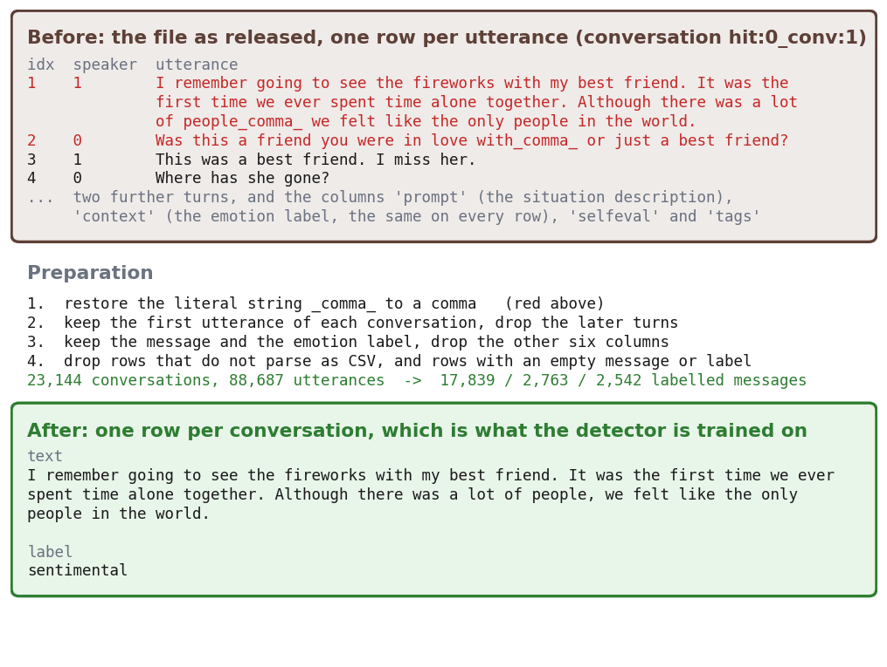

# Chapter 4: Proposed Methodology

## 4.1 Design Process or Methodology Overview

This chapter describes how the system was designed and why it takes the form it does. The goal is a reply that makes a person feel understood, produced on one 8 GB consumer GPU, with the emotional judgement behind it written down rather than hidden inside a model. Three rules governed every decision: **identify the feeling before writing anything**, so that the emotional judgement exists as a separate, inspectable object; **give the generator one coherent instruction**, because a model told to respond to several possible feelings at once responds well to none of them; and **adopt nothing that the measurements do not support**, so that each alternative is simulated on the same conversations and kept only on evidence.

The work was carried out in two connected stages. The first built and selected an emotion detector, comparing five candidate architectures on the text the system actually receives. The second built the response side on top of that detector, comparing generators, four ways of passing the detector's output to the generator, and a set of monolithic baselines that answer without any detector at all. Figure 4.1 shows the loop that governed both stages.

*Figure 4.1: The evidence-gated design process followed in this work*

### 4.1.1 The Proposed System at a Glance

The final system is a two-stage pipeline built from two models, shown in Figure 4.2. Each part exists for a stated reason.

- **d1, the emotion detector:** a RoBERTa-base encoder fine-tuned on the 32 emotions of EmpatheticDialogues [2] reads the user's message, in conversation the last four user turns, and returns a probability for every emotion. Only its three most probable emotions leave this stage. An encoder is used rather than a prompted generator because encoders fine-tuned for classification outperform generative models at emotion recognition [32], and because a 125-million-parameter classifier costs almost nothing beside a 3.8-billion-parameter generator.
- **Attention cues:** the same forward pass yields the words the detector leaned on, taken from its final-layer attention. These are passed on so the reply can refer to what the person actually wrote instead of to the emotion label alone.
- **Stage 1, emotion choice:** the generator, Phi-4-mini-instruct [21], is asked in a short deterministic call to pick the one emotion among d1's three candidates that best fits the message. This resolves the detector's uncertainty before any reply is written, and it is the step that lets the pipeline benefit from three candidates without confusing the generator with three sets of instructions.
- **Prompt builder:** the chosen emotion selects one of 32 pieces of guidance written for that specific feeling, which is combined with the cue words and the three response rules into a single system prompt.
- **Stage 2, reply generation:** the same generator, loaded in 4-bit form, writes the reply from that prompt, with the last ten exchanges of the conversation in view.

Every intermediate decision, the three candidates with their confidences, the emotion finally used, and the cue words, is recorded and displayed with the reply. That record is what a single end-to-end model cannot produce, and it is the reason the design keeps the two jobs apart.

*Figure 4.2: The complete two-stage pipeline of the proposed system*

### 4.1.2 Design Space Explored

The central question of this thesis is whether the separation just described earns its place. The methodology is built to test that question rather than to assume its answer, so the design space deliberately contains designs that would make the detector unnecessary. Four families of alternatives were implemented and simulated under identical conditions:

- **Detector alternatives:** one decoder and four encoder models, trained on identical data with identical settings (Section 4.2.1).
- **Generator alternatives:** three instruction-tuned generators of 1.5 to 4 billion parameters, with the detector, the prompt and the conversations held fixed (Section 4.2.2).
- **Integration alternatives:** four ways of passing d1's output to d2, plus the two-stage design that was finally adopted (Section 4.2.3).
- **Monolithic and retrieval alternatives:** five designs that answer with no separate detector, and one that retrieves human examples instead (Section 4.2.5).

Every one of these ran on the same 300 held-out conversations with the same decoding settings, so that any difference comes from the design and not from the data or the sampling. Their results are reported in Chapter 5; this chapter states what each design is.

### 4.1.3 Evaluation Strategy

No single automatic measure captures empathy, so each design is judged by five independent signals: rule adherence, which checks automatically whether a reply acknowledges the feeling, asks exactly one question and stays within 120 words; the WASSA 2024 empathy classifier; emotion validation, which checks whether the emotion expressed in the reply matches the conversation's true label; a blind panel of two AI judges from unrelated developers; and a forced-choice study with human raters. Detector candidates are judged separately by top-1 accuracy, top-5 accuracy and macro-F1 on the full test partition.

Because every system answers the same conversations, differences are tested with paired methods: McNemar's exact test for binary outcomes [43], the Wilcoxon signed-rank test for scores [44], bootstrap confidence intervals over 10,000 resamples [45], and Holm correction across families of comparisons [46]. A difference counts as significant only when the corrected p-value is below 0.05 and the confidence interval excludes zero.

#### 4.1.3.1 Selection of the AI-Judge Panel

Using language models as evaluators is established practice, since strong LLM judges agree with human preferences in more than 80% of cases [18], but they carry known biases and the panel was designed against them. Because LLM evaluators recognise and favour their own outputs [33], the judges come from developers unrelated to every model being judged: **Nemotron 3 Ultra** (NVIDIA) and **gpt-oss-120b** (OpenAI), neither of which shares a family with our generator (Microsoft) or with the Qwen baselines (Alibaba). Because a panel from different families shows less bias than one large judge [19], the reported score is the mean of the two. Each judge sees only the user's message and one reply, never the system's name or the human reference, and scores empathy, relevance and safety from 1 to 10 against written anchors at temperature 0. Both judges scored every reply of every judged system, which is what makes the comparison across systems fair. Table 4.1 describes the panel.

| Judge | Developer | Size | Access | Role | Why selected |
|---|---|---|---|---|---|
| Nemotron 3 Ultra | NVIDIA | 550B total / 55B active (mixture-of-experts) | OpenRouter free tier (50 requests/day) | Used - every judged system | Flagship scale; no relation to Microsoft (Phi) or Alibaba (Qwen) |
| gpt-oss-120b | OpenAI (open weights, Apache-2.0) | About 120B (mixture-of-experts) | Groq free tier | Used - every judged system | Open weights make this judge reproducible; fast enough to score everything |

*Table 4.1: The AI-judge panel*

#### 4.1.3.2 Use of the WASSA Empathy Classifier

As a signal independent of both the rule checks and the judges, replies are scored by the hyy33 system from the WASSA 2024 shared task [17]. It suits this project because it was trained on third-party human empathy ratings of individual conversation turns [16], the same unit as our replies; because it is peer-reviewed and publicly released, with predictions correlating with human ratings at r = 0.544 on the shared task's test set; and because it comes from a different group, a different dataset and a different model family from every part of our system, so it has no reason to favour it. Its limits are stated too: it was not the best system in its own shared task, its training conversations are discussions of news articles rather than supportive replies, and it outputs coarse classes. Section 5.4.5 shows that it reproduces the judges' ranking of systems closely but is too noisy at the level of a single reply, so it is used only to compare system averages over the 300 conversations.

## 4.2 Preliminary Design or Design (Model) Specification

This section specifies every design that was built: the candidates considered for each component, the mechanism each one uses, and the full specification of the design that was finally selected. Which of them performed best is reported in Chapter 5; here the concern is what they are.

### 4.2.1 Emotion Detector Candidates (d1)

Five detectors were built and trained on identical data with identical settings, so that only the architecture differs. Table 4.2 summarises them.

**GPT-2 Medium (the initial detector):** A 355-million-parameter decoder-only transformer with a classification head over its final hidden state. It was the detector of the project's first pipeline, and it was trained on the dataset's *situation description*, the paragraph a crowdworker wrote about the event before the conversation began. Two properties make it a weak fit. A left-to-right decoder sees each token only in the context of the tokens before it, whereas classification benefits from reading the whole message at once. And the situation description states the feeling far more explicitly than a person's own message does, so a detector trained on it learns an easier task than the one it meets in use.

**BERT-base:** A 110-million-parameter bidirectional encoder pre-trained with masked-language modelling [5], included as the standard reference point for sentence classification. Every token attends to every other token, so the classification token summarises the whole message.

**ELECTRA-base:** An encoder of the same size trained instead by replaced-token detection, where the model decides for every token whether it is original or substituted. This trains on all positions rather than the 15% that masking covers, and often produces a stronger encoder for the same compute.

**RoBERTa-base:** A 125-million-parameter encoder with the same architecture as BERT but pre-trained far longer, on about 160 GB of text, with dynamic masking and no next-sentence objective [6]. It is the size the memory budget favours, since it leaves almost all of the 8 GB for the generator.

**RoBERTa-large:** The 355-million-parameter version of the same model, included to answer a cost question rather than an architecture question: whether a detector 2.8 times the size earns its training and inference cost inside the complete pipeline.

All five use a 32-way classification head with softmax over the emotions, cross-entropy loss, and the training settings of Section 4.4. Selection was made on top-1 and top-5 accuracy on the 2,542-conversation test partition, with top-5 weighted heavily, because the selected design passes several candidates forward and therefore depends on the quality of the ranking rather than of the single best guess.

| Candidate | Architecture | Parameters | Input it was trained on | Why it was included |
|---|---|---|---|---|
| GPT-2 Medium | Decoder-only transformer | 355M | Situation description | The detector of the initial pipeline; kept as the starting point to be improved on |
| BERT-base | Bidirectional encoder | 110M | First user message | The original masked-language-model encoder, a standard classification baseline |
| ELECTRA-base | Bidirectional encoder | 110M | First user message | Trained by replaced-token detection, often stronger than BERT at the same size |
| RoBERTa-base | Bidirectional encoder | 125M | First user message | Longer pre-training than BERT on 160 GB of text; the size the memory budget favours |
| RoBERTa-large | Bidirectional encoder | 355M | First user message | Tests whether a larger detector is worth its training and inference cost |

*Table 4.2: Detector candidates, their architectures and why each was included*

### 4.2.2 Response Generator Candidates (d2)

Three instruction-tuned generators were compared with the detector, the prompt, the rules, the conversations and the decoding settings all held fixed, so that only the generator changed. Table 4.3 summarises them.

**Qwen2.5-1.5B-Instruct:** The generator of the initial pipeline [22]. At 1.5 billion parameters it runs in 16-bit precision within the memory budget and leaves room to spare, which makes it the natural lower bound on generator size.

**Gemma-3-4B-it:** A 4-billion-parameter instruction model from a different family, loaded in 4-bit form. It tests whether capacity alone improves supportive replies. One practical difference shaped its integration: its chat template has no system role, so the instructions must be folded into the user turn.

**Phi-4-mini-instruct:** A 3.8-billion-parameter model trained with a strong emphasis on instruction following [21], which matters here because the design asks the generator to obey three explicit rules and to stay inside a word limit. It is loaded with 4-bit NF4 quantisation [23] to fit beside the detector.

**Phi-2 (considered and dropped):** A 2.7-billion-parameter model without a chat template. Without that template there is no reliable way to separate a system instruction from the user's message, so the three rules could not be enforced, and the candidate was dropped before evaluation.

| Candidate | Parameters | Loading | Chat template | Why it was included |
|---|---|---|---|---|
| Qwen2.5-1.5B-Instruct | 1.5B | 16-bit | Yes | The generator of the initial pipeline and the size a small GPU runs comfortably |
| Gemma-3-4B-it | 4B | 4-bit NF4 | Yes, but with no system role | A strong instruction model of a different family; tests whether size alone helps |
| Phi-4-mini-instruct | 3.8B | 4-bit NF4 | Yes | Trained with an emphasis on instruction following, which the three rules demand |
| Phi-2 | 2.7B | 16-bit | No | Considered and dropped: without a chat template it cannot be steered by a system prompt |

*Table 4.3: Generator candidates, with the detector, prompt and conversations held fixed*

### 4.2.3 Integration Design: How d1's Output Reaches d2

The detector produces a full probability distribution, so the link between the two models is itself a design decision with several options (Table 4.4). Four were implemented on the initial pipeline: **argmax** passes only the most probable emotion; **confidence-gated** passes the same label but switches to tentative wording when the detector is unsure; **distribution** passes every emotion above probability 0.05; and **candidate-pick** passes the top three and asks the generator to choose and reply in a single call.

The comparison of these variants, reported in Section 5.2.4, led to the **two-stage** design used in the final system, which separates the choice of emotion from the writing of the reply. Two facts motivate it. First, the detector's correct emotion is among its three best candidates far more often than it is the single best, so a wider candidate set carries real information. Second, several emotions in one prompt produce contradictory guidance, because responding well to *disappointed* is not the same as responding well to *impressed*. Splitting the decision into its own short, greedy call resolves the uncertainty first and leaves the generation prompt describing exactly one feeling.

| Variant | What reaches the generator | Design rationale | Risk it carries |
|---|---|---|---|
| Argmax | The single most probable emotion | The simplest link; one emotion gives one coherent instruction | A wrong top-1 label sends the whole reply in the wrong direction |
| Confidence-gated | The top emotion, with tentative wording when d1 is unsure | Lets the reply hedge instead of asserting a feeling the detector doubts | Depends on the generator actually changing its wording when told to |
| Distribution | Every emotion above probability 0.05 | Passes the detector's uncertainty on in full | Several emotions at once give the generator contradictory guidance |
| Candidate-pick | The top three emotions, resolved inside the generation call | One call, so no extra latency | The model must resolve the emotion and obey the rules in a single pass |
| Two-stage (selected) | The top three emotions, resolved in a separate short call | The correct emotion is among the top three far more often than it is first, and a separate call leaves the generation prompt coherent | One extra model call per reply, measured at 0.31 s |

*Table 4.4: Ways of passing the detector's output to the generator*

### 4.2.4 Attention-Based Cue Extraction

To let the reply refer to what the person wrote rather than only to an emotion label, the design extracts the words the detector itself relied on (Figure 4.3). Let the message be tokenised into pieces and passed through the encoder, and let A ∈ R^(H x T x T) be the attention of the final layer, where H is the number of heads and T the number of tokens. The cue score of token t is the attention that the classification token pays to it, averaged over heads:

s(t) = (1/H) Σ_h A[h, 0, t]

Special tokens and punctuation are discarded, closed-class words are excluded so that the cues are not merely the function words attention tends to concentrate on, and the highest-scoring 40% of the remaining tokens are kept, with a floor of three and a ceiling of fourteen so that neither very short nor very long messages produce a useless cue list. Neighbouring kept tokens are then stitched back together and expanded to whole words, and at most three phrases are returned. The result is a handful of phrases such as "moved away" or "my dog disappeared", which the prompt builder inserts into the instruction.

One implementation detail is essential rather than incidental. The attention implementation must be requested explicitly, because the library's default returns no attention weights at all while raising no error, in which case the mechanism silently degrades into plain text splitting. The system therefore checks at start-up that weights are returned and stops if they are not (Section 3.7).

*Figure 4.3: Extraction of cue words from the detector's final-layer attention*

### 4.2.5 Monolithic and Retrieval Alternatives

To test whether a separate detector is needed at all, six designs without one were implemented (Table 4.5). Three prompt a single model to identify the emotion silently and then reply under the same three rules, at 1.5 billion parameters, at 7.6 billion in 4-bit form, and with our own 3.8-billion-parameter generator; the last of these is the sharpest comparison, because it differs from the proposed system only by the absence of the detector. A fourth prompts a generator zero-shot with a generic caring instruction and no emotion at all. A fifth fine-tunes Qwen2.5-1.5B with LoRA [24] directly on pairs of user messages and human replies, which tests whether imitating the dataset's listeners beats instructing a model. The sixth is retrieval-augmented [25]: one or two training conversations with the same detected emotion are retrieved with all-MiniLM-L6-v2 sentence embeddings [26] and shown to the generator as examples of how a person answered.

| Baseline | How it is built | What it is there to test |
|---|---|---|
| Zero-shot generator | Qwen2.5-1.5B with a generic caring prompt and no detector | Whether a detector adds anything over plain prompting |
| Fine-tuned monolithic | Qwen2.5-1.5B fine-tuned with LoRA on message and human reply pairs | Whether learning the dataset's replies beats prompting |
| Single model, same size | Qwen2.5-1.5B told to identify the emotion silently, then reply | The core question: decoupled against monolithic at equal size |
| Single model, larger | Qwen2.5-7B in 4-bit form with the same prompt | What is given up by staying inside the 8 GB budget |
| Single model, our generator | Phi-4-mini alone with the same prompt and no detector | Whether the gains come from the design or from the generator |
| Retrieval-augmented | Similar training conversations retrieved with all-MiniLM-L6-v2 and shown to the generator as examples | Whether human examples of the same emotion improve the reply |

*Table 4.5: Designs built without a separate detector, and what each one tests*

### 4.2.6 Specification of the Selected Design

**Detector:** RoBERTa-base with a 32-way classification head, fine-tuned on first messages with the settings of Table 4.8. It reads one message when answering a single message, and the user's last four turns joined together when holding a conversation; Section 4.2.7 specifies the conversational form and Section 5.3.2 gives the measurements behind the four-turn window.

**Stage 1, emotion choice:** Phi-4-mini receives the message and the three candidates with the instruction: *"An automatic detector narrowed the person's likely feeling down to these options: {a}, {b}, {c}. Read their message and decide which ONE of those options best fits what they are actually expressing. Reply with ONLY that single word."* Decoding is greedy with at most 10 new tokens. If the answer does not name one of the three, the system falls back to the detector's own top choice; in simulation every answer named a valid candidate.

**Stage 2, reply generation:** The system prompt is assembled in a fixed order from the chosen emotion, the cue words, the guidance written for that emotion, and the three universal rules (Figure 4.4). For *lonely*, for example, the guidance asks the model to "acknowledge the isolation itself, gently - the weight of it, not just 'you seem sad'" and not to "offer a surface-level fix like 'go meet people'", after which the rules require it to acknowledge and validate the feeling in two or three sentences, offer a reassuring thought specific to that feeling, and end with exactly one short question, all within 100 words. Guidance of this kind exists for all 32 emotions [[TEAM TO FILL: name the source document from which the per-emotion guidance was adapted]]. Decoding settings are given in Table 4.9.

*Figure 4.4: Assembly of the stage-2 system prompt from four inputs*

Figure 4.5 prints that prompt exactly as the generator receives it, for a message read as *lonely*, so that the wording can be checked rather than described.

*Figure 4.5: The system prompt as the generator actually receives it*

### 4.2.7 The Conversational Agent

The evaluation in Chapter 5 answers one message at a time, but the system people actually use holds a conversation. The agent is the same two-stage pipeline run once per turn, with four additions that a single-reply system does not need (Table 4.6).

**Two different memories, for two different models:** The detector and the generator do not receive the same history, because they are different kinds of model. The detector is a classifier fine-tuned on single short messages, so it reads a bounded window, the user's last four turns joined together, and only the user's own text, since it was never trained on a listener's replies. The generator is an instruction-following model with a large context window, so it receives the last ten exchanges of the conversation verbatim: summarising them would compress away exactly the emotional detail the reply depends on. The attention cues are taken from the current message alone, so that they point at what the person has just said rather than at something they have moved past.

**Rules that change after the first turn:** The first turn keeps the three response rules exactly as they are measured throughout this thesis, which is what makes the first exchange comparable with every single-turn result in Chapter 5. From the second turn the mandatory question becomes optional, the generator is asked to answer what is new rather than repeat an acknowledgement it has already given, and it is told not to reuse phrasing from its earlier replies. A question on every turn, however well meant, turns a conversation into an interrogation.

**Emotions that move:** Each turn's emotion is compared with the previous turn's. When it changes, the prompt names the change and asks for a reply to the feeling the person has now, because answering the earlier one reads as not having listened.

**An audit trail for every turn:** The agent records the detector's three candidates with their probabilities, the emotion chosen in stage 1, the cue words, whether the emotion shifted, and the reply. It prints this before each reply and can export the whole conversation. This trail is the concrete form of the argument running through this thesis: an end-to-end model can produce the same reply, but it cannot show which feeling it answered, or let anyone intervene before it answers.

| Part of the agent | Setting | Why this setting |
|---|---|---|
| Detector input | Last 4 user turns, joined, user text only | 4 was the widest window that degraded no scenario, and 6 turns flipped two of four (Section 5.3.4); d1 was never trained on assistant replies |
| Attention cues | Extracted from the current message only | Cues should point at what the person has just said, not at turns they have moved past |
| Generator memory | Last 10 exchanges, kept verbatim | Support conversations are short, and summarising is exactly where emotional detail would be lost |
| First-turn rules | The three single-turn rules, unchanged | Keeps the first exchange comparable with every single-turn result in Chapter 5 |
| Later-turn rules | At most one question, answer what is new, do not reuse earlier phrasing | A mandatory question on every turn turns the conversation into an interrogation, the failure mode the interrogative-bias check measures |
| Emotion shift | Previous emotion recorded; the prompt names the change and asks for a reply to the current feeling | Feelings move during a conversation and a reply to the earlier one reads as not listening |
| Audit trail | Per turn: the three candidates with their probabilities, the chosen emotion, the cue words, whether the emotion shifted, and the reply | This trail is the inspectability the design exists for; it is printed each turn and can be exported as a transcript |

*Table 4.6: The conversational agent: what each setting is and why*

## 4.3 Data Collection and Preparation

### 4.3.1 Source of the Data

All data comes from EmpatheticDialogues [2], a corpus in which one crowdworker describes a situation tied to one of 32 emotions and a second replies as a listener. The released files hold 23,144 conversations and 88,687 utterances, already divided by the authors into training, validation and test partitions that keep every conversation started by the same speaker inside a single partition, so no speaker's style can leak from training into testing. The corpus is used under its non-commercial research licence [20]. Figure 4.6 shows the path from those files to the four datasets this work actually uses.

*Figure 4.6: From the released corpus to the datasets used in this work*

**Why not GoEmotions:** the project began on GoEmotions [42], and the first months went into preparing it: 54,263 Reddit comments across 27 emotions and a neutral class, processed into a 28-label multi-label set, analysed, and then rewritten into dialogue form with templated replies. It was abandoned for four reasons, each measured on that prepared data rather than assumed.

1. **It contains no replies:** A comment carries a label and nothing else, so there is nothing to train or evaluate a response generator against. The replies we produced for it were written from our own templates, which means any system trained on them would only be learning our wording back.
2. **A third of it has no emotion to answer:** *Neutral* is the largest class at 32.75% of the corpus. A support system is not asked to respond to 18,000 neutral comments.
3. **The emotions it does carry are the wrong ones:** Its frequent classes are reactions to online comments, with *admiration* at 9.4%, *approval* at 6.8% and *amusement* at 5.3%, while the states a support conversation actually has to answer are its rarest: *grief* appears 96 times against *admiration*'s 5,122, a ratio of 53 to 1, and the set has no *lonely*, *devastated*, *terrified* or *apprehensive* at all.
4. **Its labels overlap:** 16.25% of examples carry more than one emotion, with *anger* and *annoyance* the most common pair, which does not fit a design that conditions one reply on one feeling.

EmpatheticDialogues answers all four: every conversation is a first-person disclosure written to be replied to, it comes with the listener's reply, it carries exactly one of 32 emotions chosen by the speaker before writing, and those 32 are the states a support conversation is made of. The GoEmotions work is kept in the repository, and the change of corpus is the reason the project's own labels are the 32 used throughout this thesis rather than the 28 of the earlier plan.

### 4.3.2 Data Cleaning

Three cleaning steps are applied, each for a specific defect of the released files. Commas are stored in the corpus as the literal string `_comma_`, which is restored to a comma; left in place it would appear inside the text a model reads and inside the replies a rater sees. Rows that do not parse as valid CSV, a small number caused by unescaped quotation marks, are skipped rather than repaired, because a partially parsed utterance cannot be trusted. Rows with an empty utterance or an empty emotion label are dropped, since neither can be used for supervision. Surrounding whitespace is stripped from both the text and the label.

### 4.3.3 Data Reduction

The corpus records a whole conversation, but the detector is asked to read one message. For every conversation the first utterance is kept, paired with the conversation's emotion label, and the rest is discarded. This single decision is the most consequential preparation step in the project, and it replaces the initial pipeline's choice of training on the *situation description*. The description is written after the event and names the feeling almost explicitly, whereas the first message is what a user actually types; training on the description therefore teaches the detector an easier task than the one it must perform, and Section 5.2.2 measures what that mismatch cost.

Figure 4.7 shows one conversation before and after the whole of this preparation, with the released rows on one side and the single labelled message that reaches the detector on the other.

*Figure 4.7: One conversation before and after preparation*

A second reduction defines the evaluation set. Reply quality is measured on 300 conversations drawn from the test partition with seed 42, and every generation experiment in this thesis answers those same 300 conversations. From them, 64 are drawn for the AI judges, two per emotion, the shortest and the longest message in each category, which keeps every emotion represented while fitting inside the judges' daily request limits.

### 4.3.4 Data Transformation

Text is transformed only as far as each model requires. For the detector, messages are tokenised with the model's own tokeniser and truncated at 128 tokens, a limit that covers 99.7% of first messages, whose mean length is 46.5 tokens; the 32 emotion names are mapped to integer labels in a fixed order so that predictions remain comparable across candidates. For the generators, no truncation is applied to the user's message; instead the message is inserted into the model's chat template, with the system prompt of Section 4.2.6 in the system role, except for Gemma, whose template has no system role and therefore receives the same instructions at the head of the user turn. No lower-casing, stemming or stop-word removal is used anywhere, because the models are pre-trained on natural text and such normalisation would remove the very cues, capitalisation and punctuation among them, that signal feeling.

### 4.3.5 Data Integration

Two kinds of record are joined for the response experiments. Each evaluation conversation contributes a pair consisting of the user's first message and the human listener's reply, the latter kept only as a reference for reading, never as a target the systems are scored against. Each generated reply is then joined back to its conversation by conversation identifier, so that the reply, the gold emotion, the detector's prediction, the automatic rule checks and the AI-judge scores all sit in one row. This one-row-per-reply structure is what makes the paired statistical tests of Chapter 5 possible: two systems can be compared conversation by conversation rather than only in aggregate.

### 4.3.6 Summary of the Prepared Data

Table 4.7 lists what the preparation produces. In total the work uses 17,839 labelled messages to train a detector, 2,763 to select its checkpoint, 2,542 to measure it, 300 conversations answered by every system, 64 of those scored by both AI judges, and 8 placed before human raters.

| Dataset produced | Size | Unit | Used for |
|---|---|---|---|
| Detector training set | 17,839 | First message with its emotion label | Fine-tuning every detector candidate |
| Detector validation set | 2,763 | First message with its emotion label | Early stopping and checkpoint selection |
| Detector test set | 2,542 | First message with its emotion label | Reported detector accuracy |
| Generator training pairs | 17,749 | First message with the human reply | The LoRA fine-tuned baseline only |
| Reply evaluation set | 300 | Test conversation | Every generation experiment, identical across systems |
| AI-judge sample | 64 | Test conversation | Blind scoring by both judges, 2 per emotion |
| Human-study sample | 8 | Test conversation | The forced-choice rating study of Chapter 5 |

*Table 4.7: The datasets produced by preparation and what each is used for*

## 4.4 Implementation of the Selected Design

### 4.4.1 Detector Training

Each detector candidate was fine-tuned end to end with a cross-entropy loss over the 32 emotions, under the settings of Table 4.8. Training runs for at most four epochs with early stopping after one epoch without improvement, and the checkpoint reported is the one with the best validation accuracy rather than the last, so that a run that begins to over-fit is not the run that gets measured. The learning rate warms up linearly over the first 6% of steps: this is RoBERTa's own fine-tuning setting, and it is not cosmetic, since without it the RoBERTa-large run diverged to 5.0% accuracy before the cause was found (Section 3.7). Mixed 16-bit precision and gradient accumulation keep the effective batch at 16 inside 8 GB of memory. Every run uses seed 42, and all five candidates were trained by the same script with only the model name changed, so the comparison in Chapter 5 is between architectures and not between training recipes.

| Setting | Value | Reason |
|---|---|---|
| Backbone | RoBERTa-base, 32-way classification head | Selected in Section 5.2.2 |
| Training input | First user message of each conversation | The text the detector receives in use |
| Maximum input length | 128 tokens | Covers 99.7% of first messages (mean 46.5 tokens) |
| Learning rate | 2e-5 | Inside the range recommended for fine-tuning BERT-family encoders |
| Effective batch size | 16 (8 per step x 2 accumulation) | Largest that fits in 8 GB at this length |
| Epochs | Up to 4, early stopping with patience 1 | Best checkpoint chosen by validation accuracy |
| Warm-up | Linear over the first 6% of steps | RoBERTa's own fine-tuning setting; without it a large run diverged |
| Weight decay / gradient clipping | 0.01 / 1.0 | Standard regularisation for this family |
| Precision / seed | 16-bit mixed precision / 42 | Fits the memory budget and keeps runs reproducible |

*Table 4.8: Detector training configuration*

### 4.4.2 Generator Configuration

The generator is never trained in the final system: it is used zero-shot and steered entirely by its system prompt. Two implementation decisions make that practical within the memory budget. The model is loaded with 4-bit NF4 quantisation, double quantisation and 16-bit computation [23], which keeps the quality of 16-bit weights at about a quarter of the memory. And decoding is fixed for every system in the thesis, with sampling at temperature 0.7 and top-p 0.9 rather than greedy or beam search, which are known to produce repetitive text [47]. Table 4.9 lists the settings; because they are identical everywhere, any difference between systems comes from the design rather than from decoding.

| Setting | Value | Reason |
|---|---|---|
| Generator | Phi-4-mini-instruct (3.8B) | Selected in Section 5.2.3 |
| Quantisation | 4-bit NF4, double quantisation, 16-bit compute | Keeps 16-bit quality at about a quarter of the memory; measured peak 3.40 GB |
| Stage-1 decoding | Greedy, at most 10 new tokens | The emotion choice must be deterministic and short |
| Stage-2 temperature | 0.7 | The developer's default for instruction models of this family |
| Stage-2 top-p | 0.9 | Nucleus sampling avoids the repetition of greedy decoding |
| Maximum new tokens | 250 | Well above the 100-word request; the longest reply reached 119 tokens |
| Candidates passed to stage 1 | Top 3 emotions | The true emotion is among the top three far more often than first |
| Attention cues | Final-layer [CLS] attention, top 40% of words | Gives the generator the words the detector actually used |
| Seed | 42 | Identical decoding for every system, so differences come from the design |

*Table 4.9: Generation configuration, identical for every system compared*

### 4.4.3 Implementing the Two Stages

Stage 1 issues a greedy call of at most ten tokens and parses the answer by matching it against the three candidate names; anything unmatched falls back to the detector's top choice. Stage 2 builds the system prompt in the fixed order of Figure 4.4 and issues a sampling call of at most 250 new tokens, well above the prompt's request for under 100 words, so that no reply is cut off mid-sentence; the longest reply the final system produced reached 119 tokens. Three model-specific details had to be handled explicitly and are the kind of thing that silently corrupts results if missed: Phi-4-mini's end-of-turn token differs from its end-of-text token, so generation must stop on the former; Gemma's chat template has no system role; and Phi-4-mini merges its attention projections into a single layer, which matters when naming the modules that low-rank adaptation should target.

### 4.4.4 Implementing the Baselines

The monolithic baselines share the pipeline's scaffolding so that only the intended difference remains: the same 300 conversations, the same decoding settings, the same rule checks and the same output format, with the detector removed and the prompt asking the model to work out the feeling itself. The LoRA baseline is the one design that trains a generator, using rank 16 and alpha 32 on the attention projections with a learning rate of 2e-4, values drawn from the original low-rank adaptation work [24]. Its implementation carries one correction worth recording: the padding token must be the model's end-of-text token, because using the end-of-turn token as padding removes that token from the loss, and a model that never sees it learns not to stop. The first version of this baseline had that defect, it was retrained once the cause was found, and every affected number was replaced (Section 5.3.3).

### 4.4.5 Complete Parameter Listing

Every parameter of the final system, of the baselines and of the evaluation was fixed before the final comparison, and each is justified by one of three things: published practice, a measurement on our own data, or an explicit hardware constraint. Settings that were never tuned are marked as such rather than presented as choices. The complete listing, with the justification and the evidence for each value, is given in Table A.6, which is in the appendix at the end of this report.

### 4.4.6 Verification and Safeguards

Every design was functionally verified on a small trial run before any full evaluation, to confirm that outputs were well formed and that the model-specific details above were handled. Two automatic safeguards then protect the selected design in normal operation: execution halts if the detector returns no attention weights, so the cue mechanism cannot silently degrade, and every stage-1 decision is written to the output file, so that a malformed emotion choice would be visible rather than absorbed by the fallback. Scored outputs for all 4,200 generated replies are kept in the repository, which is what allows every table in Chapter 5 to be regenerated by script rather than copied by hand.
