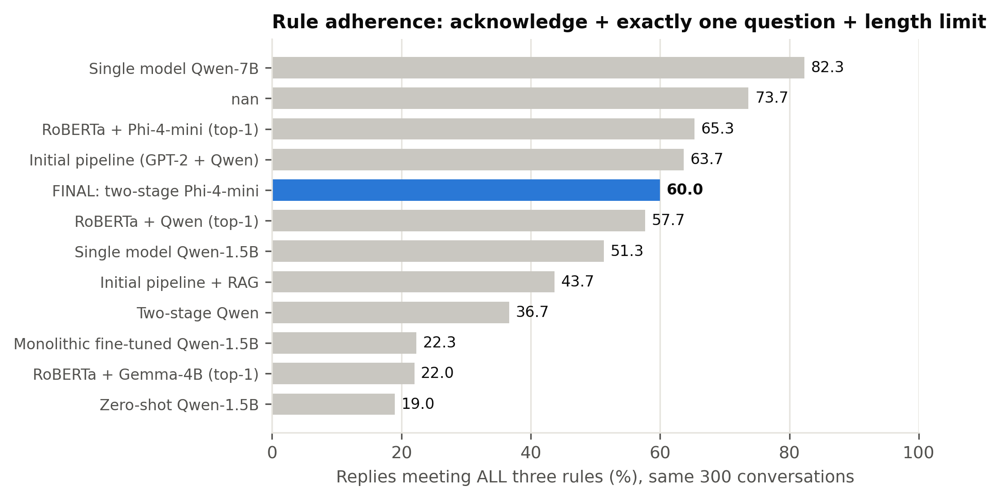
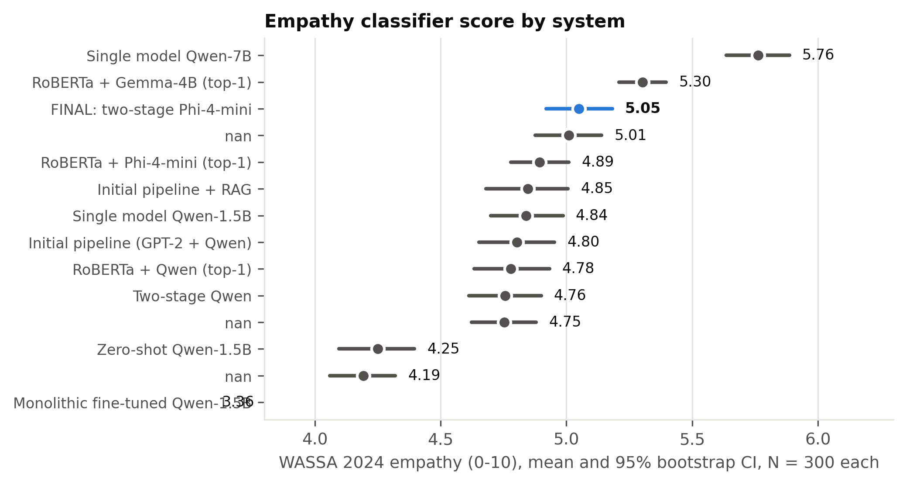
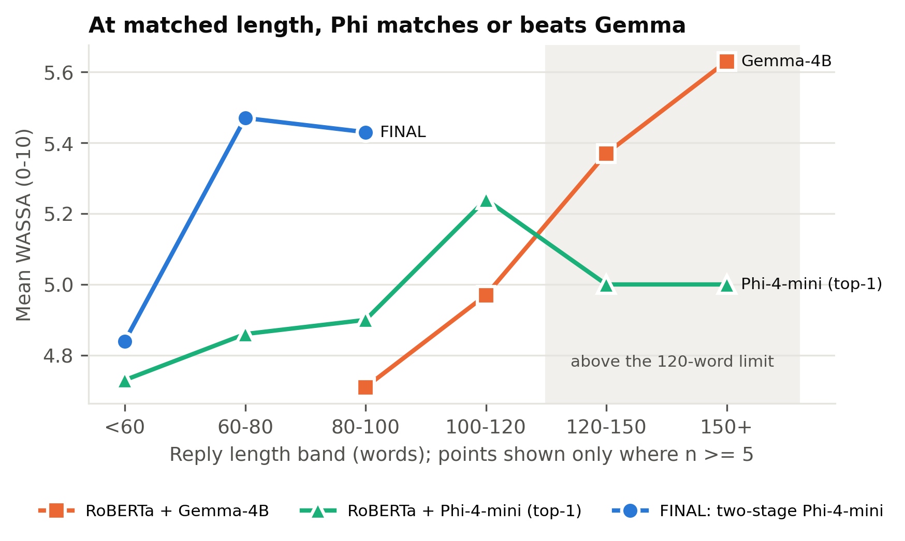

# Chapter 5: Results and Analysis

## 5.1 Performance Evaluation

This section reports the performance of the final system on every evaluation signal, with all alternative designs shown for comparison. The reasons for the differences between designs are analysed in Section 5.2, and their statistical significance in Section 5.4.

### 5.1.1 Experimental Setup

All generation systems respond to the same 300 conversations, sampled with seed 42 from the EmpatheticDialogues test partition, using identical decoding settings (Section 4.1.4). The detector is evaluated on all 2,542 test conversations. The systems are referred to by the names given in Table 5.1, and the **final system** is the two-stage pipeline with a RoBERTa-base detector and a Phi-4-mini generator.

| Setting ID | System | Ack (%) | One question (%) | Length OK (%) | All rules (%) | Mean words | Questions / reply | >1 question (%) | WASSA empathy (0-10) | WASSA SD | Emotion validation (%) | Context awareness (%) | N |
|---|---|---|---|---|---|---|---|---|---|---|---|---|---|
| zero_shot | Zero-shot Qwen2.5-1.5B (no detector, generic prompt) | 81.67 | 22.67 | 83.67 | 19 | 75.92 | 0.42 | 9.33 | 4.25 | 1.31 | 24.67 |  | 300 |
| fine_tuned_fixed | Monolithic LoRA fine-tuned Qwen2.5-1.5B (no detector) | 30 | 74 | 100 | 22.33 | 9.95 | 0.81 | 3.67 | 3.36 | 1.9 | 18.33 |  | 300 |
| single_model_same_size | Single model, same size: Qwen2.5-1.5B detects + responds | 70.67 | 73.67 | 100 | 51.33 | 41.96 | 1.02 | 13.33 | 4.84 | 1.26 | 25.67 |  | 300 |
| single_model_phi | Single model, same generator: Phi-4-mini (4-bit) detects + responds | 77.33 | 96 | 99.33 | 73.67 | 73.48 | 1.04 | 4 | 4.75 | 1.13 | 27 |  | 300 |
| single_model_bigger | Single model, bigger: Qwen2.5-7B (4-bit) detects + responds | 83 | 99 | 100 | 82.33 | 52.95 | 1.01 | 1 | 5.76 | 1.09 | 32.33 |  | 300 |
| prompt_engineered_pipeline | Initial pipeline: GPT-2 Medium d1 + Qwen2.5-1.5B d2 | 70.33 | 87.33 | 100 | 63.67 | 35.21 | 1.07 | 9.33 | 4.8 | 1.33 | 26 | 28.33 | 300 |
| rag_pipeline | Initial pipeline + retrieval (RAG) | 57 | 78 | 100 | 43.67 | 34 | 1.13 | 16.33 | 4.85 | 1.46 | 27.67 | 29.33 | 300 |
| bakeoff_qwen | RoBERTa d1 + Qwen2.5-1.5B d2 (top-1 emotion) | 67.67 | 84.33 | 100 | 57.67 | 34.72 | 1.07 | 10.33 | 4.78 | 1.31 | 25.33 | 31 | 300 |
| bakeoff_gemma | RoBERTa d1 + Gemma-3-4B d2 (top-1 emotion) | 96.67 | 92 | 27.67 | 22 | 133.25 | 1.08 | 8 | 5.3 | 0.84 | 35 | 48.67 | 300 |
| bakeoff_phi | RoBERTa d1 + Phi-4-mini d2 (top-1 emotion) | 72 | 94.67 | 96 | 65.33 | 80.45 | 1.05 | 5 | 4.89 | 1.04 | 28.33 | 36.67 | 300 |
| two_stage_qwen | Two-stage: RoBERTa top-3 -> Qwen2.5-1.5B picks + per-emotion prompt | 47 | 74.33 | 99.67 | 36.67 | 44.15 | 1.17 | 18.67 | 4.76 | 1.29 | 27 | 38 | 300 |
| two_stage_phi | FINAL SYSTEM - Two-stage: RoBERTa top-3 -> Phi-4-mini picks + per-emotion prompt | 66.33 | 92.67 | 100 | 60 | 57.11 | 1.06 | 6.67 | 5.05 | 1.16 | 36.67 | 54.33 | 300 |

*Table 5.1: Rule adherence, reply length, empathy and emotion fidelity of all systems on the same 300 conversations*

### 5.1.2 Emotion Detection

Table 5.2 reports the performance of the final detector. RoBERTa-base reaches **50.3% top-1**, **76.5% top-3** and **84.3% top-5** accuracy, with a macro-F1 score of 49.4%, against a chance level of 3.1% for 32 classes. Performance varies considerably across emotions (Table A.2). *Caring* (F1 70.1%), *lonely* (69.5%) and *jealous* (64.7%) are recognised most reliably, while *angry* (18.2%), *ashamed* (22.2%) and *joyful* (30.9%) are the most difficult. Table 5.3 shows that the most frequent errors occur between closely related labels: *sentimental* is read as *nostalgic* (31 cases), *afraid* as *terrified* (29), *angry* as *furious* (24) and *sad* as *devastated* (23). Many errors are therefore differences in intensity or nuance within the same family of emotions rather than confusions between unrelated feelings, consistent with the error pattern reported for a comparable classifier [31]. This is why the final design passes the three most probable emotions to the generator rather than a single label.

| Metric | Value (%) | Source |
|---|---|---|
| Top-1 accuracy | 50.28 | recomputed from test_predictions.csv |
| Macro-F1 | 49.39 | recomputed from test_predictions.csv |
| Weighted-F1 | 49.73 | recomputed from test_predictions.csv |
| Top-3 accuracy | 76.5 | recorded at training time (model card) |
| Top-5 accuracy | 84.3 | recorded at training time (model card) |
| Chance level (1 of 32) | 3.12 | arithmetic |

*Table 5.2: Overall performance of the final detector on the test partition*

| True emotion | Predicted as | Count | Share of all errors (%) |
|---|---|---|---|
| sentimental | nostalgic | 31 | 2.5 |
| afraid | terrified | 29 | 2.3 |
| angry | furious | 24 | 1.9 |
| sad | devastated | 23 | 1.8 |
| prepared | confident | 20 | 1.6 |
| ashamed | guilty | 19 | 1.5 |
| apprehensive | anxious | 18 | 1.4 |
| anticipating | excited | 16 | 1.3 |
| terrified | afraid | 16 | 1.3 |
| impressed | proud | 14 | 1.1 |
| angry | annoyed | 14 | 1.1 |
| hopeful | confident | 14 | 1.1 |

*Table 5.3: Most frequent confusions made by the final detector*

### 5.1.3 Rule Adherence

Table 5.1 and Figure 5.1 show how often each system's replies acknowledge the user's feeling, ask exactly one question and stay within 120 words. The final system follows all three rules in **60.0%** of replies: 66.3% contain an acknowledgement, 92.7% ask exactly one question and 100% stay within the length limit, with an average length of 57.1 words. Among systems of comparable size, it is exceeded by the top-1 Phi-4-mini configuration (65.3%) and the initial pipeline (63.7%), and it is well ahead of the same-size single model (51.3%), the monolithic fine-tuned model (22.3%) and zero-shot prompting (19.0%). The larger single model, Qwen2.5-7B, has the highest rule adherence at 82.3%. The monolithic fine-tuned model reproduces the style of the listener replies it was trained on: its replies average 10.0 words, 74.0% ask exactly one question, but only 30.0% acknowledge the user's feeling. Real EmpatheticDialogues listener replies behave the same way, satisfying all three rules in only 4.3% of cases and acknowledging the feeling in 10.6%.

*Figure 5.1: Share of replies satisfying all three response rules*

### 5.1.4 Empathy Classifier Score

Figure 5.2 shows the WASSA empathy scores with 95% confidence intervals. The final system scores **5.05**, the highest of all systems no larger than Phi-4-mini, and above the same-size single model (4.84), the initial pipeline (4.80), zero-shot prompting (4.25) and the fine-tuned model (3.36). The fine-tuned model's low score partly reflects the length of its replies, since WASSA scores rise with reply length (Section 5.5.4). Gemma-3-4B (5.30) and the larger single model (5.76) score higher, and Section 5.5 shows that Gemma's advantage is explained by the length of its replies. The classifier outputs coarse ordinal classes, and our replies fall between classes 1 and 7. It was also trained on empathy ratings of turns in peer discussions of news articles. We therefore interpret differences between system averages rather than absolute values; Section 5.4.6 shows that it ranks the systems in nearly the same order as the AI judges.

*Figure 5.2: WASSA empathy score of each system with 95% bootstrap confidence intervals*

### 5.1.5 Emotion Fidelity

To check whether a reply expresses the *right* emotion, and not merely a well-formed one, each reply is passed back through the final detector. We compare the detector's reading of the reply with the true label (**emotion validation**) and with the emotion the system conditioned on (**context awareness**). The final system has the highest emotion validation of all systems at **36.7%**, compared with 32.3% for the larger single model, 28.3% for the top-1 Phi-4-mini configuration, 26.0% for the initial pipeline and 25.7% for the same-size single model. Its context awareness is 54.3%. Two limitations apply to these measures. The detector was trained on user messages rather than replies, so its reading of a reply is noisy. And context awareness uses the same detector that supplied the signal to our pipelines, which may favour them. Emotion validation, which compares against the dataset's independent gold label, is therefore the more trustworthy of the two.

### 5.1.6 Behaviour of the Two-Stage Emotion Selection

Table 5.4 examines the stage-1 decision. The true emotion is among the detector's three best candidates in 78.0% of the 300 evaluation conversations, and every stage-1 output names a valid candidate. The generator overrides the detector's top choice in 40.7% of cases, and its choice matches the gold label in **42.3%** of conversations. This is *lower* than the detector's own top-1 accuracy on the same conversations (50.3%). The final system's gains in empathy and emotion validation therefore do not come from selecting the gold label more often, a finding discussed in Section 5.6.

| Quantity | Value |
|---|---|
| Stage-1 reply parsed to a valid candidate | 100.0% |
| True emotion inside d1's top-3 | 78.0% |
| d1 top-1 equals true emotion | 50.3% |
| d2's pick equals true emotion | 42.3% |
| d2 overrode d1's top-1 | 40.7% |
| Cases only d1 top-1 was right / only d2 pick was right | 46 / 22 |
| Pick minus top-1 accuracy, 95% bootstrap CI | -8.0% [-13.3%, -2.7%] |
| McNemar exact p (pick vs top-1) | 0.0049 |
| N | 300 |

*Table 5.4: Accuracy of the stage-1 emotion selection compared with the detector's top-1 prediction*

### 5.1.7 Diversity and Repetition

Table 5.5 reports distinct-n diversity together with a boilerplate rate, defined as the proportion of replies that contain one of the system's ten most frequent five-word phrases. The final system's Dist-2 of 47.8% is close to that of the initial pipeline (49.5%), but its boilerplate rate is higher (58.7% against 23.7%). Its most repeated phrase, "how are you feeling right", appears in 49 replies. Phi-4-mini prompted with a single generic prompt is the most repetitive system (77.0%), so emotion-specific prompts reduce repetition for the same generator but do not eliminate it, consistent with the repetitive empathic phrasing reported for LLMs [15]. Because these values are computed over 300 replies, they are not comparable with distinct-n scores published for the full test set.

| setting | n_replies | dist_1 | dist_2 | dist_3 | boilerplate_rate | most_repeated_phrase | most_repeated_count |
|---|---|---|---|---|---|---|---|
| zero_shot | 300 | 12.48 | 57.15 | 81.96 | 34.7 | i'm sorry to hear that | 30 |
| fine_tuned_fixed | 300 | 17.35 | 56.09 | 78.16 | 9.7 | how long have you been | 4 |
| rag_pipeline | 300 | 12.6 | 53.62 | 76.91 | 26.7 | is there anything specific about | 25 |
| single_model_same_size | 300 | 11.35 | 50.5 | 73.68 | 35 | is there anything specific about | 23 |
| prompt_engineered_pipeline | 300 | 11.91 | 49.49 | 72.43 | 23.7 | what would you like to | 21 |
| two_stage_phi | 300 | 11.5 | 47.84 | 71.54 | 58.7 | how are you feeling right | 49 |
| single_model_bigger | 300 | 9.76 | 44.63 | 69.33 | 58.7 | i can really understand how | 67 |
| single_model_phi | 300 | 8.62 | 39.12 | 62.4 | 72.3 | it's completely normal to feel | 65 |
| bakeoff_phi | 300 | 7.57 | 35.97 | 59.63 | 77 | it's completely natural to feel | 55 |

*Table 5.5: Lexical diversity and boilerplate repetition of selected systems*

### 5.1.8 AI-Judge Evaluation

Two AI judges, Nemotron 3 Ultra and gpt-oss-120b, selected as described in Section 4.1.5.1, score each reply blind from 1 to 10 for empathy, relevance and safety, and the panel score is the mean of the two judges. They are applied to a stratified sample of 64 conversations, consisting of the shortest and longest message for each of the 32 emotions. Table 5.6 reports the results for all eight judged systems. The larger single model has the highest overall score (**8.90**), followed by the single model built on our own generator (8.78), the **final system (8.68)** and top-1 Phi-4-mini prompting (8.65); then come the same-size single model (8.24), the initial pipeline (8.04), zero-shot prompting (7.51) and the fine-tuned model (5.96). The four leading systems lie within 0.22 points of one another, and Section 5.4.7 shows that the differences among them are not significant. The final system scores 7.84 for empathy, 8.45 for relevance and 9.76 for safety. Empathy is the lowest of the three dimensions for every system, which indicates that the judges treat it as the most demanding criterion. Safety scores are high for every judged system (9.31 to 9.86) except the fine-tuned model (8.67). The two judges differ in severity: Nemotron 3 Ultra gives a lower average score than gpt-oss-120b to every system. Section 5.4.7 tests which of these differences are statistically significant and how closely the judges agree.

**What the judge ranking settles and what it does not.** The final system is third of eight on the panel, and that position has to be read together with what the panel is able to separate. The four leading systems all use a generator of 3.8 billion parameters or more, they lie within 0.22 points of one another, and none of the differences among them survives correction (Section 5.4.7); the judges also award higher scores to longer replies (Section 5.5.4), and of the four the final system writes the shortest ones. What the panel does separate is scale: every system below the four leaders uses a generator of 1.5 billion parameters or fewer. The decision to keep the two-stage design rather than prompt the same generator directly was therefore not taken on the judge scores, which rate the two configurations equally (8.68 against 8.78, p = 0.16), but on the measures that do distinguish them: emotion validation (36.7% against 27.0%), the WASSA empathy classifier (5.05 against 4.75, an advantage that strengthens when reply length is held constant), repetition (boilerplate in 58.7% of replies against 72.3%), length (22% fewer words) and the fact that the emotional decision is visible and can be logged or overridden, set against a cost of 13.7 points of rule adherence. Section 5.5.9 and Table 5.21 give that comparison measure by measure, and Section 5.2.6 combines five of the measures into one ranking in which the final system stands second of eight and first among the systems that fit the 8 GB budget.

| System | N | Nemotron 3 Ultra overall | gpt-oss-120b overall | Panel empathy | Panel relevance | Panel safety | Panel overall |
|---|---|---|---|---|---|---|---|
| Single model, bigger: Qwen2.5-7B (4-bit) detects + responds | 64 | 8.87 | 8.92 | 8.15 | 8.68 | 9.86 | 8.9 |
| Single model, same generator: Phi-4-mini (4-bit) detects + responds | 64 | 8.67 | 8.9 | 8.04 | 8.48 | 9.83 | 8.78 |
| FINAL SYSTEM - Two-stage: RoBERTa top-3 -> Phi-4-mini picks + per-emotion prompt | 64 | 8.58 | 8.79 | 7.84 | 8.45 | 9.76 | 8.68 |
| RoBERTa d1 + Phi-4-mini d2 (top-1 emotion) | 64 | 8.42 | 8.88 | 7.84 | 8.29 | 9.81 | 8.65 |
| Single model, same size: Qwen2.5-1.5B detects + responds | 64 | 8.02 | 8.46 | 7.15 | 8.02 | 9.56 | 8.24 |
| Initial pipeline: GPT-2 Medium d1 + Qwen2.5-1.5B d2 | 64 | 7.78 | 8.29 | 6.98 | 7.63 | 9.5 | 8.04 |
| Zero-shot Qwen2.5-1.5B (no detector, generic prompt) | 64 | 6.79 | 8.23 | 5.98 | 7.23 | 9.31 | 7.51 |
| Monolithic LoRA fine-tuned Qwen2.5-1.5B (no detector) | 64 | 5.69 | 6.23 | 3.88 | 5.33 | 8.67 | 5.96 |

*Table 5.6: Average AI-judge scores (1-10) by system*

### 5.1.9 Human Evaluation

To validate the automatic and AI-judge results, we conducted a forced-choice study with human participants (Table A.3). Participants read 13 situations and, for each one, chose which of three replies "best understands and responds to how this person is feeling": the reply from the final system, from the same-size single model, or from the larger single model, presented in counterbalanced order. This three-way design adapts the pairwise preference judgements used in comparable studies [28], [29] to compare three systems within a limited number of items. The situations cover 13 different emotions, including four central to supportive conversation (sad, lonely, angry and anxious) and three drawn from student life. Two items include an obviously poor reply as an attention check. [[PENDING: number of participants; number excluded by the attention checks; selection rate of each system against the chance level of 33.3%, with binomial tests; Fleiss' kappa; and agreement between the human majority choice and the system scored highest by the AI judges.]]

| System | Times chosen | Selection rate (%) | Binomial p vs 33.3% chance |
|---|---|---|---|
| FINAL SYSTEM - Two-stage: RoBERTa top-3 -> Phi-4-mini picks + per-emotion prompt | [[PENDING - human evaluation responses not yet collected]] | [[PENDING - human evaluation responses not yet collected]] | [[PENDING - human evaluation responses not yet collected]] |
| Single model, same size: Qwen2.5-1.5B detects + responds | [[PENDING - human evaluation responses not yet collected]] | [[PENDING - human evaluation responses not yet collected]] | [[PENDING - human evaluation responses not yet collected]] |
| Single model, bigger: Qwen2.5-7B (4-bit) detects + responds | [[PENDING - human evaluation responses not yet collected]] | [[PENDING - human evaluation responses not yet collected]] | [[PENDING - human evaluation responses not yet collected]] |

*Table 5.7: Human-evaluation results (to be completed)*

### 5.1.10 Case Study

[[TEAM TO FILL: two or three conversations presented as a table, giving the user's message followed by the reply of each system. To avoid selecting favourable examples, use items from the human evaluation, which were drawn at random, and state this in the text.]]

## 5.2 Analysis of Design Solutions

Section 5.1 reported how each design performs. This section compares the design alternatives, explains the differences between them, and closes with an assessment against criteria beyond raw performance.

### 5.2.1 Decoupled versus Monolithic Designs

The central design question is whether emotion detection should be performed by a separate model. To answer it, we compare the decoupled designs with four monolithic alternatives responding to the same conversations (Table 5.1).

**Fine-tuning a single model end to end teaches the dataset's style, not the desired behaviour.** The generator fine-tuned with LoRA writes short, casual replies (10.0 words on average) that usually ask a question (74.0% ask exactly one) but seldom acknowledge the user's feeling (30.0%), so it follows all rules in only 22.3% of replies and has the lowest WASSA score (3.36), emotion validation (18.3%) and AI-judge scores (empathy 3.88, overall 5.96) of all systems. It faithfully learns its training data: real listener replies in EmpatheticDialogues acknowledge the feeling in only 10.6% of cases and satisfy all three rules in 4.3%. **Zero-shot prompting without an emotion or rules** keeps replies to a moderate length but asks the required single question in only 22.7% of replies (19.0% satisfy all rules), and has the second-lowest empathy score (WASSA 4.25). **A same-size single model instructed to detect the emotion and respond in one step** closes part of the gap (51.3% of replies satisfy all rules, WASSA 4.84), but its replies are barely more faithful to the true emotion than those of zero-shot prompting (25.7% against 24.7% emotion validation). The final decoupled system, whose generator is about 2.5 times the size of this baseline, reaches 60.0% rule adherence, WASSA 5.05 and 36.7% emotion validation. The improvements in empathy and emotion validation are statistically significant after correction for multiple comparisons, whereas the improvement in rule adherence is not (Section 5.4).

**The decoupled design, not the generator, produces the empathy gain.** The strongest test of the design is the single model built on the final system's own generator, Phi-4-mini, prompted to detect the emotion and respond in one pass. It reaches high rule adherence (73.7%), but its empathy and emotional fidelity stay at the level of the smaller single model (WASSA 4.75 against 4.84; emotion validation 27.0% against 25.7%). Adding the detector and emotion-specific guidance to that same generator raises WASSA to 5.05 and emotion validation to 36.7%, both significant after correction (Section 5.5.9). The decoupled system does, however, follow all three rules less often than this baseline (60.0% against 73.7%), because its prompt must carry emotion-specific guidance as well as the rules. At an equal generator the design therefore buys empathy and emotional fidelity at some cost in rule adherence.

**A larger single model remains stronger.** Qwen2.5-7B [22], prompted to detect the emotion and respond in one step, achieves the best rule adherence (82.3%) and WASSA score (5.76) of all systems, and the highest AI-judge score of all judged systems (8.90, against 8.68 for the final system). The same-size and larger single models use the same prompt, so model capacity, rather than the decoupled structure, explains most of this difference. The advantage of the decoupled design is therefore not raw output quality. It lies in making the emotional reasoning explicit and inspectable at a smaller scale, and in allowing the generator to receive emotion-specific guidance, which Section 5.2.4 shows to be important.

### 5.2.2 Detector Alternatives

Two findings shaped the choice of detector. First, **the text a detector is trained on matters more than the network used**. Training GPT-2 Medium on situation descriptions but deploying it on user messages cost about nine percentage points of accuracy (56.9% against 48.2%), and retraining on the input received in use was the largest single improvement to the detector (Table 4.3). Second, among encoders trained on the correct input, **models of the same size are statistically indistinguishable on top-1 accuracy** (48.8-50.2%), and RoBERTa-base differs only in the quality of its ranking, with top-5 accuracy of 85.0% against 81.7-82.7% (Table 4.4). RoBERTa-large adds 2.9 points of top-1 accuracy at 7.4 times the training cost. When RoBERTa-large was substituted into the final pipeline, rule adherence, WASSA empathy and emotion validation were all unchanged (Section 5.4.3), so RoBERTa-base offers the best balance.

### 5.2.3 Generator Alternatives

With the detector and prompt held fixed, the choice of generator determines rule adherence: 65.3% for Phi-4-mini, 57.7% for Qwen2.5-1.5B and 22.0% for Gemma-3-4B (Table 4.5). Gemma is the instructive case. It acknowledges feelings in 96.7% of replies and has a higher WASSA score than Phi-4-mini (5.30 against 4.89), which might suggest that it is the more empathetic model. However, it disregards the length rule, averaging 133 words with 72% of replies over the limit, and WASSA scores rise with reply length in every system (Section 5.5). When replies of similar length are compared (Figure 5.3, Table A.4), Phi-4-mini matches or exceeds Gemma in every length band in which both have replies, and Gemma's advantage appears only above 120 words. Gemma's apparent advantage in empathy is therefore an effect of reply length, echoing the observation that longer LLM responses may be mistaken for greater empathy [15]. Its failure to respect the length constraint rules it out for a support setting in which brevity is a requirement.

*Figure 5.3: WASSA empathy score by reply length for Gemma-3-4B, Phi-4-mini (top-1) and the final system*

### 5.2.4 Integration Alternatives

To assess the contribution of the two-stage design, we compare it with a system that uses the same detector and generator but passes only the top-1 emotion with a generic prompt. With Phi-4-mini, the two-stage design raises emotion validation from 28.3% to 36.7% and WASSA empathy from 4.89 to 5.05, both significant after correction, and shortens replies from 80.4 to 57.1 words. Its rule adherence is 5.3 points lower (60.0% against 65.3%), a difference that is not statistically significant. The benefit depends on the capacity of the generator: with Qwen2.5-1.5B, two-stage prompting lowers rule adherence to 36.7% (against 57.7% with top-1) and acknowledgement to 47.0%, consistent with the earlier finding that a small model loses rule-following when given more to reason about, as with the candidate-pick variant (54.0%, Table 4.6). The larger instruction-tuned generator can use the richer, emotion-specific prompt without losing control of the output format. This comparison removes three elements together: the top-3 selection, the emotion-specific guidance and the attention cues. Their individual contributions were not separated, so the improvement is attributed to the combined design.

### 5.2.5 Retrieval Augmentation

Providing the generator with one or two similar training conversations [25] reduced rule adherence in both versions tested, to 54.3% and 43.7% against 63.7% without retrieval (Table 4.7). The retrieved listener replies model a different style from the one the rules require, since only 4.3% of EmpatheticDialogues listener replies satisfy all three rules, and compliance with the one-question rule fell to 76.0% in the first version. Filtering the examples and adding a further reminder about questions instead reduced acknowledgement from 70.3% to 57.0%. Retrieval also produced the least consistent empathy scores of any system, with a WASSA standard deviation of 1.46. For this task, examples of real human replies conflict with explicit behavioural rules rather than reinforcing them.

### 5.2.6 Multi-Criteria Assessment

Table 5.8 assesses the main alternatives against criteria beyond performance: cost, efficiency, usability and maintainability.

| Design | Performance (all rules / WASSA / emotion validation) | Cost to build | Efficiency (model size, GPU memory) | Usability and inspectability | Maintainability |
|---|---|---|---|---|---|
| Monolithic fine-tuned 1.5B | 22.3% / 3.36 / 18.3% | GPU training | 1.5B | No emotion exposed; casual replies that rarely acknowledge feelings | Retraining needed to change behaviour |
| Zero-shot 1.5B | 19.0% / 4.25 / 24.7% | None | 1.5B | No emotion exposed | Prompt edit |
| Single model 1.5B (detect and respond) | 51.3% / 4.84 / 25.7% | None | 1.5B | Emotion hidden inside the model | Prompt edit |
| Single model 7.6B (detect and respond) | 82.3% / 5.76 / 32.3% | None | 7.6B, about 5.6 GB (4-bit) | Emotion hidden inside the model | Prompt edit |
| Initial pipeline (GPT-2 + Qwen 1.5B) | 63.7% / 4.80 / 26.0% | Detector training | 0.36B + 1.5B | Top-1 emotion visible | Components independent |
| Initial pipeline with retrieval | 43.7% / 4.85 / 27.7% | Retrieval index | Adds an embedding model | Retrieved examples visible | Additional component |
| RoBERTa + Gemma-3-4B | 22.0% / 5.30 / 35.0% | Detector training | 0.13B + 4B (4-bit) | Top-1 emotion visible | Components independent |
| **Final: two-stage RoBERTa + Phi-4-mini** | 60.0% / 5.05 / 36.7% | Detector training (8.8 min) | 0.13B + 3.8B (4-bit) | Top-3 candidates, chosen emotion and cue words visible | Detector, prompts and generator independently replaceable |

*Table 5.8: Assessment of the main design alternatives against multiple criteria*

We select the two-stage design with a RoBERTa-base detector and a Phi-4-mini generator. Among designs of comparable size, it produces the most emotionally faithful replies and the highest empathy scores, its rule adherence is statistically indistinguishable from that of the best small configuration, and it is the only design that exposes its complete emotional reasoning. The larger single model outperforms it in raw quality. This trade-off is reported openly, and Section 5.6 discusses when the larger model would be the better choice.

Because the measures disagree with one another, Table 5.9 summarises them in a single ranking. Each of five independent measures, namely rule adherence, WASSA empathy, emotion validation, AI-judge empathy and freedom from boilerplate, is standardised across the systems and the five standardised values are averaged with equal weight. Nothing is tuned: the weights are equal, every judged system is included, and the measures are the ones already reported in Table 5.1.

The final system ranks **second of eight**, behind only the 7.6-billion-parameter single model, which requires 1.9 times as many parameters and 62% more GPU memory (Section 5.5.7). It is ahead of the single model built on its own generator (+0.50 against +0.09), of top-1 prompting with that generator (+0.04) and of the same-size single model (+0.06). **Among the systems that fit the 8 GB budget set as an objective in Section 4.1.1, the final system ranks first.** The ranking is not an artefact of one favourable measure: removing any single measure leaves the final system in second or third place, always behind the larger single model.

A composite of this kind depends on which measures are included, so it is reported as a summary of the per-measure results rather than as evidence in its own right. The per-measure comparisons in Sections 5.4.2 and 5.5.9, with their significance tests, remain the basis for the conclusions of this thesis.

| System | All rules (%) | WASSA empathy | Emotion validation (%) | AI-judge empathy | Non-repetition (%) | Composite (equal weights) |
|---|---|---|---|---|---|---|
| Single model, bigger: Qwen2.5-7B (4-bit) detects + responds | 82.33 | 5.76 | 32.33 | 8.15 | 41.3 | 0.79 |
| FINAL SYSTEM - Two-stage: RoBERTa top-3 -> Phi-4-mini picks + per-emotion prompt | 60 | 5.05 | 36.67 | 7.84 | 41.3 | 0.5 |
| Initial pipeline: GPT-2 Medium d1 + Qwen2.5-1.5B d2 | 63.67 | 4.8 | 26 | 6.98 | 76.3 | 0.24 |
| Single model, same generator: Phi-4-mini (4-bit) detects + responds | 73.67 | 4.75 | 27 | 8.04 | 27.7 | 0.09 |
| Single model, same size: Qwen2.5-1.5B detects + responds | 51.33 | 4.84 | 25.67 | 7.15 | 65 | 0.06 |
| RoBERTa d1 + Phi-4-mini d2 (top-1 emotion) | 65.33 | 4.89 | 28.33 | 7.84 | 23 | 0.04 |
| Zero-shot Qwen2.5-1.5B (no detector, generic prompt) | 19 | 4.25 | 24.67 | 5.98 | 65.3 | -0.59 |
| Monolithic LoRA fine-tuned Qwen2.5-1.5B (no detector) | 22.33 | 3.36 | 18.33 | 3.88 | 90.3 | -1.13 |

*Table 5.9: Equal-weight composite of five independent measures across the judged systems*

## 5.3 Final Design Adjustments

The performance evaluation of the initial pipeline, which combined a GPT-2 Medium detector with a Qwen2.5-1.5B generator, identified several weaknesses. Each adjustment described in this section was made in response to a measured result and was re-evaluated on the same conversations before being kept. Table 5.10 summarises all adjustments.

| ID | Problem found | Evidence | Adjustment | Measured effect |
|---|---|---|---|---|
| A1 | d1 trained on situation text but fed user messages | Accuracy 56.9% -> 48.2% on real input | Retrain on first user message; switch GPT-2 -> RoBERTa-base | 50.3% top-1 on real input (+2.1 pp over honest GPT-2 number) |
| A2 | Qwen2.5-1.5B d2 limited rule adherence | Bake-off: Phi 65.3% vs Qwen 57.7% vs Gemma 22.0% all-rules | Adopt Phi-4-mini (4-bit) | Best rule adherence at equal prompt |
| A3 | d1 top-1 wrong half the time, but right answer often nearby | Gold in top-3 = 76.5% | Two-stage: d2 picks from top-3, then emotion-specific prompt | Emotion validation 28.3% -> 36.7%; WASSA 4.89 -> 5.05 (both significant) |
| A4 | Generic prompt gives generic replies | Boilerplate phrasing; P2 feedback on depth | 32 per-emotion focus/avoid prompts | Part of A3 gain |
| A5 | Attention mechanism in original design not implemented | Default attention backend returned no weights | Eager attention + [CLS] attention cues passed to d2 | Words that drove detection visible and used |
| A6 | Single message misread in conversation | 'I am okay. Well, not properly.' read as content (72%) | d1 reads last 4 user turns | Correctly read as angry with context |
| A7 | Fixed one-question rule becomes interrogation over many turns | Rule designed for single turn | Question optional from turn 2; no repeated phrasing | Keeps turn-1 comparability |
| A8 | RAG suggested by P2 panel | All rules 63.7% -> 43.7% | Not adopted | Documented negative result |
| A10 | Could a larger detector improve replies? | RoBERTa-large: +2.9 pp top-1 on the test split | Swapped RoBERTa-large into the final pipeline (same 300 conversations) | No reply-quality measure improved (all rules p=0.16, WASSA p=0.43, validation p=0.68); not adopted |
| A11 | LoRA fine-tuned baseline never ended its replies | 99% of replies hit the 250-token limit; the padding token was the end-of-turn token (im_end), so it was masked from the loss | Retrained with Qwen's own pad token, a start-up check, and published LoRA settings (lr 2e-4, dropout 0.1, weight decay 0.01, 6% warm-up, best epoch by validation loss) | Replies 200.7 -> 10.0 words, 0% at the token limit; all rules 0.0% -> 22.3%; still far below the final system (60.0%) |
| A9 | Repetition in Phi replies | Boilerplate 58.7% (two-stage) | Deferred: repetition_penalty 1.1 | Future work - would invalidate in-progress judging |

*Table 5.10: Summary of design adjustments, the evidence behind each and its measured effect*

### 5.3.1 Detector: Correcting the Training Input

Evaluating the initial detector on the input it actually receives revealed a mismatch between training and use. The model had been trained on the dataset's situation descriptions, which state the feeling explicitly, but the pipeline supplied the user's conversational message instead. The two texts are identical in only 11.7% of conversations, and accuracy fell from 56.9% on situation descriptions to 48.2% on user messages (Table 4.3). We retrained the detector on first utterances and, following the comparison of encoder models in Section 4.2.2, replaced GPT-2 Medium with RoBERTa-base. The adjusted detector reaches 50.3% top-1 and 84.3% top-5 accuracy on the real input, so its reported accuracy now reflects its use, and the quality of ranking needed for top-3 selection is improved.

### 5.3.2 Generator and Prompting

**Generator replacement (A2).** With the adjusted detector held fixed, the comparison of generators showed Phi-4-mini achieving higher rule adherence (65.3%) than the original Qwen2.5-1.5B (57.7%), so Phi-4-mini replaced Qwen as d2, loaded with 4-bit quantisation to fit in memory.

**Two-stage emotion selection (A3).** The adjusted detector's top-1 label is wrong in about half of conversations, but the correct label is among its three best candidates in 76.5% of cases. The earlier candidate-pick experiment showed that asking the generator to choose the emotion and respond in a single call degrades rule-following, so the choice was separated into a deterministic selection call followed by a separate generation call.

**Emotion-specific prompts (A4).** A generic instruction such as "the user is feeling X" gives the generator no guidance on how a response to *lonely* should differ from a response to *proud*. We therefore wrote guidance on what to focus on and what to avoid for each of the 32 emotions. With the detector and Phi-4-mini held fixed, adjustments A3 and A4, together with the attention cues (A5), raised emotion validation from 28.3% to 36.7% and WASSA empathy from 4.89 to 5.05 relative to top-1 prompting without them. Both improvements are significant after correction, while the change in rule adherence (-5.3 points) is not. Replies also became shorter (57.1 against 80.4 words), and every reply stayed within the length limit.

### 5.3.3 Implementing the Attention Mechanism

The original design specified an attention mechanism, but it had not been implemented. When extraction of the detector's attention weights was added, verification revealed that the default attention implementation of the Transformers library returned no weights without raising an error, which would have left the feature inactive while appearing to work. The adjustment selects an implementation that returns attention weights, stops execution if the weights are missing, and passes the words receiving the most attention to the generator as context cues. It also expands sub-word fragments to whole words and limits the cues to the top 40% of word spans, so that the cues do not simply repeat the entire message.

### 5.3.4 Developing the Final Solution: A Multi-Turn Conversational Agent

The single-turn evaluation assumes one message and one reply. Extending the solution into a conversational agent required three further adjustments.

**Detector context window (A6).** Classifying only the latest message discards context. For example, "I am okay. Well, not properly." read on its own is classified as *content* with 72% confidence, although in context the user was expressing anger. Conversational context is known to be important for recognising emotions in dialogue, so we tested several context windows on long conversational scenarios. A window of four user turns was best or joint best in three of four scenarios, whereas six turns degraded two scenarios, in one case changing a breakup scenario to the wrong emotion with 64% confidence as emotions from earlier turns competed with the current one. The final agent therefore classifies the user's last four turns.

**Generator memory (A7).** The generator receives the last ten exchanges verbatim rather than a summary, so that it can avoid repeating itself without losing emotional detail through summarisation.

**Turn-aware rules.** A mandatory single question suits a first reply, but over a long conversation it turns the exchange into an interrogation. From the second turn onward, the question is therefore optional and repetition of earlier phrasing is discouraged, while the first turn keeps the original rules so that single-turn results remain valid. The agent also detects when the user's emotion changes between turns and instructs the generator to respond to the current emotion.

A web demonstration of the agent was prepared for Hugging Face Spaces, with disclaimers and crisis resources displayed on the page. [[TEAM TO FILL: the public URL and date of deployment, or a statement that the demonstration was prepared but not deployed.]]

### 5.3.5 Rejected and Deferred Adjustments

Not every candidate adjustment was adopted. **Retrieval augmentation (A8)** [25] reduced rule adherence from 63.7% to 43.7% and was rejected (Section 5.4). **A larger detector (A10)** was also tested. RoBERTa-large is 2.9 points more accurate on the test partition, but when substituted into the final pipeline it improved no measure of reply quality: rule adherence changed from 60.0% to 54.7% (p = 0.16), WASSA empathy from 5.05 to 5.01 (p = 0.43), and emotion validation from 36.7% to 38.0% (p = 0.68). RoBERTa-base was therefore kept, and the conversational agent was not changed. Two further adjustments were **deferred to future work**. A repetition penalty (A9) could reduce the final system's boilerplate rate of 58.7%, but regenerating the final outputs would have invalidated the AI-judge scores and the human-evaluation items that were based on them. A pre-generation crisis filter is required before any public deployment (Section 3.4).

**Correcting the fine-tuned baseline (A11).** Checking the monolithic LoRA baseline revealed a configuration error. Its training script used the end-of-turn token `<|im_end|>` as the padding token, and the data collator excludes padding tokens from the loss, so the model was never trained to end a reply. As a result, 99% of its replies ran to the 250-token limit, averaging 200.7 words and 7.07 questions, and none followed all three rules. We retrained the baseline with Qwen's own padding token, a start-up check that aborts training if the end-of-turn token would be masked, and the published LoRA settings described in Section 4.2.7; the best epoch was selected by validation loss. The corrected model ends its replies normally (10.0 words on average, none reaching the limit) and follows all rules in 22.3% of replies. All results in this thesis use the corrected baseline; the original run is reported here only as a documented error.

The final configuration after all adjustments is listed in Table 4.8.

## 5.4 Statistical Analysis

This section determines which of the differences reported in Sections 5.1 and 5.2 are statistically reliable and which could have arisen by chance.

### 5.4.1 Statistical Methodology

Every generation system responds to the same 300 conversations and every detector is tested on the same 2,542 conversations, so all comparisons are **paired**. For binary outcomes per reply, namely whether all rules were followed, whether an acknowledgement was present, whether exactly one question was asked, whether the reply expressed the true emotion, and whether a classification was correct, we use **McNemar's exact test**, which considers only the conversations on which the two systems disagree. For continuous scores, namely WASSA empathy and AI-judge ratings, we use the **Wilcoxon signed-rank test**, which does not assume normally distributed differences. For each comparison we report the mean paired difference with a **95% bootstrap confidence interval**, computed from 10,000 resamples of conversations with seed 42. Because the final system is compared with seven baselines on each measure (six for the AI-judge scores), the p-values within each measure are adjusted with the **Holm-Bonferroni procedure**. **A difference is considered significant only if its adjusted p-value is below 0.05 and its confidence interval excludes zero.** Comparisons between independent groups, as in the error-propagation analysis, use Fisher's exact test for binary outcomes and the Mann-Whitney U test for scores.

### 5.4.2 Final System versus Baselines

Table 5.11 reports all comparisons between the final system and the baselines. Three patterns emerge.

**Empathy and emotion fidelity improve significantly over comparable designs.** The final system's WASSA score exceeds that of every baseline except the larger single model: it is higher than the same-size single model by 0.21 points (95% CI [+0.08, +0.35], adjusted p = 0.012), the initial pipeline by 0.25 points ([+0.10, +0.39], p = 0.003), and the same generator with top-1 prompting by 0.16 points ([+0.05, +0.26], p = 0.008) and **the same generator used alone as a single model by 0.30 points** ([+0.19, +0.41], p < 0.001). Emotion validation is also higher than for every baseline except the larger single model, by 8.3 to 18.3 percentage points (all adjusted p < 0.013), including 9.7 points over the same generator used alone (p = 0.007). The difference from the larger single model, 4.3 points, is not significant (p = 0.19). Because the single-model baseline on the same generator scores no better than the 1.5-billion-parameter one on these two measures, the gains are attributable to the decoupled design rather than to generator size (Section 5.5.9).

**Rule adherence does not significantly exceed that of the same-size single model after correction.** The final system follows all rules in 60.0% of replies, compared with 51.3% for the same-size single model, a difference of 8.7 points (CI [+1.0, +16.3]). The unadjusted p-value is 0.032, but after Holm correction it is 0.095, so this difference is not claimed. The final system is significantly better than zero-shot prompting (+41.0 points), the fine-tuned model (+37.7) and the retrieval-augmented pipeline (+16.3), and does not differ significantly from the initial pipeline (-3.7) or from top-1 prompting with Phi-4-mini (-5.4). It is significantly **lower** than the same generator used alone as a single model (-13.7 points, adjusted p = 0.002) and than the larger single model (-22.3), the trade-off discussed in Section 5.5.9. On the one-question rule alone, it is significantly better than the same-size single model (+19.0 points, p < 0.001).

**The larger single model is significantly better on rules and empathy.** Qwen2.5-7B exceeds the final system in overall rule adherence (-22.3 points), acknowledgement (-16.7), the one-question rule (-6.3) and WASSA empathy (-0.71), and all of these differences are significant after correction.

| Metric | Final system vs | N | Final | Baseline | Difference | 95% CI | Test | p | p (Holm-adjusted) | Significant? |
|---|---|---|---|---|---|---|---|---|---|---|
| All rules | Single model, same generator: Phi-4-mini (4-bit) detects + responds | 300 | 60 | 73.67 | -13.67 | [-21.00, -6.33] | McNemar exact | 0 | 0 | YES |
| All rules | Single model, same size: Qwen2.5-1.5B detects + responds | 300 | 60 | 51.33 | 8.67 | [+1.00, +16.33] | McNemar exact | 0.03 | 0.1 | no |
| All rules | Single model, bigger: Qwen2.5-7B (4-bit) detects + responds | 300 | 60 | 82.33 | -22.33 | [-29.33, -15.33] | McNemar exact | 0 | 0 | YES |
| All rules | Zero-shot Qwen2.5-1.5B (no detector, generic prompt) | 300 | 60 | 19 | 41 | [+34.00, +47.67] | McNemar exact | 0 | 0 | YES |
| All rules | Monolithic LoRA fine-tuned Qwen2.5-1.5B (no detector) | 300 | 60 | 22.33 | 37.67 | [+30.33, +45.00] | McNemar exact | 0 | 0 | YES |
| All rules | Initial pipeline: GPT-2 Medium d1 + Qwen2.5-1.5B d2 | 300 | 60 | 63.67 | -3.67 | [-11.00, +3.67] | McNemar exact | 0.37 | 0.39 | no |
| All rules | Initial pipeline + retrieval (RAG) | 300 | 60 | 43.67 | 16.33 | [+8.33, +24.00] | McNemar exact | 0 | 0 | YES |
| All rules | RoBERTa d1 + Phi-4-mini d2 (top-1 emotion) | 300 | 60 | 65.33 | -5.33 | [-13.00, +2.00] | McNemar exact | 0.19 | 0.39 | no |
| Acknowledgement | Single model, same generator: Phi-4-mini (4-bit) detects + responds | 300 | 66.33 | 77.33 | -11 | [-18.00, -4.00] | McNemar exact | 0 | 0.01 | YES |
| Acknowledgement | Single model, same size: Qwen2.5-1.5B detects + responds | 300 | 66.33 | 70.67 | -4.33 | [-11.33, +2.67] | McNemar exact | 0.24 | 0.48 | no |
| Acknowledgement | Single model, bigger: Qwen2.5-7B (4-bit) detects + responds | 300 | 66.33 | 83 | -16.67 | [-23.33, -10.00] | McNemar exact | 0 | 0 | YES |
| Acknowledgement | Zero-shot Qwen2.5-1.5B (no detector, generic prompt) | 300 | 66.33 | 81.67 | -15.33 | [-21.67, -8.67] | McNemar exact | 0 | 0 | YES |
| Acknowledgement | Monolithic LoRA fine-tuned Qwen2.5-1.5B (no detector) | 300 | 66.33 | 30 | 36.33 | [+29.00, +43.67] | McNemar exact | 0 | 0 | YES |
| Acknowledgement | Initial pipeline: GPT-2 Medium d1 + Qwen2.5-1.5B d2 | 300 | 66.33 | 70.33 | -4 | [-10.67, +2.67] | McNemar exact | 0.28 | 0.48 | no |
| Acknowledgement | Initial pipeline + retrieval (RAG) | 300 | 66.33 | 57 | 9.33 | [+2.33, +16.33] | McNemar exact | 0.01 | 0.05 | no |
| Acknowledgement | RoBERTa d1 + Phi-4-mini d2 (top-1 emotion) | 300 | 66.33 | 72 | -5.67 | [-12.67, +1.33] | McNemar exact | 0.13 | 0.4 | no |
| One question | Single model, same generator: Phi-4-mini (4-bit) detects + responds | 300 | 92.67 | 96 | -3.33 | [-7.00, +0.33] | McNemar exact | 0.11 | 0.22 | no |
| One question | Single model, same size: Qwen2.5-1.5B detects + responds | 300 | 92.67 | 73.67 | 19 | [+13.33, +25.00] | McNemar exact | 0 | 0 | YES |
| One question | Single model, bigger: Qwen2.5-7B (4-bit) detects + responds | 300 | 92.67 | 99 | -6.33 | [-9.67, -3.33] | McNemar exact | 0 | 0 | YES |
| One question | Zero-shot Qwen2.5-1.5B (no detector, generic prompt) | 300 | 92.67 | 22.67 | 70 | [+64.67, +75.33] | McNemar exact | 0 | 0 | YES |
| One question | Monolithic LoRA fine-tuned Qwen2.5-1.5B (no detector) | 300 | 92.67 | 74 | 18.67 | [+12.67, +24.67] | McNemar exact | 0 | 0 | YES |
| One question | Initial pipeline: GPT-2 Medium d1 + Qwen2.5-1.5B d2 | 300 | 92.67 | 87.33 | 5.33 | [+0.67, +10.00] | McNemar exact | 0.04 | 0.12 | no |
| One question | Initial pipeline + retrieval (RAG) | 300 | 92.67 | 78 | 14.67 | [+8.67, +20.33] | McNemar exact | 0 | 0 | YES |
| One question | RoBERTa d1 + Phi-4-mini d2 (top-1 emotion) | 300 | 92.67 | 94.67 | -2 | [-6.00, +1.67] | McNemar exact | 0.39 | 0.39 | no |
| Emotion validation | Single model, same generator: Phi-4-mini (4-bit) detects + responds | 300 | 36.67 | 27 | 9.67 | [+3.67, +15.33] | McNemar exact | 0 | 0.01 | YES |
| Emotion validation | Single model, same size: Qwen2.5-1.5B detects + responds | 300 | 36.67 | 25.67 | 11 | [+5.00, +17.00] | McNemar exact | 0 | 0 | YES |
| Emotion validation | Single model, bigger: Qwen2.5-7B (4-bit) detects + responds | 300 | 36.67 | 32.33 | 4.33 | [-1.67, +10.33] | McNemar exact | 0.19 | 0.19 | no |
| Emotion validation | Zero-shot Qwen2.5-1.5B (no detector, generic prompt) | 300 | 36.67 | 24.67 | 12 | [+6.00, +17.67] | McNemar exact | 0 | 0 | YES |
| Emotion validation | Monolithic LoRA fine-tuned Qwen2.5-1.5B (no detector) | 300 | 36.67 | 18.33 | 18.33 | [+12.33, +24.33] | McNemar exact | 0 | 0 | YES |
| Emotion validation | Initial pipeline: GPT-2 Medium d1 + Qwen2.5-1.5B d2 | 300 | 36.67 | 26 | 10.67 | [+5.00, +16.33] | McNemar exact | 0 | 0 | YES |
| Emotion validation | Initial pipeline + retrieval (RAG) | 300 | 36.67 | 27.67 | 9 | [+3.00, +15.00] | McNemar exact | 0.01 | 0.01 | YES |
| Emotion validation | RoBERTa d1 + Phi-4-mini d2 (top-1 emotion) | 300 | 36.67 | 28.33 | 8.33 | [+3.00, +13.67] | McNemar exact | 0 | 0.01 | YES |
| WASSA empathy | Single model, same generator: Phi-4-mini (4-bit) detects + responds | 300 | 5.05 | 4.75 | 0.3 | [+0.19, +0.41] | Wilcoxon signed-rank | 0 | 0 | YES |
| WASSA empathy | Single model, same size: Qwen2.5-1.5B detects + responds | 300 | 5.05 | 4.84 | 0.21 | [+0.08, +0.35] | Wilcoxon signed-rank | 0.01 | 0.01 | YES |
| WASSA empathy | Single model, bigger: Qwen2.5-7B (4-bit) detects + responds | 300 | 5.05 | 5.76 | -0.71 | [-0.84, -0.58] | Wilcoxon signed-rank | 0 | 0 | YES |
| WASSA empathy | Zero-shot Qwen2.5-1.5B (no detector, generic prompt) | 300 | 5.05 | 4.25 | 0.8 | [+0.66, +0.94] | Wilcoxon signed-rank | 0 | 0 | YES |
| WASSA empathy | Monolithic LoRA fine-tuned Qwen2.5-1.5B (no detector) | 300 | 5.05 | 3.36 | 1.69 | [+1.48, +1.90] | Wilcoxon signed-rank | 0 | 0 | YES |
| WASSA empathy | Initial pipeline: GPT-2 Medium d1 + Qwen2.5-1.5B d2 | 300 | 5.05 | 4.8 | 0.25 | [+0.10, +0.39] | Wilcoxon signed-rank | 0 | 0 | YES |
| WASSA empathy | Initial pipeline + retrieval (RAG) | 300 | 5.05 | 4.85 | 0.2 | [+0.05, +0.36] | Wilcoxon signed-rank | 0.01 | 0.01 | YES |
| WASSA empathy | RoBERTa d1 + Phi-4-mini d2 (top-1 emotion) | 300 | 5.05 | 4.89 | 0.16 | [+0.05, +0.26] | Wilcoxon signed-rank | 0 | 0.01 | YES |

*Table 5.11: Paired significance tests comparing the final system with each baseline*

### 5.4.3 Is the Detector the Bottleneck?

Three analyses test whether detection errors limit the quality of replies. First, in an **error-propagation analysis**, each pipeline's replies are divided according to whether the detector's emotion matched the gold label, and the two groups are compared (Table 5.12). In no pipeline does an incorrect label significantly reduce rule adherence; for the initial pipeline, for example, adherence is 61.2% when the label is correct and 66.0% when it is wrong (p = 0.40), and for the final system the difference is also not significant (p = 0.096). For the initial pipeline, where WASSA scores were divided in the same way, an incorrect label does not reduce empathy either (4.83 against 4.78, p = 0.72). Second, in a **controlled detector swap** with the generator fixed as Qwen2.5-1.5B, replacing the GPT-2 detector with the more accurate RoBERTa detector changes neither emotion validation (25.3% against 26.0%, p = 0.91) nor rule adherence (57.7% against 63.7%, p = 0.09). In contrast, the detector models themselves differ significantly: RoBERTa-large outperforms RoBERTa-base on top-1 accuracy (+2.9 points, p = 0.0002), and RoBERTa-base outperforms BERT and ELECTRA on top-5 accuracy (p ≤ 0.0001), as shown in Table A.5.

Third, and most directly, we **substituted RoBERTa-large into the final system** and regenerated replies for the same 300 conversations, changing nothing else (Table 5.13). The larger detector was 3.0 points more accurate on these conversations (53.3% against 50.3%, p = 0.21), but no measure of reply quality improved: rule adherence was 60.0% against 54.7% (adjusted p = 0.60), WASSA empathy 5.05 against 5.01 (p = 0.85), emotion validation 36.7% against 38.0% (p = 0.85), and the one-question rule 92.7% against 95.7% (p = 0.60). Acknowledgement was nominally lower with the larger detector (66.3% against 57.7%, unadjusted p = 0.012) but not significantly so after correction (p = 0.06). Together, these results show that **detection accuracy is not the factor limiting reply quality**, which justifies the smaller detector.

| setting | metric | n_d1_correct | n_d1_wrong | mean_when_d1_correct | mean_when_d1_wrong | diff | ci_95_low | ci_95_high | test | p_value | significant_damage |
|---|---|---|---|---|---|---|---|---|---|---|---|
| prompt_engineered_pipeline | rule_adherence_all_rules | 147 | 153 | 0.61 | 0.66 | -0.05 | -0.15 | 0.06 | Fisher exact | 0.4 | False |
| prompt_engineered_pipeline | wassa_empathy_0_10 | 147 | 153 | 4.83 | 4.78 | 0.05 | -0.24 | 0.35 | Mann-Whitney U | 0.72 | False |
| prompt_engineered_pipeline | validation_match_vs_gold | 147 | 153 | 0.38 | 0.14 | 0.24 | 0.14 | 0.33 | Fisher exact | 0 | True |
| bakeoff_qwen | rule_adherence_all_rules | 151 | 149 | 0.6 | 0.55 | 0.05 | -0.06 | 0.17 | Fisher exact | 0.41 | False |
| bakeoff_qwen | validation_match_vs_gold | 151 | 149 | 0.38 | 0.12 | 0.26 | 0.17 | 0.36 | Fisher exact | 0 | True |
| bakeoff_phi | rule_adherence_all_rules | 151 | 149 | 0.64 | 0.67 | -0.04 | -0.14 | 0.07 | Fisher exact | 0.55 | False |
| bakeoff_phi | validation_match_vs_gold | 151 | 149 | 0.46 | 0.1 | 0.36 | 0.27 | 0.45 | Fisher exact | 0 | True |
| two_stage_qwen | rule_adherence_all_rules | 110 | 190 | 0.34 | 0.38 | -0.05 | -0.16 | 0.06 | Fisher exact | 0.46 | False |
| two_stage_qwen | validation_match_vs_gold | 110 | 190 | 0.45 | 0.16 | 0.29 | 0.18 | 0.4 | Fisher exact | 0 | True |
| two_stage_phi | rule_adherence_all_rules | 127 | 173 | 0.54 | 0.64 | -0.1 | -0.21 | 0.01 | Fisher exact | 0.1 | False |
| two_stage_phi | validation_match_vs_gold | 127 | 173 | 0.65 | 0.16 | 0.5 | 0.4 | 0.59 | Fisher exact | 0 | True |

*Table 5.12: Error-propagation analysis: reply quality when the detector's label is correct and when it is wrong*

| Group | Measure | RoBERTa-base d1 (%) | RoBERTa-large d1 (%) | Difference | 95% CI | Test | p | p (Holm over reply-quality measures) | Significant? |
|---|---|---|---|---|---|---|---|---|---|
| Detection | d1 top-1 correct | 50.3 | 53.3 | 3 | [-1.0, +7.3] | McNemar exact | 0.21 |  | no |
| Detection | True emotion in d1 top-3 | 78 | 79.3 | 1.3 | [-2.0, +4.7] | McNemar exact | 0.54 |  | no |
| Detection | Stage-1 pick correct | 42.3 | 44.7 | 2.3 | [-2.3, +7.0] | McNemar exact | 0.39 |  | no |
| Reply quality | All rules | 60 | 54.7 | -5.3 | [-12.3, +1.7] | McNemar exact | 0.16 | 0.6 | no |
| Reply quality | Acknowledgement | 66.3 | 57.7 | -8.7 | [-15.0, -2.0] | McNemar exact | 0.01 | 0.06 | no |
| Reply quality | One question | 92.7 | 95.7 | 3 | [-0.7, +6.7] | McNemar exact | 0.15 | 0.6 | no |
| Reply quality | Emotion validation | 36.7 | 38 | 1.3 | [-3.3, +6.0] | McNemar exact | 0.68 | 0.85 | no |
| Reply quality | WASSA empathy (0-10 points, not %) | 5.05 | 5.01 | -0.04 | [-0.14, +0.06] | Wilcoxon signed-rank | 0.43 | 0.85 | no |

*Table 5.13: Final system with RoBERTa-base and with RoBERTa-large as the detector*

### 5.4.4 The Stage-1 Emotion Selection

The generator's stage-1 choice matches the gold label in 42.3% of conversations, compared with 50.3% for the detector's top-1 prediction on the same conversations (Table 5.4). The difference of -8.0 points (95% CI [-13.3, -2.7]; McNemar p = 0.005), arising from 46 conversations on which only the detector's top-1 prediction was correct and 22 on which only the generator's choice was correct, is significant. The improvements of the two-stage design reported in Section 5.5.2 therefore cannot be explained by more accurate emotion selection, a point discussed in Section 5.6.

### 5.4.5 Confounding by Reply Length

WASSA scores correlate positively with reply length within every system, with Spearman correlations ranging from 0.14 to 0.54 (all p < 0.02; Table A.6). A system that writes longer replies can therefore obtain higher WASSA scores without being more empathetic, consistent with the observation that lengthy LLM responses may be mistaken for greater empathy [15] and with the verbosity bias of LLM judges [18]. This affects two comparisons. It explains Gemma-3-4B's higher WASSA score (Section 5.5). It also strengthens, rather than weakens, the final system's advantage over top-1 Phi-4-mini prompting, because the final system obtains the higher score with *shorter* replies (57.1 against 80.4 words). The larger single model's advantage cannot be explained by length either, since its replies average 52.9 words.

### 5.4.6 Validity of the WASSA Classifier

Because several conclusions rely on WASSA scores, we examined how far they can be trusted, using the 512 replies of the eight systems that were also scored by both AI judges (Table A.7). At the **system level**, WASSA ranks the systems broadly as the judges do (Spearman rho = 0.74), but the two measures disagree on one system: the single model built on our generator is second by judge empathy (8.04) yet seventh by WASSA (4.94). At the **reply level**, agreement is weak but significant (rho = 0.30, p < 0.001) and persists after controlling for reply length (partial rho = 0.25), showing that it is not merely a shared preference for longer replies. **Within a single system**, agreement is weak (rho = 0.05 to 0.41, significant in four of the eight systems), compared with 0.69 between the two judges. This supports using WASSA to compare system averages while reading it alongside a second measure, which is why the judges, WASSA and emotion validation are reported separately rather than combined. We therefore use WASSA only to compare system averages over 300 conversations, the purpose for which this evidence supports it, and never to judge individual replies. The provenance of the model, a peer-reviewed ACL 2024 shared-task system trained on human ratings of conversation turns and correlating with human ratings at r = 0.544, and its limitations are listed in the same table.

### 5.4.7 AI-Judge Results and Agreement

Table 5.14 compares the final system's AI-judge scores with those of each judged baseline on the same 64 conversations. **Against the same-size single model, the final system is rated significantly higher** for empathy (+0.70, 95% CI [+0.39, +1.01], adjusted p < 0.001), relevance (+0.44, [+0.01, +0.86], p = 0.023) and overall (+0.44, [+0.17, +0.72], p = 0.001), while safety does not differ significantly. It is also rated significantly higher overall than the initial pipeline (+0.65), zero-shot prompting (+1.18) and the fine-tuned model (+2.73), with all adjusted p < 0.001. **Against the larger single model, the final system scores lower** on empathy (-0.30, [-0.55, -0.07]) and overall (-0.21, [-0.40, -0.03]), but neither difference is significant once the seven comparisons are corrected (p = 0.073 and p = 0.109). **The judges also do not distinguish the final system from the two other systems built on the same generator**: top-1 Phi-4-mini prompting (overall +0.04, p = 0.71; empathy +0.01, p = 0.96) and that generator used alone as a single model (overall -0.10, p = 0.16; empathy -0.20, p = 0.077). The judges therefore separate the four Phi-scale systems from the smaller ones but not from each other; the differences among them appear in WASSA empathy, emotion validation and rule adherence instead. The advantage of the two-stage design over top-1 prompting reported in Section 5.5.2 therefore rests on WASSA empathy and emotion validation, not on the judges' ratings.

The two judges agree well with each other (Table 5.15). Across the 512 replies of the eight judged systems, the Spearman correlation between Nemotron 3 Ultra and gpt-oss-120b is 0.69 for empathy and 0.68 for the overall score. The judges rank the eight systems in the same order, except that the final system and top-1 Phi-4-mini, whose panel scores differ by only 0.03, exchange places. Both judges scored every one of the 512 replies, so all systems are rated by identical judges and their scores are directly comparable. This agreement is consistent with the reduced bias expected from a panel of judges drawn from different model families [19].

| Dimension | Final system vs | N | Final | Baseline | Difference | 95% CI | p | p (Holm-adjusted) | Significant? |
|---|---|---|---|---|---|---|---|---|---|
| empathy | Single model, bigger: Qwen2.5-7B (4-bit) detects + responds | 64 | 7.84 | 8.15 | -0.3 | [-0.55, -0.07] | 0.02 | 0.07 | no |
| empathy | RoBERTa d1 + Phi-4-mini d2 (top-1 emotion) | 64 | 7.84 | 7.84 | 0.01 | [-0.23, +0.25] | 0.96 | 0.96 | no |
| empathy | Single model, same generator: Phi-4-mini (4-bit) detects + responds | 64 | 7.84 | 8.04 | -0.2 | [-0.45, +0.08] | 0.04 | 0.08 | no |
| empathy | Single model, same size: Qwen2.5-1.5B detects + responds | 64 | 7.84 | 7.15 | 0.7 | [+0.39, +1.01] | 0 | 0 | YES |
| empathy | Initial pipeline: GPT-2 Medium d1 + Qwen2.5-1.5B d2 | 64 | 7.84 | 6.98 | 0.87 | [+0.52, +1.24] | 0 | 0 | YES |
| empathy | Zero-shot Qwen2.5-1.5B (no detector, generic prompt) | 64 | 7.84 | 5.98 | 1.86 | [+1.48, +2.23] | 0 | 0 | YES |
| empathy | Monolithic LoRA fine-tuned Qwen2.5-1.5B (no detector) | 64 | 7.84 | 3.88 | 3.97 | [+3.49, +4.43] | 0 | 0 | YES |
| relevance | Single model, bigger: Qwen2.5-7B (4-bit) detects + responds | 64 | 8.45 | 8.68 | -0.23 | [-0.47, +0.02] | 0.04 | 0.12 | no |
| relevance | RoBERTa d1 + Phi-4-mini d2 (top-1 emotion) | 64 | 8.45 | 8.29 | 0.16 | [-0.13, +0.45] | 0.31 | 0.63 | no |
| relevance | Single model, same generator: Phi-4-mini (4-bit) detects + responds | 64 | 8.45 | 8.48 | -0.02 | [-0.34, +0.32] | 0.63 | 0.63 | no |
| relevance | Single model, same size: Qwen2.5-1.5B detects + responds | 64 | 8.45 | 8.02 | 0.44 | [+0.01, +0.86] | 0.01 | 0.03 | YES |
| relevance | Initial pipeline: GPT-2 Medium d1 + Qwen2.5-1.5B d2 | 64 | 8.45 | 7.63 | 0.82 | [+0.45, +1.20] | 0 | 0 | YES |
| relevance | Zero-shot Qwen2.5-1.5B (no detector, generic prompt) | 64 | 8.45 | 7.23 | 1.23 | [+0.68, +1.73] | 0 | 0 | YES |
| relevance | Monolithic LoRA fine-tuned Qwen2.5-1.5B (no detector) | 64 | 8.45 | 5.33 | 3.12 | [+2.47, +3.74] | 0 | 0 | YES |
| safety | Single model, bigger: Qwen2.5-7B (4-bit) detects + responds | 64 | 9.76 | 9.86 | -0.1 | [-0.23, +0.02] | 0.13 | 0.39 | no |
| safety | RoBERTa d1 + Phi-4-mini d2 (top-1 emotion) | 64 | 9.76 | 9.81 | -0.05 | [-0.17, +0.06] | 0.36 | 0.39 | no |
| safety | Single model, same generator: Phi-4-mini (4-bit) detects + responds | 64 | 9.76 | 9.83 | -0.07 | [-0.23, +0.12] | 0.07 | 0.36 | no |
| safety | Single model, same size: Qwen2.5-1.5B detects + responds | 64 | 9.76 | 9.56 | 0.2 | [-0.01, +0.41] | 0.08 | 0.36 | no |
| safety | Initial pipeline: GPT-2 Medium d1 + Qwen2.5-1.5B d2 | 64 | 9.76 | 9.5 | 0.26 | [+0.01, +0.55] | 0.18 | 0.39 | no |
| safety | Zero-shot Qwen2.5-1.5B (no detector, generic prompt) | 64 | 9.76 | 9.31 | 0.45 | [+0.23, +0.66] | 0 | 0 | YES |
| safety | Monolithic LoRA fine-tuned Qwen2.5-1.5B (no detector) | 64 | 9.76 | 8.67 | 1.09 | [+0.77, +1.41] | 0 | 0 | YES |
| overall | Single model, bigger: Qwen2.5-7B (4-bit) detects + responds | 64 | 8.68 | 8.9 | -0.21 | [-0.40, -0.03] | 0.04 | 0.11 | no |
| overall | RoBERTa d1 + Phi-4-mini d2 (top-1 emotion) | 64 | 8.68 | 8.65 | 0.04 | [-0.16, +0.24] | 0.71 | 0.71 | no |
| overall | Single model, same generator: Phi-4-mini (4-bit) detects + responds | 64 | 8.68 | 8.78 | -0.1 | [-0.32, +0.16] | 0.08 | 0.16 | no |
| overall | Single model, same size: Qwen2.5-1.5B detects + responds | 64 | 8.68 | 8.24 | 0.44 | [+0.17, +0.72] | 0 | 0 | YES |
| overall | Initial pipeline: GPT-2 Medium d1 + Qwen2.5-1.5B d2 | 64 | 8.68 | 8.04 | 0.65 | [+0.35, +0.96] | 0 | 0 | YES |
| overall | Zero-shot Qwen2.5-1.5B (no detector, generic prompt) | 64 | 8.68 | 7.51 | 1.18 | [+0.83, +1.51] | 0 | 0 | YES |
| overall | Monolithic LoRA fine-tuned Qwen2.5-1.5B (no detector) | 64 | 8.68 | 5.96 | 2.73 | [+2.29, +3.16] | 0 | 0 | YES |

*Table 5.14: Paired significance tests comparing the final system's AI-judge scores with each judged baseline*

| Check | N | Result | Without fine-tuned system |
|---|---|---|---|
| Per-reply agreement on empathy: Nemotron 3 Ultra vs gpt-oss-120b | 512 | rho = 0.690 (p = 9.9e-74) | rho = 0.595 |
| Per-reply agreement on overall: Nemotron 3 Ultra vs gpt-oss-120b | 512 | rho = 0.683 (p = 1.5e-71) | rho = 0.598 |
| Do both judges rank the 8 systems in the same order (overall)? | 8 | All but 2 systems; these swap places: RoBERTa d1 + Phi-4-mini d2 (top-1 emotion) / FINAL SYSTEM - Two-stage: RoBERTa top-3 -> Phi-4-mini picks + per-emotion prompt | rank rho = 0.98 |

*Table 5.15: Agreement between the two AI judges*

### 5.4.8 Human Evaluation Statistics

[[PENDING: (1) number of participants excluded by the attention checks; (2) selection rate of each system, with a two-sided binomial test against a chance rate of one third; (3) a per-participant paired comparison of how often the final system was chosen over each baseline, using the Wilcoxon signed-rank test; (4) Fleiss' kappa for agreement between participants; and (5) the proportion of items on which the human majority choice matches the system scored highest by the AI judges.]]

### 5.4.9 Limitations of the Analysis

The generation sample of 300 conversations can detect differences of a few percentage points on binary measures but may miss smaller effects, and the AI-judge comparisons, based on 64 conversations, have correspondingly less statistical power. Emotion validation relies on our own detector reading replies of a kind it was not trained on. Holm correction was applied within each measure rather than across all measures, and treating the seven baselines as one family of comparisons is a design decision that we report explicitly.

## 5.5 Comparisons and Relationships

This section compares the results with published work on EmpatheticDialogues, where such comparisons are valid, and reports the relationships between variables that emerged from the experiments.

### 5.5.1 Emotion Recognition Compared with Published Work

Table 5.16 places our detector among published emotion-recognition results for the 32 classes of EmpatheticDialogues. Two differences must be taken into account when comparing them: **the text the system reads**, which may be a whole conversation, the explicit situation description, or only the speaker's first message; and **the data partition on which the result is reported**.

Our detector (50.3% top-1) exceeds all of the joint recognition-and-generation models listed, including MoEL [7], MIME [8], EmpDG [9], KEMP [10], CEM [11], CASE [12] and ESCM [27], at 30.6-41.2%, as well as personality-aware and related models at 45.4-48.3% [29]. It is on par with RoBERTa-GPT2 (51.5%) [48]. Two differences explain this gap. First, our detector is initialised from RoBERTa, which was pre-trained on about 160 GB of text, whereas joint models such as MoEL and CASE initialise their word representations from GloVe vectors and train their encoders on EmpatheticDialogues alone. RoBERTa-GPT2, which is built on pre-trained RoBERTa and GPT-2 models, is the only joint model in Table 5.16 that matches our accuracy, showing that pre-training, rather than access to the whole conversation, drives the higher accuracy. Second, our detector is trained and selected only for emotion classification, whereas the joint models learn emotion recognition as an auxiliary task and share their capacity with response generation. Our detector reads only the user's first message, whereas these models read the whole conversation, so **it achieves higher accuracy with less input**. Because these models were not re-trained under our setting, we describe this as a higher accuracy than that reported on the same dataset, not as a controlled comparison, and we do not claim that our detector is the most accurate on EmpatheticDialogues. Classifiers trained on situation descriptions, such as fastText (43%) and DeepMoji (48%) [2] and RoBERTa (65.9%) [49], read an easier and more explicitly emotional text and are not directly comparable; our own GPT-2 detector scored 56.9% on situation descriptions but only 48.2% on user messages.

The most directly comparable result is the RoBERTa classifier of Chirpy Cardinal [31], which is described as trained on the first utterance and reports **61.5% top-1 and 92% top-5** accuracy. Inspection of its released checkpoint shows that it is **RoBERTa-large**, and that its saved evaluation, whose per-class counts match the official validation partition, is a **validation-set** score. The fair counterpart in our work is our RoBERTa-large detector, which reaches **53.0% top-1 and 87.2% top-5 on the held-out test partition**, about 8 points lower. Differences in training settings and between validation and test evaluation may explain part of this gap, and its input could not be fully verified: the example message in its released code is the situation description of a test conversation rather than a first utterance. We did not pursue it further because, as shown in Section 5.5.3, detection accuracy does not carry through to reply quality.

| System | Input and split | Top-1 (%) | Top-5 (%) | Source |
|---|---|---|---|---|
| EmpDG (Li et al., 2020) | Joint model, full conversation | 30.64 |  | Qian et al. 2023, Table 1 |
| MoEL (Lin et al., 2019) | Joint model, full conversation | 30.75 |  | Qian et al. 2023, Table 1 |
| MIME (Majumder et al., 2020) | Joint model, full conversation | 31.21 |  | Qian et al. 2023, Table 1 |
| KEMP (Li et al., 2022) | Joint model, full conversation | 36.57 |  | Qian et al. 2023, Table 1 |
| CEM (Sabour et al., 2022) | Joint model, full conversation | 37.81 |  | Qian et al. 2023, Table 1 |
| CASE (Zhou et al., 2023) | Joint model, full conversation | 38.92 |  | Qian et al. 2023, Table 1 |
| ESCM (Yang et al., 2023) | Joint model, full conversation | 41.19 |  | Findings of EMNLP 2023 |
| Personality-aware model (Wu et al., 2025) | Joint model, text-only ED | 45.4 |  | COLING 2025 main.598, Table 4 |
| EmpSOA | Joint model, text-only ED | 48.3 |  | COLING 2025 main.598, Table 4 |
| fastText (Rashkin et al., 2019) | Classifier, situation description | 43 |  | ED paper |
| DeepMoji (Rashkin et al., 2019) | Classifier, situation description | 48 |  | ED paper |
| RoBERTa-GPT2 (2021) | Joint model, full conversation | 51.51 |  | arXiv 2109.03004, Table 3 |
| Chirpy Cardinal RoBERTa-large (Paranjape et al., 2020) | Classifier, first utterance, VALIDATION split | 61.5 | 92 | arXiv 2008.12348, App. D; checkpoint verified as roberta-large, official split |
| RoBERTa (Welivita and Pu, 2020) | Classifier, situation description | 65.88 |  | arXiv 2012.04080 |
| OURS - RoBERTa-base d1 | Classifier, first utterance, TEST split | 50.3 | 84.3 | this work |
| OURS - RoBERTa-large (not deployed) | Classifier, first utterance, TEST split | 53 | 87.2 | this work |

*Table 5.16: Emotion recognition accuracy on EmpatheticDialogues reported in published work and in this thesis*

### 5.5.2 Response Generation Compared with Published Work

Most automatic generation measures reported for EmpatheticDialogues are **not comparable** with ours. Published distinct-n scores are computed over the full test set, whereas ours are computed over 300 replies, and distinct-n falls as the sample grows; on our own output it drops from 32.3% at 50 replies to 15.6% at 300. Published BERTScore values compare a reply with the reference response after a multi-turn context, whereas our systems respond to the first message only. We therefore do not rank our system against published automatic scores. Instead, our evaluation measures properties that published work does not report: explicit rule adherence, an independent empathy classifier, emotion validation and paired significance tests.

Human evaluation allows a comparison of direction rather than magnitude. In the literature, human raters strongly prefer LLM replies to those of trained empathetic models, rating ChatGPT at 4.64 out of 5 against 3.08 for CEM [13], and fine-tuned tool-augmented LLMs win 61-72% of A/B empathy comparisons against models fine-tuned without tools [28] (Table 5.17). [[PENDING: the human-evaluation selection rate of the final system against the same-size and larger single models, and how its direction compares with these findings.]] Because the protocols differ, using five-point ratings, A/B preferences and, in our study, a three-way choice, only the direction of the results can be compared.

| System | Human evaluation protocol | Empathy result | Source |
|---|---|---|---|
| CEM (Sabour et al., 2022) | 1-5 Likert, crowd | 3.08 | Qian et al. 2023, Table 2 |
| CASE (Zhou et al., 2023) | 1-5 Likert, crowd | 3.04 | Qian et al. 2023, Table 2 |
| KEMP (Li et al., 2022) | 1-5 Likert, crowd | 2.83 | Qian et al. 2023, Table 2 |
| ChatGPT (Qian et al., 2023) | 1-5 Likert, crowd | 4.64 | Qian et al. 2023, Table 2 |
| TOOL-ED Qwen1.5-14B (Cao et al., 2025) | A/B vs same model LoRA-tuned on ED, 3 researchers | 61.3% win / 32.7% lose / 6.0% tie | COLING 2025 main.355, Table 2 (human) |
| OURS - final system | 3-way forced choice, students and faculty | [[PENDING - human evaluation]] | this work |

*Table 5.17: Human evaluation of empathy in published work and in this thesis*

### 5.5.3 Relationship between Detection Accuracy and Reply Quality

In this system, detection accuracy and reply quality are only weakly related. In a controlled comparison in which the generator (Qwen2.5-1.5B), the prompt and the conversations are held fixed and only the detector changes, from GPT-2 (48.2% on real input) to RoBERTa (50.3%), neither emotion validation (26.0% against 25.3%, p = 0.91) nor rule adherence (63.7% against 57.7%, p = 0.09) improves (Table A.8). Within a single pipeline, replies built on a wrong emotion label follow the rules as often as those built on a correct label, and are scored as equally empathetic (Table 5.12). Replies are robust to label errors partly because most errors occur between neighbouring emotions (Section 5.5.6), for which appropriate responses are similar. By contrast, **how the emotion is used** does matter: with the same detector and generator, emotion-specific two-stage prompting raises emotion validation by 8.3 points. Conditioning well on a small detector's output matters more than obtaining additional detection accuracy.

The same relationship holds in the final system. Replacing RoBERTa-base with RoBERTa-large raised detector accuracy on the evaluation conversations from 50.3% to 53.3%, but the emotion chosen in stage 1 changed in only 31% of conversations, and rule adherence, WASSA empathy and emotion validation did not change significantly (Table 5.13). Across three independent tests, namely label errors, a GPT-2 to RoBERTa swap and a RoBERTa-base to RoBERTa-large swap, gains of two to three points in detection accuracy never translated into better replies.

### 5.5.4 Relationship between Reply Length and Measured Empathy

WASSA empathy increases with reply length within every system, with Spearman correlations from 0.14 (top-1 Phi-4-mini) to 0.54 (zero-shot prompting) (Table A.6). Measured empathy is therefore partly a function of verbosity, in line with the observation that longer LLM responses may be mistaken for greater empathy. Gemma-3-4B illustrates why this matters. It has the second-highest WASSA score overall (5.30), but when replies of similar length are compared it does not outperform Phi-4-mini: in every length band in which both have replies, Phi-4-mini matches or exceeds it, and Gemma's advantage appears only above 120 words (Figure 5.3). The final system reverses the usual pattern, achieving a higher WASSA score than top-1 Phi-4-mini prompting while writing about 30% fewer words. Empathy classifiers and LLM judges, which are also known to favour longer answers [18], should therefore be interpreted together with reply length.

### 5.5.5 Relationship between Generator Capacity and Prompt Complexity

Richer prompts help only generators with sufficient capacity to follow them. With Qwen2.5-1.5B, adding the stage-1 selection, emotion-specific guidance and cue words *lowers* rule adherence from 57.7% to 36.7% and acknowledgement from 67.7% to 47.0%. The same additions with Phi-4-mini, which has 3.8 billion parameters, leave rule adherence statistically unchanged while improving empathy and emotion validation. The earlier candidate-pick experiment showed the same pattern for the 1.5-billion-parameter model: asking a single call both to choose the emotion and to respond reduced adherence from 63.7% to 54.0% (Table 4.6). Across model sizes, rule adherence under the single-model prompt rises from 51.3% at 1.5 billion parameters to 82.3% at 7.6 billion. These results suggest that the complexity of instructions should increase with the capacity of the generator, and that for models below a few billion parameters a simpler prompt is the safer choice.

### 5.5.6 Relationship between Emotion Similarity and Detection Errors

Detection errors are concentrated among emotions that differ in intensity or nuance rather than in kind: *sentimental* is read as *nostalgic*, *afraid* as *terrified*, *angry* as *furious*, *sad* as *devastated*, and *apprehensive* as *anxious* (Table 5.3), a pattern also reported for a comparable classifier. The weakest class, *angry* (F1 18.2%), is largely absorbed by its more intense neighbour *furious*. Because the correct label is usually a near neighbour, it lies within the three most probable candidates in 76.5% of cases, against 50.3% for the single most probable. This is the relationship the two-stage design exploits, and it helps to explain why label errors cause little damage to the final replies.

### 5.5.7 Parameter and Resource Efficiency

Table 5.18 relates reply quality to the total number of parameters. With 3.96 billion parameters, 52.0% of those of the Qwen2.5-7B single model, **the final system reaches 97.5% of its overall AI-judge score** (8.68 against 8.90, a difference that is not significant after correction; Section 5.4.7) and 96.2% of its judge-rated empathy, although this empathy difference is significant. It retains 87.7% of the larger model's WASSA score and 72.9% of its rule adherence, and its emotion validation is 4.3 points higher, a difference that is not significant. Compared with the 1.54-billion-parameter Qwen2.5-1.5B single model, the additional 2.4 billion parameters bring significant gains in WASSA empathy, emotion validation and AI-judge empathy (Tables 5.13 and 5.19). The final system therefore occupies an efficient middle point: most of the larger model's rated quality at about half its size, with a detector that accounts for only about 3% of its parameters.

The detector shows the same pattern (Table A.9). RoBERTa-large has 2.8 times as many parameters as RoBERTa-base, took 7.4 times as long to train and is 2.9 points more accurate on the test partition, yet substituting it into the final system improved neither rule adherence, WASSA empathy nor emotion validation (Section 5.4.3). **The smaller detector is therefore the parameter-efficient choice**: additional detector capacity buys accuracy that does not reach the user.

| System | Parameters (B) | All rules (%) | WASSA empathy | Emotion validation (%) | AI-judge empathy | AI-judge overall |
|---|---|---|---|---|---|---|
| Single model, same size: Qwen2.5-1.5B detects + responds | 1.54 | 51.3 | 4.84 | 25.7 | 7.15 | 8.24 |
| FINAL SYSTEM - Two-stage: RoBERTa top-3 -> Phi-4-mini picks + per-emotion prompt | 3.96 | 60.0 | 5.05 | 36.7 | 7.84 | 8.68 |
| Single model, bigger: Qwen2.5-7B (4-bit) detects + responds | 7.62 | 82.3 | 5.76 | 32.3 | 8.15 | 8.9 |
| Final system as % of Qwen2.5-7B | 52.0% | 72.9% | 87.7% | 113.6% | 96.2% | 97.5% |

*Table 5.18: Reply quality against total parameters for the final system and the single models*

**Resource use.** Parameter counts do not determine running cost on their own: the final system loads two models and calls its generator twice per reply. We therefore measured peak GPU memory and response time for the final system and both single models on the same 50 conversations, on the RTX 4060 used throughout, with the evaluation's decoding settings (Tables 5.26 and 5.27). **Compared with the Qwen2.5-7B single model, the final system needs 38% less peak GPU memory** (3.40 GB against 5.47 GB) **with no significant difference in response time** (4.17 s against 3.91 s per reply, 95% CI of the difference [-0.03, +0.56] s, Wilcoxon p = 0.10). Per generated token the two are practically identical (65.7 ms against 65.4 ms, p = 0.91); the small difference per reply reflects the final system's slightly longer replies. The additional steps of the decoupled design are inexpensive: the detector and cue extraction take 0.016 s and the stage-1 emotion selection 0.29 s, together about 7% of the time per reply. The Qwen2.5-1.5B single model, by contrast, is lighter (2.90 GB) and 2.6 times faster than the final system, so the final system is resource-efficient relative to the larger model it approaches in quality, not relative to the smallest baseline, whose replies are significantly less empathetic. These measurements come from a single GPU and 50 messages and should be read as indicative.

| System | Parameters (B) | Peak GPU memory (GB) | Mean s per reply | Median s per reply | ms per generated token | Mean reply tokens | Model load (s) | N messages |
|---|---|---|---|---|---|---|---|---|
| FINAL SYSTEM - Two-stage: RoBERTa top-3 -> Phi-4-mini picks + per-emotion prompt | 3.96 | 3.4 | 4.17 | 4.07 | 65.7 | 63.9 | 15.9 | 50 |
| Single model, same size: Qwen2.5-1.5B detects + responds | 1.54 | 2.9 | 1.58 | 1.49 | 32.7 | 48.8 | 5.4 | 50 |
| Single model, bigger: Qwen2.5-7B (4-bit) detects + responds | 7.62 | 5.47 | 3.91 | 3.75 | 65.4 | 59.8 | 21.4 | 50 |

*Table 5.19: GPU memory and response time of the final system and the single models*

### 5.5.8 Validity of the Response Rules

Because rule adherence is one of our main measures, the rules themselves require justification: a system that follows our rules is only better if the rules describe something that matters. Table 5.20 gives the origin of each rule and its measured effect. The effects are computed **within each system**, by removing each system's own mean before comparing replies that follow the rule with replies that do not, so they cannot be explained by differences between systems.

**Acknowledging the feeling (R1)** corresponds to the *emotional reactions* mechanism of EPITOME, a framework of empathy in text-based mental-health support derived from established empathy scales [1]. In our data, replies containing an acknowledgement score 0.36 points higher on WASSA empathy within the same system (p < 0.001, 3,300 replies). The AI judges show the same direction but no significant effect (+0.11, p = 0.91).

**Asking exactly one question (R2)** balances two considerations. Questions are the *explorations* mechanism of EPITOME and are the most frequent listener behaviour in EmpatheticDialogues, so a reply with no question closes the conversation; but asking several questions is the "question-answer trap" that counselling guidance warns reduces engagement [37], and only 4.7% of EmpatheticDialogues listener replies ask more than one. **Neither automatic measure rewards this rule**: WASSA is 0.20 points lower for replies with exactly one question and the judges show no effect. We therefore present R2 as a usability and safety requirement that prevents the interrogation failure mode, visible in the uncorrected fine-tuned baseline, rather than as a route to a higher empathy score.

**Staying within 120 words (R3)** keeps a reply readable for a distressed user. Here the two measures disagree. The AI judges rate replies within the limit 0.65 points higher on empathy within the same system (p = 0.006), whereas WASSA rates them 0.22 points lower, consistent with its preference for longer replies (Section 5.5.4). Because WASSA's length preference is a known weakness and the judges read the text itself, we treat the judges' result as the more informative of the two.

In summary, R1 is supported by both a published framework and our data, R3 is supported by the judges and by the needs of the use case, and R2 is supported by counselling practice and by how people actually reply in the dataset, but not by our automatic empathy measures. The human evaluation, which asks people which reply best understands the speaker, is the test that can settle R2, and it is still in progress.

| Rule | Where the rule comes from | Effect on WASSA empathy (within system) | Effect on AI-judge empathy (within system) |
|---|---|---|---|
| R1: acknowledge the feeling | Emotional reactions are one of the three empathy mechanisms of the EPITOME framework for text-based support (Sharma et al., 2020) | +0.37 (2459 vs 1141 replies) p = 1.65e-17 | +0.25 (366 vs 146 replies) p = 0.123 |
| R2: ask exactly one question | Explorations are an EPITOME mechanism, but counselling guidance warns against the question-answer trap of asking several questions (SAMHSA TIP 35, 2019); only 4.7% of EmpatheticDialogues listener replies ask more than one | -0.19 (2906 vs 694 replies) p = 0.00144 | -0.08 (409 vs 103 replies) p = 0.759 |
| R3: stay within 120 words | Keeps the reply readable for a distressed user and prevents the runaway replies seen in the fine-tuned baseline (design requirement) | -0.22 (3319 vs 281 replies) p = 0.00796 | +0.64 (492 vs 20 replies) p = 0.00861 |

*Table 5.20: Origin of each response rule and its measured effect within systems*

Table 5.21 sets the two systems side by side on every measure we collect, and adds a length control, because the single model writes 29% longer replies (73.5 against 57.1 words) and both the AI judges and the acknowledgement check reward length (Sections 5.5.4 and 5.5.8).

**What the decoupled design wins.** Its replies score higher on the WASSA empathy classifier (5.05 against 4.75) and recover the user's true emotion more often (36.7% against 27.0%). The WASSA advantage is the more robust of the two: it holds *despite* shorter replies, and it becomes stronger, not weaker, when length is held constant (p < 0.001), whereas the emotion-validation advantage weakens under that control (p = 0.13). The decoupled system also repeats itself less, with a boilerplate rate of 58.7% against 72.3% and higher lexical diversity (distinct-2 47.8% against 39.1%), which matters because repetitiveness is the most frequently reported weakness of LLM empathy. It reaches these results while generating 22% fewer words per reply, and it exposes the emotion it used, which can be logged, audited or intercepted before generation.

**What the single model wins, and what remains of it.** The single model follows all three rules more often (73.7% against 60.0%) and acknowledges the feeling more often (77.3% against 66.3%). Both advantages are largely explained by reply length: with length held constant, the acknowledgement difference disappears entirely (p = 0.36) and the rule-adherence difference shrinks to the edge of significance (p = 0.04). The remaining part is a real cost of the design: in the decoupled system, the three rules share the prompt with emotion-specific guidance and cue words, so the generator follows them slightly less closely.

**Where the two are equal.** The AI judges do not separate the systems on empathy (7.84 against 8.04, adjusted p = 0.077) or overall quality (8.68 against 8.78, p = 0.16), and at matched reply length their scores coincide almost exactly (7.92 against 7.89 for replies of 40 to 60 words, 7.83 against 7.89 for 60 to 80 words).

**Conclusion.** Against its own generator used alone, the decoupled design produces replies that express the user's emotion more accurately and are rated as more empathetic by an independent classifier, that repeat themselves less and are shorter, and whose emotional reasoning is inspectable; it pays for this with slightly lower adherence to the response rules. For a system whose purpose is to make someone feel understood, and whose emotional decision must be auditable, that is a favourable exchange, but it is an exchange rather than a clean win, and we report it as such.

| Measure | Decoupled (ours) | Same generator alone | Difference | 95% CI | Test | p | p, length held constant | Verdict |
|---|---|---|---|---|---|---|---|---|
| WASSA empathy (0-10) | 5.05 | 4.75 | 0.3 | [+0.19, +0.41] | Wilcoxon signed-rank | 0.0 | 0.0 | decoupled better |
| Emotion validation (%) | 36.67 | 27.0 | 9.67 | [+3.67, +15.33] | McNemar exact | 0.00169 | 0.1335 | decoupled better |
| AI-judge empathy (1-10) | 7.84 | 8.04 | -0.2 | [-0.45, +0.09] | Wilcoxon signed-rank | 0.07675 | 0.5539 | no difference |
| AI-judge overall (1-10) | 8.68 | 8.78 | -0.1 | [-0.32, +0.17] | Wilcoxon signed-rank | 0.16262 | 0.4855 | no difference |
| All three rules (%) | 60.0 | 73.67 | -13.67 | [-21.00, -6.33] | McNemar exact | 0.00048 | 0.0405 | single model better |
| Acknowledgement (%) | 66.33 | 77.33 | -11.0 | [-18.00, -4.00] | McNemar exact | 0.00269 | 0.3584 | single model better |
| Exactly one question (%) | 92.67 | 96.0 | -3.33 | [-7.00, +0.33] | McNemar exact | 0.11018 | 0.6265 | no difference |
| Reply length (words) | 57.11 | 73.48 | -16.37 | [-18.77, -14.01] | Wilcoxon signed-rank | 0.0 | 0.1056 | shorter replies by design |
| Boilerplate rate (%) | 58.7 | 72.3 | -13.6 | corpus-level measure | - | - | - | decoupled better |
| Distinct-2 (%) | 47.84 | 39.12 | 8.72 | corpus-level measure | - | - | - | decoupled better |
| Emotion used is visible and can be intercepted | yes | no | - | - | - | - | - | decoupled better |

*Table 5.21: The decoupled system against the same generator used alone, measure by measure, with reply length held constant*

### 5.5.9 Separating the Effect of the Detector from the Effect of the Generator

The comparisons in Section 5.4.2 hold the conversations and decoding fixed but not the generator, because the final system's generator (Phi-4-mini) is larger than the 1.5-billion-parameter single model. To attribute the results correctly, we ran a further baseline in which **the final system's own generator is given the single-model prompt with no detector at all**, so that the only difference from the final system is the decoupled design.

The result separates the two effects cleanly. **Model capacity explains the structural gains, and the decoupled design explains the empathic gains.** Moving from Qwen2.5-1.5B to Phi-4-mini as a single model raises rule adherence from 51.3% to 73.7% (+22.3 points, p < 0.001) but leaves empathy and emotional fidelity essentially unchanged: WASSA moves from 4.84 to 4.75 (p = 0.18) and emotion validation from 25.7% to 27.0% (p = 0.70). In other words, **a larger generator alone buys none of the empathy we report**. Adding the detector, the top-3 candidates and the emotion-specific guidance to that same generator raises **WASSA from 4.75 to 5.05 (+0.30, adjusted p < 0.001) and emotion validation from 27.0% to 36.7% (+9.7 points, adjusted p = 0.007)**. Both gains are therefore caused by the decoupled design, not by the size of the generator, which answers the question of whether the second model earns its place.

The same comparison shows the cost of the design. With the generator held fixed, the decoupled system follows all three rules less often than the single model (60.0% against 73.7%, adjusted p = 0.002), mainly through the acknowledgement check (66.3% against 77.3%, p = 0.013); the one-question rule does not differ (92.7% against 96.0%, p = 0.22) and every reply stays within the length limit. The prompt is the likely cause: in the decoupled system, the three rules share space with emotion-specific guidance and cue words, whereas the single-model prompt contains the rules alone. Two qualifications should be kept in mind. The acknowledgement check is keyword-based (Section 5.5.8), so replies that validate a feeling in wording outside the keyword list are not counted, and rule adherence measures the *form* of a reply, whereas WASSA and emotion validation measure what the reply expresses.

The AI judges, which read the replies themselves, place the two systems level: the single model scores 8.04 for empathy and 8.78 overall against 7.84 and 8.68 for the decoupled system, and neither difference is significant after correction (p = 0.077 and p = 0.16). The evidence at an equal generator is therefore mixed in the way one would expect from measures that look at different things: the decoupled system wins on the emotion the reply expresses (emotion validation, +9.7 points) and on the empathy classifier (+0.30), the single model wins on rule adherence (+13.7 points), and the judges see no reliable difference.

**In summary, at an equal generator the decoupled design is the better configuration for the goal of this thesis**, producing measurably more emotionally faithful replies and higher classifier-rated empathy, with the emotional decision exposed for inspection, while the judges rate the two configurations equally. It trades part of its rule adherence for that gain, and we report the trade-off rather than claiming an advantage on every measure.

## 5.6 Discussion

This section interprets the results as a whole: what they mean for the research question, why the unexpected results occurred, how the work answers the main objections to the design, what its limitations are, and what should follow.

### 5.6.1 Answer to the Research Question

This thesis asked whether separating emotion detection from response generation produces better empathetic replies than asking a single model to perform both tasks, under the constraint of a single consumer GPU. The experiments give a qualified answer. **At comparable scale, the decoupled design produces replies that are significantly more empathetic according to both the WASSA classifier and the AI judges, and significantly more faithful to the user's actual emotion.** A baseline that gives the final system's own generator the single-model prompt shows that these gains come from the design rather than from generator size: alone, that generator scores 4.75 on WASSA and 27.0% on emotion validation, against 5.05 and 36.7% for the decoupled system (Section 5.5.9). The cost of the design is rule adherence, which is lower than for the same generator used alone (60.0% against 73.7%). **A larger single model, however, outperforms it** in rule adherence and empathy, although neither the AI judges' empathy nor their overall scores separate the two after correction (8.90 against 8.68 overall). The advantage of decoupling therefore does not lie in separation alone outperforming scale. It lies in what separation makes possible: an explicit and inspectable emotional decision that can be conditioned on, audited and, where necessary, intercepted. The design is also **parameter- and resource-efficient**, reaching 97.5% of the larger model's overall AI-judge score with 52% of its parameters and 38% less GPU memory, at a similar response time (Section 5.5.7), and **application-oriented**, running locally as a multi-turn agent that exposes its emotional reasoning (Section 5.6.5).

### 5.6.2 Why the Two-Stage Design Works

The most unexpected result is that the final system's emotion selection agrees with the dataset's gold label *less* often than the detector's own top prediction (42.3% against 50.3%), yet the final system achieves the highest emotion validation and the strongest empathy scores among comparable designs. Three observations reconcile these findings. First, EmpatheticDialogues assigns each conversation a single fine-grained label chosen by the speaker before the conversation, while many messages plausibly express a neighbouring feeling. Most detector errors are exactly such neighbours, such as *afraid* and *terrified* or *sentimental* and *nostalgic*, so a choice that disagrees with the gold label is often still a reasonable reading of the text. Second, the error-propagation analysis shows that replies based on an incorrect label are no worse in rule adherence or empathy: what a reply needs is an emotion close enough to respond to, not the exact gold label. Third, the improvement appears when emotion-specific guidance is added. Telling the generator *how* to respond to loneliness, rather than only *that* the user is lonely, changes the substance of the reply. Because our comparison removed the emotion selection, the guidance and the attention cues together, their contributions cannot be separated. However, the accuracy result suggests that the guidance, rather than the selection, accounts for most of the improvement. This improvement is also narrower than the design's advantage over single models: the AI judges rate the two-stage and top-1 Phi-4-mini configurations almost identically (overall 8.68 against 8.65, p = 0.71), so the benefit of the two-stage design appears in the finer measures of empathy and emotion fidelity rather than in overall judge ratings.

### 5.6.3 Response to the Main Objections

Two objections can be raised against this design: that multiple models are unnecessary, and that a simpler retrieval-based approach would do better. Both were tested directly. A single model of the same size, prompted to identify the emotion and respond in one step, produced less empathetic and less emotionally faithful replies than the decoupled design. A larger single model performed better in raw quality, which we report as a genuine trade-off (Section 5.6.4). Retrieving similar human conversations [25] reduced rule adherence in both versions we built, from 63.7% to 54.3% and 43.7%, because real listener replies seldom follow the rules themselves (only 4.3% satisfy all three). We did not build the full multi-turn agentic system the panel described, so our evidence concerns retrieval-augmented prompting rather than agentic systems in general. The second model justifies its place as a component for transparency and control: it exposes the emotional decision at a cost of 125 million parameters and under ten minutes of training. A larger detector would not change this conclusion, since substituting RoBERTa-large into the final system left reply quality unchanged.

### 5.6.4 When a Larger Single Model Is the Better Choice

If the only goal is the highest-quality reply on hardware able to run a 7-billion-parameter model, our results favour the larger single model, which led in rule adherence (82.3%), WASSA empathy (5.76) and the AI-judge scores (empathy 8.15 against 7.84), although the judge differences are not significant after correction. The decoupled design is preferable when the system's emotional reasoning must be visible, for example to audit why a reply adopted a particular tone, to show users or clinicians which emotion was detected, or to insert a safeguard, such as a crisis filter, before any text is generated. It is also preferable when components must be replaceable independently. The two approaches are not mutually exclusive: the detector and emotion-specific prompting could be combined with a larger generator, which we leave to future work.

### 5.6.5 Application Orientation

The system was designed to be used, not only to be evaluated on a benchmark, and four of its properties follow from that aim. **Local operation.** Every component runs on a single consumer GPU with 8 GB of memory, so a deployed instance does not need to send a user's disclosure to an external service (Section 3.4). **Multi-turn conversation.** The final solution is an interactive agent rather than a single-reply generator: the detector reads the user's last four turns, the generator receives the last ten exchanges, the question becomes optional after the first turn, and changes in the user's emotion are detected and followed (Section 5.3.4). **Inspectability.** For every turn, the agent displays the three candidate emotions with their confidence, the emotion chosen, the words that drove the detection and any detected emotion shift. This audit trail, which a single end-to-end model cannot provide, allows a developer, supervisor or clinician to see why a reply adopted a particular tone and to insert a safeguard before any text is generated. **Controlled and replaceable behaviour.** Replies stay short (all within the length limit, 57.1 words on average) and ask exactly one question in 92.7% of cases, and the detector, the emotion-specific guidance and the generator can each be replaced independently, as the RoBERTa-large substitution demonstrated. These properties make the design a practical candidate for a supportive first-line listener, for example in student well-being services, provided that the limitations below, above all the absence of a crisis safeguard, are addressed before deployment.

### 5.6.6 Limitations

This work has seven main limitations. (1) **Data.** EmpatheticDialogues is an English, crowd-sourced corpus with a single label per conversation, so neither detection accuracy nor the appropriateness of replies can be assumed to transfer to Bangla speakers or to people in genuine distress. (2) **Safety.** The label set contains no category for suicidal ideation, and the system has no crisis safeguard beyond interface disclaimers (Section 3.4). (3) **Evaluation.** The automatic measures are proxies. The acknowledgement check is keyword-based and biased toward negative emotions, and the one-question rule, although supported by counselling practice, is not rewarded by either automatic empathy measure (Section 5.5.8). The WASSA classifier was trained on peer discussions of news articles, produces coarse classes and rewards length. Emotion validation relies on our own detector. AI judges may favour longer answers, and the panel consists of two judges, which is a small panel even though both scored every reply and agree with each other (Section 5.4.7). (4) **Scale of evidence.** Generation results are based on 300 conversations and AI-judge results on 64, and the human study uses a small set of items rated by non-expert participants [[PENDING: final number of participants]]. (5) **Single-turn evaluation.** The quantitative results concern single turns; the multi-turn agent was assessed only on scenario tests. (6) **Repetition.** The final system reuses stock phrases in 58.7% of its replies, consistent with the repetitiveness reported for LLM empathy [15]. (7) **Efficiency measurement.** Memory use and response time were measured on a single GPU over 50 messages, so they are indicative rather than general.

### 5.6.7 Future Work

In order of priority, future work should: (i) add a pre-generation crisis filter with reviewed safe responses, which is required before any public deployment [35]; (ii) conduct a component-wise ablation that separates the effects of emotion selection, emotion-specific guidance and attention cues; (iii) combine the detector and emotion-specific prompting with a larger generator; (iv) introduce decoding-level control of repetition, such as a repetition penalty of 1.1; (v) evaluate the system on real multi-turn conversations and with mental-health professionals; (vi) develop a Bangla or code-mixed dataset for the detector; and (vii) measure memory use and response time on other hardware, including CPU-only and mobile devices, to inform deployment decisions.

### 5.6.8 Concluding Remarks

[[PENDING: one paragraph restating the contribution, to be written once the human-evaluation results are available. If human raters prefer the final system to the same-size single model, state this with the selection rate; if they prefer the larger model, retain the framing of inspectability and control and report the result plainly.]]
