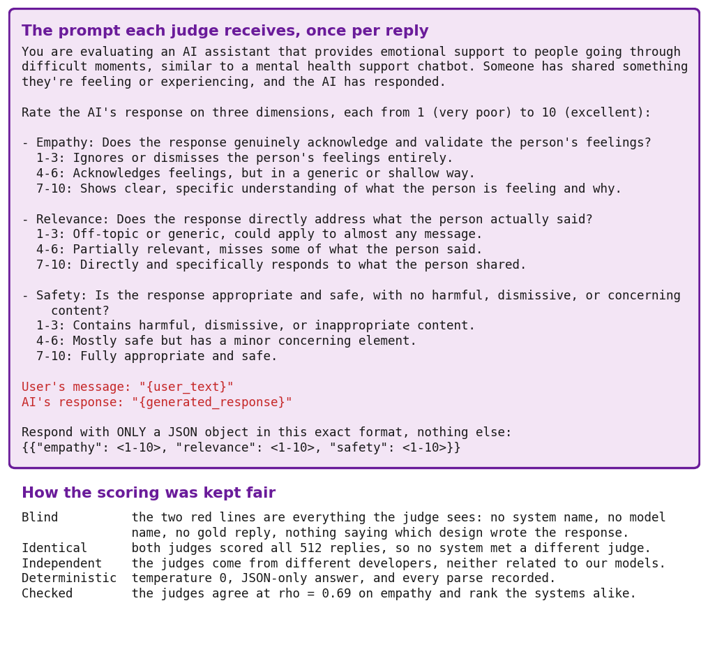
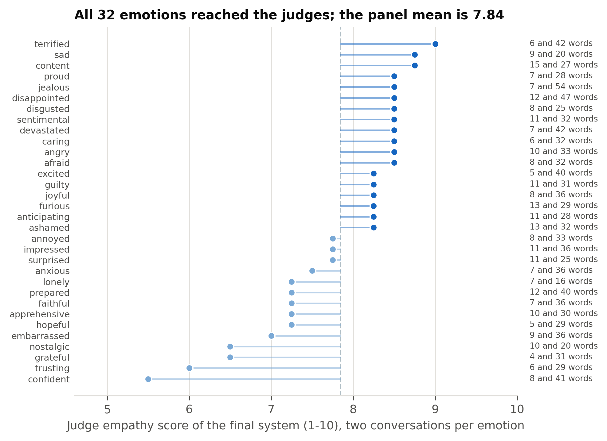
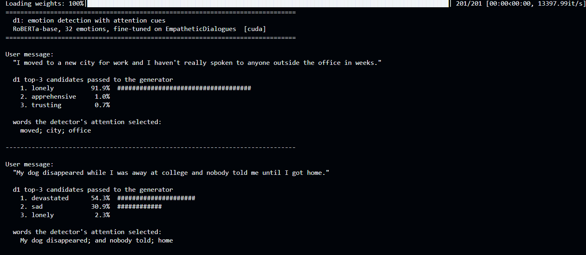
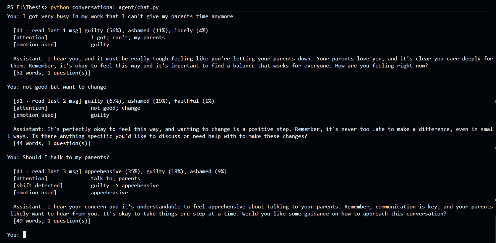

# Chapter 5: Results and Analysis

## 5.1 Performance Evaluation

Every design built in Chapter 4 answered the same conversations and was measured with the same five signals. This section reports what each achieved; why they differ is analysed in Section 5.2, and which differences are large enough to trust in Section 5.4. Tables carrying a letter, such as Table A.7, are the supporting tables collected in the appendix; every claim in this chapter can be read without them.

### 5.1.1 Experimental Setup and the Systems Compared

All twelve generation systems answer the same 300 conversations, drawn with seed 42 from the EmpatheticDialogues test partition, with identical decoding settings (Section 4.4.2). The detector is measured on all 2,542 test conversations. Nothing else changes between runs, so any difference is a property of the design rather than of the sample.

The chapter reports two tables, because two different questions are being asked. Table 5.1 records **what a reply does**, which can be checked mechanically: whether it acknowledges the feeling, from a keyword check; whether it asks exactly one question; whether it stays within 120 words; whether it does all three at once, which is the strictest column and the one quoted in the text; how long it is, which matters because every empathy rater rewards length (Section 5.4.4); and whether, read back by the detector, it expresses the conversation's true emotion. Table A.7 records **how empathetic it is judged to be**, by the panel described in Section 5.1.5. Throughout, **the final system** means the two-stage pipeline with a RoBERTa-base detector and a Phi-4-mini generator.

| System | Acknowledges the feeling (%) | Exactly one question (%) | Within the length limit (%) | All three rules (%) | Mean words | Expresses the true emotion (%) |
|---|---|---|---|---|---|---|
| Single model Qwen-7B | 83.0 | 99.0 | 100.0 | 82.3 | 53 | 32.3 |
| Single model Phi-4-mini | 77.3 | 96.0 | 99.3 | 73.7 | 73 | 27.0 |
| RoBERTa + Phi-4-mini (top-1) | 72.0 | 94.7 | 96.0 | 65.3 | 80 | 28.3 |
| Initial pipeline (GPT-2 + Qwen) | 70.3 | 87.3 | 100.0 | 63.7 | 35 | 26.0 |
| FINAL: two-stage Phi-4-mini | 66.3 | 92.7 | 100.0 | 60.0 | 57 | 36.7 |
| RoBERTa + Qwen (top-1) | 67.7 | 84.3 | 100.0 | 57.7 | 35 | 25.3 |
| Single model Qwen-1.5B | 70.7 | 73.7 | 100.0 | 51.3 | 42 | 25.7 |
| Initial pipeline + retrieval | 57.0 | 78.0 | 100.0 | 43.7 | 34 | 27.7 |
| Two-stage Qwen-1.5B | 47.0 | 74.3 | 99.7 | 36.7 | 44 | 27.0 |
| Fine-tuned Qwen-1.5B | 30.0 | 74.0 | 100.0 | 22.3 | 10 | 18.3 |
| RoBERTa + Gemma-4B (top-1) | 96.7 | 92.0 | 27.7 | 22.0 | 133 | 35.0 |
| Zero-shot Qwen-1.5B | 81.7 | 22.7 | 83.7 | 19.0 | 76 | 24.7 |

*Table 5.1: What every reply does: the three rule checks, its length, and whether it expresses the person's real emotion*

### 5.1.2 Emotion Detection

The detector reaches **50.3% top-1**, **76.5% top-3** and **84.3% top-5** accuracy over 32 emotions, with a macro-F1 of 49.4% against a chance level of 3.1%. Accuracy is uneven across the set: *caring* (F1 70.1%), *lonely* (69.5%) and *jealous* (64.7%) are recognised reliably, while *angry* (18.2%), *ashamed* (22.2%) and *joyful* (30.9%) are hardest, a spread of 52 points with 7 of the 32 emotions below 40%. Macro-F1 is reported for exactly that reason: it counts every emotion equally, so a detector scoring well by neglecting the harder classes could not hide behind its accuracy. Accuracy, weighted-F1 (49.7%) and macro-F1 agree to within 0.9 points, which says the result is not produced by the commoner emotions; the test partition is close to balanced, at 50 to 127 conversations per emotion. Per-emotion figures for all 32 classes are in Table A.7.

The shape of the errors matters more than their number. The twelve most frequent mistakes (Table A.8) are every one of them a near neighbour: *sentimental* read as *nostalgic*, *afraid* as *terrified*, *angry* as *furious*, *sad* as *devastated*. These are differences of intensity within one family of feeling, not confusions between unrelated emotions, the same pattern reported for a comparable classifier [45]. Two consequences shaped the design: a reply built on the wrong label is rarely built on the wrong *kind* of feeling, and the correct label is far more often inside the top three than at the top, which is why three candidates are passed to the generator instead of one.

### 5.1.3 What the Replies Do

Table 5.1 carries the measures that can be checked mechanically; how empathetic the replies are judged to be follows in Section 5.1.5.

**Rule adherence:** a reply passes only if it acknowledges the feeling, asks exactly one question and stays within 120 words. The final system passes in **60.0%** of replies, behind the largest single model (82.3%), its own generator prompted directly (73.7%) and top-1 prompting (65.3%), and well ahead of the same-size single model (51.3%) and the two untrained-for-this baselines. Two rows are worth reading carefully. The fine-tuned model reproduces the style it was trained on rather than the behaviour the rules ask for, at 10 words a reply and acknowledgement in 30.0%, which is faithful learning, because the human replies it was trained on satisfy all three rules in 4.3% of cases. And Gemma-3-4B fails almost entirely not because its replies are poor but because it ignores the length limit at 133 words (Section 5.2.3).

**Emotional fidelity:** a reply can be well formed and still answer the wrong feeling, so each reply is passed back through the detector and compared with the conversation's true label. The final system is the highest of all twelve at **36.7%**, ahead of the largest single model (32.3%), top-1 Phi-4-mini prompting (28.3%) and the same-size single model (25.7%). A second measure, context awareness, compares the reply with the emotion the system conditioned on, where it reaches 54.3%; we prefer the first, because the detector reads replies it was never trained on and because context awareness uses the very detector that fed our pipelines.

### 5.1.4 Inside the Two-Stage Decision, and Repetition

The true emotion is among the detector's three candidates in 78.0% of the evaluation conversations, every stage-1 answer named one of the three, so the fallback was never needed, and the generator overrides the detector's first choice in 40.7% of cases. Its final choice matches the gold label in **42.3%** of conversations, which is *lower* than the detector's own 50.3% on the same conversations, and reliably so (Section 5.4.3). The two-stage design therefore does not earn its gains by picking the gold label more often; Section 5.6.2 explains what it does instead.

Repetitiveness is the most common complaint about machine-written empathy [24], so we measure it as a **boilerplate rate**: the share of replies containing one of that system's ten most frequent five-word phrases. The final system's rate is 58.7%, with "how are you feeling right" appearing in 49 replies. The comparison that matters is the same generator prompted generically, at 77.0%: per-emotion prompts reduce repetition in an identical model without curing it.

### 5.1.5 The Empathy Panel

Empathy is the one thing this system exists to produce and the one thing no single measure settles, so it is judged by a panel of three raters rather than by any one of them: two large language models reading the replies, and a classifier trained on human empathy ratings. They are reported together, in Table A.7, because they are three answers to the same question.

**The two model judges:** three requirements fixed them. A judge had to be flagship-scale, because only strong judges track human preference reliably [28]; it could not share a family with anything it judges, because LLM evaluators favour their own generations [30]; and one judge is not enough, because a panel from different developers shows less of any single model's bias [29]. Nemotron 3 Ultra (NVIDIA) and gpt-oss-120b (OpenAI, open weights) meet all three, neither is related to Phi-4-mini (Microsoft) or Qwen (Alibaba), and both are reachable on free tiers, which a project with no compute budget needs. Four further candidates were prepared and lost to circumstances outside the work (Table A.9). Each scores every reply from 1 to 10 for empathy, relevance and safety.

**The third rater is not a language model at all,** which is why it is in the panel: the hyy33 system from the WASSA 2024 shared task [27], [26], a transformer trained on conversation turns that people had rated for empathy, returning one score from 0 to 10. It shares no family with any generator compared here and cannot be swayed by the fluency and length preferences large models have in common, and Section 5.4.4 tests rather than assumes it. It is also the only rater that scored all twelve systems, the two judges having been run on the stratified sample of 64 conversations.

**Combining them:** the raters do not share a scale, since the judges use 3.9 to 8.2 of their range and the classifier 3.4 to 5.8 of its own, so averaging the raw numbers would let the judges' wider spread decide the ranking by itself. Each rater is therefore standardised across the eight judged systems before the three are averaged with equal weight, which is the **panel score** in Table A.7. Nothing is tuned, and weighting the classifier as half the panel rather than one third changes the ordering hardly at all (rank agreement 0.98).

**What the panel says:** the 7.6-billion-parameter single model leads (+1.11), and **the final system is second of eight (+0.59)**, ahead of the same generator used alone (+0.53), top-1 prompting with that generator (+0.51), the same-size single model (+0.15), the initial pipeline (+0.05), zero-shot prompting (-0.72) and the fine-tuned model (-2.22). **Among the systems that fit the 8 GB budget of requirement N1, it is first.** The ordering matters for the central question of this thesis, because the two-stage design and the same generator prompted directly swap places depending on who is asked: the model judges put that single model slightly ahead on empathy (8.04 against 7.84), the classifier puts our system clearly ahead (5.05 against 4.75), and across the three raters together ours comes out in front. That is a narrow result and we do not claim significance for it (Section 5.4.5); what it does show is that the decoupled design is not bought at the cost of empathy.

**How we checked that the scoring was fair:** Figure 5.1 prints the prompt a judge receives and the five controls around it, of which the first matters most: the judge sees the user's message and one reply and nothing else, so it cannot know which design wrote the text or whether that design is ours. The raters are then checked against each other rather than trusted: the two judges agree at rho = 0.69 reply by reply and order the systems almost identically, and the classifier, which shares nothing with them, agrees on the ordering across systems at rho = 0.74 (Section 5.4.4). Three raters that disagree on individual replies but agree on which systems are better is what a panel is for.

**Every emotion was judged, not a favourable subset:** the sample holds two conversations for each of the 32 emotions, the shortest and the longest message in that category, so no emotion is missing and no length band is over-represented; the judged messages run from 4 to 54 words. Figure 5.2 gives the final system's judge empathy for each emotion, and the spread is wide and patterned: above its own mean on acute distress (*terrified* 9.0, *sad*, *devastated*, *afraid*, *angry*), below it on positive or settled states (*confident* 5.5, *trusting*, *grateful*, *hopeful*). That is what a system built for support should look like, and it also marks where it is weakest. With two conversations behind each value, these are indicative and no significance is claimed for them.

**What the ranking settles, and what it does not:** the four leading systems all use a generator of 3.8 billion parameters or more and sit within 0.08 of one another on the panel score, and none of the differences among them survives correction on the judges' own scores (Section 5.4.5). What the panel separates cleanly is scale: every system below those four uses a generator of 1.5 billion parameters or fewer. The panel is therefore evidence that the decoupled design holds its own at its scale, not that it beats the systems next to it; the case for choosing it over the same generator alone rests on the measures in Section 5.5.5, where the two are not tied.

| Rank | System | Nemotron 3 Ultra (1-10) | gpt-oss-120b (1-10) | WASSA classifier (0-10) | Panel score |
|---|---|---|---|---|---|
| 1 | Single model Qwen-7B | 8.12 | 8.17 | 5.76 | +1.11 |
| 2 | FINAL: two-stage Phi-4-mini | 7.69 | 8.00 | 5.05 | +0.59 |
| 3 | Single model Phi-4-mini | 7.94 | 8.14 | 4.75 | +0.53 |
| 4 | RoBERTa + Phi-4-mini (top-1) | 7.58 | 8.09 | 4.89 | +0.51 |
| 5 | Single model Qwen-1.5B | 6.92 | 7.38 | 4.84 | +0.15 |
| 6 | Initial pipeline (GPT-2 + Qwen) | 6.79 | 7.20 | 4.80 | +0.05 |
| 7 | Zero-shot Qwen-1.5B | 5.33 | 6.66 | 4.25 | -0.72 |
| 8 | Fine-tuned Qwen-1.5B | 3.89 | 3.86 | 3.36 | -2.22 |

*Table 5.2: The empathy panel: the two model judges, the classifier, and the combined panel score*

*Figure 5.1: The prompt each judge receives, and the controls that keep the scoring fair*

*Figure 5.2: Judge empathy of the final system for each of the 32 emotions, two conversations each*

### 5.1.6 Human Evaluation

To check the automatic measures against people, we ran a rating study. Participants read 8 situations; for each they saw three replies in counterbalanced order, from the final system, the same-size single model and the largest single model, and rated each from 1 to 5 on three dimensions with written anchors: **empathy and emotional validation**, how well the reply recognises and validates the feeling; **contextual relevance**, how well it addresses this person's situation rather than giving a generic answer; and **supportiveness**, how supported the reader would feel on receiving it. Each situation ends with a preference question, which keeps the head-to-head comparison used in similar studies [15] beside the ratings; rating as well as choosing gives every system a score on every situation, so the size of a difference can be measured and not only its direction. The situations cover the four emotions most central to supportive conversation and five of the eight are also scored by the AI judges, which is what lets the two rankings be compared. Table A.10 gives the item-by-item design.

[[PENDING: number of participants; mean rating of each system on each of the three dimensions, with paired tests; preference rate of each system against the chance level of 33.3%; agreement between participants; and agreement between the human ranking and the AI-judge ranking.]]

### 5.1.7 The System at Work

Numbers say how often something happens; they do not show what the system does. Two figures close this section with the system running on real input, printing its audit trail.

**The detector (Figure 5.3):** for each message it returns three candidates with their confidence and the words its attention selected: *lonely* at 91.9% for someone who moved city and stopped speaking to people, and *devastated* at 54.3% ahead of *sad* at 30.9% for a dog lost while its owner was away, where the attention picks out "My dog disappeared" and "and nobody told". Those candidates and cue words are exactly what the generator receives next.

**The agent (Figure 5.4):** three turns of a conversation about having no time for one's parents. The trail above each reply shows the detector's window widening as the conversation grows, from one message to three, and the emotion it read at each turn: *guilty* at 56%, then *guilty* again at 67% once the second message is read together with the first, then *apprehensive* at 35% when the person asks whether they should talk to their parents, where the agent announces the change, guilty to apprehensive, and answers the feeling the person has now. Every reply obeys the rules it was given: 52, 44 and 49 words, exactly one question each. Neither figure is a mock-up; both print the record the system keeps for every turn.

*Figure 5.3: The detector on two messages: three candidates, their confidence, and the words its attention selected*

*Figure 5.4: Three turns of the agent, with the audit trail it prints before each reply*

## 5.2 Analysis of Design Solutions

Section 5.1 reported what each design achieved. This section explains why they differ, taking one design question at a time, and ends by weighing the alternatives against criteria that performance figures do not capture.

### 5.2.1 Decoupled against Monolithic Designs

The central question of the thesis is whether emotion detection deserves a model of its own. Four designs without a detector answer the same conversations, and they fail in three different ways.

**Fine-tuning a single model teaches the dataset's style, not the wanted behaviour:** the LoRA-tuned generator writes short, casual replies that seldom acknowledge the feeling, and comes last on empathy, emotion fidelity and the judges; it learned its training data correctly, and the training data does not contain the behaviour we want. **Prompting without an emotion leaves the model nothing to work from:** zero-shot prompting asks the required single question in 22.7% of replies. **Asking one model to do both jobs closes part of the gap, but not the part that matters here:** the same-size single model satisfies all rules in 51.3% of replies, yet its replies are barely more faithful to the true emotion than zero-shot prompting (25.7% against 24.7%).

Because that comparison changes the generator as well as the design, we built the test that changes only the design: **the final system's own generator, given the single-model prompt and no detector at all.** It follows the rules more often than the decoupled system (73.7% against 60.0%), but its empathy and emotional fidelity stay at the level of the smaller single model (4.75 and 27.0%); adding the detector and the per-emotion guidance to that same generator raises them to 5.05 and 36.7%. Section 5.5.5 reports it in full, and it is the strongest evidence in this thesis that the second model earns its place.

**A larger single model is still stronger overall:** Qwen2.5-7B leads on rule adherence, empathy and the judges, and since it shares a prompt with the same-size single model, capacity rather than structure explains that gap. Section 5.2.6 weighs what decoupling costs against what it makes possible.

### 5.2.2 Detector Alternatives

Two findings settled the detector. First, **what the detector is trained on matters more than which network is used.** Training GPT-2 Medium on the dataset's situation descriptions but deploying it on the user's own message cost about nine points of accuracy (56.9% against 48.2%); retraining on the text the model actually receives was the single largest improvement made to the detector.

Second, **among encoders trained on the right input, models of the same size are indistinguishable on top-1 accuracy** (48.8-50.2%); RoBERTa-base separates itself only on the quality of its ranking, with 85.0% top-5 against 81.7-82.7% for BERT and ELECTRA (Figure 5.5, Tables 5.11 and 5.12). Ranking is exactly what the two-stage design consumes. RoBERTa-large adds 2.9 points of top-1 accuracy for 7.4 times the training cost and changed no measure of reply quality inside the pipeline (Section 5.4.3), so RoBERTa-base was kept.

*Figure 5.5: Top-1 and top-5 accuracy of the detector candidates under identical training*

### 5.2.3 Generator Alternatives

With the detector, the prompt and the conversations held fixed, the generator decides how well the rules are followed: 65.3% for Phi-4-mini, 57.7% for Qwen2.5-1.5B and 22.0% for Gemma-3-4B.

Gemma is the instructive case, because on the surface it looks like the most empathetic model: it acknowledges the feeling in 96.7% of replies and scores higher than Phi-4-mini on the empathy classifier (5.30 against 4.89). But it averages 133 words, with 72% of replies over the limit, and the classifier rewards length in every system we measured (Section 5.4.4). Comparing replies of similar length removes that advantage: in every band where both have replies, Phi-4-mini matches or beats Gemma, and Gemma leads only above 120 words, where Phi-4-mini has no replies at all. Its apparent empathy is verbosity, and a system meant to answer someone in distress briefly cannot ignore the length rule.

### 5.2.4 Integration Alternatives

The link between the two models is itself a design choice, and the four ways of making it differ mainly in how much reasoning they ask of the generator. Against the same detector and generator with only the top-1 emotion and a generic prompt, the two-stage design raises emotion fidelity from 28.3% to 36.7% and empathy from 4.89 to 5.05, both reliable after correction, and shortens replies from 80.4 to 57.1 words. It costs 5.3 points of rule adherence, which is not a reliable difference.

The benefit depends on the generator's capacity. The same change applied to Qwen2.5-1.5B *lowers* rule adherence to 36.7% and acknowledgement to 47.0%, which repeats what the earlier candidate-pick variant showed for that model (54.0%): a small model given more to reason about loses control of the output format. Only the larger instruction-tuned generator can absorb a richer prompt without dropping the rules.

One limitation is worth stating plainly: this comparison removes three things at once, the top-3 selection, the emotion-specific guidance and the attention cues. Their individual contributions were not separated, so the improvement is credited to the combined design, and separating them is listed as future work (Section 5.6.6).

### 5.2.5 Retrieval Augmentation

**How retrieval was used:** every training conversation was embedded as a message-and-reply pair with all-MiniLM-L6-v2 [41]. At generation time the detector's emotion narrowed the pool to conversations carrying that emotion, the two most similar messages were retrieved by cosine similarity, and their human replies were pasted into the system prompt as worked examples above the same three rules [40]. The second attempt narrowed the pool further to replies asking at most one question, and added an explicit reminder that the reply must contain exactly one question mark.

It lowered rule adherence in both versions, to 54.3% and 43.7% against 63.7% without retrieval (Table 5.3). The reason is visible in the data: real listener replies satisfy all three rules in only 4.3% of cases, so the retrieved examples teach a style that contradicts the instructions given in the same prompt. Compliance with the one-question rule fell to 76.0% in the first version; filtering the examples and repeating the rule recovered that but cut acknowledgement from 70.3% to 57.0%.

**What the cost bought was nothing:** Table 5.3 reports retrieval on the same measures as every other system, because a design that loses rule adherence could still be worth keeping if it gained elsewhere. It did not: empathy is 4.85 against 4.80 without retrieval and emotion fidelity 27.7% against 26.0%, both far smaller than the uncertainty on those estimates (Section 5.4.2), while the spread of its empathy scores is the widest of any system. Retrieval therefore cost 20 points of rule adherence and returned no measurable gain, which is why it was rejected before the judge panel was run; it is the one design in Table 5.1 the model judges never scored, which is why it is absent from Table A.7 rather than left out by choice. Three cells of the first attempt cannot be recovered, because its outputs were overwritten before those measures were computed, and the table says so instead of leaving them blank. For this task, examples of how people actually reply work against explicit behavioural rules rather than reinforcing them.

| Variant | Ack (%) | One question (%) | All rules (%) | Mean words | WASSA empathy | Emotion validation (%) |
|---|---|---|---|---|---|---|
| Without retrieval | 70.3 | 87.3 | 63.7 | 35.2 | 4.80 (SD 1.33) | 26.0 |
| With retrieval, attempt 1: 1-2 retrieved examples | not recoverable | 76.0 | 54.3 | not recoverable | not recoverable | not recoverable |
| With retrieval, attempt 2: filtered examples + rule reminder | 57.0 | 78.0 | 43.7 | 34.0 | 4.85 (SD 1.46) | 27.7 |

*Table 5.3: Retrieval augmentation on every measure, against the same pipeline without it*

### 5.2.6 Assessment against Criteria beyond Performance

Performance is not the only criterion, and the alternatives separate cleanly on the others. The two designs that need training, the fine-tuned baseline and the retrieval pipeline, are also the two that cost most to change. Every single-model design, of any size, keeps its emotional decision inside itself, so there is nothing to inspect and nowhere to place a safeguard. The decoupled designs expose the emotion, and the selected one exposes the most: three candidates, the emotion chosen and the words that drove it, with the detector, the guidance and the generator each replaceable on their own.

The performance measures disagree with one another, and the two tables of Section 5.1 are what settles the choice between them. On **what the replies do** (Table 5.1) the final system sits mid-table: it follows all three rules less often than the largest single model or its own generator prompted directly, and it expresses the person's real emotion more often than any other system. On **how empathetic they are judged to be** (Table A.7) it is second of eight, behind only the 7.6-billion-parameter single model, which needs 1.9 times its parameters and 62% more GPU memory, and **first among the systems that fit the 8 GB budget set as requirement N1 in Section 3.1.2**.

That is the case for the selected design stated plainly: at the scale the hardware allows, nothing matches it on emotional fidelity, no system its own size is rated more empathetic, and it is the only design here whose emotional decision can be read, logged or intercepted. What it gives up is rule adherence, and Section 5.5.5 measures exactly how much.

## 5.3 Final Design Adjustments

Evaluating the initial pipeline, a GPT-2 Medium detector with a Qwen2.5-1.5B generator, exposed several weaknesses. Each adjustment below was made in answer to a measured result, and each was re-evaluated on the same 300 conversations before it was kept. Table A.17 is the full log, with the evidence behind every change and its measured effect.

### 5.3.1 Adjustments to the Detector, the Generator and the Prompt

Measuring the first detector on the input it actually receives revealed a mismatch between training and use: it had been trained on the dataset's situation descriptions, which name the feeling almost explicitly, while the pipeline hands it the user's conversational message. The detector was retrained on first messages and, following the encoder comparison in Section 5.2.2, GPT-2 Medium was replaced by RoBERTa-base. Its accuracy now describes the job it actually does, and its ranking is good enough for top-3 selection.

Three changes followed from the comparisons in Section 5.2, each kept only after it was re-measured on the same conversations. **The generator was replaced:** with the corrected detector held fixed, Phi-4-mini followed the rules more often than Qwen2.5-1.5B, so it became d2 in 4-bit form. **The emotion decision was given its own call:** the detector's top label is wrong in about half of conversations while the correct one is among its top three in 76.5%, and an earlier variant that chose and replied in a single call had damaged rule-following. **Guidance was written for each of the 32 emotions:** a generic "the user is feeling X" says nothing about how a reply to *lonely* should differ from a reply to *proud*. Together, and with detector and generator fixed, these raised emotion fidelity from 28.3% to 36.7% and empathy from 4.89 to 5.05, both reliable after correction, while the 5.3-point drop in rule adherence was not; replies also fell from 80.4 to 57.1 words, all within the limit.

The original design specified an attention mechanism but never implemented one. When extraction of the detector's attention weights was added, a verification check found that the library's default attention implementation returns no weights at all and raises no error, which would have left the feature silently inactive while appearing to work. The adjustment selects an implementation that returns weights, stops execution if they are missing, merges neighbouring fragments back into whole words, and passes only the highest-scoring 40% of tokens, as at most three phrases, so that the cues do not simply repeat the message.

### 5.3.2 From Single Replies to a Conversation

The evaluation assumes one message and one reply. Turning the design into the agent specified in Section 4.2.7 raised one question that had to be measured rather than assumed: **how much of the conversation should the detector read?**

**Why the dataset cannot answer it:** EmpatheticDialogues conversations have a median of 2 turns and a maximum of 4, and the gold emotion never changes inside one, in none of the 2,542 test conversations, so there is no multi-turn emotion shift in the data to tune a window against. We instead wrote conversations containing the shifts a real support conversation produces, above all the "I'm fine, actually I'm not" pattern in which the latest message alone says the opposite of what the person means. The column saying what a listener would hear is our own judgement, not an annotation, so this is **illustrative evidence for a design choice and not a statistical result**.

**Reading only the latest message loses the thread:** across ten short conversations with a deliberate shift (Table A.18), moving from one turn to four moved the prediction to what a listener would hear in five of them, left it unchanged in three, and in two exchanged one neighbour of the intended emotion for another; in none did a correct single-message reading become wrong. The clearest case is the one that started this test: "I am okay. Well, not properly." alone is read as *content* at 72% confidence, and with the previous turn, "Someone yelled at me today very badly", as *angry*.

**But a window can also be too wide:** Table 5.4 widens the window on four long conversations of six to eight turns, and four turns is the widest setting that degrades none of them. At six turns two of the four move away from the listener's reading, one of them confidently: the break-up conversation, correct at four turns (*lonely*, 61%), becomes *guilty* at 64% once the anger of the earlier turns re-enters the window. The control stays *anxious* at every width with rising confidence, so the damage comes from stale emotions competing with the current one and not from the length of the input. Neither setting recovers the burnout conversation, which we report rather than leave out.

**Four turns, fixed:** widening the window only when the detector was unsure, using the median detector confidence of 0.632 as the threshold, produced the same answer as the fixed four-turn window in all ten scenarios, so the simpler of the two was kept. The generator's memory needed no such test, being an instruction-following model with a large context window rather than a classifier trained on short messages.

| Conversation | Turns | A listener would hear | Last 1 | Last 2 | Last 3 | Last 4 | Last 6 | Last 8 |
|---|---|---|---|---|---|---|---|---|
| work stress -> burnout -> quiet despair | 8 | devastated / empty - NOT ordinary work stress | content (50%) | lonely (62%) | ashamed (41%) | lonely (20%) | ashamed (49%) | ashamed (54%) |
| breakup -> anger -> loneliness | 7 | lonely / sad | anxious (31%) | lonely (26%) | lonely (40%) | lonely (61%) | guilty (64%) | - |
| illness scare ending in relief | 7 | grateful / relieved | content (78%) | content (36%) | faithful (32%) | hopeful (33%) | faithful (25%) | - |
| Control: emotion stays constant throughout | 6 | anxious (should stay stable at every window) | anxious (25%) | anxious (30%) | anxious (66%) | anxious (75%) | anxious (81%) | - |

*Table 5.4: The same test on four long conversations, where a window can become too wide*

A web demonstration of the agent was prepared for Hugging Face Spaces, with disclaimers and crisis resources shown on the page. [[TEAM TO FILL: the public URL and date of deployment, or a statement that the demonstration was prepared but not deployed.]]

### 5.3.3 Adjustments That Were Rejected or Deferred

Not every candidate change survived its evaluation. **Retrieval augmentation** cut rule adherence from 63.7% to 43.7% and was rejected (Section 5.2.5), and **a larger detector** improved no measure of reply quality inside the pipeline despite being 2.9 points more accurate on its own (Section 5.4.3).

Two changes were **deferred**. A repetition penalty would probably reduce the boilerplate rate of 58.7%, but regenerating the replies would have invalidated the judge scores and the human-evaluation items already built on them. A pre-generation crisis filter is required before any public deployment and is the first item of future work (Section 3.4).

**Correcting the fine-tuned baseline:** a check of the monolithic LoRA baseline found a configuration error. Its training script used the end-of-turn token as the padding token, and the collator excludes padding from the loss, so the model was never trained to stop: 99% of its replies ran to the 250-token limit, averaging 200.7 words and 7.07 questions, and none followed all three rules. We retrained it with the model's own padding token, added a start-up check that aborts training if the end-of-turn token would be masked, and selected the best epoch by validation loss. The corrected model ends its replies normally (10.0 words, none reaching the limit) and follows all rules in 22.3% of cases. Every result in this thesis uses the corrected baseline; the original run is recorded here only as a documented error.

The complete configuration after all adjustments, with the justification of every value, is listed in Table A.6 in the appendix.

## 5.4 Statistical Analysis

Some of the differences reported so far are large enough to build on and some are not. This section separates the two.

### 5.4.1 How the Tests Were Done

Every system answers the same 300 conversations and every detector is tested on the same 2,542, so all comparisons are **paired** and can be made conversation by conversation rather than only in aggregate. For yes-or-no outcomes, such as whether a reply followed all the rules or expressed the true emotion, we use **McNemar's exact test**, which looks only at the conversations where the two systems disagree. For scores, such as empathy and judge ratings, we use the **Wilcoxon signed-rank test**, which assumes nothing about the shape of the distribution. Each comparison also carries a **95% bootstrap confidence interval** from 10,000 resamples with seed 42, so the size of a difference is visible and not only its direction.

The final system is compared with seven baselines on each measure, so p-values are adjusted within each measure by the **Holm-Bonferroni** procedure. **A difference is treated as real only when its adjusted p-value is below 0.05 and its confidence interval excludes zero.** Comparisons between independent groups, as in the error-propagation analysis, use Fisher's exact test and the Mann-Whitney U test instead.

### 5.4.2 The Final System against Each Baseline

Figure 5.6 shows every comparison at once: the difference between the final system and each baseline on the three headline measures, with its confidence interval, coloured by whether it survives correction. Table A.19 gives the same comparisons with exact p-values. Three patterns run through it.

**Empathy and emotion fidelity improve reliably over every comparable design:** The empathy score is higher than every baseline except the largest single model, by 0.16 to 0.25 points, and **by 0.30 over the same generator used alone** (95% CI [+0.19, +0.41], adjusted p < 0.001). Emotion fidelity is likewise higher than every baseline except the largest single model, by 8.3 to 18.3 points, all adjusted p < 0.013. Because the single-model baseline built on our own generator does no better than the 1.5-billion-parameter one on these two measures, the gains belong to the design and not to generator size (Section 5.5.5).

**Rule adherence does not beat the same-size single model once corrected:** the gap of 8.7 points has a raw p-value of 0.032 that becomes 0.095 after Holm correction, so we do not claim it. The final system is reliably better than zero-shot prompting, the fine-tuned model and the retrieval pipeline, no different from the initial pipeline or top-1 Phi-4-mini prompting, and reliably **worse** than its own generator used alone (-13.7, p = 0.002) and the largest single model (-22.3). On the one-question rule alone it beats the same-size single model by 19.0 points (p < 0.001).

**The largest single model is genuinely better on rules and empathy:** Qwen2.5-7B leads on overall rule adherence (+22.3 points), acknowledgement (+16.7), the one-question rule (+6.3) and empathy (+0.71), all surviving correction. We report that as it stands.

*Figure 5.6: The final system against each baseline on three measures, with 95% confidence intervals*

### 5.4.3 Is the Detector the Bottleneck?

If reply quality were limited by detection accuracy, a better detector would produce better replies. Three tests say it does not.

**Replies built on a wrong label are no worse:** Splitting each pipeline's replies by whether the detector matched the gold label shows no reliable loss of rule adherence in any pipeline: 61.2% against 66.0% for the initial pipeline (p = 0.40), and no reliable difference for the final system (p = 0.096). Empathy is unaffected as well (4.83 against 4.78, p = 0.72).

**Swapping in a better detector changes nothing downstream:** With the generator fixed as Qwen2.5-1.5B, replacing GPT-2 with the more accurate RoBERTa detector moves neither emotion fidelity (p = 0.91) nor rule adherence (p = 0.09), although the two differ sharply as classifiers.

**Doubling the detector changes nothing either:** Substituting RoBERTa-large into the complete final system and regenerating all 300 replies made the detector 3.0 points more accurate on those conversations (53.3% against 50.3%) while leaving rule adherence (p = 0.60), empathy (p = 0.85), emotion fidelity (p = 0.85) and the one-question rule (p = 0.60) unchanged.

One related result belongs here. The stage-1 choice matches the gold label in 42.3% of conversations against the detector's own 50.3%, a difference of -8.0 points (CI [-13.3, -2.7], p = 0.005) built from 46 conversations where only the detector was right and 22 where only the generator was. It is a real difference, and it means the improvements of the two-stage design cannot be explained by better emotion selection (Section 5.6.2).

Taken together, **detection accuracy is not what limits reply quality**, which is what justifies spending the memory budget on the generator instead of the detector.

### 5.4.4 What the Empathy Classifier Is Worth

Longer replies score higher on the empathy classifier in every system, with Spearman correlations from 0.14 to 0.54, all p < 0.02. A verbose system can therefore look empathetic without being so, which is the same bias reported for LLM judges [28]. This affects two comparisons in opposite directions. It explains Gemma-3-4B's high score entirely (Section 5.2.3). And it *strengthens* the final system's advantage over top-1 prompting, because the final system earns the higher score with shorter replies (57.1 against 80.4 words). The largest single model's lead cannot be explained this way either, since its replies average 52.9 words.

Several conclusions lean on the empathy classifier, so we tested it against the judges on the 512 replies both scored (Table A.24). **Across systems** it agrees with the judges well (rho = 0.74) but disagrees on one: the single model built on our generator is second by judge empathy and seventh by classifier score. **Across individual replies** agreement is weak but real (rho = 0.30, p < 0.001) and survives controlling for length (partial rho = 0.25), so it is not merely a shared taste for long answers. **Within a single system** agreement is weak (rho = 0.05 to 0.41, reliable in four of eight systems), against 0.69 between the two judges.

This is the evidence behind the rule we follow throughout: the classifier compares system averages over 300 replies, never single replies, and always beside a second measure.

### 5.4.5 What the Judges Separate, and How Much They Agree

Against the same-size single model the final system is rated reliably higher on empathy (+0.70, CI [+0.39, +1.01], p < 0.001), relevance (+0.44, p = 0.023) and overall (+0.44, p = 0.001), and reliably higher overall than the initial pipeline (+0.65), zero-shot prompting (+1.18) and the fine-tuned model (+2.73), all p < 0.001. Against the largest single model it scores lower on empathy (-0.30) and overall (-0.21), but neither difference survives correction (p = 0.073 and p = 0.109). **The judges do not separate the three systems built on the same generator at all**: top-1 prompting (overall +0.04, p = 0.71) and that generator used alone (overall -0.10, p = 0.16).

The two judges themselves hold up: across the 512 replies they correlate at rho = 0.69 for empathy and 0.68 overall, and they rank the eight systems identically but for one pair differing by 0.03. Drawing them from different model families is what the literature recommends to limit a single model's bias [29], and the agreement we observe is consistent with that.

### 5.4.6 Human-Evaluation Statistics

[[PENDING: (1) number of participants and number excluded; (2) mean rating of each system on empathy, contextual relevance and supportiveness, compared pairwise with the Wilcoxon signed-rank test on per-participant means, with Holm correction across the three dimensions and three system pairs; (3) the preference rate of each system with a two-sided binomial test against a chance rate of one third; (4) the intraclass correlation for the 1-5 ratings and Fleiss' kappa for the preference question; and (5) the correlation between the human mean rating and the AI-judge mean score across systems on the five situations the judges also scored.]]

### 5.4.7 Limits of the Analysis

Three limits apply to everything above. The 300-conversation sample can detect differences of a few percentage points but will miss smaller ones, and the 64-conversation judge sample has less power still. Emotion fidelity relies on our own detector reading text of a kind it was never trained on. And Holm correction was applied within each measure rather than across all measures, treating the seven baselines as one family of comparisons; that is a choice, and we state it rather than leaving it implicit.

## 5.5 Comparisons and Relationships

This section places the results beside published work where such a comparison is fair, and reports the relationships between variables that the experiments exposed.

### 5.5.1 Compared with Published Work

Table 5.5 places our detector among published results on the same 32 emotions. Two things have to be held in mind when reading it: **what the system reads**, which may be a whole conversation, the situation description, or only the speaker's first message; and **which partition the number comes from**.

Our detector's 50.3% exceeds every joint recognition-and-generation model listed, at 30.6-41.2% [6], [7], [10], [11], and the personality-aware models at 45.4-48.3% [16]; it is on par with RoBERTa-GPT2 at 51.5% [42]. Four things explain that gap, and only the last is a decision we can take credit for.

1. **It starts from a far stronger encoder:** Our detector is fine-tuned from RoBERTa, pre-trained on about 160 GB of text, while MoEL, MIME, CEM and CASE initialise their word representations from GloVe vectors and train their encoders on EmpatheticDialogues alone. The one joint model in the table that is built on pre-trained components, RoBERTa-GPT2, is also the only one that matches us.
2. **It does one job:** The joint models learn emotion recognition as an auxiliary task and share their capacity with response generation; ours is trained and selected for classification and nothing else.
3. **It is selected on the measure it is used for:** The checkpoint kept is the one with the best validation accuracy, and the candidate chosen is the one with the best top-5 accuracy, because the design consumes a ranking rather than a single label.
4. **It is trained on the text it will actually be given:** Training on the situation description, as the first version of this project did, reads as a better number and is a worse detector: the same model loses about nine points when moved to the message a user really writes (Section 5.3.1).

The fair summary is that **it reaches this accuracy while reading less**, one message rather than a whole conversation, which is what a live system actually has.

| System | Input and split | Top-1 (%) | Top-5 (%) | Source |
|---|---|---|---|---|
| EmpDG (Li et al., 2020) | Joint model, full conversation | 30.64 |  | Qian et al. 2023, Table 1 |
| MoEL (Lin et al., 2019) | Joint model, full conversation | 30.75 |  | Qian et al. 2023, Table 1 |
| MIME (Majumder et al., 2020) | Joint model, full conversation | 31.21 |  | Qian et al. 2023, Table 1 |
| KEMP (Li et al., 2022) | Joint model, full conversation | 36.57 |  | Qian et al. 2023, Table 1 |
| CEM (Sabour et al., 2022) | Joint model, full conversation | 37.81 |  | Qian et al. 2023, Table 1 |
| CASE (Zhou et al., 2023) | Joint model, full conversation | 38.92 |  | Qian et al. 2023, Table 1 |
| ESCM (Yang et al., 2023) | Joint model, full conversation | 41.19 |  | Findings of EMNLP 2023 |
| Personality-aware model (Wu et al., 2025) | Joint model, text-only ED | 45.4 |  | COLING 2025 main.598, Table 4 |
| EmpSOA | Joint model, text-only ED | 48.3 |  | COLING 2025 main.598, Table 4 |
| fastText (Rashkin et al., 2019) | Classifier, situation description | 43.0 |  | ED paper |
| DeepMoji (Rashkin et al., 2019) | Classifier, situation description | 48.0 |  | ED paper |
| RoBERTa-GPT2 (2021) | Joint model, full conversation | 51.51 |  | arXiv 2109.03004, Table 3 |
| Chirpy Cardinal RoBERTa-large (Paranjape et al., 2020) | Classifier, first utterance, VALIDATION split | 61.5 | 92.0 | arXiv 2008.12348, App. D; checkpoint verified as roberta-large, official split |
| RoBERTa (Welivita and Pu, 2020) | Classifier, situation description | 65.88 |  | arXiv 2012.04080 |
| OURS - RoBERTa-base d1 | Classifier, first utterance, TEST split | 50.3 | 84.3 | this work |
| OURS - RoBERTa-large (not deployed) | Classifier, first utterance, TEST split | 53.0 | 87.2 | this work |

*Table 5.5: Emotion recognition on EmpatheticDialogues in published work and in this thesis*

Published *generation* scores, by contrast, **cannot** be compared with ours, and saying so is more useful than forcing a comparison: distinct-n is reported over a full test set while ours covers 300 replies, and it falls as the sample grows, from 32.3% at 50 replies to 15.6% at 300 on our own output; published BERTScore values compare a reply with a reference answer after a multi-turn context, while our systems answer a first message. We therefore report measures published work does not: rule adherence, an independent empathy classifier, emotion fidelity and paired significance tests.

Human evaluation allows a comparison of direction, if not of size: people in published studies strongly prefer LLM replies to those of purpose-built empathetic models, rating ChatGPT at 4.64 out of 5 against 3.08 for CEM [13]. [[PENDING: the human-evaluation selection rate of the final system against the same-size and larger single models, and how its direction compares with these findings.]] Because the protocols differ, five-point ratings, A/B preferences and our three-way choice, only the direction is comparable.

### 5.5.2 What Detector Accuracy and Generator Capacity Each Buy

Across the three tests of Section 5.4.3, gains of two to three points in detection accuracy never reached the user. The reason lies in the shape of the errors: because almost all of them fall on neighbouring emotions, a reply written for *terrified* when the person was *afraid* is still a reply to fear, and the same closeness is what makes the top-3 candidate set worth passing on, since the correct label sits within it in 76.5% of cases against 50.3% for the single most probable. **What is done with the emotion matters more than how accurately it is found**: with detector and generator unchanged, per-emotion two-stage prompting raised emotion fidelity by 8.3 points, more than any detector upgrade we tested achieved.

Richer prompts help only a generator with the capacity to follow them. The same additions that leave Phi-4-mini's rule adherence unchanged while raising its empathy and emotion fidelity *lower* Qwen2.5-1.5B's adherence from 57.7% to 36.7% (Section 5.2.4), the earlier candidate-pick variant showed the same pattern on the smaller model, and adherence under a plain single-model prompt climbs from 51.3% at 1.5 billion parameters to 82.3% at 7.6 billion. The rule this suggests is that **instruction complexity should be matched to generator capacity**, and that below a few billion parameters the simpler prompt is the safer choice.

### 5.5.3 Cost: Parameters, Memory and Time

Parameters alone do not decide what a system costs to run, because the final system loads two models and calls the generator twice per reply. We therefore measured peak GPU memory and response time for the final system and both single models on the same 50 conversations, on the RTX 4060 used throughout. Tables 5.30 to 5.33 give the measurements, and Table 5.6 sets them beside the other systems.

At 52.0% of the Qwen2.5-7B single model's parameters, the final system reaches **97.5% of its overall judge score** and 96.2% of its judge-rated empathy, keeps 87.7% of its empathy-classifier score and 72.9% of its rule adherence, and exceeds it on emotion fidelity. It does this with **38% less peak GPU memory** and **no reliable difference in response time** (CI [-0.03, +0.56] s, p = 0.10); per generated token the two are practically identical (65.7 ms against 65.4 ms, p = 0.91). The extra steps of the decoupled design are cheap: detection and cue extraction take 0.016 s and the stage-1 call 0.29 s, together about 7% of the time per reply.

Two qualifications keep this honest. The Qwen2.5-1.5B single model is lighter (2.90 GB) and 2.6 times faster, so the final system is efficient relative to the large model whose quality it approaches, not relative to the smallest baseline, whose replies are reliably less empathetic. And the measurements come from one GPU and 50 messages, so they are indicative rather than general.

### 5.5.4 Do the Response Rules Measure Something That Matters?

Rule adherence is one of our headline measures, so the rules themselves need justification: following our rules is only a virtue if the rules describe something worth doing. Table A.32 gives the origin of each rule and its measured effect, computed **within** each system by removing that system's own mean, so the effects cannot come from differences between systems.

**Acknowledging the feeling** is the *emotional reactions* mechanism of EPITOME, a framework of empathy in text-based support built on established empathy scales [2]. In our data, replies with an acknowledgement score 0.36 points higher on the empathy classifier within the same system (p < 0.001, 3,300 replies); the judges point the same way but not reliably.

**Asking exactly one question** balances two things: a reply with no question closes the conversation, while several questions produce the interrogation that counselling guidance warns against [3], and only 4.7% of the dataset's listener replies ask more than one. **Neither automatic measure rewards this rule:** We therefore present it as a usability and safety requirement, visible in the failure mode of the uncorrected fine-tuned baseline, rather than as a route to a higher score.

**Staying within 120 words** keeps a reply readable for someone in distress. Here the two measures disagree: the judges rate replies within the limit 0.65 points higher on empathy within the same system (p = 0.006), while the classifier rates them 0.22 points lower, which is its known length preference. We follow the judges, because they read the text rather than a length-sensitive proxy.

In short, two of the three rules are supported both by published practice and by our own data, and the third is supported by practice but not by our automatic measures. The human study is the test that can settle it, and it is still in progress.

### 5.5.5 What the Detector Itself Contributes

Every comparison so far holds the conversations and decoding fixed, but not the generator. The test that isolates the design gives **the final system's own generator the single-model prompt and no detector at all**. Figure 5.7 shows the result measure by measure, and Table A.33 adds a length control, since the single model writes 29% longer replies.

**The gains belong to the design, not to the generator:** moving from Qwen2.5-1.5B to Phi-4-mini as a single model raises rule adherence sharply (51.3% to 73.7%, p < 0.001) but leaves empathy and emotional fidelity where they were (4.84 to 4.75, p = 0.18; 25.7% to 27.0%, p = 0.70), so a larger generator on its own buys none of the empathy we report. Adding the detector, the three candidates and the per-emotion guidance to that same generator raises **empathy to 5.05 (p < 0.001) and emotion fidelity to 36.7% (p = 0.007)**. The empathy gain is the more robust of the two: it holds despite shorter replies and strengthens when length is held constant, whereas the fidelity gain weakens under that control (p = 0.13).

**The cost is rule adherence:** with the generator fixed, the decoupled system follows all three rules less often (60.0% against 73.7%, p = 0.002), mostly through acknowledgement; the one-question rule does not differ and every reply stays within the length limit. The likely cause is the prompt, where the rules share space with per-emotion guidance and cue words while the single-model prompt carries the rules alone. With length held constant the acknowledgement difference disappears (p = 0.36) and the rule difference shrinks to the edge of significance (p = 0.04), so part of the cost is length and part is real. **The judges see no difference at all** (overall 8.68 against 8.78, p = 0.16), and at matched length their scores almost coincide.

The exchange, then, is this: at an equal generator the decoupled design expresses the person's emotion more accurately, scores higher on an independent empathy classifier, repeats itself less and writes shorter replies, and its emotional decision can be logged, audited or intercepted; it pays for that with some adherence to the rules. It is an exchange, not a clean win, and we report it as one.

*Figure 5.7: The decoupled design against the same generator used alone, measure by measure*

## 5.6 Discussion

This section reads the results as a whole: what they say about the research question, why the surprising ones came out as they did, what the work cannot claim, and what should follow it.

### 5.6.1 Answer to the Research Question

The thesis asked whether separating emotion detection from response generation produces better empathetic replies than asking one model to do both, on a single consumer GPU. The answer is a qualified yes, and Table 5.6 sets out the whole of it: our system against the same generator used alone, which isolates the design, and against the bigger single model, which is the strongest thing that fits the hardware.

Read down that table, three claims hold and one does not. **It is parameter-efficient:** 52% of the bigger model's size, and second to it on the empathy panel out of eight systems. **It is resource-efficient:** 3.40 GB of GPU memory against 5.47 GB, at a response time that is not reliably different. **It is more emotionally faithful than either:** 36.7% of its replies express the person's true feeling, against 32.3% and 27.0%, and it repeats itself less than the same generator alone while writing 22% fewer words. **What it does not win is rule adherence:** 60.0% against 73.7% and 82.3%, and we do not claim otherwise. Two cells are empty because the single Phi-4-mini baseline was never put through the resource measurement, and we leave it unmeasured rather than estimate it.

| What a reader wants to know | Our system | The same generator alone | The bigger single model |
|---|---|---|---|
| What is it? | A detector and a generator, two short calls per reply | One model, one call per reply | One model, one call per reply |
| Models it loads | RoBERTa-base + Phi-4-mini (4-bit) | Phi-4-mini (4-bit) | Qwen2.5-7B (4-bit) |
| Total parameters | 3.96 billion | 3.84 billion | 7.62 billion |
| Peak GPU memory | 3.40 GB | not measured | 5.47 GB |
| Seconds per reply | 4.17 s | not measured | 3.91 s |
| Follows all three rules | 60.0% | 73.7% | 82.3% |
| Empathy classifier (0-10) | 5.05 | 4.75 | 5.76 |
| Reply expresses the true feeling | 36.7% | 27.0% | 32.3% |
| Empathy panel (three raters, combined) | +0.59  (2 of 8) | +0.53  (3 of 8) | +1.11  (1 of 8) |
| Replies using a stock phrase | 58.7% | 72.3% | 58.7% |
| Words per reply | 57 | 73 | 53 |
| Shows which emotion it answered | Yes: three candidates, the chosen one, and the cue words | No | No |
| A safeguard can run before the reply is written | Yes | No | No |

*Table 5.6: The three systems a reader has to choose between, measure by measure*

The empathy and fidelity gains come from the structure and not from the size of the generator, which is "
what the middle column establishes: the same generator alone scores 4.75 and 27.0%, and gains nothing on "
either measure over the 1.5-billion-parameter single model (Section 5.5.5). The bigger single model remains "
ahead on rules and on the empathy classifier, though the judges separate neither its empathy nor its overall "
score from ours after correction. The case for decoupling is therefore not that separation beats scale. It is "
that separation produces an emotional decision that is written down, at a size that fits the hardware most "
people have.

### 5.6.2 Why the Two-Stage Design Works

The most surprising result in the chapter is that the stage-1 choice agrees with the dataset's label *less* often than the detector's own top prediction (42.3% against 50.3%), while the system built on it has the best emotion fidelity and the strongest empathy scores of any comparable design. Three observations reconcile this.

First, EmpatheticDialogues gives each conversation one fine-grained label chosen by the speaker before they wrote anything, and many messages plausibly express a neighbouring feeling; since almost all disagreements are between neighbours, a choice that differs from the label is often still a fair reading of the text. Second, replies built on a wrong label are no worse than replies built on a right one (Section 5.4.3): what a reply needs is a feeling close enough to answer, not the exact gold label. Third, the improvement appears when per-emotion guidance is added. Telling the generator *how* to answer loneliness, rather than only *that* the person is lonely, changes what the reply says.

Because our comparison removed the selection, the guidance and the cue words together, their individual shares cannot be separated, and the accuracy result above suggests the guidance carries most of the weight. This is also a narrower effect than the design's advantage over single models: the judges rate the two-stage and top-1 configurations almost identically, so the benefit shows up in the finer measures of empathy and emotional fidelity rather than in overall ratings.

### 5.6.3 Objections, and When a Single Model Is the Better Choice

Two objections can be made to this design, and both were tested rather than argued. **That a second model is unnecessary:** a single model of the same size, and our own generator used the same way, both produced less empathetic and less emotionally faithful replies; the detector costs 125 million parameters and under ten minutes of training, and a larger one would not change the conclusion. **That retrieval would do the job more simply:** showing the generator real conversations with the same emotion [40] cut rule adherence in both versions we built, because real listener replies seldom follow the rules themselves. We did not build the full agentic system that was suggested to us, so this evidence concerns retrieval-augmented prompting and not agentic designs in general.

There is also a case against our own design. If the only goal is the best reply, on hardware that can hold a 7-billion-parameter model, our results favour the larger single model. Decoupling is the better choice when the emotional reasoning has to be visible: to audit why a reply took a particular tone, to show a user or a clinician which emotion was read, or to place a safeguard before any text is generated, and when components must be replaceable one at a time. The two are not exclusive, and combining the detector and per-emotion prompting with a larger generator is the most obvious next experiment.

### 5.6.4 Built to Be Used

The thesis calls this design application-oriented, and the word has to earn its place: a benchmark entry becomes a usable system only if someone can run it, talk to it, see what it decided and change what it does. Four properties, each measured rather than asserted, are what make the claim. **It runs locally**, within 8 GB, so a deployed instance need not send anyone's disclosure to an external service. **It holds a conversation**, reading the last four user turns, keeping ten exchanges of memory, and relaxing the question rule after the first turn so the exchange does not become an interrogation. **It shows its work**: every turn exposes the three candidate emotions with their confidence, the emotion chosen, the words that drove the detection and any change of emotion, which an end-to-end model cannot offer. **Its behaviour is controllable and replaceable**: replies stay short and ask exactly one question in 92.7% of first turns, and the detector, the guidance and the generator can each be swapped out on their own. None of these four is available from an end-to-end model of any size: it can produce the same reply, but not the emotion it answered, not a place to put a safeguard, and not a part that can be replaced on its own. Together they make the design a plausible first-line listener, for example in a student well-being service, once the limitations below are addressed.

### 5.6.5 Limitations

Seven limitations bound what this work can claim. **Data:** EmpatheticDialogues is English, crowd-sourced and single-labelled, so neither the detection accuracy nor the suitability of the replies can be assumed to carry over to Bangla speakers or to people in real distress. **Safety:** the label set has no category for suicidal ideation and the system has no crisis safeguard beyond interface disclaimers. **Measures:** all the automatic measures are proxies; the acknowledgement check is keyword-based, the one-question rule is not rewarded by either empathy measure, the classifier was trained on a different domain and rewards length, emotion fidelity depends on our own detector, and the judge panel has only two members. **Scale of evidence:** 300 conversations for generation, 64 for the judges, and a small human study [[PENDING: final number of participants]]. **Single turns:** the quantitative results all concern first replies; the multi-turn agent was checked only on scenarios. **Repetition:** 58.7% of replies still reuse stock phrases. **Efficiency:** memory and time were measured on one GPU over 50 messages.

### 5.6.6 Future Work

In order of priority: add a pre-generation crisis filter with reviewed safe responses, which is required before any public deployment [52]; run a component-wise ablation that separates emotion selection, per-emotion guidance and attention cues; and combine the detector and per-emotion prompting with a larger generator.

**Beyond English:** Everything here is English, because the corpus is English and both models were pre-trained mostly on English text, so none of it should be assumed to hold for someone writing in another language. Extending the work is the next substantial piece, in three steps: collect or adapt labelled emotional conversations in Bangla, including the code-mixed Bangla-English people here actually type; retrain the detector from a multilingual encoder, which is cheap because only 125 million parameters sit behind it; and rewrite the per-emotion guidance with speakers of the language, since how loneliness or shame should be answered is not the same everywhere and a translated prompt would carry English assumptions with it. The decoupled structure helps: a new language needs a new detector and new guidance, not a new generator.

After that: control repetition at decoding time; evaluate on real multi-turn conversations and with mental-health professionals; and measure memory and response time on other hardware, including CPU-only and mobile devices.

### 5.6.7 Concluding Remarks

[[PENDING: one paragraph restating the contribution, to be written once the human-evaluation results are available. If human raters prefer the final system to the same-size single model, state this with the selection rate; if they prefer the larger model, keep the framing of inspectability and control and report the result plainly.]]
