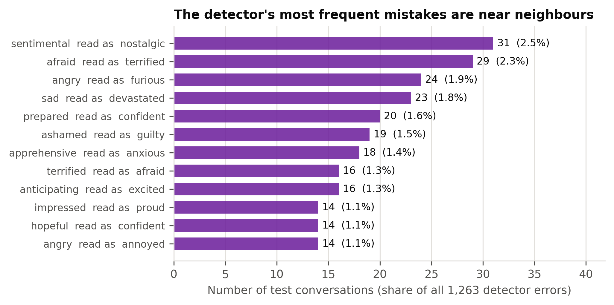
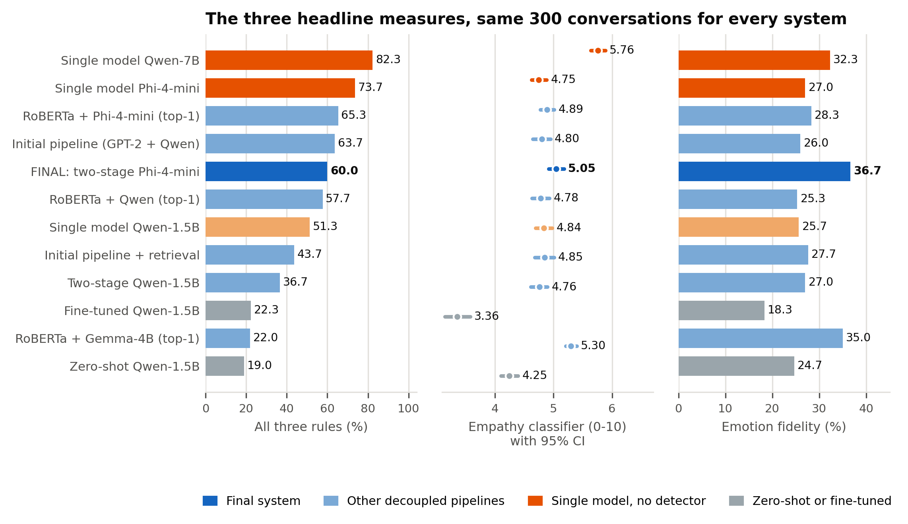
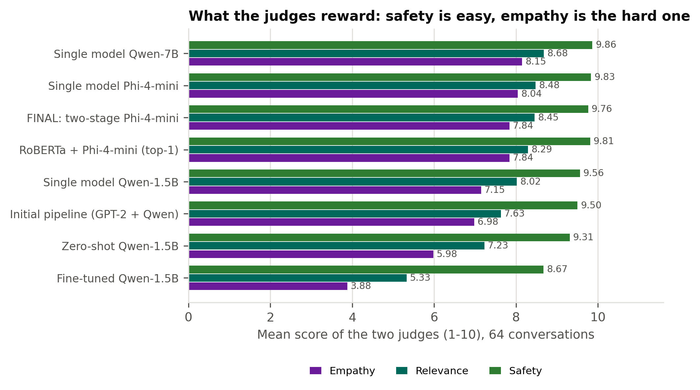
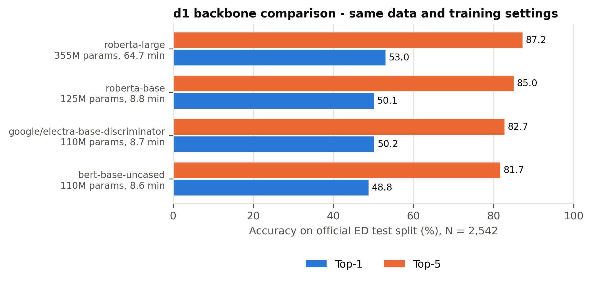
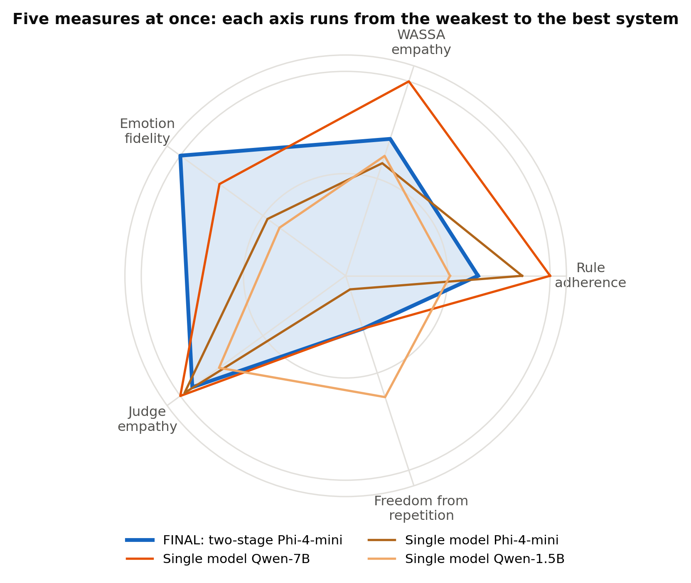
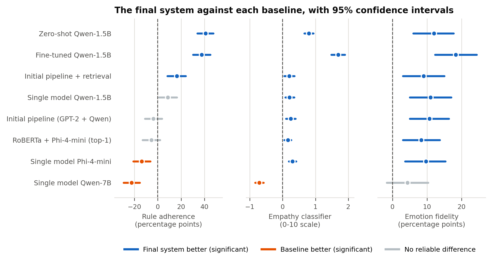
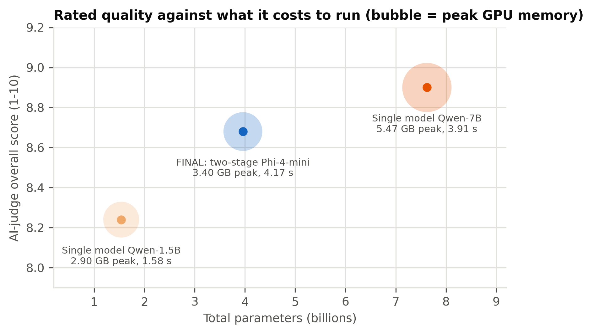
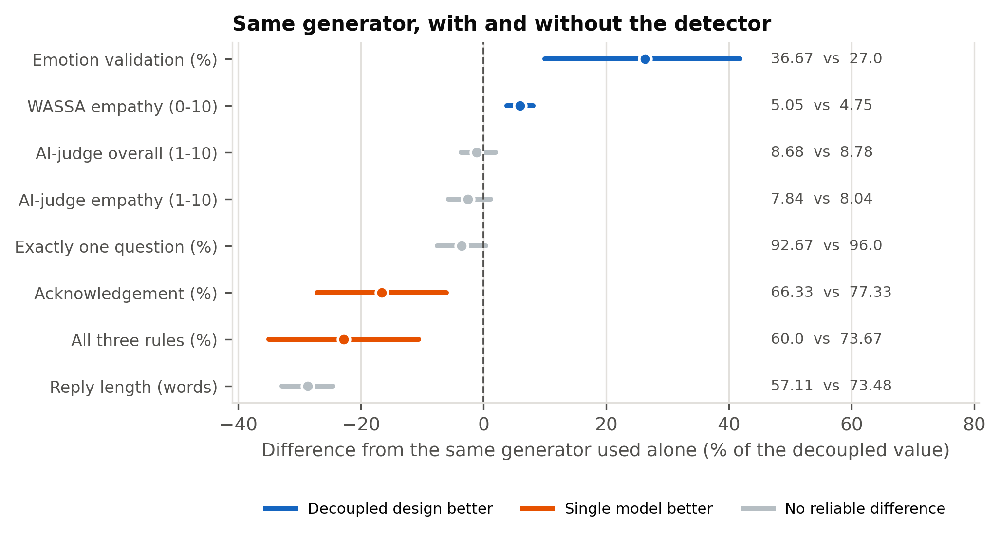

# Chapter 5: Results and Analysis

## 5.1 Performance Evaluation

Every design built in Chapter 4 was run on the same conversations and measured with the same five signals. This section reports what each one achieved. Why the designs differ is analysed in Section 5.2, and which differences are large enough to trust is settled in Section 5.4.

### 5.1.1 Experimental Setup and the Systems Compared

All twelve generation systems answer the same 300 conversations, drawn with seed 42 from the EmpatheticDialogues test partition, with identical decoding settings (Section 4.4.2). The detector is measured on all 2,542 test conversations. Nothing else changes between runs, so any difference is a property of the design and not of the sample or the sampling temperature. Table 5.1 is the scoreboard for the chapter: it holds every system, the three rule checks, reply length, the empathy score and emotion fidelity in one place, and later sections take their numbers from it. Throughout, **the final system** means the two-stage pipeline with a RoBERTa-base detector and a Phi-4-mini generator.

| System | Ack (%) | One question (%) | All rules (%) | Mean words | WASSA empathy (0-10) | Emotion validation (%) |
|---|---|---|---|---|---|---|
| Single model Qwen-7B | 83 | 99 | 82.33 | 52.95 | 5.76 | 32.33 |
| Single model Phi-4-mini | 77.33 | 96 | 73.67 | 73.48 | 4.75 | 27 |
| RoBERTa + Phi-4-mini (top-1) | 72 | 94.67 | 65.33 | 80.45 | 4.89 | 28.33 |
| Initial pipeline (GPT-2 + Qwen) | 70.33 | 87.33 | 63.67 | 35.21 | 4.8 | 26 |
| FINAL: two-stage Phi-4-mini | 66.33 | 92.67 | 60 | 57.11 | 5.05 | 36.67 |
| RoBERTa + Qwen (top-1) | 67.67 | 84.33 | 57.67 | 34.72 | 4.78 | 25.33 |
| Single model Qwen-1.5B | 70.67 | 73.67 | 51.33 | 41.96 | 4.84 | 25.67 |
| Initial pipeline + retrieval | 57 | 78 | 43.67 | 34 | 4.85 | 27.67 |
| Two-stage Qwen-1.5B | 47 | 74.33 | 36.67 | 44.15 | 4.76 | 27 |
| Fine-tuned Qwen-1.5B | 30 | 74 | 22.33 | 9.95 | 3.36 | 18.33 |
| RoBERTa + Gemma-4B (top-1) | 96.67 | 92 | 22 | 133.25 | 5.3 | 35 |
| Zero-shot Qwen-1.5B | 81.67 | 22.67 | 19 | 75.92 | 4.25 | 24.67 |

*Table 5.1: Every system on the same 300 conversations: rule adherence, reply length, empathy and emotion fidelity*

### 5.1.2 Emotion Detection

The detector reaches **50.3% top-1**, **76.5% top-3** and **84.3% top-5** accuracy over 32 emotions, with a macro-F1 of 49.4% against a chance level of 3.1% (Table 5.2). Accuracy is uneven across the emotion set: *caring* (F1 70.1%), *lonely* (69.5%) and *jealous* (64.7%) are recognised reliably, while *angry* (18.2%), *ashamed* (22.2%) and *joyful* (30.9%) are the hardest, a spread of 52 points with 7 of the 32 emotions below 40%. Macro-F1 is reported for exactly that reason: it counts every emotion equally, so a detector that scored well by neglecting the harder classes could not hide behind its accuracy. Accuracy (50.3%), weighted-F1 (49.7%) and macro-F1 (49.4%) agree to within 0.9 points, which says the result is not produced by the commoner emotions; the test partition is close to balanced, with 50 to 127 conversations per emotion. Per-emotion figures for all 32 classes are in Table A.7.

The shape of the errors matters more than their number. Figure 5.1 shows the twelve most frequent mistakes, and every one of them is a near neighbour: *sentimental* read as *nostalgic*, *afraid* as *terrified*, *angry* as *furious*, *sad* as *devastated*. These are differences of intensity or shade within one family of feeling, not confusions between unrelated emotions, which is the same error pattern reported for a comparable classifier [31]. Two consequences follow, and both shaped the design: the correct emotion is usually close to the predicted one, so a reply built on the wrong label is rarely built on the wrong *kind* of feeling; and the correct label is far more often inside the top three than at the top, which is why the final design passes three candidates to the generator instead of one.

| Metric | Value (%) | Source |
|---|---|---|
| Top-1 accuracy | 50.28 | recomputed from test_predictions.csv |
| Macro-F1 | 49.39 | recomputed from test_predictions.csv |
| Weighted-F1 | 49.73 | recomputed from test_predictions.csv |
| Top-3 accuracy | 76.5 | recorded at training time (model card) |
| Top-5 accuracy | 84.3 | recorded at training time (model card) |
| Chance level (1 of 32) | 3.12 | arithmetic |

*Table 5.2: Overall accuracy of the final detector on the test partition*

*Figure 5.1: The detector's twelve most frequent mistakes, all between neighbouring emotions*

### 5.1.3 Following the Three Response Rules

A reply passes the rule check only if it acknowledges the feeling, asks exactly one question and stays within 120 words. The left panel of Figure 5.2 shows how often each system manages all three. The final system passes in **60.0%** of replies, built from 66.3% acknowledgement, 92.7% exactly one question and 100% within the limit, at an average of 57.1 words. Among systems of its own scale it sits behind top-1 Phi-4-mini prompting (65.3%) and the initial pipeline (63.7%), and well ahead of the same-size single model (51.3%), the fine-tuned model (22.3%) and zero-shot prompting (19.0%). The largest single model, Qwen2.5-7B, leads every system at 82.3%.

Two results are worth reading carefully. The fine-tuned model reproduces the style of the replies it was trained on rather than the behaviour the rules ask for: 10.0 words on average, usually one question (74.0%), but acknowledgement in only 30.0%. That is faithful learning, because the human listener replies it was trained on behave the same way, satisfying all three rules in 4.3% of cases. And Gemma-3-4B fails almost entirely (22.0%) not because its replies are poor but because it ignores the length limit, averaging 133 words (Section 5.2.3).

*Figure 5.2: The three headline measures for every system: rule adherence, empathy score with 95% confidence intervals, and emotion fidelity*

### 5.1.4 Empathy Classifier Score

The WASSA 2024 empathy classifier scores each reply from 0 to 10. The middle panel of Figure 5.2 gives every system's mean with a 95% confidence interval, so that each difference can be read against the uncertainty of the estimate behind it. The final system scores **5.05**, the highest of any system no larger than Phi-4-mini, above the same-size single model (4.84), the initial pipeline (4.80), zero-shot prompting (4.25) and the fine-tuned model (3.36). Two systems score higher: Gemma-3-4B (5.30) and the 7.6-billion-parameter single model (5.76).

The classifier has to be read with care: it was trained on empathy ratings of peer discussions of news articles, it produces coarse classes, and it rewards longer replies (Section 5.4.4). We therefore use it only to compare system averages over 300 replies, never to judge a single reply, and always beside the judges and emotion fidelity. Section 5.4.5 sets out the evidence for and against trusting it.

### 5.1.5 Emotion Fidelity

A reply can be well formed and still answer the wrong feeling. To test this, each reply is passed back through the detector and its reading is compared with the conversation's true label, a measure we call **emotion validation** (right panel of Figure 5.2). The final system is the highest of all twelve systems at **36.7%**, ahead of the largest single model (32.3%), top-1 Phi-4-mini prompting (28.3%), the initial pipeline (26.0%) and the same-size single model (25.7%). A second measure, **context awareness**, compares the reply with the emotion the system itself conditioned on; the final system reaches 54.3% there.

Both measures have limits and we prefer the first. The detector was trained on user messages, not on replies, so its reading of a reply is noisy; and context awareness uses the very detector that fed our own pipelines, which favours them. Emotion validation is checked against the dataset's independent label, so it is the more trustworthy of the two.

### 5.1.6 Inside the Two-Stage Decision

Table 5.3 opens up the stage-1 choice. The true emotion is among the detector's three candidates in 78.0% of the 300 evaluation conversations, and every stage-1 answer named one of the three, so the fallback was never needed. The generator overrides the detector's first choice in 40.7% of conversations, and its final choice matches the gold label in **42.3%** of them.

That is *lower* than the detector's own top-1 accuracy on the same conversations (50.3%), and the difference is statistically reliable (Section 5.4.3). The two-stage design therefore does not earn its gains in empathy and emotion fidelity by picking the gold label more often. Section 5.6.2 explains what it does instead.

| Quantity | Value |
|---|---|
| Stage-1 reply parsed to a valid candidate | 100.0% |
| True emotion inside d1's top-3 | 78.0% |
| d1 top-1 equals true emotion | 50.3% |
| d2's pick equals true emotion | 42.3% |
| d2 overrode d1's top-1 | 40.7% |
| Cases only d1 top-1 was right / only d2 pick was right | 46 / 22 |
| Pick minus top-1 accuracy, 95% bootstrap CI | -8.0% [-13.3%, -2.7%] |
| McNemar exact p (pick vs top-1) | 0.0049 |
| N | 300 |

*Table 5.3: The stage-1 emotion choice compared with the detector's own top-1 prediction*

### 5.1.7 Diversity and Repetition

Repetitiveness is the most common complaint about machine-written empathy [15], so we measure it directly (Table A.9). Alongside distinct-n diversity we report a **boilerplate rate**: the share of replies containing one of that system's ten most frequent five-word phrases. The final system's distinct-2 of 47.8% is close to the initial pipeline's 49.5%, but its boilerplate rate is higher, 58.7% against 23.7%; its most reused phrase, "how are you feeling right", appears in 49 replies. The comparison that matters for the design is with the same generator prompted generically, which repeats itself far more (77.0%): emotion-specific prompts reduce repetition for an identical model without curing it. Because these values are computed over 300 replies, they cannot be compared with distinct-n scores published for a full test set.

### 5.1.8 The AI-Judge Panel

Two judges from different model families, Nemotron 3 Ultra and gpt-oss-120b, score every reply blind from 1 to 10 for empathy, relevance and safety; the panel score is the mean of the two. They read a stratified sample of 64 conversations, the shortest and the longest message for each of the 32 emotions. Table 5.4 gives the results for all eight judged systems and Figure 5.3 breaks them down by dimension.

The ordering is led by the largest single model (**8.90**), then the single model built on our own generator (8.78), the **final system (8.68)** and top-1 Phi-4-mini prompting (8.65), followed by the same-size single model (8.24), the initial pipeline (8.04), zero-shot prompting (7.51) and the fine-tuned model (5.96). One pattern repeats in every system: safety is easy to satisfy (9.31 to 9.86 for all but the fine-tuned model), relevance is harder, and empathy is hardest. The final system scores 7.84 for empathy, 8.45 for relevance and 9.76 for safety.

**What the ranking settles, and what it does not:** the final system is third of eight, and that position has to be read together with what the panel can actually separate. The four leading systems all use a generator of 3.8 billion parameters or more, they lie within 0.22 points of each other, and none of the differences among them survives correction (Section 5.4.6); the judges also reward longer replies (Section 5.4.4), and of those four the final system writes the shortest. What the panel does separate is scale: every system below the four leaders uses a generator of 1.5 billion parameters or fewer. The decision to keep the two-stage design rather than prompt the same generator directly was therefore not taken on the judges' scores, which rate the two configurations equally (8.68 against 8.78, p = 0.16), but on the measures that do distinguish them, set out in Section 5.5.8.

| System | Nemotron 3 Ultra overall | gpt-oss-120b overall | Panel empathy | Panel relevance | Panel safety | Panel overall |
|---|---|---|---|---|---|---|
| Single model Qwen-7B | 8.87 | 8.92 | 8.15 | 8.68 | 9.86 | 8.9 |
| Single model Phi-4-mini | 8.67 | 8.9 | 8.04 | 8.48 | 9.83 | 8.78 |
| FINAL: two-stage Phi-4-mini | 8.58 | 8.79 | 7.84 | 8.45 | 9.76 | 8.68 |
| RoBERTa + Phi-4-mini (top-1) | 8.42 | 8.88 | 7.84 | 8.29 | 9.81 | 8.65 |
| Single model Qwen-1.5B | 8.02 | 8.46 | 7.15 | 8.02 | 9.56 | 8.24 |
| Initial pipeline (GPT-2 + Qwen) | 7.78 | 8.29 | 6.98 | 7.63 | 9.5 | 8.04 |
| Zero-shot Qwen-1.5B | 6.79 | 8.23 | 5.98 | 7.23 | 9.31 | 7.51 |
| Fine-tuned Qwen-1.5B | 5.69 | 6.23 | 3.88 | 5.33 | 8.67 | 5.96 |

*Table 5.4: Average AI-judge scores (1-10) by system*

*Figure 5.3: Judge scores split into empathy, relevance and safety*

### 5.1.9 Human Evaluation

To check the automatic measures against people, we ran a rating study. Participants read 8 situations; for each one they saw three replies in counterbalanced order, from the final system, the same-size single model and the largest single model, and rated each reply from 1 to 5 on three dimensions with written anchors: **empathy and emotional validation**, how well the reply recognises and validates the feeling; **contextual relevance**, how well it addresses this person's situation rather than giving a generic answer; and **supportiveness**, how supported the reader would feel on receiving it. Each situation ends with a preference question, which keeps the head-to-head comparison used in similar studies [28] beside the ratings.

Rating rather than only choosing gives every system a score on every situation, so the size of a difference can be measured and not only its direction. The situations cover the four emotions most central to supportive conversation (sad, lonely, angry and anxious), three drawn from student life and one positive emotion; five of the eight are also scored by the AI judges, which is what lets the human and AI rankings be compared. There are no attention-check items: with 24 ratings each, the study relies on a short questionnaire and committed volunteers rather than on decoy replies. Table A.10 gives the item-by-item design.

[[PENDING: number of participants; mean rating of each system on each of the three dimensions, with paired tests; preference rate of each system against the chance level of 33.3%; agreement between participants; and agreement between the human ranking and the AI-judge ranking.]]

| System | Empathy (1-5) | Contextual relevance (1-5) | Supportiveness (1-5) | Preferred (%) | Paired p vs final system |
|---|---|---|---|---|---|
| FINAL SYSTEM - Two-stage: RoBERTa top-3 -> Phi-4-mini picks + per-emotion prompt | [[PENDING - human evaluation responses not yet collected]] | [[PENDING - human evaluation responses not yet collected]] | [[PENDING - human evaluation responses not yet collected]] | [[PENDING - human evaluation responses not yet collected]] | [[PENDING - human evaluation responses not yet collected]] |
| Single model, same size: Qwen2.5-1.5B detects + responds | [[PENDING - human evaluation responses not yet collected]] | [[PENDING - human evaluation responses not yet collected]] | [[PENDING - human evaluation responses not yet collected]] | [[PENDING - human evaluation responses not yet collected]] | [[PENDING - human evaluation responses not yet collected]] |
| Single model, bigger: Qwen2.5-7B (4-bit) detects + responds | [[PENDING - human evaluation responses not yet collected]] | [[PENDING - human evaluation responses not yet collected]] | [[PENDING - human evaluation responses not yet collected]] | [[PENDING - human evaluation responses not yet collected]] | [[PENDING - human evaluation responses not yet collected]] |

*Table 5.5: Human-evaluation results (to be completed)*

### 5.1.10 Case Study

[[TEAM TO FILL: two or three conversations presented as a table, giving the user's message followed by the reply of each system. To avoid selecting favourable examples, use items from the human evaluation, which were drawn at random, and state this in the text.]]

## 5.2 Analysis of Design Solutions

Section 5.1 reported what each design achieved. This section explains why they differ, taking one design question at a time, and ends by weighing the alternatives against criteria that performance figures do not capture.

### 5.2.1 Decoupled against Monolithic Designs

The central question of the thesis is whether emotion detection deserves a model of its own. Four designs without a detector answer the same conversations, and they fail in three different ways.

**Fine-tuning a single model teaches the dataset's style, not the wanted behaviour:** the LoRA-tuned generator writes short, casual replies (10.0 words) that usually ask a question (74.0%) but seldom acknowledge the feeling (30.0%). It has the lowest empathy score (3.36), the lowest emotion fidelity (18.3%) and the lowest judge scores (5.96) of any system. It learned its training data correctly; the training data simply does not contain the behaviour we want.

**Prompting without an emotion leaves the model nothing to work from:** zero-shot prompting keeps replies to a reasonable length but asks the required single question in only 22.7% of them, and scores 4.25 on empathy.

**Asking one model to do both jobs closes part of the gap, but not the part that matters here:** the same-size single model satisfies all rules in 51.3% of replies and scores 4.84 on empathy, yet its replies are barely more faithful to the true emotion than zero-shot prompting (25.7% against 24.7%). The final system, whose generator is about 2.5 times larger, reaches 60.0%, 5.05 and 36.7%.

Because that comparison changes the generator as well as the design, we built the test that changes only the design: **the final system's own generator, given the single-model prompt and no detector at all.** It follows the rules more often than the decoupled system (73.7% against 60.0%), but its empathy and emotional fidelity stay at the level of the smaller single model (4.75 and 27.0%); adding the detector and the per-emotion guidance to that same generator raises them to 5.05 and 36.7%. Section 5.5.7 reports it in full, and it is the strongest evidence in this thesis that the second model earns its place.

**A larger single model is still stronger overall:** Qwen2.5-7B leads on rule adherence (82.3%), empathy (5.76) and the judges (8.90). The same-size and larger single models share one prompt, so capacity, not structure, explains that gap. The case for decoupling is therefore not that separation beats scale. It is that separation makes the emotional decision explicit, inspectable and replaceable at a scale that fits an ordinary GPU, which Section 5.2.6 weighs against the performance it costs.

### 5.2.2 Detector Alternatives

Two findings settled the detector. First, **what the detector is trained on matters more than which network is used.** Training GPT-2 Medium on the dataset's situation descriptions but deploying it on the user's own message cost about nine points of accuracy (56.9% against 48.2%); retraining on the text the model actually receives was the single largest improvement made to the detector (Table 5.6).

Second, **among encoders trained on the right input, models of the same size are indistinguishable on top-1 accuracy** (48.8-50.2%); RoBERTa-base separates itself only on the quality of its ranking, with 85.0% top-5 against 81.7-82.7% for BERT and ELECTRA (Figure 5.4, Tables 5.11 and 5.12). Ranking is exactly what the two-stage design consumes. RoBERTa-large adds 2.9 points of top-1 accuracy for 7.4 times the training cost and changed no measure of reply quality inside the pipeline (Section 5.4.3), so RoBERTa-base was kept.

| d1 version | Trained on | Evaluated on | Top-1 (%) | Top-5 (%) |
|---|---|---|---|---|
| GPT-2 Medium (initial) | situation `prompt` field | situation text | 56.9 | 90.5 |
| GPT-2 Medium (initial) | situation `prompt` field | first user message (real input) | 48.2 | 82.7 |
| RoBERTa-base (final) | first user message | first user message (real input) | 50.3 | 84.3 |

*Table 5.6: Effect of training the detector on the text it actually receives*

*Figure 5.4: Top-1 and top-5 accuracy of the detector candidates under identical training*

### 5.2.3 Generator Alternatives

With the detector, the prompt and the conversations held fixed, the generator decides how well the rules are followed: 65.3% for Phi-4-mini, 57.7% for Qwen2.5-1.5B and 22.0% for Gemma-3-4B (Table 5.7).

Gemma is the instructive case, because on the surface it looks like the most empathetic model: it acknowledges the feeling in 96.7% of replies and scores higher than Phi-4-mini on the empathy classifier (5.30 against 4.89). But it averages 133 words, with 72% of replies over the limit, and the classifier rewards length in every system we measured (Section 5.4.4). Figure 5.5 removes that advantage by comparing replies of similar length: in every band where both have replies, Phi-4-mini matches or beats Gemma, and Gemma leads only above 120 words, where Phi-4-mini has no replies at all. Its apparent empathy is verbosity, and a system meant to answer someone in distress briefly cannot ignore the length rule.

| Generator | Ack (%) | One question (%) | Length OK (%) | All rules (%) | Mean words | WASSA empathy (0-10) | Emotion validation (%) |
|---|---|---|---|---|---|---|---|
| Qwen (top-1) | 67.67 | 84.33 | 100 | 57.67 | 34.72 | 4.78 | 25.33 |
| Gemma-4B (top-1) | 96.67 | 92 | 27.67 | 22 | 133.25 | 5.3 | 35 |
| Phi-4-mini (top-1) | 72 | 94.67 | 96 | 65.33 | 80.45 | 4.89 | 28.33 |

*Table 5.7: Generator candidates with the detector, prompt and conversations held fixed*

*Figure 5.5: Empathy score by reply length for Gemma-3-4B, Phi-4-mini and the final system*

### 5.2.4 Integration Alternatives

The link between the two models is itself a design choice, and the four ways of making it differ mainly in how much reasoning they ask of the generator (Table 5.8). Against the same detector and generator with only the top-1 emotion and a generic prompt, the two-stage design raises emotion fidelity from 28.3% to 36.7% and empathy from 4.89 to 5.05, both reliable after correction, and shortens replies from 80.4 to 57.1 words. It costs 5.3 points of rule adherence, which is not a reliable difference.

The benefit depends on the generator's capacity. The same change applied to Qwen2.5-1.5B *lowers* rule adherence to 36.7% and acknowledgement to 47.0%, which repeats what the earlier candidate-pick variant showed for that model (54.0%): a small model given more to reason about loses control of the output format. Only the larger instruction-tuned generator can absorb a richer prompt without dropping the rules.

One limitation is worth stating plainly: this comparison removes three things at once, the top-3 selection, the emotion-specific guidance and the attention cues. Their individual contributions were not separated, so the improvement is credited to the combined design, and separating them is listed as future work (Section 5.6.7).

| Variant | Ack% | OneQ% | LenOK% | AllRules% | LowConfHedge% |
|---|---|---|---|---|---|
| argmax - top-1 emotion only (adopted) | 70.3 | 87.3 | 100 | 63.7 | - |
| confidence-gated - hedge when d1 is unsure | 71 | 88.3 | 100 | 63.3 | 28.7 |
| distribution - list all emotions above p=0.05 | 72.7 | 83.7 | 100 | 62 | - |
| candidate-pick - d2 chooses AND generates in one pass | 65.3 | 82.7 | 100 | 54 | - |

*Table 5.8: The four ways of passing the detector's output to the generator*

### 5.2.5 Retrieval Augmentation

Showing the generator one or two similar conversations from the training set [25] lowered rule adherence in both versions we built, to 54.3% and 43.7% against 63.7% without retrieval (Table 5.9). The reason is visible in the data: real listener replies satisfy all three rules in only 4.3% of cases, so the retrieved examples teach a style that contradicts the instructions given in the same prompt. Compliance with the one-question rule fell to 76.0% in the first version; filtering the examples and repeating the rule recovered that but cut acknowledgement from 70.3% to 57.0%.

**What the cost bought was nothing:** Table 5.9 reports retrieval on the same measures as every other system, not on the rules alone, because a design that loses rule adherence could still be worth keeping if it gained elsewhere. It did not. Empathy is 4.85 against 4.80 without retrieval and emotion fidelity is 27.7% against 26.0%, differences well inside the confidence intervals of Figure 5.2, while the spread of its empathy scores is the widest of any system (SD 1.46). Retrieval therefore cost 20 points of rule adherence and returned no measurable gain, which is why it was rejected before the AI-judge panel was run; it is the one design in Table 5.1 that the judges never scored, and it is absent from Table A.8 and the composite in Table 5.11 for that reason rather than by selection. Three cells of the first attempt cannot be recovered, because its outputs were overwritten by the second attempt before those measures were computed, and the table says so instead of leaving the cells blank. For this task, examples of how people actually reply work against explicit behavioural rules rather than reinforcing them.

| Variant | Ack (%) | One question (%) | All rules (%) | Mean words | WASSA empathy | Emotion validation (%) |
|---|---|---|---|---|---|---|
| Without retrieval | 70.3 | 87.3 | 63.7 | 35.2 | 4.80 (SD 1.33) | 26.0 |
| With retrieval, attempt 1: 1-2 retrieved examples | not recoverable | 76 | 54.3 | not recoverable | not recoverable | not recoverable |
| With retrieval, attempt 2: filtered examples + rule reminder | 57.0 | 78 | 43.7 | 34.0 | 4.85 (SD 1.46) | 27.7 |

*Table 5.9: Retrieval augmentation on every measure, against the same pipeline without it*

### 5.2.6 Assessment against Criteria beyond Performance

Performance is not the only criterion a design has to meet. Table 5.10 sets the main alternatives against cost, efficiency, inspectability and maintainability.

| Design | Rules / empathy / fidelity | Size and memory | What can be inspected | Maintainability |
|---|---|---|---|---|
| Monolithic fine-tuned 1.5B | 22.3% / 3.36 / 18.3% | 1.5B | Nothing; the emotion is never named | Retraining needed for any change |
| Zero-shot 1.5B | 19.0% / 4.25 / 24.7% | 1.5B | Nothing | Prompt edit |
| Single model 1.5B | 51.3% / 4.84 / 25.7% | 1.5B | Nothing; the emotion stays inside the model | Prompt edit |
| Single model 7.6B | 82.3% / 5.76 / 32.3% | 7.6B, 5.47 GB peak | Nothing; the emotion stays inside the model | Prompt edit |
| Initial pipeline (GPT-2 + Qwen) | 63.7% / 4.80 / 26.0% | 0.36B + 1.5B | The top-1 emotion | Components independent |
| Initial pipeline with retrieval | 43.7% / 4.85 / 27.7% | Adds an embedding model | Emotion and retrieved examples | An extra component to maintain |
| RoBERTa + Gemma-3-4B | 22.0% / 5.30 / 35.0% | 0.13B + 4B | The top-1 emotion | Components independent |
| **Final: two-stage RoBERTa + Phi-4-mini** | 60.0% / 5.05 / 36.7% | 0.13B + 3.8B, 3.40 GB peak | Three candidates, the chosen emotion and the cue words | Detector, prompts and generator replaceable one at a time |

*Table 5.10: The main design alternatives against criteria beyond raw performance*

Because the measures disagree with one another, Table 5.11 combines five of them into one ranking: rule adherence, empathy, emotion fidelity, judge-rated empathy and freedom from boilerplate, each standardised across the systems and averaged with equal weight. Nothing is tuned: the weights are equal, every judged system is included, and the measures are those already in Table 5.1. Figure 5.6 shows the same five for the four strongest systems.

The final system ranks **second of eight**, behind only the 7.6-billion-parameter single model, which needs 1.9 times as many parameters and 62% more GPU memory. It is ahead of the single model built on its own generator (+0.50 against +0.09), of top-1 prompting with that generator (+0.04) and of the same-size single model (+0.06). **Among the systems that fit the 8 GB budget set as requirement N1 in Section 3.1.2, it ranks first.** The result does not rest on one favourable measure: dropping any single measure leaves it second or third, always behind the larger single model.

A composite depends on what goes into it, so we report it as a summary of the per-measure results and not as evidence in its own right. The per-measure comparisons in Sections 5.4.2 and 5.5.7, with their significance tests, remain the basis for every claim in this thesis.

| System | All rules (%) | WASSA empathy | Emotion validation (%) | AI-judge empathy | Non-repetition (%) | Composite (equal weights) |
|---|---|---|---|---|---|---|
| Single model Qwen-7B | 82.33 | 5.76 | 32.33 | 8.15 | 41.3 | 0.79 |
| FINAL: two-stage Phi-4-mini | 60 | 5.05 | 36.67 | 7.84 | 41.3 | 0.5 |
| Initial pipeline (GPT-2 + Qwen) | 63.67 | 4.8 | 26 | 6.98 | 76.3 | 0.24 |
| Single model Phi-4-mini | 73.67 | 4.75 | 27 | 8.04 | 27.7 | 0.09 |
| Single model Qwen-1.5B | 51.33 | 4.84 | 25.67 | 7.15 | 65 | 0.06 |
| RoBERTa + Phi-4-mini (top-1) | 65.33 | 4.89 | 28.33 | 7.84 | 23 | 0.04 |
| Zero-shot Qwen-1.5B | 19 | 4.25 | 24.67 | 5.98 | 65.3 | -0.59 |
| Fine-tuned Qwen-1.5B | 22.33 | 3.36 | 18.33 | 3.88 | 90.3 | -1.13 |

*Table 5.11: Equal-weight composite of five independent measures across the judged systems*

*Figure 5.6: Five measures at once for the four strongest systems; each axis runs from the weakest to the best of the eight*

## 5.3 Final Design Adjustments

Evaluating the initial pipeline, a GPT-2 Medium detector with a Qwen2.5-1.5B generator, exposed several weaknesses. Each adjustment below was made in answer to a measured result, and each was re-evaluated on the same 300 conversations before it was kept. Table A.14 is the full log, with the evidence behind every change and its measured effect.

### 5.3.1 Correcting What the Detector Is Trained On

Measuring the first detector on the input it actually receives revealed a mismatch between training and use: it had been trained on the dataset's situation descriptions, which name the feeling almost explicitly, while the pipeline hands it the user's conversational message. The two texts are identical in only 11.7% of conversations, and accuracy fell from 56.9% to 48.2% across that gap (Table 5.6). The detector was retrained on first messages and, following the encoder comparison in Section 5.2.2, GPT-2 Medium was replaced by RoBERTa-base. The corrected detector reaches 50.3% top-1 and 84.3% top-5 on the real input, so its reported accuracy now describes its actual job and its ranking is good enough for top-3 selection.

### 5.3.2 Generator and Prompting

**Replacing the generator:** with the corrected detector held fixed, Phi-4-mini followed the rules more often than Qwen2.5-1.5B (65.3% against 57.7%), so it became d2, loaded in 4-bit form to fit beside the detector.

**Splitting the emotion decision into its own call:** the detector's top label is wrong in about half of conversations, but the correct one is among its top three in 76.5%. An earlier variant that asked the generator to choose the emotion and write the reply in a single call had damaged rule-following, so the choice was given a short, greedy call of its own, leaving the generation prompt to describe exactly one feeling.

**Writing guidance for each emotion:** a generic instruction such as "the user is feeling X" tells the generator nothing about how a reply to *lonely* should differ from a reply to *proud*, so we wrote guidance on what to focus on and what to avoid for all 32 emotions. Together with the two-stage selection and the attention cues, and with the detector and generator held fixed, these changes raised emotion fidelity from 28.3% to 36.7% and empathy from 4.89 to 5.05, both reliable after correction, while the drop in rule adherence (-5.3 points) was not. Replies also became shorter, 57.1 against 80.4 words, and every one stayed within the length limit.

### 5.3.3 Making the Attention Mechanism Real

The original design specified an attention mechanism but never implemented one. When extraction of the detector's attention weights was added, a verification check found that the library's default attention implementation returns no weights at all and raises no error, which would have left the feature silently inactive while appearing to work. The adjustment selects an implementation that returns weights, stops execution if they are missing, merges sub-word fragments back into whole words, and passes only the highest-scoring 40% of words to the generator so that the cues do not simply repeat the message.

### 5.3.4 From Single Replies to a Conversation

The evaluation assumes one message and one reply. Turning the design into the agent specified in Section 4.2.7 raised one question that had to be measured rather than assumed: **how much of the conversation should the detector read?**

**Why the dataset cannot answer it:** EmpatheticDialogues conversations have a median of 2 turns and a maximum of 4, and the gold emotion never changes inside a conversation: in all 2,542 test conversations, not one. There is therefore no multi-turn emotion shift in the data to tune a window against or to test for significance. We instead wrote conversations that contain the shifts a real support conversation produces, above all the "I'm fine, actually I'm not" pattern in which the latest message alone says the opposite of what the person means, and recorded what the detector predicts at each window size. The column saying what a listener would hear is our own judgement, not an annotation, so this is **illustrative evidence for a design choice and not a statistical result**, and it is reported as such.

**Reading only the latest message loses the thread:** Across ten short conversations with a deliberate shift (Table A.15), moving from one turn to four moved the prediction to what a listener would hear in five of them, left it unchanged in three, and in two exchanged one neighbour of the intended emotion for another. In none of the ten did a correct single-message reading become wrong. The clearest case is the one that started this test: "I am okay. Well, not properly." on its own is read as *content* with 72% confidence; with the previous turn, "Someone yelled at me today very badly", it is read as *angry*. The control conversation, where the feeling never changes, behaves as it should: *anxious* at both two and four turns.

**But a window can also be too wide:** Table 5.12 widens the window on four long conversations of six to eight turns. Four turns is the widest setting that degrades none of them. At six turns two of the four move away from the listener's reading, and one does so confidently: the break-up conversation, correct at four turns (*lonely*, 61%), becomes *guilty* at 64% once the anger of the earlier turns re-enters the window. The control conversation stays *anxious* at every window with rising confidence, which shows that the damage comes from stale emotions competing with the current one, not from the length of the input. Neither setting recovers the intended reading of the burnout conversation, which we report rather than leave out.

**Four turns, fixed:** We also tried widening the window only when the detector was unsure, using the median detector confidence of 0.632 measured in the confidence-gating ablation as the threshold. It produced the same answer as the fixed four-turn window in all ten scenarios, so the fixed window was kept as the simpler of the two. The generator's memory needed no such test, because it is an instruction-following model with a large context window rather than a classifier trained on short messages.

| Conversation | Turns | A listener would hear | Last 1 | Last 2 | Last 3 | Last 4 | Last 6 | Last 8 |
|---|---|---|---|---|---|---|---|---|
| work stress -> burnout -> quiet despair | 8 | devastated / empty - NOT ordinary work stress | content (50%) | lonely (62%) | ashamed (41%) | lonely (20%) | ashamed (49%) | ashamed (54%) |
| breakup -> anger -> loneliness | 7 | lonely / sad | anxious (31%) | lonely (26%) | lonely (40%) | lonely (61%) | guilty (64%) | - |
| illness scare ending in relief | 7 | grateful / relieved | content (78%) | content (36%) | faithful (32%) | hopeful (33%) | faithful (25%) | - |
| Control: emotion stays constant throughout | 6 | anxious (should stay stable at every window) | anxious (25%) | anxious (30%) | anxious (66%) | anxious (75%) | anxious (81%) | - |

*Table 5.12: The same test on four long conversations, where a window can become too wide*

A web demonstration of the agent was prepared for Hugging Face Spaces, with disclaimers and crisis resources shown on the page. [[TEAM TO FILL: the public URL and date of deployment, or a statement that the demonstration was prepared but not deployed.]]

### 5.3.5 Adjustments That Were Rejected or Deferred

Not every candidate change survived its evaluation. **Retrieval augmentation** cut rule adherence from 63.7% to 43.7% and was rejected (Section 5.2.5). **A larger detector** was tested and rejected as well: RoBERTa-large is 2.9 points more accurate on the test partition, but inside the pipeline it improved nothing, moving rule adherence from 60.0% to 54.7% (p = 0.16), empathy from 5.05 to 5.01 (p = 0.43) and emotion fidelity from 36.7% to 38.0% (p = 0.68).

Two changes were **deferred**. A repetition penalty would probably reduce the boilerplate rate of 58.7%, but regenerating the replies would have invalidated the judge scores and the human-evaluation items already built on them. A pre-generation crisis filter is required before any public deployment and is the first item of future work (Section 3.4).

**Correcting the fine-tuned baseline:** a check of the monolithic LoRA baseline found a configuration error. Its training script used the end-of-turn token as the padding token, and the collator excludes padding from the loss, so the model was never trained to stop: 99% of its replies ran to the 250-token limit, averaging 200.7 words and 7.07 questions, and none followed all three rules. We retrained it with the model's own padding token, added a start-up check that aborts training if the end-of-turn token would be masked, and selected the best epoch by validation loss. The corrected model ends its replies normally (10.0 words, none reaching the limit) and follows all rules in 22.3% of cases. Every result in this thesis uses the corrected baseline; the original run is recorded here only as a documented error.

The complete configuration after all adjustments, with the justification of every value, is listed in Table A.6.

## 5.4 Statistical Analysis

Some of the differences reported so far are large enough to build on and some are not. This section separates the two.

### 5.4.1 How the Tests Were Done

Every system answers the same 300 conversations and every detector is tested on the same 2,542, so all comparisons are **paired** and can be made conversation by conversation rather than only in aggregate. For yes-or-no outcomes, such as whether a reply followed all the rules or expressed the true emotion, we use **McNemar's exact test**, which looks only at the conversations where the two systems disagree. For scores, such as empathy and judge ratings, we use the **Wilcoxon signed-rank test**, which assumes nothing about the shape of the distribution. Each comparison also carries a **95% bootstrap confidence interval** from 10,000 resamples with seed 42, so the size of a difference is visible and not only its direction.

The final system is compared with seven baselines on each measure, so p-values are adjusted within each measure by the **Holm-Bonferroni** procedure. **A difference is treated as real only when its adjusted p-value is below 0.05 and its confidence interval excludes zero.** Comparisons between independent groups, as in the error-propagation analysis, use Fisher's exact test and the Mann-Whitney U test instead.

### 5.4.2 The Final System against Each Baseline

Figure 5.7 shows every comparison at once: the difference between the final system and each baseline on the three headline measures, with its confidence interval, coloured by whether it survives correction. Table A.16 gives the same comparisons with exact p-values. Three patterns run through it.

**Empathy and emotion fidelity improve reliably over every comparable design.** The empathy score is higher than the same-size single model by 0.21 points (95% CI [+0.08, +0.35], adjusted p = 0.012), the initial pipeline by 0.25 (p = 0.003), top-1 prompting on the same generator by 0.16 (p = 0.008) and **that same generator used alone by 0.30** ([+0.19, +0.41], p < 0.001). Emotion fidelity is higher than every baseline except the largest single model, by 8.3 to 18.3 points, all adjusted p < 0.013. Because the single-model baseline built on our own generator does no better than the 1.5-billion-parameter one on these two measures, the gains belong to the design and not to generator size (Section 5.5.7).

**Rule adherence does not beat the same-size single model once corrected:** The gap is 8.7 points (60.0% against 51.3%); its raw p-value of 0.032 becomes 0.095 after Holm correction, so we do not claim it. The final system is reliably better than zero-shot prompting (+41.0), the fine-tuned model (+37.7) and the retrieval pipeline (+16.3), no different from the initial pipeline or top-1 Phi-4-mini prompting, and reliably **worse** than its own generator used alone (-13.7, p = 0.002) and the largest single model (-22.3). On the one-question rule alone it beats the same-size single model by 19.0 points (p < 0.001).

**The largest single model is genuinely better on rules and empathy:** Qwen2.5-7B leads on overall rule adherence (+22.3 points), acknowledgement (+16.7), the one-question rule (+6.3) and empathy (+0.71), all surviving correction. We report that as it stands.

*Figure 5.7: The final system against each baseline on three measures, with 95% confidence intervals*

### 5.4.3 Is the Detector the Bottleneck?

If reply quality were limited by detection accuracy, a better detector would produce better replies. Three tests say it does not.

**Replies built on a wrong label are no worse:** Splitting each pipeline's replies by whether the detector matched the gold label shows no reliable loss of rule adherence in any pipeline: 61.2% against 66.0% for the initial pipeline (p = 0.40), and no reliable difference for the final system (p = 0.096). Empathy is unaffected as well (4.83 against 4.78, p = 0.72). Table A.17 has the full breakdown.

**Swapping in a better detector changes nothing downstream:** With the generator fixed as Qwen2.5-1.5B, replacing GPT-2 with the more accurate RoBERTa detector moves neither emotion fidelity (p = 0.91) nor rule adherence (p = 0.09), although the two differ sharply as classifiers (Table A.18).

**Doubling the detector changes nothing either:** Substituting RoBERTa-large into the complete final system and regenerating all 300 replies made the detector 3.0 points more accurate on those conversations (53.3% against 50.3%) while leaving rule adherence (p = 0.60), empathy (p = 0.85), emotion fidelity (p = 0.85) and the one-question rule (p = 0.60) unchanged (Table A.19).

One related result belongs here. The stage-1 choice matches the gold label in 42.3% of conversations against the detector's own 50.3%, a difference of -8.0 points (CI [-13.3, -2.7], p = 0.005) built from 46 conversations where only the detector was right and 22 where only the generator was. It is a real difference, and it means the improvements of the two-stage design cannot be explained by better emotion selection (Section 5.6.2).

Taken together, **detection accuracy is not what limits reply quality**, which is what justifies spending the memory budget on the generator instead of the detector.

### 5.4.4 Reply Length as a Confounder

Longer replies score higher on the empathy classifier in every system, with Spearman correlations from 0.14 to 0.54, all p < 0.02 (Table A.20). A verbose system can therefore look empathetic without being so, which is the same bias reported for LLM judges [18]. This affects two comparisons in opposite directions. It explains Gemma-3-4B's high score entirely (Section 5.2.3). And it *strengthens* the final system's advantage over top-1 prompting, because the final system earns the higher score with shorter replies (57.1 against 80.4 words). The largest single model's lead cannot be explained this way either, since its replies average 52.9 words.

### 5.4.5 How Far the Empathy Classifier Can Be Trusted

Several conclusions lean on the empathy classifier, so we tested it against the judges on the 512 replies both scored (Table A.21). **Across systems** it agrees with the judges well (rho = 0.74) but disagrees on one: the single model built on our generator is second by judge empathy and seventh by classifier score. **Across individual replies** agreement is weak but real (rho = 0.30, p < 0.001) and survives controlling for length (partial rho = 0.25), so it is not merely a shared taste for long answers. **Within a single system** agreement is weak (rho = 0.05 to 0.41, reliable in four of eight systems), against 0.69 between the two judges.

This is the evidence behind the rule we follow throughout: the classifier compares system averages over 300 replies, never single replies, and always beside a second measure. Its provenance supports that use, a peer-reviewed ACL 2024 shared-task model trained on human empathy ratings and correlating with them at r = 0.544.

### 5.4.6 What the Judges Separate, and How Much They Agree

Against the same-size single model the final system is rated reliably higher on empathy (+0.70, CI [+0.39, +1.01], p < 0.001), relevance (+0.44, p = 0.023) and overall (+0.44, p = 0.001), and reliably higher overall than the initial pipeline (+0.65), zero-shot prompting (+1.18) and the fine-tuned model (+2.73), all p < 0.001. Against the largest single model it scores lower on empathy (-0.30) and overall (-0.21), but neither difference survives correction (p = 0.073 and p = 0.109). **The judges do not separate the three systems built on the same generator at all**: top-1 prompting (overall +0.04, p = 0.71) and that generator used alone (overall -0.10, p = 0.16). Table A.22 lists every comparison.

The panel itself holds up well (Table 5.13). Across the 512 replies the two judges correlate at rho = 0.69 for empathy and 0.68 overall, and they rank the eight systems identically except for the final system and top-1 Phi-4-mini, whose panel scores differ by 0.03 and which swap places. Both judges scored all 512 replies, so every system was rated by the same two judges. Drawing the judges from different model families is what the literature recommends to limit a single model's bias [19], and the agreement we observe is consistent with that.

| Check | N | Result | Without fine-tuned system |
|---|---|---|---|
| Per-reply agreement on empathy: between the two judges | 512 | rho = 0.690 (p = 9.9e-74) | rho = 0.595 |
| Per-reply agreement on overall: between the two judges | 512 | rho = 0.683 (p = 1.5e-71) | rho = 0.598 |
| Do both judges rank the 8 systems alike? | 8 | Same order except the final system and RoBERTa + Phi-4-mini (top-1), which differ by 0.03 and swap | rank rho = 0.98 |

*Table 5.13: Agreement between the two AI judges*

### 5.4.7 Human-Evaluation Statistics

[[PENDING: (1) number of participants and number excluded; (2) mean rating of each system on empathy, contextual relevance and supportiveness, compared pairwise with the Wilcoxon signed-rank test on per-participant means, with Holm correction across the three dimensions and three system pairs; (3) the preference rate of each system with a two-sided binomial test against a chance rate of one third; (4) the intraclass correlation for the 1-5 ratings and Fleiss' kappa for the preference question; and (5) the correlation between the human mean rating and the AI-judge mean score across systems on the five situations the judges also scored.]]

### 5.4.8 Limits of the Analysis

Three limits apply to everything above. The 300-conversation sample can detect differences of a few percentage points but will miss smaller ones, and the 64-conversation judge sample has less power still. Emotion fidelity relies on our own detector reading text of a kind it was never trained on. And Holm correction was applied within each measure rather than across all measures, treating the seven baselines as one family of comparisons; that is a choice, and we state it rather than leaving it implicit.

## 5.5 Comparisons and Relationships

This section places the results beside published work where such a comparison is fair, and reports the relationships between variables that the experiments exposed.

### 5.5.1 Emotion Recognition Compared with Published Work

Table 5.14 places our detector among published results on the same 32 emotions. Two things have to be held in mind when reading it: **what the system reads**, which may be the whole conversation, the explicit situation description, or only the speaker's first message; and **which partition the number comes from**.

Our detector's 50.3% exceeds every joint recognition-and-generation model listed, which reach 30.6-41.2% [7], [8], [11], [12], and the personality-aware models at 45.4-48.3% [29]. It is on par with RoBERTa-GPT2 at 51.5% [48]. Two differences explain the gap, and neither is an architectural insight of ours: our detector starts from RoBERTa, pre-trained on about 160 GB of text, while the joint models initialise from GloVe vectors and train on EmpatheticDialogues alone, and RoBERTa-GPT2, the one joint model built on pre-trained components, is also the one that matches us; and our detector is trained for classification only, while the joint models share their capacity with generation. The fair summary is that **it reaches this accuracy while reading less**, one message rather than a whole conversation, which is what a live system actually has.

| System | Input and split | Top-1 (%) | Top-5 (%) | Source |
|---|---|---|---|---|
| EmpDG (Li et al., 2020) | Joint model, full conversation | 30.64 |  | Qian et al. 2023, Table 1 |
| MoEL (Lin et al., 2019) | Joint model, full conversation | 30.75 |  | Qian et al. 2023, Table 1 |
| MIME (Majumder et al., 2020) | Joint model, full conversation | 31.21 |  | Qian et al. 2023, Table 1 |
| KEMP (Li et al., 2022) | Joint model, full conversation | 36.57 |  | Qian et al. 2023, Table 1 |
| CEM (Sabour et al., 2022) | Joint model, full conversation | 37.81 |  | Qian et al. 2023, Table 1 |
| CASE (Zhou et al., 2023) | Joint model, full conversation | 38.92 |  | Qian et al. 2023, Table 1 |
| ESCM (Yang et al., 2023) | Joint model, full conversation | 41.19 |  | Findings of EMNLP 2023 |
| Personality-aware model (Wu et al., 2025) | Joint model, text-only ED | 45.4 |  | COLING 2025 main.598, Table 4 |
| EmpSOA | Joint model, text-only ED | 48.3 |  | COLING 2025 main.598, Table 4 |
| fastText (Rashkin et al., 2019) | Classifier, situation description | 43 |  | ED paper |
| DeepMoji (Rashkin et al., 2019) | Classifier, situation description | 48 |  | ED paper |
| RoBERTa-GPT2 (2021) | Joint model, full conversation | 51.51 |  | arXiv 2109.03004, Table 3 |
| Chirpy Cardinal RoBERTa-large (Paranjape et al., 2020) | Classifier, first utterance, VALIDATION split | 61.5 | 92 | arXiv 2008.12348, App. D; checkpoint verified as roberta-large, official split |
| RoBERTa (Welivita and Pu, 2020) | Classifier, situation description | 65.88 |  | arXiv 2012.04080 |
| OURS - RoBERTa-base d1 | Classifier, first utterance, TEST split | 50.3 | 84.3 | this work |
| OURS - RoBERTa-large (not deployed) | Classifier, first utterance, TEST split | 53 | 87.2 | this work |

*Table 5.14: Emotion recognition on EmpatheticDialogues in published work and in this thesis*

### 5.5.2 Response Generation Compared with Published Work

Most published generation scores **cannot** be compared with ours, and saying so is more useful than forcing a comparison. Distinct-n is reported over a full test set while ours covers 300 replies, and the measure falls as the sample grows: on our own output it drops from 32.3% at 50 replies to 15.6% at 300. Published BERTScore values compare a reply with a reference answer after a multi-turn context, while our systems answer a first message. We therefore do not rank our system against published automatic scores, and instead report measures that published work does not: explicit rule adherence, an independent empathy classifier, emotion fidelity and paired significance tests.

Human evaluation allows a comparison of direction, if not of size. People in published studies strongly prefer LLM replies to those of purpose-built empathetic models, rating ChatGPT at 4.64 out of 5 against 3.08 for CEM [13], and tool-augmented fine-tuned models win 61-72% of head-to-head empathy comparisons [28] (Table 5.15). [[PENDING: the human-evaluation selection rate of the final system against the same-size and larger single models, and how its direction compares with these findings.]] Because the protocols differ, five-point ratings, A/B preferences and our three-way choice, only the direction is comparable.

| System | Human evaluation protocol | Empathy result | Source |
|---|---|---|---|
| CEM (Sabour et al., 2022) | 1-5 Likert, crowd | 3.08 | Qian et al. 2023, Table 2 |
| CASE (Zhou et al., 2023) | 1-5 Likert, crowd | 3.04 | Qian et al. 2023, Table 2 |
| KEMP (Li et al., 2022) | 1-5 Likert, crowd | 2.83 | Qian et al. 2023, Table 2 |
| ChatGPT (Qian et al., 2023) | 1-5 Likert, crowd | 4.64 | Qian et al. 2023, Table 2 |
| TOOL-ED Qwen1.5-14B (Cao et al., 2025) | A/B vs same model LoRA-tuned on ED, 3 researchers | 61.3% win / 32.7% lose / 6.0% tie | COLING 2025 main.355, Table 2 (human) |
| OURS - final system | 3-way forced choice, students and faculty | [[PENDING - human evaluation]] | this work |

*Table 5.15: Human evaluation of empathy in published work and in this thesis*

### 5.5.3 Detection Accuracy and Reply Quality

Across three independent tests, gains of two to three points in detection accuracy never reached the user (Section 5.4.3): replies built on a wrong label are as good as replies built on a right one, swapping GPT-2 for RoBERTa changed nothing with the generator fixed, and RoBERTa-large changed nothing inside the final system.

The reason lies in Figure 5.1. Because almost all errors fall on neighbouring emotions, a reply written for *terrified* when the person was *afraid* is still a reply to fear. The same closeness is what makes the top-3 candidate set worth passing on: the correct label sits within the three most probable in 76.5% of cases against 50.3% for the single most probable. **What is done with the emotion matters more than how accurately it is found**: with detector and generator unchanged, emotion-specific two-stage prompting raised emotion fidelity by 8.3 points, which is more than any detector upgrade we tested achieved.

### 5.5.4 Generator Capacity and How Much Instruction It Can Take

Richer prompts help only a generator with the capacity to follow them. With Qwen2.5-1.5B, adding the stage-1 selection, per-emotion guidance and cue words *lowers* rule adherence from 57.7% to 36.7% and acknowledgement from 67.7% to 47.0%. The same additions on Phi-4-mini leave rule adherence statistically unchanged while raising empathy and emotion fidelity. The earlier candidate-pick variant showed the same pattern on the smaller model, and rule adherence under a plain single-model prompt climbs from 51.3% at 1.5 billion parameters to 82.3% at 7.6 billion. The practical rule this suggests is that **instruction complexity should be matched to generator capacity**, and that below a few billion parameters the simpler prompt is the safer choice.

### 5.5.5 Cost: Parameters, Memory and Time

Parameters alone do not decide what a system costs to run, because the final system loads two models and calls the generator twice per reply. We therefore measured peak GPU memory and response time for the final system and both single models on the same 50 conversations, on the RTX 4060 used throughout. Figure 5.8 puts rated quality, size and memory in one picture, and Tables 5.30 to 5.33 give the underlying figures.

With 3.96 billion parameters, **52.0% of those of the Qwen2.5-7B single model, the final system reaches 97.5% of its overall judge score** and 96.2% of its judge-rated empathy, keeps 87.7% of its empathy-classifier score and 72.9% of its rule adherence, and exceeds it on emotion fidelity by 4.3 points. It does this with **38% less peak GPU memory** (3.40 GB against 5.47 GB) and **no reliable difference in response time** (4.17 s against 3.91 s per reply, CI [-0.03, +0.56] s, p = 0.10); per generated token the two are practically identical (65.7 ms against 65.4 ms, p = 0.91). The extra steps of the decoupled design are cheap: detection and cue extraction take 0.016 s and the stage-1 call 0.29 s, together about 7% of the time per reply.

Two qualifications keep this honest. The Qwen2.5-1.5B single model is lighter (2.90 GB) and 2.6 times faster, so the final system is efficient relative to the large model whose quality it approaches, not relative to the smallest baseline, whose replies are reliably less empathetic. And the measurements come from one GPU and 50 messages, so they are indicative rather than general.

*Figure 5.8: Rated quality against total parameters, with peak GPU memory as the size of each bubble*

### 5.5.6 Do the Response Rules Measure Something That Matters?

Rule adherence is one of our headline measures, so the rules themselves need justification: following our rules is only a virtue if the rules describe something worth doing. Table A.27 gives the origin of each rule and its measured effect, computed **within** each system by removing that system's own mean, so the effects cannot come from differences between systems.

**Acknowledging the feeling** is the *emotional reactions* mechanism of EPITOME, a framework of empathy in text-based support built on established empathy scales [1]. In our data, replies with an acknowledgement score 0.36 points higher on the empathy classifier within the same system (p < 0.001, 3,300 replies); the judges point the same way but not reliably.

**Asking exactly one question** balances two things: a reply with no question closes the conversation, while several questions produce the interrogation that counselling guidance warns against [41], and only 4.7% of the dataset's listener replies ask more than one. **Neither automatic measure rewards this rule:** We therefore present it as a usability and safety requirement, visible in the failure mode of the uncorrected fine-tuned baseline, rather than as a route to a higher score.

**Staying within 120 words** keeps a reply readable for someone in distress. Here the two measures disagree: the judges rate replies within the limit 0.65 points higher on empathy within the same system (p = 0.006), while the classifier rates them 0.22 points lower, which is its known length preference. We follow the judges, because they read the text rather than a length-sensitive proxy.

In short, two of the three rules are supported both by published practice and by our own data, and the third is supported by practice but not by our automatic measures. The human study is the test that can settle it, and it is still in progress.

### 5.5.7 What the Detector Itself Contributes

Every comparison so far holds the conversations and decoding fixed, but not the generator. The test that isolates the design is the one that gives **the final system's own generator the single-model prompt and no detector at all**. Figure 5.9 shows the result measure by measure, and Table A.28 adds a length control, because the single model writes 29% longer replies and both the judges and the acknowledgement check reward length.

**The gains belong to the design, not to the generator:** Moving from Qwen2.5-1.5B to Phi-4-mini as a single model raises rule adherence sharply (51.3% to 73.7%, p < 0.001) but leaves empathy and emotional fidelity where they were (4.84 to 4.75, p = 0.18; 25.7% to 27.0%, p = 0.70). In other words, a larger generator on its own buys none of the empathy we report. Adding the detector, the three candidates and the per-emotion guidance to that same generator raises **empathy from 4.75 to 5.05 (p < 0.001) and emotion fidelity from 27.0% to 36.7% (p = 0.007)**. The empathy gain is the more robust of the two: it holds despite shorter replies and strengthens when length is held constant, whereas the fidelity gain weakens under that control (p = 0.13). The decoupled system also repeats itself less (boilerplate 58.7% against 72.3%, distinct-2 47.8% against 39.1%) while writing 22% fewer words.

**The cost is rule adherence:** With the generator fixed, the decoupled system follows all three rules less often (60.0% against 73.7%, p = 0.002), mostly through acknowledgement (66.3% against 77.3%, p = 0.013); the one-question rule does not differ and every reply stays within the length limit. The likely cause is the prompt: in the decoupled system the rules share space with per-emotion guidance and cue words, while the single-model prompt carries the rules alone. With length held constant the acknowledgement difference disappears (p = 0.36) and the rule difference shrinks to the edge of significance (p = 0.04), so part of the cost is length and part is real.

**The judges see no difference at all** (empathy 7.84 against 8.04, p = 0.077; overall 8.68 against 8.78, p = 0.16), and at matched reply length their scores almost coincide.

The exchange, then, is this: at an equal generator, the decoupled design produces replies that express the person's emotion more accurately and score higher on an independent empathy classifier, that repeat themselves less and are shorter, and whose emotional decision can be logged, audited or intercepted; it pays for that with some adherence to the response rules. For a system whose purpose is to make someone feel understood, and whose emotional decision must be inspectable, we judge that a good exchange, but it is an exchange and not a clean win.

*Figure 5.9: The decoupled design against the same generator used alone, measure by measure*

## 5.6 Discussion

This section reads the results as a whole: what they say about the research question, why the surprising ones came out as they did, what the work cannot claim, and what should follow it.

### 5.6.1 Answer to the Research Question

The thesis asked whether separating emotion detection from response generation produces better empathetic replies than asking one model to do both, on a single consumer GPU. The answer is a qualified yes.

**At a comparable scale, the decoupled design produces replies that are measurably more empathetic and more faithful to the person's actual feeling.** The test that isolates the design, giving the final system's own generator the single-model prompt and no detector, shows the gains coming from the structure rather than from size: alone, that generator scores 4.75 on the empathy classifier and 27.0% on emotion fidelity, against 5.05 and 36.7% for the decoupled system (Section 5.5.7). The cost is rule adherence, 60.0% against 73.7%.

**A larger single model is still better on raw quality**, leading on rule adherence and empathy, although the judges separate neither its empathy nor its overall score from ours after correction (8.90 against 8.68). The case for decoupling is therefore not that separation beats scale. It is that separation produces an explicit emotional decision that can be conditioned on, logged, audited and, where necessary, intercepted, at a size that fits the hardware most people have, reaching 97.5% of the larger model's judge score with 52% of its parameters and 38% less GPU memory (Section 5.5.5).

### 5.6.2 Why the Two-Stage Design Works

The most surprising result in the chapter is that the stage-1 choice agrees with the dataset's label *less* often than the detector's own top prediction (42.3% against 50.3%), while the system built on it has the best emotion fidelity and the strongest empathy scores of any comparable design. Three observations reconcile this.

First, EmpatheticDialogues gives each conversation one fine-grained label chosen by the speaker before they wrote anything, and many messages plausibly express a neighbouring feeling; since almost all disagreements are between neighbours, a choice that differs from the label is often still a fair reading of the text. Second, replies built on a wrong label are no worse than replies built on a right one (Section 5.4.3): what a reply needs is a feeling close enough to answer, not the exact gold label. Third, the improvement appears when per-emotion guidance is added. Telling the generator *how* to answer loneliness, rather than only *that* the person is lonely, changes what the reply says.

Because our comparison removed the selection, the guidance and the cue words together, their individual shares cannot be separated, and the accuracy result above suggests the guidance carries most of the weight. This is also a narrower effect than the design's advantage over single models: the judges rate the two-stage and top-1 configurations almost identically, so the benefit shows up in the finer measures of empathy and emotional fidelity rather than in overall ratings.

### 5.6.3 The Two Main Objections

Two objections can be made to this design, and both were tested rather than argued.

**That a second model is unnecessary:** a single model of the same size, asked to work out the emotion and reply in one step, produced less empathetic and less emotionally faithful replies, and so did our own generator used the same way. The detector costs 125 million parameters and under ten minutes of training, and a larger one would not change the conclusion.

**That retrieval would do the job more simply:** showing the generator real conversations with the same emotion [25] cut rule adherence in both versions we built, because real listener replies seldom follow the rules themselves. We did not build the full agentic system that was suggested to us, so this evidence concerns retrieval-augmented prompting and not agentic designs in general.

### 5.6.4 When a Larger Single Model Is the Better Choice

If the only goal is the best reply on hardware that can hold a 7-billion-parameter model, our results favour the larger single model. The decoupled design is the better choice when the emotional reasoning has to be visible: to audit why a reply took a particular tone, to show a user or a clinician which emotion was read, or to place a safeguard such as a crisis filter before any text is generated. It is also better when components must be replaceable one at a time. The two are not exclusive, and combining the detector and per-emotion prompting with a larger generator is the most obvious next experiment.

### 5.6.5 Built to Be Used

Four properties follow from designing the system to be used rather than only measured. **It runs locally**, within 8 GB, so a deployed instance need not send anyone's disclosure to an external service. **It holds a conversation**, reading the last four user turns, keeping ten exchanges of memory, and relaxing the question rule after the first turn so the exchange does not become an interrogation. **It shows its work**: every turn exposes the three candidate emotions with their confidence, the emotion chosen, the words that drove the detection and any change of emotion, which an end-to-end model cannot offer. **Its behaviour is controllable and replaceable**: replies stay short and ask exactly one question in 92.7% of first turns, and the detector, the guidance and the generator can each be swapped out on their own. Together these make the design a plausible first-line listener, for example in a student well-being service, once the limitations below are addressed.

### 5.6.6 Limitations

Seven limitations bound what this work can claim. **Data:** EmpatheticDialogues is English, crowd-sourced and single-labelled, so neither the detection accuracy nor the suitability of the replies can be assumed to carry over to Bangla speakers or to people in real distress. **Safety:** the label set has no category for suicidal ideation and the system has no crisis safeguard beyond interface disclaimers. **Measures:** all the automatic measures are proxies; the acknowledgement check is keyword-based, the one-question rule is not rewarded by either empathy measure, the classifier was trained on a different domain and rewards length, emotion fidelity depends on our own detector, and the judge panel has only two members. **Scale of evidence:** 300 conversations for generation, 64 for the judges, and a small human study [[PENDING: final number of participants]]. **Single turns:** the quantitative results all concern first replies; the multi-turn agent was checked only on scenarios. **Repetition:** 58.7% of replies still reuse stock phrases. **Efficiency:** memory and time were measured on one GPU over 50 messages.

### 5.6.7 Future Work

In order of priority: add a pre-generation crisis filter with reviewed safe responses, which is required before any public deployment [39]; run a component-wise ablation that separates emotion selection, per-emotion guidance and attention cues; combine the detector and per-emotion prompting with a larger generator; control repetition at decoding time; evaluate on real multi-turn conversations and with mental-health professionals; build a Bangla or code-mixed dataset for the detector; and measure memory and response time on other hardware, including CPU-only and mobile devices.

### 5.6.8 Concluding Remarks

[[PENDING: one paragraph restating the contribution, to be written once the human-evaluation results are available. If human raters prefer the final system to the same-size single model, state this with the selection rate; if they prefer the larger model, keep the framing of inspectability and control and report the result plainly.]]
