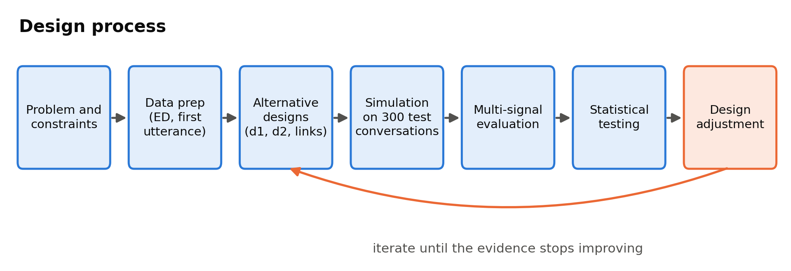

# 4.1 Design Process or Methodology Overview

The design process follows an iterative, evidence-gated methodology (Figure 4.1). Starting from the problem definition and its constraints, we prepare the data, design several alternatives for each component, simulate every alternative on the same held-out conversations, and evaluate the results with several independent measures and paired statistical tests. A design change is adopted only when this evidence supports it, and each adopted change returns to the design stage for further refinement.

*Figure 4.1: Design process followed in this work*

## 4.1.1 Problem Definition and Objective Formulation

The objective is a text-based conversational system that responds to a person sharing an emotional experience with a short, validating and non-intrusive reply, and that makes its emotional reasoning inspectable. This objective translates into three measurable targets: (i) to identify the expressed emotion among 32 fine-grained categories and expose both the candidate emotions and the final choice; (ii) to generate replies that acknowledge the feeling, ask at most one question and remain short; and (iii) to run all components on a single 8 GB consumer GPU without sending user messages to an external service. The central design question, raised directly by the Pre-Thesis 2 defence panel, is whether emotion detection and response generation should be performed by separate models or whether a single model suffices. The methodology is therefore constructed to test that question rather than to assume its answer.

## 4.1.2 Data Acquisition and Preprocessing

We use EmpatheticDialogues [1] with its official training, validation and test partitions, which keep all conversations started by the same speaker in the same partition. Each conversation contributes one example: the **first utterance** written by the speaker, labelled with the conversation's emotion. We deliberately do not use the dataset's situation-description field, because that text is written after the fact and states the feeling far more explicitly than a user's message, so a detector trained on it learns an easier task than the one it faces in use (Section 4.2.2 quantifies this effect). Preprocessing restores commas that the dataset encodes as the string "_comma_", discards rows that fail to parse, and retains the first utterance of each conversation, giving 2,542 test examples for evaluating the detector. For response generation, each test conversation is represented as a pair consisting of the speaker's first utterance and the listener's reply, and the same random sample of 300 conversations (seed 42) is used in every generation experiment, so that all systems respond to exactly the same inputs.

## 4.1.3 Model Architecture Design

We adopt a decoupled architecture with two components. The first, **d1**, is an encoder classifier that reads the user's text and outputs a probability distribution over the 32 emotions. The second, **d2**, is an instruction-tuned decoder that writes the reply, conditioned on d1's output through its system prompt. This design has three motivations. Encoders fine-tuned for classification outperform prompted generative models at emotion recognition [33]. A separate detection step exposes the system's emotional reasoning for inspection. And each component can be selected, replaced and evaluated independently within the memory budget. To test the design question rather than assume its answer, the design space deliberately includes **monolithic alternatives**: a generator with no detector prompted zero-shot, a generator fine-tuned end to end on EmpatheticDialogues replies, and single models of equal and larger size prompted to identify the emotion and respond in one step. It also includes several ways of connecting d1 to d2, described in Section 4.2.

## 4.1.4 Model Training and Generation Strategy

Only the detector is trained. Detector candidates are fully fine-tuned with a cross-entropy loss, early stopping on validation accuracy, and a learning rate that warms up linearly over the first 6% of training steps, following the fine-tuning practice of RoBERTa [6]. The generator is used **zero-shot** and controlled entirely through its system prompt, for two reasons established by the experiments: a generator fine-tuned with LoRA [10] imitated the dataset's habit of asking many questions and failed every rule, whereas prompting can be adapted to each emotion at no training cost. Generators larger than 1.5 billion parameters are loaded with 4-bit NF4 quantisation [9] to fit in GPU memory. All generation uses identical sampling settings (temperature 0.7, top-p 0.9, at most 250 new tokens and seed 42), so that differences between systems arise from their design rather than from decoding.

## 4.1.5 Model Evaluation and Interpretation

No single automatic measure captures empathy, so each design is evaluated with **five independent signals**: (1) rule adherence, which checks whether a reply acknowledges the feeling, asks exactly one question and stays within 120 words; (2) the WASSA 2024 empathy classifier; (3) emotion validation, which checks whether the emotion expressed in the reply, as read by the final detector, matches the true label; (4) a blind panel of AI judges from different developers, scoring empathy, relevance and safety; and (5) a human forced-choice study. Detector candidates are evaluated by top-1 accuracy, top-5 accuracy and macro-F1 on the full test partition. Because all systems respond to the same conversations, differences are tested with paired methods: McNemar's exact test for binary outcomes [16], the Wilcoxon signed-rank test for scores [17], bootstrap confidence intervals over 10,000 resamples [18], and Holm correction for multiple comparisons [19]. A difference is considered significant only when the corrected p-value is below 0.05 and the confidence interval excludes zero. We additionally analyse error propagation, that is, whether an incorrect detector label degrades the final reply, to establish which component limits overall quality.

### 4.1.5.1 Selection of the AI-Judge Panel

Using language models as evaluators is established practice: strong LLM judges agree with human preferences in more than 80% of cases [13]. They also carry known biases, and the panel was designed to counter them. First, LLM evaluators can recognise their own outputs and rate them more favourably [34]. We therefore selected judges from developers unrelated to the models being evaluated: **Nemotron 3 Ultra** (NVIDIA, a 550-billion-parameter mixture-of-experts model) and **gpt-oss-120b** (OpenAI, with openly released weights), with **Mistral Large** (Mistral AI) planned as a third judge. None of them shares a model family with our generator, Phi-4-mini (Microsoft) [7], or with the Qwen baselines (Alibaba) [8]. Second, a panel of judges from different model families shows less bias than a single large judge [35], so the scores of several judges are averaged rather than relying on one. Third, in line with the co-supervisor's requirement, all judges are flagship-tier models; smaller local judges considered earlier were not used.

Each judge sees only the user's message and a single reply, never the name of the system or the reference reply, and scores empathy, relevance and safety from 1 to 10 against explicit anchors for the ranges 1-3, 4-6 and 7-10, at temperature 0. All judges were available through free API tiers, which allowed team members without a GPU to run the evaluation. Earlier candidates that became unavailable through quota limits or retirement were replaced. Mistral Large scored the five systems built first, but became unavailable on both team accounts before the final system and the top-1 Phi-4-mini configuration could be judged. Because scores from different panels are not comparable, **all seven systems are compared on the two judges that scored every one of them**. On the replies that all three judges scored, the two-judge and three-judge averages correlate at 0.98 and rank the systems identically (Section 5.3.7), so the reduced panel does not change the conclusions. Table 4.1 describes the panel and Table 4.2 summarises the selection criteria.

| Judge | Developer | Size | Access | Role | Why selected |
|---|---|---|---|---|---|
| Nemotron 3 Ultra | NVIDIA | 550B total / 55B active (mixture-of-experts) | OpenRouter free tier (50 requests/day) | Used - all 7 systems | Flagship scale; no relation to Microsoft (Phi) or Alibaba (Qwen) |
| gpt-oss-120b | OpenAI (open weights, Apache-2.0) | About 120B (mixture-of-experts) | Groq free tier | Used - all 7 systems | Open weights make this judge reproducible; fast enough to score everything |
| Mistral Large | Mistral AI | Flagship (size not published) | Mistral free Experiment tier | Planned third judge - 5 systems only, then unavailable (HTTP 403) | Kept only to check that the two-judge panel gives the same result |

*Table 4.1: The AI-judge panel*

| Criterion | How it was applied | Evidence or reason |
|---|---|---|
| Flagship-tier capability | Required by the co-supervisor; small local judges (Gemma-2-2B, Phi-3-mini) were dropped from an earlier plan | Zheng et al. (2023): strong LLM judges agree with human preferences over 80% of the time |
| Different developers, none related to our models | No judge shares a family with the generator (Phi, Microsoft) or the baselines (Qwen, Alibaba) | Panickssery et al. (2024): LLM evaluators recognise and favour their own generations |
| A panel instead of one judge | Scores averaged over the two judges that scored every system | Verga et al. (2024): a panel from disjoint model families shows less intra-model bias than one large judge |
| Same judges for every system | Mistral Large dropped from the final panel because it could not score the final systems | Mixing judge sets across systems would make scores incomparable; two- and three-judge panels agree (rho 0.98) |
| Blind scoring | Judges see only the user message and one reply - never the system name or the gold reply | Removes identity bias and any reward for word overlap with a reference reply |
| Anchored rubric, deterministic output | 1-3 / 4-6 / 7-10 anchors for empathy, relevance and safety; temperature 0; JSON-only answer | Anchors keep judges on the same scale; temperature 0 removes sampling noise |
| Free API access | No GPU needed, so non-coding teammates could run the judging | Project resource constraint (Section 3.8) |
| Documented replacements | Gemini (repeated quota failures), DeepSeek (retired on GitHub Models, removed from OpenRouter free tier), Llama 3.3 70B (decommissioned on Groq), Mistral Large (subscription tier) | See risk R7 in Section 3.7 |

*Table 4.2: Criteria for selecting the AI judges*

### 4.1.5.2 Use of the WASSA Empathy Classifier

As a signal independent of both the rule checks and the AI judges, we use the hyy33 system from the WASSA 2024 shared task, held at the ACL 2024 conference [15]. It suits this project for three reasons. It was trained on third-party human ratings of empathy for individual conversation turns [14], the same unit as the replies we evaluate. It is a peer-reviewed, publicly released system whose predictions correlate with human empathy ratings at r = 0.544 on the shared task's test set [14]. And it belongs to a different model family, was trained on a different dataset and was developed by a different group from every component of our system, so it has no reason to favour our pipeline. Its limitations are also acknowledged. It was not the most accurate empathy predictor in its own shared task, where the organisers' RoBERTa baseline reached r = 0.694 [14]. Its training conversations are peer discussions of news articles rather than supportive replies. And it outputs coarse ordinal classes. Section 5.3 shows that on our data it nearly reproduces the AI judges' ranking of systems (Spearman rho = 0.96 across seven systems) but is too noisy to rank individual replies (Table 5.18), so it is used **only to compare system averages** over 300 conversations.

## 4.1.6 Implementation Environment

All components are implemented in Python 3.10 with PyTorch 2.5.1 [41] and Hugging Face Transformers 5.16.1 [40], using bitsandbytes for 4-bit quantisation, SciPy [42] for statistical testing and scikit-learn [43] for classification metrics. All experiments run on a single NVIDIA GeForce RTX 4060 with 8 GB of memory [38] and 16 GB of system memory (Table 4.3).

| Purpose | Tool | Version |
|---|---|---|
| Language | Python | 3.10.9 |
| Deep learning | PyTorch (CUDA 12.1) | 2.5.1 |
| Models and training | Hugging Face Transformers | 5.16.1 |
| Parameter-efficient tuning | PEFT | 0.18.1 |
| Quantisation | bitsandbytes (4-bit NF4) | 0.49.2 |
| Training utilities | Accelerate / Datasets | 1.13.0 / 4.8.5 |
| Statistics | SciPy / scikit-learn | 1.15.3 / 1.7.2 |
| Data handling | pandas / NumPy | 2.3.3 / 2.2.6 |
| Retrieval | sentence-transformers | 5.7.0 |
| Evaluation | bert-score | 0.3.13 |
| AI-judge APIs | openai SDK (OpenRouter), groq SDK, Mistral API | 2.53.0 / 1.6.0 / - |
| Demo interface | Gradio on Hugging Face Spaces | 5.9.1 (planned) |
| Human evaluation | Google Forms | - |
| Documents | python-docx, Microsoft Word | 1.2.0 |
| Version control | Git | - |
| Hardware | NVIDIA RTX 4060 8 GB, 16 GB RAM, Windows 11 Pro | driver 616.56 |

*Table 4.3: Software and hardware used in this work*

In summary, the design process treats the choice between a decoupled and a monolithic system as an empirical question. It holds data, sampling and decoding constant across all alternatives, and adopts only those changes supported by several independent measures that withstand paired statistical testing.

## References

[1] H. Rashkin, E. M. Smith, M. Li, and Y.-L. Boureau, "Towards empathetic open-domain conversation models: A new benchmark and dataset," in Proc. 57th Annu. Meeting Assoc. Comput. Linguistics (ACL), Florence, Italy, 2019, pp. 5370-5381, doi: 10.18653/v1/P19-1534.  
[6] Y. Liu, M. Ott, N. Goyal, J. Du, M. Joshi, D. Chen, O. Levy, M. Lewis, L. Zettlemoyer, and V. Stoyanov, "RoBERTa: A robustly optimized BERT pretraining approach," arXiv:1907.11692, 2019.  
[7] A. Abouelenin, A. Ashfaq, A. Atkinson et al. (Microsoft), "Phi-4-Mini technical report: Compact yet powerful multimodal language models via Mixture-of-LoRAs," arXiv:2503.01743, 2025.  
[8] A. Yang, B. Yang, B. Zhang, B. Hui et al. (Qwen Team), "Qwen2.5 technical report," arXiv:2412.15115, 2024.  
[9] T. Dettmers, A. Pagnoni, A. Holtzman, and L. Zettlemoyer, "QLoRA: Efficient finetuning of quantized LLMs," in Advances in Neural Information Processing Systems (NeurIPS), vol. 36, 2023.  
[10] E. J. Hu, Y. Shen, P. Wallis, Z. Allen-Zhu, Y. Li, S. Wang, L. Wang, and W. Chen, "LoRA: Low-rank adaptation of large language models," in Proc. Int. Conf. Learning Representations (ICLR), 2022.  
[13] L. Zheng, W.-L. Chiang, Y. Sheng et al., "Judging LLM-as-a-judge with MT-Bench and Chatbot Arena," in Advances in Neural Information Processing Systems (NeurIPS), Datasets and Benchmarks Track, vol. 36, 2023; arXiv:2306.05685.  
[14] S. Giorgi, J. Sedoc, V. Barriere, and S. Tafreshi, "Findings of WASSA 2024 shared task on empathy and personality detection in interactions," in Proc. 14th Workshop Computational Approaches to Subjectivity, Sentiment, & Social Media Analysis (WASSA), 2024, pp. 369-379, doi: 10.18653/v1/2024.wassa-1.30.  
[15] H. Yang, L. Huang, T. Li, N. Rusnachenko, and H. Liang, "hyy33 at WASSA 2024 empathy and personality shared task: Using the CombinedLoss and FGM for enhancing BERT-based models in emotion and empathy prediction from conversation turns," in Proc. 14th Workshop Computational Approaches to Subjectivity, Sentiment, & Social Media Analysis (WASSA), 2024, pp. 430-434, doi: 10.18653/v1/2024.wassa-1.39.  
[16] Q. McNemar, "Note on the sampling error of the difference between correlated proportions or percentages," Psychometrika, vol. 12, no. 2, pp. 153-157, 1947.  
[17] F. Wilcoxon, "Individual comparisons by ranking methods," Biometrics Bulletin, vol. 1, no. 6, pp. 80-83, 1945.  
[18] B. Efron and R. J. Tibshirani, An Introduction to the Bootstrap. New York, NY, USA: Chapman & Hall, 1993.  
[19] S. Holm, "A simple sequentially rejective multiple test procedure," Scandinavian J. Statistics, vol. 6, no. 2, pp. 65-70, 1979.  
[33] T. D. Belay, I. A. Azime, A. A. Ayele, G. Sidorov, D. Klakow, P. Slusallek, O. Kolesnikova, and S. M. Yimam, "Evaluating the capabilities of large language models for multi-label emotion understanding," in Proc. 31st Int. Conf. Computational Linguistics (COLING), Abu Dhabi, UAE, 2025, pp. 3523-3540.  
[34] A. Panickssery, S. R. Bowman, and S. Feng, "LLM evaluators recognize and favor their own generations," in Advances in Neural Information Processing Systems (NeurIPS), vol. 37, 2024; arXiv:2404.13076.  
[35] P. Verga, S. Hofstatter, S. Althammer, Y. Su, A. Piktus, A. Arkhangorodsky, M. Xu, N. White, and P. Lewis, "Replacing judges with juries: Evaluating LLM generations with a panel of diverse models," arXiv:2404.18796, 2024.  
[38] NVIDIA, "GeForce RTX 4060 Ti & 4060 graphics cards: Specifications." [Online]. Available: https://www.nvidia.com/en-us/geforce/graphics-cards/40-series/rtx-4060-4060ti/  
[40] T. Wolf, L. Debut, V. Sanh, J. Chaumond, C. Delangue, A. Moi, P. Cistac, T. Rault, R. Louf, M. Funtowicz et al., "Transformers: State-of-the-art natural language processing," in Proc. 2020 Conf. Empirical Methods Natural Language Processing: System Demonstrations, 2020, pp. 38-45, doi: 10.18653/v1/2020.emnlp-demos.6.  
[41] A. Paszke, S. Gross, F. Massa, A. Lerer, J. Bradbury, G. Chanan et al., "PyTorch: An imperative style, high-performance deep learning library," in Advances in Neural Information Processing Systems (NeurIPS), vol. 32, 2019, pp. 8024-8035.  
[42] P. Virtanen, R. Gommers, T. E. Oliphant et al., "SciPy 1.0: Fundamental algorithms for scientific computing in Python," Nature Methods, vol. 17, pp. 261-272, 2020, doi: 10.1038/s41592-019-0686-2.  
[43] F. Pedregosa, G. Varoquaux, A. Gramfort et al., "Scikit-learn: Machine learning in Python," J. Machine Learning Research, vol. 12, pp. 2825-2830, 2011.  
