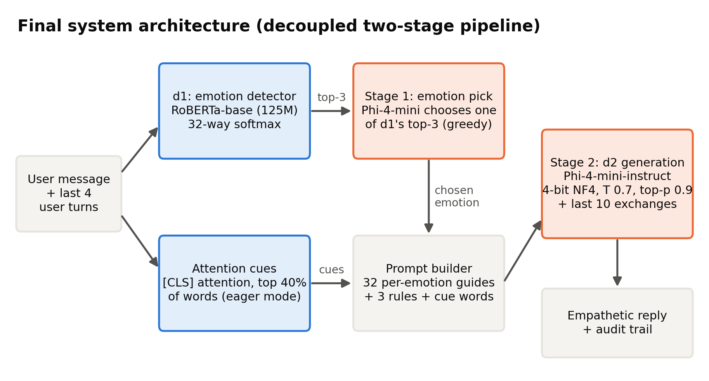

# 4.2 Preliminary Design or Design (Model) Specification

This section presents the alternative designs considered for each part of the system, the simulation evidence that decided between them, and the full specification of the selected design.

## 4.2.1 Overview

Figure 4.2 shows the selected design. The user's latest message, together with their preceding turns, is read by the emotion detector d1, a fine-tuned RoBERTa-base classifier [6], which outputs the three most probable of the 32 emotions. In a first, deterministic stage, the generator Phi-4-mini-instruct [7] chooses which of these three emotions best fits the message. The system prompt is then assembled from guidance specific to the chosen emotion, three behavioural rules, and the words that received the most attention within d1. In the second stage, Phi-4-mini generates the reply. Every intermediate decision is recorded. The following subsections describe the alternatives simulated for each component and the evidence behind each choice.

*Figure 4.2: Architecture of the selected system*

## 4.2.2 Emotion Detector Alternatives (d1)

**GPT-2 Medium (initial design).** The initial detector was GPT-2 Medium, a 355-million-parameter decoder-only model, fine-tuned on the dataset's situation descriptions. On those descriptions it reached 56.9% top-1 accuracy, but when evaluated on the input it actually receives, the user's first message, its accuracy fell to 48.2% (Table 4.4). This design was rejected for two reasons: it was trained on the wrong kind of text, and a left-to-right decoder is a weaker architecture for classification than a bidirectional encoder [5].

| d1 version | Trained on | Evaluated on | Top-1 (%) | Top-5 (%) | Note |
|---|---|---|---|---|---|
| GPT-2 Medium (initial) | situation `prompt` field | situation text | 56.9 | 90.5 | Matches training text, but NOT what the system receives at inference |
| GPT-2 Medium (initial) | situation `prompt` field | first user message (real input) | 48.2 | 82.7 | Honest deployment number - train/inference mismatch costs ~9 points |
| RoBERTa-base (final) | first user message | first user message (real input) | 50.3 | 84.3 | Deployed checkpoint; top-3 = 76.5% |

*Table 4.4: Effect of training the detector on the text it receives in use*

**Encoder candidates.** We then trained four encoder models under identical conditions: the same first-utterance data, four epochs, a maximum length of 128 tokens, a warmup ratio of 0.06, and the same test partition (Table 4.5, Figure 4.3). BERT-base [5] reaches 48.8% top-1 and 81.7% top-5 accuracy, ELECTRA-base 50.2% and 82.7%, and RoBERTa-base [6] 50.1% and 85.0%. The three base-sized models are statistically tied on top-1 accuracy, but RoBERTa-base is significantly better than both of the others on top-5 accuracy (Table 5.15). Because the selected design passes the detector's three best candidates to the generator, the quality of the ranking matters more than the single top label, and **RoBERTa-base was therefore selected**. RoBERTa-large, with 355 million parameters, is significantly more accurate still (53.0% top-1 and 87.2% top-5), but it requires 7.4 times the training time. When it was substituted into the final pipeline, no measure of reply quality improved (Section 5.3), so RoBERTa-base was retained.

| Backbone | Parameters (M) | Learning rate | Batch size | Top-1 acc (%) | Top-5 acc (%) | Macro-F1 (%) | Train time (min) |
|---|---|---|---|---|---|---|---|
| bert-base-uncased | 110 | 0 | 8 | 48.8 | 81.7 | 47.9 | 8.6 |
| google/electra-base-discriminator | 110 | 0 | 8 | 50.2 | 82.7 | 48.9 | 8.7 |
| roberta-base | 125 | 0 | 8 | 50.1 | 85 | 49.1 | 8.8 |
| roberta-large | 355 | 0 | 4 | 53 | 87.2 | 52.4 | 64.7 |

*Table 4.5: Comparison of detector models trained under identical settings*

*Figure 4.3: Top-1 and top-5 accuracy of the candidate detectors*

## 4.2.3 Response Generator Alternatives (d2)

To isolate the effect of the generator, we ran a controlled comparison in which the detector (RoBERTa-base), the prompt and rules, the 300 conversations and the decoding settings were all held fixed and only d2 was changed (Table 4.6). **Qwen2.5-1.5B-Instruct** [8], the initial generator, followed all rules in 57.7% of replies. **Gemma-3-4B-it** acknowledged feelings most often (96.7%) but kept to the length limit in only 27.7% of replies, averaging 133 words, so only 22.0% of its replies satisfied all rules. **Phi-4-mini-instruct**, with 3.8 billion parameters and 4-bit quantisation, achieved the highest rule adherence at 65.3% while keeping 96.0% of replies within the length limit, and **was therefore selected**. An earlier candidate, Phi-2, was excluded because it lacks a chat template and could not reliably follow system-prompt instructions.

| Setting ID | System | Ack (%) | One question (%) | Length OK (%) | All rules (%) | Mean words | Questions / reply | >1 question (%) | WASSA empathy (0-10) | WASSA SD | Emotion validation (%) | Context awareness (%) | N |
|---|---|---|---|---|---|---|---|---|---|---|---|---|---|
| bakeoff_qwen | RoBERTa d1 + Qwen2.5-1.5B d2 (top-1 emotion) | 67.67 | 84.33 | 100 | 57.67 | 34.72 | 1.07 | 10.33 | 4.78 | 1.31 | 25.33 | 31 | 300 |
| bakeoff_gemma | RoBERTa d1 + Gemma-3-4B d2 (top-1 emotion) | 96.67 | 92 | 27.67 | 22 | 133.25 | 1.08 | 8 | 5.3 | 0.84 | 35 | 48.67 | 300 |
| bakeoff_phi | RoBERTa d1 + Phi-4-mini d2 (top-1 emotion) | 72 | 94.67 | 96 | 65.33 | 80.45 | 1.05 | 5 | 4.89 | 1.04 | 28.33 | 36.67 | 300 |

*Table 4.6: Generator candidates with the detector, prompt and conversations held fixed*

## 4.2.4 Integration Alternatives: How d1's Output Reaches d2

Because d1 produces a full probability distribution, its output can be passed to the generator in several ways. Using the initial detector and generator, we simulated four variants on the same 300 conversations (Table 4.7). *Argmax* passes only the most probable emotion and achieved 63.7% rule adherence. *Confidence-gated* switches to tentative wording when d1 is uncertain and achieved 63.3%, but only 28.7% of the low-confidence replies actually used tentative wording. *Distribution* lists every emotion with probability above 0.05 and achieved 62.0%. *Candidate-pick* asks the generator to choose among the candidates and write the reply in a single call, and achieved 54.0%. None of the variants outperformed argmax, and candidate-pick reduced rule adherence, suggesting that a single generation call cannot both resolve the emotion and follow the rules reliably.

This analysis motivated the **two-stage** design adopted in the final system. The correct emotion lies among d1's three best candidates in 76.5% of test cases, compared with 50.3% for its top candidate alone, so the wider candidate set is valuable. However, combining several emotions in one prompt produces contradictory guidance: responding well to *disappointed*, for instance, is very different from responding well to *impressed*. The two-stage design therefore separates the choice of emotion into its own short, deterministic call, and gives the generation call a single, coherent prompt for that emotion.

| Variant | Ack% | OneQ% | LenOK% | AllRules% | LowConfHedge% |
|---|---|---|---|---|---|
| argmax - top-1 emotion only (adopted) | 70.3 | 87.3 | 100 | 63.7 | - |
| confidence-gated - hedge when d1 is unsure | 71 | 88.3 | 100 | 63.3 | 28.7 |
| distribution - list all emotions above p=0.05 | 72.7 | 83.7 | 100 | 62 | - |
| candidate-pick - d2 chooses AND generates in one pass | 65.3 | 82.7 | 100 | 54 | - |

*Table 4.7: Alternative ways of passing the detector's output to the generator*

## 4.2.5 Monolithic and Retrieval Alternatives

To test whether a separate detector is needed at all, four monolithic alternatives were simulated using the same rules and conversations. In the *zero-shot* alternative, Qwen2.5-1.5B receives a generic caring prompt and no detected emotion. In the *monolithic fine-tuned* alternative, Qwen2.5-1.5B is fine-tuned with LoRA [10] directly on pairs of user messages and human replies. In the *single model of the same size*, Qwen2.5-1.5B is instructed to identify the emotion silently and then respond under the three rules. In the *larger single model*, the same prompt is given to Qwen2.5-7B in 4-bit form. Their results are analysed in Section 5.2. In brief, the fine-tuned model adopted the dataset's short, casual listener style and rarely acknowledged the user's feeling, the zero-shot model rarely asked the single required question, the same-size single model trailed the decoupled designs, and the larger single model performed best overall.

Following the Pre-Thesis 2 panel's suggestion, we also simulated a **retrieval-augmented** variant [11] that retrieves one or two similar training conversations with the same detected emotion, using all-MiniLM-L6-v2 sentence embeddings [12], and shows them to the generator as examples. Across two versions, retrieval reduced rule adherence from 63.7% to 54.3% and then to 43.7%, so it was not adopted (Table 4.8).

| Variant | Ack (%) | One question (%) | All rules (%) | WASSA SD | Source |
|---|---|---|---|---|---|
| Initial pipeline (no retrieval) | 70.33 | 87.33 | 63.67 | 1.33 | result files |
| RAG attempt 1 (1-2 retrieved ED examples) |  | 76 | 54.3 |  | recorded in Full_Project_Documentation (outputs overwritten by attempt 2) |
| RAG attempt 2 (+ single-question filter + reminder) | 57 | 78 | 43.67 | 1.46 | result files |

*Table 4.8: Effect of retrieval augmentation on rule adherence*

## 4.2.6 Specification of the Selected Design

**Detector.** The detector is RoBERTa-base with a 32-way classification head, fine-tuned on first utterances with a learning rate of 2e-5, an effective batch size of 16, up to four epochs with early stopping, a warmup ratio of 0.06, weight decay of 0.01, gradient clipping at 1.0 and 16-bit mixed precision. In conversation, d1 reads the user's last four turns joined together. Conversational context is known to be important for recognising emotions in dialogue [44], and among the windows we tested on long conversational scenarios, four turns was best or joint best in three of four scenarios, whereas six turns degraded two scenarios because emotions from earlier turns competed with the current one.

**Attention cues.** d1 is loaded with an attention implementation that returns attention weights, because the default implementation in the Transformers library [40] returned none in our verification. We take the attention from the first token to every other token in the final layer [4], averaged across attention heads, keep the highest-scoring 40% of word spans (between 3 and 14), and expand sub-word pieces to whole words.

**Stage 1: emotion selection.** Phi-4-mini receives the user's message and the three candidate emotions with the instruction: *"An automatic detector narrowed the person's likely feeling down to these options: {a}, {b}, {c}. Read their message and decide which ONE of those options best fits what they are actually expressing. Reply with ONLY that single word."* Decoding is greedy with at most 10 new tokens. If the output does not name one of the candidates, the system falls back to d1's most probable emotion; in simulation, every output named a valid candidate.

**Stage 2: generation.** The system prompt combines, in order, the chosen emotion, the cue words, emotion-specific guidance on what to focus on and what to avoid, and the three universal rules. For example, for *lonely* the prompt instructs the model to "acknowledge the isolation itself, gently - the weight of it, not just 'you seem sad'" and not to "offer a surface-level fix like 'go meet people'", followed by the rules to acknowledge and validate the feeling in two to three sentences, share a reassuring thought specific to that feeling, and ask exactly one short, gentle question at the end, all within 100 words. Guidance of this kind was written for all 32 emotions [[TEAM TO FILL: name the source document from which the per-emotion guidance was adapted]]. Phi-4-mini is loaded with 4-bit NF4 quantisation, double quantisation and 16-bit computation [9], and samples with temperature 0.7 and top-p 0.9, up to 250 new tokens.

**Conversation memory.** The generator receives the last ten exchanges verbatim. From the second turn onward, the question becomes optional and the model is asked not to reuse earlier phrasing, so that a multi-turn conversation does not become an interrogation. The first turn keeps the original rules, so single-turn results remain comparable.

Section 4.2.7 justifies each of these settings.

## 4.2.7 Justification of Parameter Choices

Every parameter of the final design, the baselines and the evaluation was fixed before the final comparison and is justified in Table 4.9 by one of three kinds of evidence: published practice, a measurement on our own data, or an explicit design or hardware constraint. Settings that were not tuned are identified as such.

**Detector.** The learning rate of 2e-5, effective batch size of 16 and limit of four epochs lie within the fine-tuning ranges recommended for BERT [5] and used for RoBERTa [6], and the 6% linear warm-up follows RoBERTa's fine-tuning setting; without warm-up, our RoBERTa-large run diverged to 5.0% accuracy. The best checkpoint is selected by validation accuracy with early stopping, which prevents over-fitting. The maximum input length of 128 tokens covers 99.7% of first utterances, whose mean length is 46.5 tokens.

**Generator.** Four-bit NF4 quantisation preserves the quality of 16-bit models while reducing memory about fourfold [9]; the final system's measured peak use is 3.40 GB. Sampling uses nucleus sampling with top-p 0.9, which avoids the repetitive, degenerate text produced by greedy or beam decoding [45], and a temperature of 0.7, the developer's default for Qwen2.5-Instruct. These values are identical for every system, so that differences between systems arise from their design rather than from decoding. The limit of 250 new tokens is well above the prompt's request for under 100 words: the longest final-system reply is 119 tokens, so no reply is truncated. Passing the three most probable emotions to stage 1 is justified by the detector's accuracy: the true emotion is among the top three in 76.5% of messages, against 50.3% for the top prediction.

**Conversational agent.** The detector reads the last four user turns because conversational context matters for emotion recognition [44], and four turns performed best or joint best in three of four long test scenarios. The generator keeps the last ten exchanges verbatim, a design choice that avoids losing emotional detail through summarisation.

**LoRA baseline.** The corrected monolithic baseline uses rank 16 and alpha 32 on the attention projections, following the observation that low ranks suffice to adapt attention weights [10], together with a learning rate of 2e-4, dropout of 0.1 and weight decay of 0.01, the values used for LoRA fine-tuning of GPT-2 and for QLoRA on models of up to 13 billion parameters [10], [9]. Its padding token is Qwen's own end-of-text token: using the end-of-turn token as padding, as in the original run, removes that token from the loss and the model never learns to stop (Section 5.2.5).

**Evaluation.** AI judges score at temperature 0 on 64 conversations, the shortest and longest message for each emotion, which covers every emotion within the free tier's daily limit; the judges come from developers unrelated to our models [34], [35]. Paired comparisons use McNemar's exact test [16] and the Wilcoxon signed-rank test [17], confidence intervals use 10,000 bootstrap resamples, above the 1,000 recommended for percentile intervals [18], and the Holm procedure controls the family-wise error rate with more power than a Bonferroni correction [19].

| Component | Parameter | Value | Justification | Evidence |
|---|---|---|---|---|
| d1 detector | Backbone | RoBERTa-base (125M) | Highest top-5 accuracy (85.0%) of the base-size encoders at equal top-1; RoBERTa-large adds 2.9 pp but has 2.8x the parameters, 7.4x the training time and gives no reply gain | Our measurement (Tables 4.5, 5.16, 5.25) |
| d1 detector | Training input | First user utterance | A detector trained on situation descriptions fell from 56.9% to 48.2% on the user messages it actually receives | Our measurement (Table 4.4) |
| d1 detector | Maximum input length | 128 tokens | 99.7% of training first utterances fit (mean 46.5 tokens) | Our measurement |
| d1 detector | Learning rate | 2e-5 | Inside the fine-tuning ranges recommended for BERT (2e-5 to 5e-5) and used for RoBERTa (1e-5 to 3e-5) | Devlin et al. (2019); Liu et al. (2019) |
| d1 detector | Effective batch size | 16 (8 per step x 2 accumulation) | Batch size recommended for BERT/RoBERTa fine-tuning; 8 per step fits in 8 GB | Devlin et al. (2019); Liu et al. (2019); hardware limit |
| d1 detector | Epochs and selection | Up to 4, early stopping (patience 1), best checkpoint by validation accuracy | BERT recommends 2-4 fine-tuning epochs; keeping the best validation checkpoint prevents over-fitting | Devlin et al. (2019) |
| d1 detector | Warm-up | Linear, 6% of steps | RoBERTa's fine-tuning setting; without warm-up our RoBERTa-large run diverged to 5.0% accuracy | Liu et al. (2019); our observation |
| d1 detector | Weight decay / gradient clipping | 0.01 / 1.0 | Weight decay as used for BERT; clipping at 1.0 is the Transformers default and keeps updates stable | Devlin et al. (2019); library default |
| d1 detector | Precision / seed | fp16 mixed precision / 42 | Fits the 8 GB GPU and trains faster; fixed seed for reproducibility | Hardware limit; convention |
| d1 detector (comparison only) | RoBERTa-large learning rate / batch | 1e-5 / 4 | The base settings diverged; 1e-5 is the lowest value of RoBERTa's fine-tuning range and batch 4 fits in memory | Liu et al. (2019); our observation |
| Two-stage selection | Candidates passed to d2 | Top-3 emotions | The true emotion is in the top-3 for 76.5% of messages against 50.3% for top-1, and most errors are neighbouring emotions | Our measurement (Tables 5.2, 5.4) |
| Two-stage selection | Stage-1 decoding | Greedy, at most 10 new tokens, fall back to d1 top-1 | A classification decision should be deterministic; 100% of stage-1 outputs named a valid candidate | Our measurement (Table 5.5) |
| Attention cues | Attention source | Final-layer attention from the [CLS] token, eager attention | RoBERTa classifies from [CLS]; the default sdpa attention returns no weights, so eager attention is required | Liu et al. (2019); our verification |
| Attention cues | Amount | Top 40% of tokens, at most 3 phrases | Design choice to keep the prompt short; not tuned (listed as a limitation) | Design choice |
| d2 generator | Model | Phi-4-mini-instruct (3.8B) | Highest rule adherence in the bake-off with detector and prompt fixed (65.3% vs 57.7% Qwen2.5-1.5B, 22.0% Gemma-3-4B) | Our measurement (Table 4.6) |
| d2 generator | Quantisation | 4-bit NF4, double quantisation, fp16 compute | NF4 preserves 16-bit quality while cutting memory about fourfold; measured peak use 3.40 GB on the 8 GB GPU | Dettmers et al. (2023); our measurement (Table 5.26) |
| d2 generator | Temperature | 0.7 | The developer's default for Qwen2.5-Instruct; identical for every system so differences come from design, not decoding | Qwen2.5 generation_config; fairness |
| d2 generator | Top-p (nucleus sampling) | 0.9 | Nucleus sampling avoids the repetitive, degenerate text of pure greedy or beam decoding; identical for every system | Holtzman et al. (2020) |
| d2 generator | Maximum new tokens | 250 | The prompt asks for under 100 words (about 130 tokens); the longest final reply is 119 tokens, so no reply is cut off | Our measurement |
| d2 generator | Word limit | Under 100 words in the prompt, scored at 120 | Short replies reduce burden on a distressed user; the 20-word margin tolerates small overshoots | Design choice |
| d2 generator | Repetition penalty |  | Kept identical for all systems; a penalty of 1.1 is deferred because it would change the judged outputs | Fairness; future work |
| Conversational agent | d1 context window | Last 4 user turns | Context matters for emotion recognition in conversation; 4 turns was best or joint best in 3 of 4 long scenarios, 6 turns degraded 2 | Poria et al. (2019); our scenario tests |
| Conversational agent | d2 memory | Last 10 exchanges, verbatim | Support conversations are short; verbatim history avoids losing emotional detail through summarisation | Design choice |
| Conversational agent | Question rule | Mandatory on turn 1, optional afterwards | A question in every reply turns a long conversation into an interrogation; turn 1 keeps the evaluated rules | Design choice |
| LoRA baseline | Rank / alpha | 16 / 32 | Low ranks are sufficient to adapt attention weights; alpha = 2 x rank scales the update | Hu et al. (2022) |
| LoRA baseline | Target modules | q, k, v, o attention projections | The weight matrices studied for adaptation in LoRA | Hu et al. (2022) |
| LoRA baseline | Learning rate / dropout / weight decay | 2e-4 / 0.1 / 0.01 | LoRA's GPT-2 settings; QLoRA uses 2e-4 and dropout 0.1 for models up to 13B | Hu et al. (2022); Dettmers et al. (2023) |
| LoRA baseline | Warm-up / effective batch / optimiser | 6% linear / 16 (2 x 8) / paged AdamW 32-bit | Same warm-up rule as the detector; batch fits 8 GB; paged optimisers avoid memory spikes | Liu et al. (2019); Dettmers et al. (2023) |
| LoRA baseline | Epochs and selection | Up to 3, best epoch by validation loss, early stopping (patience 1) | Validation loss rose after epoch 1 (1.4607 to 1.4626), so epoch 1 was kept | Our training log |
| LoRA baseline | Maximum length | 256 tokens | The longest training pair is 177 tokens, so nothing is truncated | Our measurement |
| LoRA baseline | Padding token | Qwen end-of-text token (endoftext) | Using the end-of-turn token as padding masked it from the loss: the original run never learned to stop (99% of replies hit the token limit) | Our finding (adjustment A11) |
| AI judges | Decoding | Temperature 0, JSON-only answer | Removes sampling noise so the same reply always gets the same score | Design choice |
| AI judges | Sample | 64 conversations: shortest and longest per emotion | Covers all 32 emotions and both short and long messages within the 50-requests-per-day limit | Design choice; resource limit |
| AI judges | Panel | Nemotron 3 Ultra + gpt-oss-120b, blind | Different developers from our models avoid self-preference; a panel reduces single-judge bias | Panickssery et al. (2024); Verga et al. (2024) |
| WASSA classifier | Model | hyy33, WASSA 2024 Track 2 | Trained on human empathy ratings of conversation turns; r = 0.544 with human ratings | Giorgi et al. (2024); Yang et al. (2024) |
| Statistics | Evaluation sample | 300 test conversations, seed 42 | Fixed before any experiment and identical for every system, so all comparisons are paired | Design choice |
| Statistics | Tests | McNemar exact (binary), Wilcoxon signed-rank (scores) | Paired tests matched to the data type; Wilcoxon does not assume normal differences | McNemar (1947); Wilcoxon (1945) |
| Statistics | Confidence intervals | Paired bootstrap, 10,000 resamples | More than the 1,000 resamples recommended for percentile intervals, giving stable limits | Efron and Tibshirani (1993) |
| Statistics | Multiple comparisons | Holm correction; significant only if adjusted p < 0.05 and CI excludes zero | Controls the family-wise error rate with more power than Bonferroni | Holm (1979) |
| Human evaluation | Design | 13 items (11 scored + 2 attention checks), 3-way forced choice | Keeps the form short enough to avoid rater fatigue; preference judgements follow comparable studies | Cao et al. (2025); Wu et al. (2025) |
| Resource benchmark | Protocol | 50 messages, 3 warm-up, one system per run | Warm-up removes first-call overhead; separate runs keep memory readings clean | Design choice |

*Table 4.9: Every parameter used in this work, its value, justification and evidence*

## 4.2.8 Simulation and Verification

Each alternative was functionally verified before full evaluation. Small trial runs confirmed that outputs were well formed and that model-specific details were handled correctly: Phi-4-mini uses an end-of-turn token different from its end-of-text token, Gemma's chat template has no system role, and Phi-4-mini combines its attention projections into a single layer. Every generation design was then simulated on the same 300 held-out conversations with identical decoding settings, and every detector candidate on the full test partition of 2,542 conversations. Two automatic safeguards protect the selected design: execution stops if the detector returns no attention weights, and the outcome of every stage-1 decision is recorded, all of which parsed successfully. The results of these simulations determined the selections described above and are analysed in full in Chapter 5.

## References

[4] A. Vaswani, N. Shazeer, N. Parmar, J. Uszkoreit, L. Jones, A. N. Gomez, L. Kaiser, and I. Polosukhin, "Attention is all you need," in Advances in Neural Information Processing Systems (NeurIPS), vol. 30, 2017, pp. 5998-6008.  
[5] J. Devlin, M.-W. Chang, K. Lee, and K. Toutanova, "BERT: Pre-training of deep bidirectional transformers for language understanding," in Proc. 2019 Conf. North American Chapter Assoc. Comput. Linguistics (NAACL-HLT), 2019, pp. 4171-4186, doi: 10.18653/v1/N19-1423.  
[6] Y. Liu, M. Ott, N. Goyal, J. Du, M. Joshi, D. Chen, O. Levy, M. Lewis, L. Zettlemoyer, and V. Stoyanov, "RoBERTa: A robustly optimized BERT pretraining approach," arXiv:1907.11692, 2019.  
[7] A. Abouelenin, A. Ashfaq, A. Atkinson et al. (Microsoft), "Phi-4-Mini technical report: Compact yet powerful multimodal language models via Mixture-of-LoRAs," arXiv:2503.01743, 2025.  
[8] A. Yang, B. Yang, B. Zhang, B. Hui et al. (Qwen Team), "Qwen2.5 technical report," arXiv:2412.15115, 2024.  
[9] T. Dettmers, A. Pagnoni, A. Holtzman, and L. Zettlemoyer, "QLoRA: Efficient finetuning of quantized LLMs," in Advances in Neural Information Processing Systems (NeurIPS), vol. 36, 2023.  
[10] E. J. Hu, Y. Shen, P. Wallis, Z. Allen-Zhu, Y. Li, S. Wang, L. Wang, and W. Chen, "LoRA: Low-rank adaptation of large language models," in Proc. Int. Conf. Learning Representations (ICLR), 2022.  
[11] P. Lewis, E. Perez, A. Piktus, F. Petroni, V. Karpukhin, N. Goyal, H. Kuttler, M. Lewis, W. Yih, T. Rocktaschel, S. Riedel, and D. Kiela, "Retrieval-augmented generation for knowledge-intensive NLP tasks," in Advances in Neural Information Processing Systems (NeurIPS), vol. 33, 2020, pp. 9459-9474.  
[12] N. Reimers and I. Gurevych, "Sentence-BERT: Sentence embeddings using Siamese BERT-networks," in Proc. 2019 Conf. Empirical Methods Natural Language Processing and 9th Int. Joint Conf. Natural Language Processing (EMNLP-IJCNLP), 2019, pp. 3982-3992, doi: 10.18653/v1/D19-1410.  
[16] Q. McNemar, "Note on the sampling error of the difference between correlated proportions or percentages," Psychometrika, vol. 12, no. 2, pp. 153-157, 1947.  
[17] F. Wilcoxon, "Individual comparisons by ranking methods," Biometrics Bulletin, vol. 1, no. 6, pp. 80-83, 1945.  
[18] B. Efron and R. J. Tibshirani, An Introduction to the Bootstrap. New York, NY, USA: Chapman & Hall, 1993.  
[19] S. Holm, "A simple sequentially rejective multiple test procedure," Scandinavian J. Statistics, vol. 6, no. 2, pp. 65-70, 1979.  
[34] A. Panickssery, S. R. Bowman, and S. Feng, "LLM evaluators recognize and favor their own generations," in Advances in Neural Information Processing Systems (NeurIPS), vol. 37, 2024; arXiv:2404.13076.  
[35] P. Verga, S. Hofstatter, S. Althammer, Y. Su, A. Piktus, A. Arkhangorodsky, M. Xu, N. White, and P. Lewis, "Replacing judges with juries: Evaluating LLM generations with a panel of diverse models," arXiv:2404.18796, 2024.  
[40] T. Wolf, L. Debut, V. Sanh, J. Chaumond, C. Delangue, A. Moi, P. Cistac, T. Rault, R. Louf, M. Funtowicz et al., "Transformers: State-of-the-art natural language processing," in Proc. 2020 Conf. Empirical Methods Natural Language Processing: System Demonstrations, 2020, pp. 38-45, doi: 10.18653/v1/2020.emnlp-demos.6.  
[44] S. Poria, N. Majumder, R. Mihalcea, and E. Hovy, "Emotion recognition in conversation: Research challenges, datasets, and recent advances," IEEE Access, vol. 7, pp. 100943-100953, 2019, doi: 10.1109/ACCESS.2019.2929050.  
[45] A. Holtzman, J. Buys, L. Du, C. Fang, and Y. Choi, "The curious case of neural text degeneration," in Proc. Int. Conf. Learning Representations (ICLR), 2020.  
