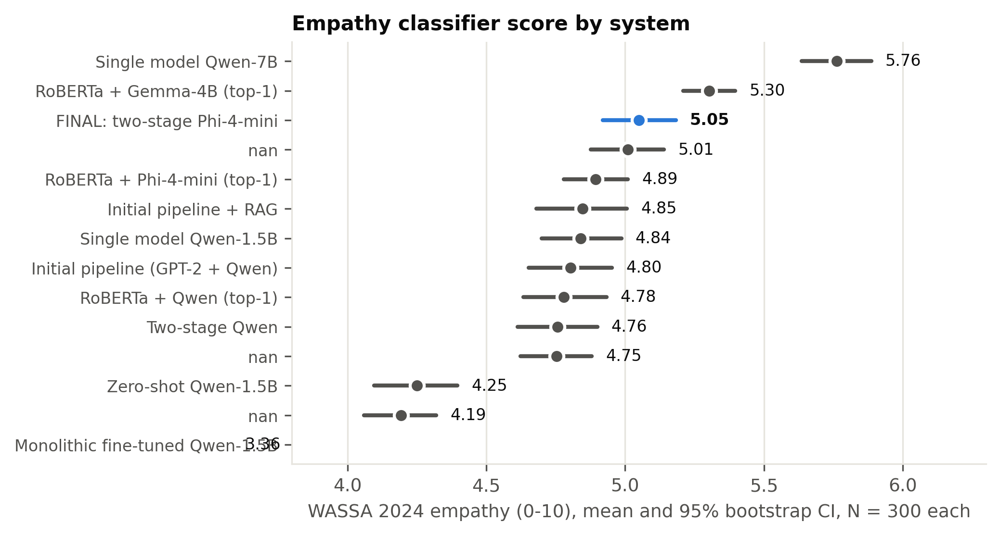

# 5.1 Performance Evaluation

This section reports the performance of the final system on every evaluation signal, with all alternative designs shown for comparison. The reasons for the differences between designs are analysed in Section 5.2, and their statistical significance in Section 5.3.

## 5.1.1 Experimental Setup

All generation systems respond to the same 300 conversations, sampled with seed 42 from the EmpatheticDialogues test partition [1], using identical decoding settings (Section 4.1.4). The detector is evaluated on all 2,542 test conversations. The systems are referred to by the names given in Table 5.1, and the **final system** is the two-stage pipeline with a RoBERTa-base detector and a Phi-4-mini generator.

| Setting ID | System | Ack (%) | One question (%) | Length OK (%) | All rules (%) | Mean words | Questions / reply | >1 question (%) | WASSA empathy (0-10) | WASSA SD | Emotion validation (%) | Context awareness (%) | N |
|---|---|---|---|---|---|---|---|---|---|---|---|---|---|
| zero_shot | Zero-shot Qwen2.5-1.5B (no detector, generic prompt) | 81.67 | 22.67 | 83.67 | 19 | 75.92 | 0.42 | 9.33 | 4.25 | 1.31 | 24.67 |  | 300 |
| fine_tuned_fixed | Monolithic LoRA fine-tuned Qwen2.5-1.5B (no detector) | 30 | 74 | 100 | 22.33 | 9.95 | 0.81 | 3.67 | 3.36 | 1.9 | 18.33 |  | 300 |
| single_model_same_size | Single model, same size: Qwen2.5-1.5B detects + responds | 70.67 | 73.67 | 100 | 51.33 | 41.96 | 1.02 | 13.33 | 4.84 | 1.26 | 25.67 |  | 300 |
| single_model_phi | Single model, same generator: Phi-4-mini (4-bit) detects + responds | 77.33 | 96 | 99.33 | 73.67 | 73.48 | 1.04 | 4 | 4.75 | 1.13 | 27 |  | 300 |
| single_model_bigger | Single model, bigger: Qwen2.5-7B (4-bit) detects + responds | 83 | 99 | 100 | 82.33 | 52.95 | 1.01 | 1 | 5.76 | 1.09 | 32.33 |  | 300 |
| prompt_engineered_pipeline | Initial pipeline: GPT-2 Medium d1 + Qwen2.5-1.5B d2 | 70.33 | 87.33 | 100 | 63.67 | 35.21 | 1.07 | 9.33 | 4.8 | 1.33 | 26 | 28.33 | 300 |
| rag_pipeline | Initial pipeline + retrieval (RAG) | 57 | 78 | 100 | 43.67 | 34 | 1.13 | 16.33 | 4.85 | 1.46 | 27.67 | 29.33 | 300 |
| bakeoff_qwen | RoBERTa d1 + Qwen2.5-1.5B d2 (top-1 emotion) | 67.67 | 84.33 | 100 | 57.67 | 34.72 | 1.07 | 10.33 | 4.78 | 1.31 | 25.33 | 31 | 300 |
| bakeoff_gemma | RoBERTa d1 + Gemma-3-4B d2 (top-1 emotion) | 96.67 | 92 | 27.67 | 22 | 133.25 | 1.08 | 8 | 5.3 | 0.84 | 35 | 48.67 | 300 |
| bakeoff_phi | RoBERTa d1 + Phi-4-mini d2 (top-1 emotion) | 72 | 94.67 | 96 | 65.33 | 80.45 | 1.05 | 5 | 4.89 | 1.04 | 28.33 | 36.67 | 300 |
| two_stage_qwen | Two-stage: RoBERTa top-3 -> Qwen2.5-1.5B picks + per-emotion prompt | 47 | 74.33 | 99.67 | 36.67 | 44.15 | 1.17 | 18.67 | 4.76 | 1.29 | 27 | 38 | 300 |
| two_stage_phi | FINAL SYSTEM - Two-stage: RoBERTa top-3 -> Phi-4-mini picks + per-emotion prompt | 66.33 | 92.67 | 100 | 60 | 57.11 | 1.06 | 6.67 | 5.05 | 1.16 | 36.67 | 54.33 | 300 |

*Table 5.1: Rule adherence, reply length, empathy and emotion fidelity of all systems on the same 300 conversations*

## 5.1.2 Emotion Detection

Table 5.2 reports the performance of the final detector. RoBERTa-base reaches **50.3% top-1**, **76.5% top-3** and **84.3% top-5** accuracy, with a macro-F1 score of 49.4%, against a chance level of 3.1% for 32 classes. Performance varies considerably across emotions (Table 5.3). *Caring* (F1 70.1%), *lonely* (69.5%) and *jealous* (64.7%) are recognised most reliably, while *angry* (18.2%), *ashamed* (22.2%) and *joyful* (30.9%) are the most difficult. Table 5.4 shows that the most frequent errors occur between closely related labels: *sentimental* is read as *nostalgic* (31 cases), *afraid* as *terrified* (29), *angry* as *furious* (24) and *sad* as *devastated* (23). Many errors are therefore differences in intensity or nuance within the same family of emotions rather than confusions between unrelated feelings, consistent with the error pattern reported for a comparable classifier [32]. This is why the final design passes the three most probable emotions to the generator rather than a single label.

| Metric | Value (%) | Source |
|---|---|---|
| Top-1 accuracy | 50.28 | recomputed from test_predictions.csv |
| Macro-F1 | 49.39 | recomputed from test_predictions.csv |
| Weighted-F1 | 49.73 | recomputed from test_predictions.csv |
| Top-3 accuracy | 76.5 | recorded at training time (model card) |
| Top-5 accuracy | 84.3 | recorded at training time (model card) |
| Chance level (1 of 32) | 3.12 | arithmetic |

*Table 5.2: Overall performance of the final detector on the test partition*

| Emotion | Precision (%) | Recall (%) | F1 (%) | Support |
|---|---|---|---|---|
| caring | 71.4 | 68.8 | 70.1 | 80 |
| lonely | 65.2 | 74.4 | 69.5 | 78 |
| jealous | 80 | 54.3 | 64.7 | 81 |
| embarrassed | 69 | 60.5 | 64.5 | 81 |
| disgusted | 66.7 | 58.1 | 62.1 | 86 |
| nostalgic | 55 | 71.4 | 62.1 | 77 |
| surprised | 60.9 | 61.4 | 61.2 | 127 |
| guilty | 54.4 | 65.2 | 59.3 | 66 |
| content | 60.6 | 56.6 | 58.5 | 76 |
| prepared | 62.7 | 54.5 | 58.3 | 77 |
| impressed | 54.9 | 61.7 | 58.1 | 81 |
| proud | 51.2 | 65.6 | 57.5 | 96 |
| faithful | 53.4 | 62 | 57.4 | 50 |
| trusting | 54.4 | 57.8 | 56.1 | 64 |
| grateful | 54.7 | 54.7 | 54.7 | 95 |
| annoyed | 52.7 | 53.8 | 53.3 | 91 |
| devastated | 40.4 | 68.7 | 50.8 | 67 |
| confident | 41.2 | 56 | 47.5 | 75 |
| hopeful | 46.8 | 45.6 | 46.2 | 79 |
| excited | 42.7 | 48.4 | 45.4 | 91 |
| furious | 44.3 | 46.3 | 45.3 | 67 |
| terrified | 37.6 | 53.5 | 44.2 | 71 |
| disappointed | 44.9 | 43.2 | 44 | 81 |
| sentimental | 60.8 | 34.1 | 43.7 | 91 |
| anxious | 39.1 | 43.6 | 41.2 | 78 |
| sad | 42.3 | 34.1 | 37.7 | 88 |
| anticipating | 35.5 | 30.1 | 32.6 | 73 |
| afraid | 33.8 | 30.1 | 31.9 | 73 |
| apprehensive | 38 | 26.8 | 31.4 | 71 |
| joyful | 31.6 | 30.1 | 30.9 | 83 |
| ashamed | 27.3 | 18.8 | 22.2 | 64 |
| angry | 25 | 14.3 | 18.2 | 84 |

*Table 5.3: Precision, recall and F1 of the final detector for each emotion*

| True emotion | Predicted as | Count | Share of all errors (%) |
|---|---|---|---|
| sentimental | nostalgic | 31 | 2.5 |
| afraid | terrified | 29 | 2.3 |
| angry | furious | 24 | 1.9 |
| sad | devastated | 23 | 1.8 |
| prepared | confident | 20 | 1.6 |
| ashamed | guilty | 19 | 1.5 |
| apprehensive | anxious | 18 | 1.4 |
| anticipating | excited | 16 | 1.3 |
| terrified | afraid | 16 | 1.3 |
| impressed | proud | 14 | 1.1 |
| angry | annoyed | 14 | 1.1 |
| hopeful | confident | 14 | 1.1 |

*Table 5.4: Most frequent confusions made by the final detector*

## 5.1.3 Rule Adherence

Table 5.1 and Figure 5.1 show how often each system's replies acknowledge the user's feeling, ask exactly one question and stay within 120 words. The final system follows all three rules in **60.0%** of replies: 66.3% contain an acknowledgement, 92.7% ask exactly one question and 100% stay within the length limit, with an average length of 57.1 words. Among systems of comparable size, it is exceeded by the top-1 Phi-4-mini configuration (65.3%) and the initial pipeline (63.7%), and it is well ahead of the same-size single model (51.3%), the monolithic fine-tuned model (22.3%) and zero-shot prompting (19.0%). The larger single model, Qwen2.5-7B, has the highest rule adherence at 82.3%. The monolithic fine-tuned model reproduces the style of the listener replies it was trained on: its replies average 10.0 words, 74.0% ask exactly one question, but only 30.0% acknowledge the user's feeling. Real EmpatheticDialogues listener replies behave the same way, satisfying all three rules in only 4.3% of cases and acknowledging the feeling in 10.6%.

*Figure 5.1: Share of replies satisfying all three response rules*

## 5.1.4 Empathy Classifier Score

Figure 5.2 shows the WASSA empathy scores [15] with 95% confidence intervals. The final system scores **5.05**, the highest of all systems no larger than Phi-4-mini, and above the same-size single model (4.84), the initial pipeline (4.80), zero-shot prompting (4.25) and the fine-tuned model (3.36). The fine-tuned model's low score partly reflects the length of its replies, since WASSA scores rise with reply length (Section 5.4.4). Gemma-3-4B (5.30) and the larger single model (5.76) score higher, and Section 5.4 shows that Gemma's advantage is explained by the length of its replies. The classifier outputs coarse ordinal classes, and our replies fall between classes 1 and 7. It was also trained on empathy ratings of turns in peer discussions of news articles [14]. We therefore interpret differences between system averages rather than absolute values; Section 5.3.6 shows that it ranks the systems in nearly the same order as the AI judges.

*Figure 5.2: WASSA empathy score of each system with 95% bootstrap confidence intervals*

## 5.1.5 Emotion Fidelity

To check whether a reply expresses the *right* emotion, and not merely a well-formed one, each reply is passed back through the final detector. We compare the detector's reading of the reply with the true label (**emotion validation**) and with the emotion the system conditioned on (**context awareness**). The final system has the highest emotion validation of all systems at **36.7%**, compared with 32.3% for the larger single model, 28.3% for the top-1 Phi-4-mini configuration, 26.0% for the initial pipeline and 25.7% for the same-size single model. Its context awareness is 54.3%. Two limitations apply to these measures. The detector was trained on user messages rather than replies, so its reading of a reply is noisy. And context awareness uses the same detector that supplied the signal to our pipelines, which may favour them. Emotion validation, which compares against the dataset's independent gold label, is therefore the more trustworthy of the two.

## 5.1.6 Behaviour of the Two-Stage Emotion Selection

Table 5.5 examines the stage-1 decision. The true emotion is among the detector's three best candidates in 78.0% of the 300 evaluation conversations, and every stage-1 output names a valid candidate. The generator overrides the detector's top choice in 40.7% of cases, and its choice matches the gold label in **42.3%** of conversations. This is *lower* than the detector's own top-1 accuracy on the same conversations (50.3%). The final system's gains in empathy and emotion validation therefore do not come from selecting the gold label more often, a finding discussed in Section 5.6.

| Quantity | Value |
|---|---|
| Stage-1 reply parsed to a valid candidate | 100.0% |
| True emotion inside d1's top-3 | 78.0% |
| d1 top-1 equals true emotion | 50.3% |
| d2's pick equals true emotion | 42.3% |
| d2 overrode d1's top-1 | 40.7% |
| Cases only d1 top-1 was right / only d2 pick was right | 46 / 22 |
| Pick minus top-1 accuracy, 95% bootstrap CI | -8.0% [-13.3%, -2.7%] |
| McNemar exact p (pick vs top-1) | 0.0049 |
| N | 300 |

*Table 5.5: Accuracy of the stage-1 emotion selection compared with the detector's top-1 prediction*

## 5.1.7 Diversity and Repetition

Table 5.6 reports distinct-n diversity together with a boilerplate rate, defined as the proportion of replies that contain one of the system's ten most frequent five-word phrases. The final system's Dist-2 of 47.8% is close to that of the initial pipeline (49.5%), but its boilerplate rate is higher (58.7% against 23.7%). Its most repeated phrase, "how are you feeling right", appears in 49 replies. Phi-4-mini prompted with a single generic prompt is the most repetitive system (77.0%), so emotion-specific prompts reduce repetition for the same generator but do not eliminate it, consistent with the repetitive empathic phrasing reported for LLMs [29]. Because these values are computed over 300 replies, they are not comparable with distinct-n scores published for the full test set.

| setting | n_replies | dist_1 | dist_2 | dist_3 | boilerplate_rate | most_repeated_phrase | most_repeated_count |
|---|---|---|---|---|---|---|---|
| zero_shot | 300 | 12.48 | 57.15 | 81.96 | 34.7 | i'm sorry to hear that | 30 |
| rag_pipeline | 300 | 12.6 | 53.62 | 76.91 | 26.7 | is there anything specific about | 25 |
| single_model_same_size | 300 | 11.35 | 50.5 | 73.68 | 35 | is there anything specific about | 23 |
| prompt_engineered_pipeline | 300 | 11.91 | 49.49 | 72.43 | 23.7 | what would you like to | 21 |
| two_stage_phi | 300 | 11.5 | 47.84 | 71.54 | 58.7 | how are you feeling right | 49 |
| single_model_bigger | 300 | 9.76 | 44.63 | 69.33 | 58.7 | i can really understand how | 67 |
| bakeoff_phi | 300 | 7.57 | 35.97 | 59.63 | 77 | it's completely natural to feel | 55 |

*Table 5.6: Lexical diversity and boilerplate repetition of selected systems*

## 5.1.8 AI-Judge Evaluation

Two AI judges, Nemotron 3 Ultra and gpt-oss-120b, selected as described in Section 4.1.5.1, score each reply blind from 1 to 10 for empathy, relevance and safety, and the panel score is the mean of the two judges. They are applied to a stratified sample of 64 conversations, consisting of the shortest and longest message for each of the 32 emotions. Table 5.7 reports the results. The larger single model has the highest overall score (**8.90**), followed closely by the **final system (8.68)** and top-1 Phi-4-mini prompting (8.65), and then by the same-size single model (8.24), the initial pipeline (8.04) and zero-shot prompting (7.51). [[PENDING: AI-judge scores of the corrected fine-tuned baseline (gpt-oss-120b complete, Nemotron 3 Ultra in progress).]] The final system scores 7.84 for empathy, 8.45 for relevance and 9.76 for safety. Empathy is the lowest of the three dimensions for every system, which indicates that the judges treat it as the most demanding criterion. Safety scores are high for every judged system (9.31 to 9.86). The two judges differ in severity: Nemotron 3 Ultra gives a lower average score than gpt-oss-120b to every system. Section 5.3.7 tests which of these differences are statistically significant and how closely the judges agree.

| System | N | Nemotron 3 Ultra overall | gpt-oss-120b overall | Panel empathy | Panel relevance | Panel safety | Panel overall |
|---|---|---|---|---|---|---|---|
| Single model, bigger: Qwen2.5-7B (4-bit) detects + responds | 64 | 8.87 | 8.92 | 8.15 | 8.68 | 9.86 | 8.9 |
| FINAL SYSTEM - Two-stage: RoBERTa top-3 -> Phi-4-mini picks + per-emotion prompt | 64 | 8.58 | 8.79 | 7.84 | 8.45 | 9.76 | 8.68 |
| RoBERTa d1 + Phi-4-mini d2 (top-1 emotion) | 64 | 8.42 | 8.88 | 7.84 | 8.29 | 9.81 | 8.65 |
| Single model, same size: Qwen2.5-1.5B detects + responds | 64 | 8.02 | 8.46 | 7.15 | 8.02 | 9.56 | 8.24 |
| Initial pipeline: GPT-2 Medium d1 + Qwen2.5-1.5B d2 | 64 | 7.78 | 8.29 | 6.98 | 7.63 | 9.5 | 8.04 |
| Zero-shot Qwen2.5-1.5B (no detector, generic prompt) | 64 | 6.79 | 8.23 | 5.98 | 7.23 | 9.31 | 7.51 |
| Monolithic LoRA fine-tuned Qwen2.5-1.5B (no detector) | [[PENDING - AI-judge scores for the corrected fine-tuned baseline]] | [[PENDING - AI-judge scores for the corrected fine-tuned baseline]] | [[PENDING - AI-judge scores for the corrected fine-tuned baseline]] | [[PENDING - AI-judge scores for the corrected fine-tuned baseline]] | [[PENDING - AI-judge scores for the corrected fine-tuned baseline]] | [[PENDING - AI-judge scores for the corrected fine-tuned baseline]] | [[PENDING - AI-judge scores for the corrected fine-tuned baseline]] |

*Table 5.7: Average AI-judge scores (1-10) by system*

## 5.1.9 Human Evaluation

To validate the automatic and AI-judge results, we conducted a forced-choice study with human participants (Table 5.8). Participants read 13 situations and, for each one, chose which of three replies "best understands and responds to how this person is feeling": the reply from the final system, from the same-size single model, or from the larger single model, presented in counterbalanced order. This three-way design adapts the pairwise preference judgements used in comparable studies [27], [28] to compare three systems within a limited number of items. The situations cover 13 different emotions, including four central to supportive conversation (sad, lonely, angry and anxious) and three drawn from student life. Two items include an obviously poor reply as an attention check. [[PENDING: number of participants; number excluded by the attention checks; selection rate of each system against the chance level of 33.3%, with binomial tests; Fleiss' kappa; and agreement between the human majority choice and the system scored highest by the AI judges.]]

| item_number | gold_emotion | is_attention_check | ai_judge_scored | student_situation |
|---|---|---|---|---|
| 1 | joyful | False | True | False |
| 2 | nostalgic | True | True | False |
| 3 | faithful | False | True | False |
| 4 | angry | False | True | False |
| 5 | prepared | False | False | True |
| 6 | anxious | False | True | False |
| 7 | furious | False | False | True |
| 8 | anticipating | False | False | True |
| 9 | lonely | False | True | False |
| 10 | disgusted | False | True | False |
| 11 | sad | False | True | False |
| 12 | impressed | True | True | False |
| 13 | content | False | True | False |

*Table 5.8: Design of the human-evaluation items*

| System | Times chosen | Selection rate (%) | Binomial p vs 33.3% chance |
|---|---|---|---|
| FINAL SYSTEM - Two-stage: RoBERTa top-3 -> Phi-4-mini picks + per-emotion prompt | [[PENDING - human evaluation responses not yet collected]] | [[PENDING - human evaluation responses not yet collected]] | [[PENDING - human evaluation responses not yet collected]] |
| Single model, same size: Qwen2.5-1.5B detects + responds | [[PENDING - human evaluation responses not yet collected]] | [[PENDING - human evaluation responses not yet collected]] | [[PENDING - human evaluation responses not yet collected]] |
| Single model, bigger: Qwen2.5-7B (4-bit) detects + responds | [[PENDING - human evaluation responses not yet collected]] | [[PENDING - human evaluation responses not yet collected]] | [[PENDING - human evaluation responses not yet collected]] |

*Table 5.9: Human-evaluation results (to be completed)*

## 5.1.10 Case Study

[[TEAM TO FILL: two or three conversations presented as a table, giving the user's message followed by the reply of each system. To avoid selecting favourable examples, use items from the human evaluation, which were drawn at random, and state this in the text.]]

## References

[1] H. Rashkin, E. M. Smith, M. Li, and Y.-L. Boureau, "Towards empathetic open-domain conversation models: A new benchmark and dataset," in Proc. 57th Annu. Meeting Assoc. Comput. Linguistics (ACL), Florence, Italy, 2019, pp. 5370-5381, doi: 10.18653/v1/P19-1534.  
[14] S. Giorgi, J. Sedoc, V. Barriere, and S. Tafreshi, "Findings of WASSA 2024 shared task on empathy and personality detection in interactions," in Proc. 14th Workshop Computational Approaches to Subjectivity, Sentiment, & Social Media Analysis (WASSA), 2024, pp. 369-379, doi: 10.18653/v1/2024.wassa-1.30.  
[15] H. Yang, L. Huang, T. Li, N. Rusnachenko, and H. Liang, "hyy33 at WASSA 2024 empathy and personality shared task: Using the CombinedLoss and FGM for enhancing BERT-based models in emotion and empathy prediction from conversation turns," in Proc. 14th Workshop Computational Approaches to Subjectivity, Sentiment, & Social Media Analysis (WASSA), 2024, pp. 430-434, doi: 10.18653/v1/2024.wassa-1.39.  
[27] H. Cao, Y. Zhang, S. Feng, X. Yang, D. Wang, and Y. Zhang, "TOOL-ED: Enhancing empathetic response generation with the tool calling capability of LLM," in Proc. 31st Int. Conf. Computational Linguistics (COLING), Abu Dhabi, UAE, 2025, pp. 5305-5320.  
[28] J. Wu, X. Huang, Z. Zhu, and S. Wang, "From traits to empathy: Personality-aware multimodal empathetic response generation," in Proc. 31st Int. Conf. Computational Linguistics (COLING), Abu Dhabi, UAE, 2025, pp. 8925-8938.  
[29] V. Sorin, D. Brin, Y. Barash, E. Konen, A. Charney, G. Nadkarni, and E. Klang, "Large language models and empathy: Systematic review," J. Med. Internet Res., vol. 26, p. e52597, 2024, doi: 10.2196/52597.  
[32] A. Paranjape, A. See, K. Kenealy, H. Li, A. Hardy, P. Qi, K. R. Sadagopan, N. M. Phu, D. Soylu, and C. D. Manning, "Neural generation meets real people: Towards emotionally engaging mixed-initiative conversations," in 3rd Proc. Alexa Prize (Alexa Prize 2019), 2020; arXiv:2008.12348.  
